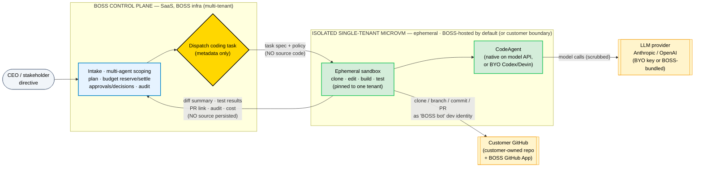
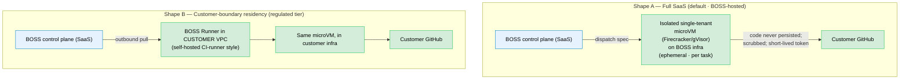
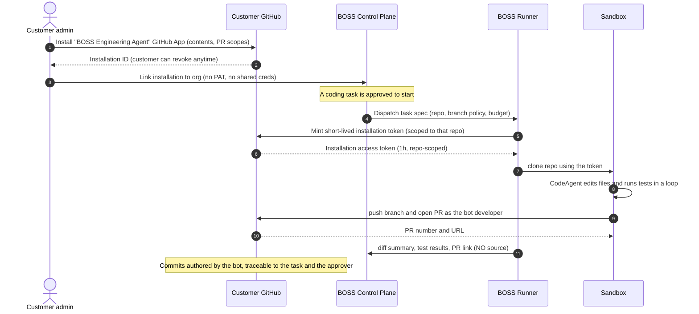
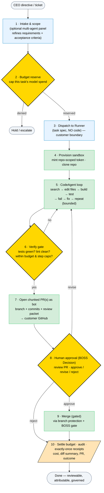

# BOSS — The Governed Coding-Agent Orchestrator

**A strategic & technical architecture for building autonomous, multi-file, test-driven coding into BOSS — where code runs only in isolated, ephemeral, single-tenant sandboxes and is never persisted.**

> _Two audiences: §1–§5 answer "what's the gap, why build it, and how does it stay safe to sell as SaaS?" in plain terms (stop at §5 and you can pitch it). §6–§11 are the technical build — flows, trust boundaries, the GitHub-App developer-impersonation model, and the phased plan to implement in BOSS._

---

## 1. Executive Summary (the 90-second pitch)

**What BOSS is.** A **governed autonomous company OS** — a CEO (or a stakeholder) issues a directive **through Metatron (BOSS's command interface)**; a panel of AI role-agents scopes it; BOSS plans, budgets, executes through tools, and gates every real effect behind human approval, with a full audit trail. BOSS is the **harness and the governor**, not the brain and not the hands.

**The gap.** Today BOSS can *reason, study, plan, debate, and publish a document* — but it **cannot write and verify code**. It reads repo files and commits a single doc via the GitHub API. It has no sandbox, no multi-file editing, no build/test loop, no real code diff. For any developer or engineering stakeholder, that's the difference between "an interesting governance demo" and "a tool that ships work."

**What we're building.** A **coding-execution core** that lets BOSS take a task, spin up an **isolated sandbox**, run a coding agent that **edits multiple files and iterates against tests** (`run → fail → fix`), and produce a **real pull request with test evidence** — all wrapped in BOSS's existing budget, approval, and audit envelope.

**The SaaS execution model (the default).** BOSS is a **full SaaS** — the customer buys and owns **no infrastructure**. The code work runs in a **BOSS-hosted, isolated, single-tenant microVM sandbox** that is created clean per task, lives only for that task, and is destroyed (or hibernated) afterward. **Code is never persisted** to BOSS's durable storage — only governance metadata is (diff *summary*, test *status*, PR *link*, cost). Each sandbox is **pinned to one tenant** (the strongest isolation there is — no cross-tenant sharing, ever) and isolated at the hypervisor level (a Firecracker/gVisor microVM, both open source). The agent works on a **customer-owned git repo** by impersonating a developer through a **GitHub App the customer installs and can revoke**, using short-lived, repo-scoped tokens minted per task. For regulated buyers who require code to never touch BOSS infra at all, the same sandbox is **optionally deployable into the customer's own boundary** (the residency tier — §5.3).

**Why we win (and don't become Devin).** We don't sell a coding agent; we sell the **governed orchestration of coding agents across models, budgets, agents, and tenants** — the layer none of Devin / Codex / Cursor / Claude Code provides. Customers bring **model access** (or we bundle it with cost governance). They never have to buy a third-party coding agent.

---

## 2. The Gap Today — and What Must Change

### 2.1 What BOSS can do now

| Capability | Status |
|---|---|
| Reason / plan via an LLM with a governed tool loop | ✅ |
| Study a live website (Playwright MCP) | ✅ |
| Read repo files (`list_repo_files`, `read_repo_file`) | ✅ (read-only, no search) |
| Multi-agent role panels (debate → synthesize → draft) | ✅ |
| Budget reserve/settle, approvals/decisions, audit, multi-org | ✅ |
| Commit a **single document** to a PR (`publish_document`) | ✅ |

### 2.2 What BOSS cannot do — the chasm

| Missing capability | Consequence |
|---|---|
| **Edit multiple files** in a working tree | Can't implement a feature or fix |
| **Run anything** (build / tests / lint) in a sandbox | Can't verify its own work |
| **Iterate against test feedback** (`run → fail → fix`) | Can't converge to a passing change |
| **Codebase search** (grep / glob / semantic) | Can't navigate a real repo |
| **Real code diff → branch → PR with evidence** | Can't ship reviewable engineering work |
| **An execution environment that's safe & isolated** | Can't be trusted in production |
| **Chunk a large task into small, CI-sized PRs** (PRD §7.8) | One giant diff — un-reviewable; breaks PRD's 'prefer small, chunked PRs' |
| **Emit a review packet + optional second-model cross-check** (PRD §7.8) | No structured review evidence behind the merge decision |
| **Receipt PR-creation & merge as exactly-once effects** (PRD §16) | A retry or worker crash could double-open or double-merge |
| **Earn autonomy via trust score** (PRD §20) | No graduated autonomy — every merge needs a human, forever |

### 2.3 What must change (the one-paragraph version)

BOSS gains an **execution plane**: a per-task **sandbox** (clone the repo → isolated workspace → run commands) and a **`CodeAgent`** that edits + tests in a loop, behind a swappable interface. BOSS's control plane (the part that's already built — planning, budget, approvals, audit) stays exactly as is; it simply gains a new tool category ("code") and a new gate ("open PR / merge"). The execution plane runs as a **BOSS-hosted, isolated, single-tenant microVM** by default (full SaaS, code never persisted), and is **optionally deployable into the customer's boundary** for the residency tier — same code, a `SandboxProvider` swap.

---

## 3. The Strategy — Own Layer 2, Rent Layer 1, Isolate Layer 3

Three layers get conflated when people say "coding agent." Separating them is the whole strategy.

| Layer | What it is | Who owns it | Does the customer buy a 3rd-party product? |
|---|---|---|---|
| **1 · Model (brain)** | GPT-5 / Claude Opus | **Rented** — frontier model via API | **Yes — model access only.** (BYO key, or BOSS bundles with caps + margin.) |
| **2 · Coding-agent harness** | the `edit → run → test → fix` loop + code tools | **BOSS owns it** | **No.** Built on raw model APIs + agent SDKs (libraries, not products). |
| **3 · Execution sandbox** | isolated env where code runs | **BOSS builds AND hosts it** — an isolated, single-tenant microVM per task (full SaaS); optionally deployable in the customer boundary | No |

**Why own Layer 2 (and not just wrap Devin/Codex):**
- **Tool-level governance.** BOSS's value is governing *every tool call* (budget, data-boundary, audit). If execution happens in Devin's black box, BOSS can only govern at the task boundary — the moat weakens.
- **Data protection.** Wrapping a 3rd-party cloud means the customer's code leaves to *that* vendor. Owning the sandbox lets BOSS run it in a **hardened, single-tenant, ephemeral microVM** that never persists code — and, for regulated buyers, run that *same* sandbox inside the customer's own boundary.
- **No dependency / margins.** No third-party coding-agent SaaS in the customer's bill; BOSS owns the value and the pricing.
- **It's buildable on raw APIs.** Open agents (OpenHands / SWE-agent / aider) hit real SWE-bench scores on nothing but model API keys. The agent loop is a *known pattern*, not a proprietary moat.

**The honest caveat (where "harness" still applies):** a *reliable* coding agent is the hardest engineering here. So we build on **agent frameworks** — the **Claude Agent SDK** / **OpenAI Agents SDK** and open SWE-agent patterns — which are **libraries that run on the customer's model key**, never products the customer buys. And we keep **"bring-your-own external agent" (Codex / Devin / Cursor) as an optional connector** for shops already standardized on one — **supported, never required.**

> **What the customer buys:** **BOSS** (governed autonomous engineering) **+ model access** (BYO or bundled). Not Devin. Not Cursor. Not Codex-the-product.

---

## 4. The Architecture in One Diagram — Two Planes, One Boundary

The defining decision: **split the control plane (multi-tenant SaaS) from the execution plane — an isolated, single-tenant microVM that exists only for one task.** By default BOSS hosts the microVM (full SaaS); for the residency tier the *same* microVM runs in the customer's boundary. Either way the microVM is the only place code is cloned, edited, or tested, and **code is never persisted** — only governance metadata flows back to the control plane.



📂 **[View as zoomable image →](./diagrams/boss-01.svg)**

### Plain-text fallback

```
   ┌──────────────────────────────────────────────────────────────────────┐
   │  BOSS CONTROL PLANE  (SaaS — BOSS infra, multi-tenant)               │
   │  • Intake the CEO directive                                          │
   │  • Multi-agent panel scopes it (the meetings we built)              │
   │  • Plan · reserve budget · approval gates · audit                  │
   │  • Dispatch the coding task as a SPEC (no source code)              │
   └───────────────────────────────┬──────────────────────────────────────┘
                                   │  task spec + policy (NO code)
   ════════════════════════════════▼═══════ microVM isolation boundary ════
   ┌──────────────────────────────────────────────────────────────────────┐
   │  ISOLATED SINGLE-TENANT MICROVM  (ephemeral · BOSS-hosted by default) │
   │  (same microVM optionally runs in the customer's boundary — residency)│
   │                                                                      │
   │   Ephemeral sandbox ── clone repo · edit files · build · test        │
   │        │              (pinned to ONE tenant; destroyed/hibernated     │
   │        ▼               after the task; code NEVER persisted)          │
   │   CodeAgent ── native (raw model API) OR BYO (Codex/Devin)          │
   │        │                          │                                 │
   │        │ model calls (scrubbed)   │ clone/branch/commit/PR          │
   │        ▼                          ▼   as "BOSS bot" developer       │
   │   LLM provider (BYO key)     Customer GitHub (customer-owned repo)  │
   └───────────────────────────────┬──────────────────────────────────────┘
                                   │  diff SUMMARY · test results · PR link
                                   │  audit · cost   (NO source persisted)
   ════════════════════════════════▼═══════════════════════════════════════
                       back to BOSS Control Plane for the approval gate
```

**Plain English:** The directive and governance live in BOSS's multi-tenant SaaS. The actual code work happens **only inside an isolated, single-tenant microVM** — created clean for one task, pinned to one tenant, and destroyed (or hibernated) afterward. BOSS hosts that microVM by default; a regulated customer can run the *same* microVM in their own boundary. Either way BOSS persists only enough to govern — what changed (summary), did tests pass, the PR link, the cost — **never the source itself.**

---

## 5. Data Protection & Isolation (the SaaS trust model)

This is the section a security/compliance buyer reads. The promise is precise:

> **BOSS never *persists* the customer's source code.** Code is cloned, edited, and tested **only** inside an isolated, single-tenant, ephemeral microVM that exists for one task and is then destroyed. BOSS's control plane holds *metadata, governance records, and approvals* — never the working tree. (For buyers who require code to never run on BOSS infra *at all*, the same microVM runs in the customer's boundary — §5.3.)

### 5.1 What is persisted — and what never is

| Data | Lives where | Persisted in BOSS control plane? |
|---|---|---|
| **Source code / working tree** | Ephemeral single-tenant microVM | **Never** (gone on task teardown) |
| **Repo secrets / `.env` / keys** | Ephemeral microVM only | **Never** |
| **Model API key** | Injected per task (BYO) or BOSS-bundled gateway | **Never** (per-task, not stored) |
| **Task spec** (what to do, which repo, policy) | Control plane → sandbox | Yes (no code) |
| **Tool-call audit** (which tools the agent ran) | Sandbox → control plane | Yes (governance) |
| **Diff *summary*** (files touched, ± lines, test status) | Sandbox → control plane | Yes (for the approval card) |
| **Full diff / patch** | Customer GitHub PR | **Stays in the customer's GitHub** |
| **PR link + test results** | Sandbox → control plane | Yes |
| **Cost / token usage** | Sandbox → control plane | Yes (budget settle) |

The full diff lives in the **customer's GitHub PR**, where their reviewers already look. BOSS's approval card links to it; BOSS itself doesn't need to ingest the patch (optional, customer-configurable, if they *want* BOSS to show diffs inline — default off).

> **Note — this refines PRD §14.1.** The original PRD listed full diffs and test reports as canonical artifacts in BOSS object storage. That no longer holds: only **governance metadata** (diff *summary*, test *status*, PR link, cost) is persisted in BOSS; the **full diff/patch stays in the customer's GitHub**, and the **working tree exists only in the ephemeral microVM** (never written to durable BOSS storage). Inline full-diff ingestion is customer-opt-in, default off. This is a deliberate evolution driven by the isolated-sandbox / never-persist-code model that postdates the PRD.

### 5.2 Scrubbing what goes to the model

When the CodeAgent sends code to the LLM, that traffic can be routed through a **secret/PII scrubber** (the same reversible-tokenization pattern Kaappu uses) or through the **customer's own LLM gateway** — so secrets and PII never leave the boundary in cleartext even to the model provider. (This is a natural place to *integrate Kaappu* as the AI gateway in front of BOSS's model calls.)

### 5.3 The two deployment shapes



📂 **[View as zoomable image →](./diagrams/boss-02.svg)**

- **Shape A — Full SaaS (the default).** Each task runs in an **isolated, single-tenant microVM that BOSS hosts** (Firecracker/gVisor). The repo is cloned via the customer's GitHub-App token, the work happens, the PR is opened, and **the microVM is destroyed (or hibernated)** — code is never persisted to BOSS storage. The customer buys and runs **no infrastructure**. This is the model for most customers.
- **Shape B — Customer-boundary residency.** The *same* microVM runs inside the **customer's VPC**, pulled by a lightweight outbound-only **BOSS Runner** (self-hosted-CI-runner style). Code never transits BOSS's network at all. This is the **regulated / Fortune-500** tier.

Same control plane, same `CodeAgent`, same microVM image — a **`SandboxProvider` swap**, not a fork. (Mirrors Kaappu's "same code at every tier.")

### 5.4 Sandbox isolation & lifecycle (the SaaS execution model)

The default sandbox is a **microVM** (a real VM with its own guest kernel), not a bare container — so untrusted, agent-generated code can't escape the namespace into the host or a neighbor. **Firecracker and gVisor are both open source (Apache 2.0).** Bare Linux namespaces (e.g. systemd-nspawn) are acceptable only as a hardened *v1* substrate; the microVM is the multi-tenant boundary.

**Single-tenant pinning** is the cornerstone — and it does double duty:
- **Security.** A sandbox that only ever holds *one* tenant's code + credentials means a hypothetical escape reaches only that tenant's own data. The scary cross-tenant case is removed *by construction*. Single-tenancy is the strongest isolation primitive there is.
- **Billing.** A dedicated sandbox is a clean, meterable unit — active sandbox-time + a little cache storage (the Codespaces / Modal / E2B model). Dedicated, per-tenant, charged.

**Lifecycle = the task, not the execution.** The sandbox is scoped to the *work-item* (the branch), not a single run:

```
new task        → fresh CLEAN microVM, pinned to the tenant
  ↓
iterate (mutable): exec → revise → review feedback → exec   ← reuse the SAME microVM
  ↓                                                           (keeps working tree, branch,
  [idle: snapshot / hibernate] ──► resume on follow-up        warm deps, agent context)
  ↓
task closed (merged / abandoned) → destroy
```

So the agent's **inner loop** (edit→test→fix) runs inside one execution; the **outer control loop** (revisions, review feedback, CI fixes) reuses the *same* microVM across executions of that task. Different tasks always start clean; **different tenants never share a sandbox.** Each execution is checkpointed/receipted — the *audit history* is immutable, the working tree stays mutable until the task closes.

**Churn is a non-issue** with the right primitives — microVMs are built for per-task spin-up, not the 1–2-minute traditional-VM boot:
- **microVM cold boot ≈ 125 ms** (Firecracker); **snapshot/restore in tens of ms**.
- **Warm pool** of pre-booted, toolchain-loaded microVMs → a task gets one instantly; the pool refills in the background.
- **Per-repo persistent cache volume** (git mirror + dependency/build cache) mounted in → even a clean checkout is *seconds*, not minutes (`npm install` is the real cost, and it's warm).
- **Hibernate-on-idle** → during human PR review the microVM is snapshot-paused (near-zero cost) and resumed in <1s on the next iteration. You bill active compute, not idle cores.

So the steady state is **grab-from-pool once at task start → snapshot/resume across iterations → release at task end** — amortized, not churny.

**Networking & hardening (per sandbox):** own network namespace; **egress allowlist** (model endpoints + the customer git host only); **block link-local `169.254.169.254`** (cloud-metadata SSRF is the #1 escape-to-credentials vector); no east-west between sandboxes; all egress through a filtering proxy that also runs the §5.2 scrubber. **Optional customer-attached VNIC/ENI:** where the compute/network fabric allows it, a customer-owned virtual NIC can be attached to the microVM so the customer's *own* firewall/egress/DLP rules govern the sandbox's traffic — a "bring-your-network-boundary" option that pairs BOSS-hosted compute with customer-controlled networking.

**Shared data:** immutable, non-tenant data (base images, language toolchains, package mirrors) is mounted **read-only** (the kernel shares the page cache across guests automatically — mmap-level efficiency, no cross-tenant write path). Per-task scratch is a private overlay/tmpfs, wiped on teardown. **Never** a writable surface shared between tenants. **Agent context** persists as a per-repo **index / knowledge base** (symbol map, embeddings, repo guide) in the control plane or the per-repo volume — queryable and restart-surviving — *not* as live container state.

### 5.5 Build toolchains — compiling & testing any language

The sandbox must actually **build and test the repo in its own language** — `mvn`/`./gradlew test` for Java, `go test`, `dotnet test`, `cargo test`, `pytest`, `npm test`, etc. There is no single image with "every compiler" (even GitHub's runner image is ~30 GB and still misses versions), so toolchains are delivered in **layers**:

1. **Curated base image** with the top ecosystems preinstalled — **JDK LTS (11/17/21) + Maven + Gradle**, Node LTS, Python, Go, Rust, .NET SDK, plus `gcc/clang/make/cmake`. Covers ~80–90% of repos immediately. (This is the microVM rootfs.)
2. **Version managers** baked in (**mise / asdf / SDKMAN! / nvm**) to install the *exact* version a repo needs on demand (repo wants JDK 17, base has 21 → provision 17).
3. **Repo-declared environment is the source of truth.** Before building, detect and honor `.devcontainer/devcontainer.json` or a repo `Dockerfile` (best — it's what their own CI uses), then `.tool-versions`/`.sdkmanrc`/`.java-version`/`.nvmrc`, then manifests (`pom.xml`/`build.gradle`, `go.mod`, `pyproject.toml`, `package.json`). Matching the repo's real CI environment is what makes "tests pass in the sandbox" mean "tests pass in their CI" — no false greens from a mismatched JDK.
4. **Dependency caching, split read-only vs writable** (this is the security-critical part):

   | Layer | Shared? | Why it's safe |
   |---|---|---|
   | **Public dependency mirror** (Maven Central / npm / PyPI / Go-proxy **pull-through proxy**) | **shared, READ-ONLY**, checksum-verified | immutable + content-addressed; this is where the slow downloads live, and read-only sharing can't poison anyone |
   | **Per-`(tenant, repo)` writable cache** (`~/.m2` local installs, `~/.gradle`, build outputs) | **isolated per tenant**, encrypted, attached to one microVM | a build can write to `.m2`, so it's tainted by whatever ran — it may only ever taint *its own* tenant's cache |

   The writable cache is a **per-tenant volume mounted into that tenant's microVM** (the guest sees `~/.m2`), **never a host path multiple tenants bind-mount.** Same physical host as other tenants is fine; same *mount* is not. This split gives warm builds (cold `mvn` on an empty `.m2` is minutes) without a shared writable surface, and the mirror's checksum/version-pinning is a supply-chain control point.
5. **Registry egress.** Builds must reach package registries — so the per-sandbox egress allowlist permits the registries (ideally only via the pull-through mirror), in addition to model + git.
6. **Command allowlist + wrapper handling.** BOSS re-runs the task's `test_commands` as the authoritative gate, so those executables are allowlisted (`mvn`, `gradle`, `java`, `go`, `cargo`, `dotnet`, …), and repo-local **wrapper scripts** (`./mvnw`, `./gradlew` — the Java norm) are matched by basename while absolute/traversal paths and shells stay blocked.

**Net:** a strong base image + repo-declared version provisioning + a shared read-only dependency mirror + per-tenant warm caches = the sandbox compiles and tests any mainstream language, fast, without cross-tenant exposure.

---

## 6. The Developer-Impersonation Model (customer-authorized, revocable)

The agent acts **as a developer** on the customer's repo via a **GitHub App** (or GitLab/Bitbucket equivalent) that the customer installs and controls.

### 6.1 How it works — in plain terms

Think of a GitHub App as a **robot developer account** the customer installs onto specific repos. It replaces the bad old pattern — handing BOSS a long-lived Personal Access Token (a house key that never expires) — with **short-lived guest badges**: BOSS "rings the doorbell" each task and gets a badge scoped to one repo that expires in ~an hour, and the customer can revoke the whole arrangement with one click.

Three things identify the setup:
- an **App ID** + a **private key** — identify the App itself (BOSS holds the key);
- an **Installation ID** — the specific grant of that App onto a customer's repo(s).

Each time a task needs the repo, BOSS performs a two-step token exchange (the sequence below):
1. **Sign a short JWT** with the App private key → proves "I am this App" (valid ~10 min).
2. **Exchange it for an installation access token** — scoped to that repo, `contents` + `pull_requests` write only, valid ~1 hour.
3. The sandbox uses that token to **clone → push a branch → open the PR** as the bot developer.
4. The token **expires; nothing is stored.** The next task repeats the exchange.

In BOSS's code this is `github_app_adapter` (sign JWT → mint token) feeding `github_adapter` (use token) — every clone and PR mints a fresh, repo-scoped token; no PAT is involved.



📂 **[View as zoomable image →](./diagrams/boss-03.svg)**

**Properties this guarantees:**
- **No shared credentials.** No long-lived PAT in BOSS. Tokens are **short-lived, repo-scoped, minted per task** from the customer's installation.
- **Customer-revocable.** Uninstall the App → BOSS can touch nothing. One click, customer-side.
- **Attributable.** Every commit is authored by `boss-agent[bot]` and the BOSS audit ties it back to the task and the **human who approved it** — the same forensic property Kaappu gives for agent actions.
- **Branch protection still applies.** The agent opens a PR; it cannot push to `main`. Merge goes through the customer's existing branch protection **and** BOSS's approval gate.

### 6.2 Who creates it, who installs it — and the secret to guard

**The customer grants access; BOSS never holds standing access.** In production there are two distinct parties:
- **BOSS (the vendor)** publishes **one** GitHub App and holds its private key in the control-plane secret store.
- **Each customer** clicks **Install** on their own repos to authorize the agent — choosing exactly which repos, and keeping a one-click **Uninstall** that instantly cuts off all access.

This is what makes the model safe to sell: the customer authorizes the AI agent **on their terms**, scopes it to chosen repos, and revokes it unilaterally — without ever sharing a credential.

> **Prototype note.** In a single-operator BOSS instance the *same* person plays **both** roles — they create the App (normally the vendor's job) *and* install it on their repo (the customer's job). In production those are separate parties; the customer only ever **installs**, never creates.

**The one secret to guard: the App private key.** It is what lets BOSS mint tokens for every repo the App is installed on, so it belongs in BOSS's secret store — in the prototype, outside the repo with `0600` permissions and `*.pem` gitignored — and **never in source control**. The customer's safety lever is the install/uninstall toggle; BOSS's responsibility is protecting (and rotating) that key.

---

## 7. The Coding-Task Flow — Annotated

Every coding task moves through these stages. Diamonds are governance gates (BOSS); green stages run in the customer boundary.



📂 **[View as zoomable image →](./diagrams/boss-04.svg)**

**Plain English:** A directive (or a Jira/GitHub ticket) comes in. BOSS optionally convenes a role-agent panel to nail the requirements, reserves a budget cap, and dispatches the task into the customer's boundary. There, a sandbox clones the repo, the coding agent edits and tests in a loop until green, and opens a PR **as the bot developer**. BOSS raises a Decision; on approval it merges (respecting branch protection), settles the cost, and records the audit. **BOSS governed the whole thing without its servers ever holding a line of the customer's code.**

Each diamond is a place a regulated customer plugs in their own rule — exactly the composability principle from the Kaappu gateway.

**PRD requirements this flow implements (not in the product today — this is what we're building):**
- **Small, chunked PRs** (§7.8). A large task is planned into multiple small, CI-sized PRs rather than one giant diff; throughput scales only as fast as CI + review keep up (WIP limits).
- **Review packet + optional second-model cross-check** (§7.8). Step 7 emits a structured review packet (diff summary, test results, rule-based checks) that the Decision in step 8 reviews; a second model can cross-check before approval.
- **Exactly-once PR & merge** (§16). Open-PR and merge are dedupe-keyed, receipted effects — a retry or worker crash can never double-open or double-merge.
- **Earned autonomy** (§20). A coding agent's autonomy level (e.g. auto-merge on low-risk chunks) is granted through the trust/autonomy ladder on measured success — never by config.

---

## 8. How It Maps to What BOSS Already Has

The execution plane is *new*; the governance around it is *already built*. We're extending, not rebuilding.

| Flow stage | Reuses existing BOSS | New work |
|---|---|---|
| Intake & multi-agent scoping | `intake`, `meeting_service` (panels) | — |
| Budget reserve / settle | `budget` (reserve→settle, caps/freezes) | per-task code budget category |
| Dispatch + durable execution | durable job queue, worker, `agent_runs`/`meeting_runs` pattern | `code.task` job + **Runner** |
| The agent loop | `agent_loop` pattern, `claude_cli_adapter`, MCP | **`CodeAgent` interface** + sandbox tools (edit/bash/grep/test) |
| PR + merge gate | `github_adapter`, decisions/approvals | **GitHub App** + **chunked PRs** + **review packet** (+ 2nd-model check) |
| Exactly-once PR / merge | receipts + dedupe keys | dedupe keys for `github.create_pr` / `github.merge_pr` |
| Earned coding autonomy | trust score + autonomy ladder | per-agent trust signals (CI-green, low rollback) |
| Audit / receipts / cost | receipts, audit, reports | code-task scorecards |
| Multi-tenant isolation | orgs (just built) | execution-plane per-org runner |
| Model choice | adapter (openai/azure/claude_cli) | route per coding task |

---

## 9. Phased Implementation Plan

Designed so each phase is independently shippable and reviewable. Phases 0–1 can run in BOSS infra to prove the loop fast; Phases 2–3 move execution into the customer boundary and harden for enterprise.

### Phase 0 — Prove the loop (sandbox in BOSS infra; ~fast)
**Goal:** a CEO command produces a real, tested code PR through BOSS's gates.
- Ephemeral **git worktree/container** per task in the worker (clone via a token, teardown after).
- Wrap **Claude Code headless** (already wired via `claude_cli`) as the first `CodeAgent`.
- Capture **diff summary + test output**; open a real PR; gate the **merge** behind a Decision.
- **Receipt** open-PR and merge as exactly-once effects (dedupe keys) — no double-open/merge on retry (PRD §16).
- Reserve/settle **budget** per task.
- *Exit criteria:* the north-star flow works end-to-end, in BOSS infra, on a sandbox repo.

### Phase 1 — Own the agent (the `CodeAgent` interface + native agent)
**Goal:** stop depending on a 3rd-party agent; customers need only a model key.
- Define a **`CodeAgent` interface**: `run(task, repo_ctx, sandbox) → {diff, tests, summary, cost}`.
- Implement a **native agent on raw model APIs** (Claude Agent SDK / OpenAI Agents SDK) with code tools: `read`/`edit`/`write`/`bash`/`grep`/`glob`/`run_tests`.
- **Codebase navigation** (grep/glob/semantic) + **repo context** ingestion (`AGENTS.md` / `CLAUDE.md` / a per-project knowledge base).
- **Chunked-PR planner**: break a large task into small, CI-sized PRs (WIP-limited) — PRD §7.8.
- **Review packet** generator (diff summary + test results + rule-based checks) and optional **second-model cross-check** before the merge Decision — PRD §7.8.
- Keep **BYO agent** (Codex/Devin/Claude Code) as alternate implementations of the same interface.
- *Exit criteria:* native agent passes a small SWE-bench-style internal eval; BYO is optional.

### Phase 2 — The isolated-sandbox SaaS execution plane (microVM)
**Goal:** the SaaS promise — code runs only in an isolated, single-tenant, ephemeral microVM; never persisted.
- **`SandboxProvider` interface** — refactor today's local sandbox behind it (no behavior change), then add the microVM provider.
- **microVM sandbox** (Firecracker/gVisor, open source): **single-tenant pinned**, **task-scoped** (clean per task, reused across that task's iterations), **snapshot/hibernate on idle**, **warm pool** + **per-repo cache volume** so there's no provisioning churn. (v1 may ship on hardened nspawn behind the same interface.)
- **BOSS GitHub App** (install/authorize/revoke; short-lived, repo-scoped tokens minted per task).
- **Per-sandbox networking**: egress allowlist, block cloud-metadata, no east-west; **optional customer-attached VNIC/ENI** so the customer's own netsec rules govern egress.
- **Secret/PII scrubbing** on model traffic (reversible tokenization) or **BYO LLM gateway** (Kaappu integration point).
- **Residency tier (Shape B):** the same microVM, pulled by an outbound-only **BOSS Runner** in the customer VPC — code never transits BOSS.
- *Exit criteria:* a task runs end-to-end in a single-tenant microVM with code never persisted to BOSS storage; idle hibernate + resume works; revoke (uninstall App) = instant lockout.

### Phase 3 — Enterprise hardening & adoption
**Goal:** sellable to engineering orgs.
- **SSO / identity** (Kaappu IDM) in front of the org gate; **per-org secrets vault**.
- **Parallel task fan-out** as a product surface (durable queue already supports it).
- **Ticket intake** (GitHub Issues → Jira/Linear) → governed task; **Slack** assign/notify/approve.
- **Trust/autonomy ladder for coding agents**: graduate proven agents to auto-merge low-risk chunks on measured success (CI-green, low rollback, no violations) — PRD §20.
- **Quality/eval dashboard**: test-pass rate, regression catch, cost-per-task, agent scorecards (extend Reports).
- **Compliance pack**: audit evidence, data-residency attestation, SOC2-style controls.
- *Exit criteria:* land the first engineering-org pilot.

---

## 10. Why This Architecture Wins — Principles

1. **Separate control plane from execution plane.** Governance is multi-tenant SaaS; code execution is an isolated, single-tenant microVM. This single split is what makes "AI that writes code" sellable to enterprise.
2. **Own the agent, rent the model, isolate the sandbox.** Customers buy BOSS + model access — never a third-party coding agent, and never any infrastructure of their own (full SaaS).
3. **The repo is customer-owned; the agent is a revocable bot.** Short-lived, repo-scoped tokens via a GitHub App. No shared creds, instant revocation, full attribution.
4. **Govern at the tool level, not the task boundary.** Because BOSS owns the agent loop, every edit/bash/test call flows through budget + data-boundary + audit — the moat.
5. **Single-tenant, ephemeral, never persisted.** Code runs only in a microVM pinned to one tenant, destroyed after the task; BOSS persists metadata, approvals, audit, diff summaries, PR links, cost — never the source. The full diff lives in the customer's PR.
6. **Scrub or gateway the model traffic.** Secrets/PII tokenized before the model, or routed via the customer's own gateway (Kaappu).
7. **Human-in-the-loop is the product, not a feature.** "Open PR" and "merge" are gated Decisions; branch protection compounds it.
8. **Multi-agent scoping before code.** The panel turns a vague directive into acceptance criteria — fewer wasted runs, better diffs.
9. **Budget-governed autonomy.** Every coding task is cost-capped (reserve→settle); spend is metered per org — a control surface competitors lack.
10. **Same code at every tier.** BOSS-hosted microVM (full SaaS) ↔ customer-boundary residency is a `SandboxProvider` swap, not a fork.
11. **Exactly-once external effects.** Open-PR and merge are dedupe-keyed and receipted — no double-open or double-merge under retries or crashes (PRD §16).
12. **Autonomy is earned, not configured.** Coding-agent autonomy (e.g. auto-merge low-risk chunks) is granted by the trust/autonomy ladder on measured success — never by config (PRD §20).

---

## 11. Appendix A — What BOSS stores vs. never stores

| BOSS control plane **stores** | BOSS **never stores** |
|---|---|
| Task spec, plan, acceptance criteria | Source code / working tree (lives only in the ephemeral microVM) |
| Multi-agent meeting transcripts | Repo secrets, `.env`, keys |
| Budget reservations & settlements (cost) | Full diffs/patches (unless customer opts in) |
| Decisions / approvals / audit / receipts | Model API keys (BYO by default) |
| Diff **summary** (files, ±lines, test status) | The customer's data the code touches |
| PR link, branch name, commit shas | — |
| Per-org config, GitHub-App installation id | Long-lived git credentials (uses short-lived tokens) |

## Appendix B — Component glossary (BOSS terms)

| Term | What it is |
|---|---|
| **Control plane** | BOSS SaaS — intake, scoping, budget, approvals, audit, UI. Multi-tenant. |
| **Execution plane** | The sandbox + runner that touch code. Runs in the customer boundary. |
| **CodeAgent** | Swappable interface: native (raw model API) by default; BYO Codex/Devin optional. |
| **Runner** | Outbound-only worker (customer-hosted in Shape B) that pulls tasks and posts results. |
| **Sandbox** | Ephemeral, isolated workspace per task: clone → edit → build → test → teardown. |
| **GitHub App ("BOSS bot")** | Customer-installed, revocable identity the agent uses to act as a developer. |
| **Decision** | BOSS's human-approval gate (open PR / merge are gated decisions). |
| **Diff summary** | Files touched, ± lines, test status — the governed metadata BOSS receives. |

---

*Prepared as a reference for the BOSS coding-agent build and the Sean review. Companion strategy: `BOSS_Progress_Summary.md`, `BOSS_Competitive_MVP.md`.*
