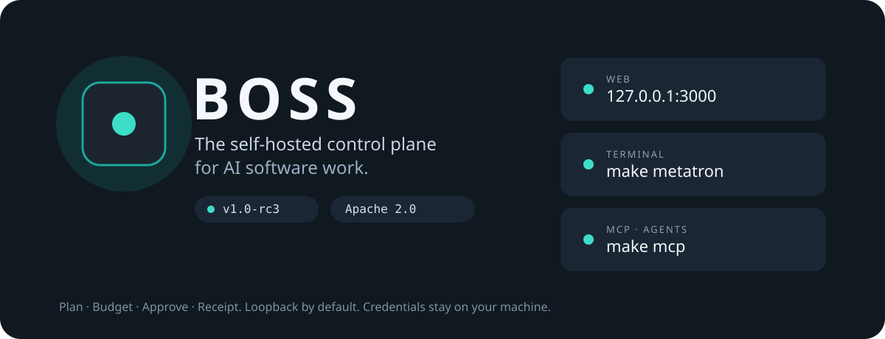

<p align="center">
  
</p>

<p align="center">
  <strong>The self-hosted control plane for AI software work.</strong><br>
  Give it a goal. Review the plan, the spend, and the evidence before anything leaves your machine.
</p>

<p align="center">
  <a href="https://github.com/seanventures/boss/releases/tag/v1.0-rc1"></a>
  <a href="LICENSE"></a>
  
  
</p>

<p align="center">
  <a href="#deploy">Deploy</a> ·
  <a href="docs/community/QUICKSTART.md">Quickstart</a> ·
  <a href="docs/community/README.md">Documentation</a> ·
  <a href="docs/community/FEATURES.md">Features</a> ·
  <a href="examples/README.md">Examples</a> ·
  <a href="CONTRIBUTING.md">Contributing</a>
</p>

---

AI agents can write code, open pull requests, call paid APIs, and touch infrastructure. BOSS is the layer that decides whether they should, and keeps the proof when they do.

Every goal you give BOSS becomes an auditable chain: a plan you can read, a budget reserved before any spend, a leased and heartbeated job, a decision whenever a person has to approve, and a receipt for every external effect. Drive it from the web console, the Metatron terminal, or straight from your coding agents over MCP. It runs on hardware you control, with model keys that never leave it.

```text
Goal  →  Plan  →  Budget  →  Work  →  Evidence  →  Decision  →  Receipt
```

## Why BOSS

**Nothing happens off the record.** Every external effect is recorded as a receipt with a unique dedupe key, so a retried step is recognized instead of repeated.

**Spend is reserved before it is spent.** Model and tool work goes through a quote, reserve, consume, and release cycle. A runaway agent hits a budget wall, not your credit card.

**People decide where it matters.** Gated steps land in an approval inbox with the context needed to decide. BOSS proposes changes to itself as pull requests and config diffs, never as silent writes.

**No silent failures.** Every job holds a lease with a TTL and heartbeat. A failure is retried, dead-lettered, or escalated to a person. It is never dropped.

**Yours to run.** Apache 2.0, self-hosted on your own infrastructure, bring your own models. Credentials live in a private `.env` on your server and never leave it.

## How it works


BOSS runs as a small set of services on one machine: **Postgres** as the durable system of record, a **FastAPI** control plane, a **worker** that leases jobs, and **Mission Control**, the web console. Everything the console does is an authenticated API call first, so the Metatron terminal, the CLI, and your MCP-connected agents all work against the same product.

## Deploy

BOSS runs on a server you control, and your team reaches Mission Control over HTTPS on your domain or your private network. A fresh Ubuntu 22.04/24.04 or Debian 12/13 VM works out of the box; the installer sets up Docker, generates credentials, starts the services, seeds your first project, and verifies everything is healthy.

**1. Pick an address.** Use a domain such as `boss.example.com` with a DNS record pointing at the server, or the server's private IP on your network, such as `192.168.1.50`.

**2. Install the `v1.0-rc1` release**, with that address as the console origin. The script and the checkout are both verified against the same pinned commit:

```sh
BOSS_RELEASE_COMMIT=7b88a18a2b4cd0b14b09a47fc415f7ffd4580066 bash -c 'set -u; [[ $BOSS_RELEASE_COMMIT =~ ^[0-9a-f]{40}$ ]] || { echo "Set the reviewed 40-character release SHA" >&2; exit 2; }; tmp=$(mktemp) || exit; curl -fsSL "https://raw.githubusercontent.com/seanventures/boss/$BOSS_RELEASE_COMMIT/install.sh" -o "$tmp" && BOSS_REPO_REF="$BOSS_RELEASE_COMMIT" bash "$tmp" "$@"; status=$?; rm -f "$tmp"; exit "$status"' _
```

Append installer flags after the final `_`, for example `_ --console-origin https://boss.example.com` or `_ --console-origin https://192.168.1.50`. Working from a clone instead? Run `./install.sh --dir "$PWD" --console-origin https://boss.example.com`.

**3. Put HTTPS in front.** BOSS services listen only on the server itself, so nothing is exposed until your proxy is in place. [Caddy](https://caddyserver.com) handles certificates for you:

```caddy
boss.example.com {
    reverse_proxy 127.0.0.1:3000 {
        header_up Host boss.example.com
        header_up X-Forwarded-Host boss.example.com
        header_up X-Forwarded-Proto https
    }
}
```

On a private IP, use `https://192.168.1.50` as the site address and in the three header lines, and add `tls internal` inside the block. Caddy then issues the certificate from its own local authority, which each browser trusts once.

**4. Sign in** at your address, such as `https://boss.example.com`. The installer prints the command that shows your console password.

When the installer asks for a model key, paste it at the hidden prompt or [connect a model](docs/community/MODEL_CONNECTIONS.md) later; keys are never accepted as command-line arguments. The [deployment guide](docs/community/hostname.md) covers nginx, publishing the API for remote clients, and adding a domain to a running install. Ports, flags, and recovery are in the [installer guide](scripts/install/README.md).

> [!TIP]
> **Just evaluating?** Run `./install.sh --dir "$PWD"` on your laptop or a dev box and open `http://127.0.0.1:3000`. The [Quickstart](docs/community/QUICKSTART.md) walks you from there to your first goal.

Optional host copies of the Claude Code, Codex CLI, and Grok Build binaries install with `--install-coding-clis`; you sign in to each one on the server.

## Four ways to drive BOSS

Every interface is a client of the same authenticated HTTP API, so the same permissions, budgets, approvals, and receipts apply no matter where a request comes from.

| Interface | Open it with | Guide |
| --- | --- | --- |
| **Mission Control** (web) | `https://boss.example.com`, or your server's private IP | [Console access](docs/community/CONSOLE_AUTH.md) |
| **Metatron** (terminal) | `make metatron` in the install directory | [Terminal and API](docs/community/TERMINAL_API.md) |
| **MCP** (agents) | `make mcp-setup`, then point your agent at `make mcp` | [MCP](docs/community/MCP.md) |
| **CLI and HTTP API** | `source boss-community.env.sh` (the API key is never printed) | [CLI](docs/community/cli.md) |

### Metatron: BOSS in your terminal

Metatron is a full terminal client for the control plane. Talk to BOSS in plain text, work the task list and decision inbox, and reach any API operation without leaving the keyboard.

```text
$ make metatron
metatron> /project boss-dogfood
metatron> /tasks
metatron> /task create launch-plan-1 Plan the community launch
metatron> /decisions
metatron> /decision approve dec-launch-1 Release gates reviewed
metatron> /ops budget
metatron> /describe <operation-id>
metatron> /op <operation-id> {"query": {"project_id": "boss-dogfood"}}
```

`/ops` searches the live operation catalog, `/describe` shows an operation's parameters and body without calling it, and `/op` invokes it. For scripts and CI, one-shot mode returns stable JSON:

```sh
python3 scripts/metatron_tui.py --exec '/api GET /v1/tasks?project_id=boss-dogfood' --json
```

See the [terminal and API reference](docs/community/TERMINAL_API.md) for every command, and the [capability matrix](docs/community/TERMINAL_CAPABILITY_MATRIX.md) for what the terminal can reach.

### MCP: plug BOSS into your agents

BOSS speaks the Model Context Protocol, so Claude Code, Codex, and any other MCP client can discover and drive governed work, with BOSS enforcing the rules on every call.

```sh
make mcp-setup   # once: creates a dedicated, project-scoped MCP member and key (never printed)
make mcp         # the stdio command your MCP client launches
```

- **Project-scoped by design.** Each MCP credential belongs to one project and one principal. The client cannot change the URL, headers, or credentials it calls with.
- **Full API reach, same guardrails.** Agents search, describe, and call the mounted BOSS API through a handful of tools, and every call passes the same permission, budget, approval, and receipt checks as the console.
- **People confirm the risky calls.** Sensitive actions require a separate human to approve the exact request, by digest, before the agent can run it once.
- **Native engine tools.** Engine-only sessions on the install machine expose typed tools for starting code tasks, steering runs, reading pull requests, and authoring workflows, with a `--read-only` mode for inspection.

Remote MCP over HTTP requires a bearer token in `BOSS_MCP_HTTP_TOKEN`. The [MCP guide](docs/community/MCP.md) covers transports, permissions, and the confirmation flow.

## What's inside

**Mission Control.** Start in **Command Center**. **Approvals** is where people decide, **Activity log** shows every receipt and failure, and **Agent work** groups recent runs by role. **Team structure** lays out your planned roles next to the handoffs that actually happened, and **Agent Studio** lets you inspect and test agent definitions before they do anything.

**Software Factory.** Turn an outcome into a governed code task, from spec and architecture through implementation and tests to a pull request with evidence attached. Each run stops for the approvals, budget checks, and receipts it needs along the way.

**Agents and workflows.** A starter catalog of agent definitions, role and skill packs, and [five example workflows](examples/README.md) covering research, content preparation, and handoff to a person for approval. Installing a definition or a workflow never starts work on its own.

**Bring your own models.** OpenAI, Anthropic, and OpenAI-compatible endpoints, plus the Claude Code, Codex CLI, and Grok Build subscriptions you already have. See [Model connections](docs/community/MODEL_CONNECTIONS.md).

**GitHub.** Repository binding, branch policies, fenced branch leases, and pull request review packets.

The complete, status-tagged list is in [Features](docs/community/FEATURES.md).

> [!NOTE]
> **About this release candidate.** A few capabilities are paused in `v1.0-rc1` while their spend, recovery, and effect safeguards are finished: new Discovery web research, live debugging investigations, and BOSS-initiated SSH workload planning and deployment. Saved dossiers, investigation results, and deployment records stay readable. A preview record is not proof that a deploy succeeded.

## Documentation

| Guide | What it covers |
| --- | --- |
| [Quickstart](docs/community/QUICKSTART.md) | Install, sign in, and run a first goal |
| [Deploy](docs/community/hostname.md) | HTTPS on your domain or private network, and publishing the API |
| [Use cases](docs/community/use-cases.md) | What a fresh install can do today |
| [Walkthroughs](docs/community/walkthroughs.md) | Guided tours of the console and terminal |
| [Interfaces](docs/community/interfaces.md) | Choosing between web, terminal, API, and MCP |
| [Terminal and API](docs/community/TERMINAL_API.md) | Every Metatron command, plus one-shot JSON for scripts |
| [MCP](docs/community/MCP.md) | Connecting agents, transports, and the human confirmation flow |
| [Control surfaces](docs/community/CONTROL_SURFACES.md) | How the API, terminal, and MCP fit together |

Everything else is linked from the [documentation home](docs/community/README.md).

## Upgrade and uninstall

From the installed checkout:

```sh
./scripts/install/upgrade.sh --dir "$PWD"          # writes a private backup, then upgrades
./scripts/install/uninstall.sh --dir "$PWD" --yes  # stops BOSS, keeps data and credentials
```

Deleting data takes a separate confirmation. See [upgrade, backup, and restore](scripts/install/README.md#upgrade--recover).

## Community

- **Bugs, install problems, and ideas:** open an issue with the bug, install, or feature form. The [feedback process](docs/community/FEEDBACK_LOOP.md) explains how a report becomes a shipped change.
- **Contributing:** start with [CONTRIBUTING.md](CONTRIBUTING.md). Small, focused pull requests with tests are the fastest way in.
- **Security:** report vulnerabilities privately to [boss@sean.net](mailto:boss@sean.net), never in a public issue. See [SECURITY.md](SECURITY.md).
- **Conduct:** everyone in project spaces follows the [Code of Conduct](CODE_OF_CONDUCT.md).

## License

BOSS Community is licensed under the [Apache License 2.0](LICENSE). Third-party components keep their own licenses; see [THIRD-PARTY-NOTICES.md](THIRD-PARTY-NOTICES.md).
