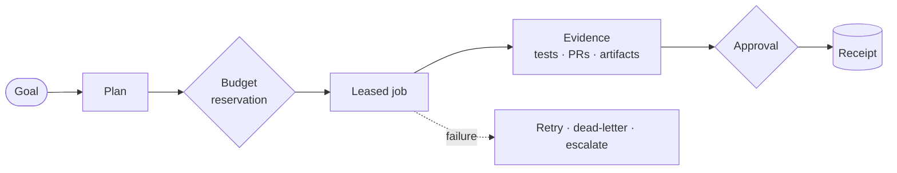

<p align="center">
  
</p>

<p align="center">
  <strong>The self-hosted control plane for AI software work.</strong><br>
  Give it a goal. Review the plan, the spend, and the evidence before anything leaves your machine.
</p>

<p align="center">
  <a href="https://github.com/seanventures/boss/releases/tag/v1.0-rc1"></a>
  <a href="LICENSE"></a>
  
  
</p>

<p align="center">
  <a href="docs/community/QUICKSTART.md">Quickstart</a> ·
  <a href="docs/community/README.md">Documentation</a> ·
  <a href="docs/community/FEATURES.md">Features</a> ·
  <a href="examples/README.md">Examples</a> ·
  <a href="CONTRIBUTING.md">Contributing</a>
</p>

---

AI agents can write code, open pull requests, call paid APIs, and touch infrastructure. BOSS is the layer that decides whether they should, and keeps the proof when they do.

Every goal you give BOSS becomes an auditable chain: a plan you can read, a budget reserved before any spend, a leased and heartbeated job, a decision whenever a person has to approve, and a receipt for every external effect. It runs on hardware you control, with model keys that never leave it.

```text
Goal  →  Plan  →  Budget  →  Work  →  Evidence  →  Decision  →  Receipt
```

## Why BOSS

**Nothing happens off the record.** Every external effect is recorded as a receipt with a unique dedupe key, so a retried step is recognized instead of repeated.

**Spend is reserved before it is spent.** Model and tool work goes through a quote, reserve, consume, and release cycle. A runaway agent hits a budget wall, not your credit card.

**People decide where it matters.** Gated steps land in an approval inbox with the context needed to decide. BOSS proposes changes to itself as pull requests and config diffs, never as silent writes.

**No silent failures.** Every job holds a lease with a TTL and heartbeat. A failure is retried, dead-lettered, or escalated to a person. It is never dropped.

**Yours to run.** Apache 2.0, self-hosted, bring your own models. The API binds to loopback by default and your credentials stay in a local `.env`.

## How it works



BOSS runs as a small set of services on one machine: **Postgres** as the durable system of record, a **FastAPI** control plane, a **worker** that leases jobs, and **Mission Control**, the web console. Everything the console does is an authenticated API call first, so the terminal, the CLI, and MCP clients all work against the same product.

## Quickstart

BOSS installs on a machine you administer. On a fresh Ubuntu 22.04/24.04 or Debian 12/13 VM, the installer also sets up Docker for you.

**From a checkout:**

```sh
git clone https://github.com/seanventures/boss.git && cd boss
./install.sh --dir "$PWD"
```

**Or install the pinned `v1.0-rc1` release in one command.** The script and the checkout are both verified against the same commit, and a failed download stops before anything runs:

```sh
BOSS_RELEASE_COMMIT=7b88a18a2b4cd0b14b09a47fc415f7ffd4580066 bash -c 'set -u; [[ $BOSS_RELEASE_COMMIT =~ ^[0-9a-f]{40}$ ]] || { echo "Set the reviewed 40-character release SHA" >&2; exit 2; }; tmp=$(mktemp) || exit; curl -fsSL "https://raw.githubusercontent.com/seanventures/boss/$BOSS_RELEASE_COMMIT/install.sh" -o "$tmp" && BOSS_REPO_REF="$BOSS_RELEASE_COMMIT" bash "$tmp" "$@"; status=$?; rm -f "$tmp"; exit "$status"' _
```

The installer generates local credentials, starts the services, seeds a project, and verifies that the API and console are healthy. When it asks for a model key, paste it at the hidden prompt, or skip and [connect a model](docs/community/MODEL_CONNECTIONS.md) later. Keys are never accepted as command-line arguments.

Then open **http://127.0.0.1:3000**. The installer prints the command that shows your console password, which is separate from the API key.

> [!TIP]
> Installed on a remote VM? Tunnel the console to your laptop with
> `ssh -L 3000:127.0.0.1:3000 -L 8000:127.0.0.1:8000 user@your-vm`, then open `http://127.0.0.1:3000` locally.
> To serve it on a real hostname behind your own TLS proxy, see [Hostname](docs/community/hostname.md).

The [Quickstart](docs/community/QUICKSTART.md) takes you from install to a first goal. Ports, flags, subscription import, and recovery are in the [installer guide](scripts/install/README.md). Optional host copies of the Claude Code, Codex CLI, and Grok Build binaries install with `--install-coding-clis`; you sign in to each one on the install machine.

## Three ways in

| Interface | Open it with | Guide |
| --- | --- | --- |
| **Mission Control** (web) | `http://127.0.0.1:3000`, or a hostname you terminate TLS for | [Console access](docs/community/CONSOLE_AUTH.md) |
| **Metatron** (terminal) | `make metatron` in the install directory | [Terminal](docs/community/terminal.md) |
| **CLI** | `source boss-community.env.sh` (the API key is never printed) | [CLI](docs/community/cli.md) |

Agent clients connect over [MCP](docs/community/MCP.md), scoped to one configured project. Remote MCP over HTTP requires `BOSS_MCP_HTTP_TOKEN`.

## What's inside

**Mission Control.** Start in **Command Center**. **Approvals** is where people decide, **Activity log** shows every receipt and failure, and **Agent work** groups recent runs by role. **Team structure** lays out your planned roles next to the handoffs that actually happened, and **Agent Studio** lets you inspect and test agent definitions before they do anything.

**Software Factory.** Turn an outcome into a governed code task, from spec and architecture through implementation and tests to a pull request with evidence attached. Each run stops for the approvals, budget checks, and receipts it needs along the way.

**Agents and workflows.** A starter catalog of agent definitions, role and skill packs, and [five example workflows](examples/README.md) covering research, content preparation, and handoff to a person for approval. Installing a definition or a workflow never starts work on its own.

**Bring your own models.** OpenAI, Anthropic, and OpenAI-compatible endpoints, plus the Claude Code, Codex CLI, and Grok Build subscriptions you already have. See [Model connections](docs/community/MODEL_CONNECTIONS.md).

**GitHub.** Repository binding, branch policies, fenced branch leases, and pull request review packets.

The complete, status-tagged list is in [Features](docs/community/FEATURES.md).

> [!NOTE]
> **About this release candidate.** A few capabilities are paused in `v1.0-rc1` while their spend, recovery, and effect safeguards are finished: new Discovery web research, live debugging investigations, and BOSS-initiated SSH workload planning and deployment. Saved dossiers, investigation results, and deployment records stay readable. A preview record is not proof that a deploy succeeded.

## Documentation

| Guide | What it covers |
| --- | --- |
| [Quickstart](docs/community/QUICKSTART.md) | Install, sign in, and run a first goal |
| [Use cases](docs/community/use-cases.md) | What a fresh install can do today |
| [Walkthroughs](docs/community/walkthroughs.md) | Guided tours of the console and terminal |
| [Interfaces](docs/community/interfaces.md) | Choosing between web, terminal, API, and MCP |
| [Control surfaces](docs/community/CONTROL_SURFACES.md) | How the API, terminal, and MCP fit together |

Everything else is linked from the [documentation home](docs/community/README.md).

## Upgrade and uninstall

From the installed checkout:

```sh
./scripts/install/upgrade.sh --dir "$PWD"          # writes a private backup, then upgrades
./scripts/install/uninstall.sh --dir "$PWD" --yes  # stops BOSS, keeps data and credentials
```

Deleting data takes a separate confirmation. See [upgrade, backup, and restore](scripts/install/README.md#upgrade--recover).

## Community

- **Bugs, install problems, and ideas:** open an issue with the bug, install, or feature form. The [feedback process](docs/community/FEEDBACK_LOOP.md) explains how a report becomes a shipped change.
- **Contributing:** start with [CONTRIBUTING.md](CONTRIBUTING.md). Small, focused pull requests with tests are the fastest way in.
- **Security:** report vulnerabilities privately to [boss@sean.net](mailto:boss@sean.net), never in a public issue. See [SECURITY.md](SECURITY.md).
- **Conduct:** everyone in project spaces follows the [Code of Conduct](CODE_OF_CONDUCT.md).

## License

BOSS Community is licensed under the [Apache License 2.0](LICENSE). Third-party components keep their own licenses; see [THIRD-PARTY-NOTICES.md](THIRD-PARTY-NOTICES.md).
