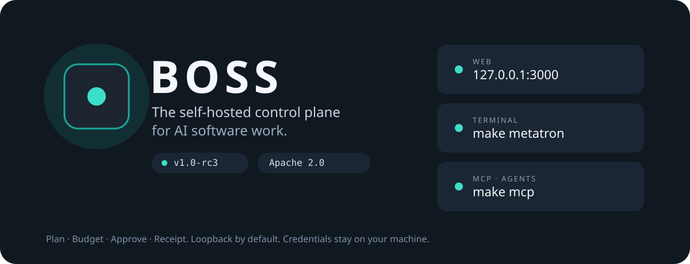

<p align="center">
  
</p>

<p align="center">
  <a href="https://github.com/seanventures/boss/releases/tag/v1.0-rc10.11"></a>
  <a href="LICENSE"></a>
  
  
</p>

BOSS is a self-hosted control plane for AI software work. An agent can plan, spend, and change things. BOSS makes a person review the plan, the result, and the cost, and keeps the receipt.

## Who it is for

A technical founder who will run BOSS on a server they administer. You should be comfortable with one Linux machine, Docker, a GitHub repository you are allowed to change, and a diff. The people you invite share that install. It is not a hosted service.

Credentials stay on the machine. A call to a hosted model sends that provider the authentication and the task data the call needs. A local model can keep inference on the machine.

## The shortest path

1. Install v1.0-rc10.11.
2. Claim the install.
3. Connect a repository.
4. Connect a model.
5. Open one pull request.

The [quickstart](docs/community/QUICKSTART.md) is those steps. A hostname and TLS are in the [hostname guide](docs/community/hostname.md). Passkeys, passwords, and an SSH tunnel are in [sign-in](docs/community/CONSOLE_AUTH.md).

You need Git on the install machine. If GitHub asks you to sign in, use an account that can read the repository. On Ubuntu or Debian without Git, first run `sudo apt-get update && sudo apt-get install -y git`.

```bash
(
  set -e
  git clone --branch v1.0-rc10.11 https://github.com/seanventures/boss.git boss-rc10.11
  cd boss-rc10.11
  BOSS_RELEASE_COMMIT="$(git rev-parse HEAD)"
  ./install.sh --dir "$PWD" --ref "$BOSS_RELEASE_COMMIT"
)
```

Use a new directory named `boss-rc10.11`. The command stops if the clone fails, and it pins the install to that commit. Continue from `cd boss-rc10.11`. Services listen on the machine itself. Add `--console-origin https://boss.example.com`, with your hostname, when the console will be opened from somewhere else. Omit it to open `http://127.0.0.1:3000` on the install machine.

`boss upgrade` writes a backup (database, keys, artifacts, and the local repositories volume that holds unpublished local projects' code), then moves to a later release. `boss upgrade --to REF` picks the release. `boss uninstall` stops BOSS and keeps the data. Ports, flags, and recovery are in the [installer guide](scripts/install/README.md).

The copy at [boss.sean.network/install.sh](https://boss.sean.network/install.sh) is published separately. This page does not treat it as v1.0-rc10.11. The manual in this repository is the source. The [hosted docs](https://boss.sean.network/docs/) are published separately too.

The installer targets Ubuntu 22.04/24.04 and Debian 12/13, and it can set up Docker. The bounded installed checks behind this candidate are an owned Linux arm64 machine that already had Docker. A clean-host install and useful provider work are separate checks. Read the [release notes](docs/community/RELEASE_NOTES_v1.0-rc10.11.md) and the [RC9 validation record](docs/community/RC9_VALIDATION.md) before you rely on a path.

## What you get

A governed workflow gives you four records.

- **A plan you can read,** before the work runs.
- **A budget reservation before work.** The reservation is an estimate. It is not a cap on a provider's invoice. Admission can refuse more work. Review held and uncertain exposure before you continue.
- **An approval when it matters.** Gated steps wait, with the context for the decision. BOSS proposes changes to itself as pull requests and config diffs, not as silent writes.
- **A receipt after.** The receipt and its dedupe key identify an attempt. A dedupe key does not make every provider idempotent. An ambiguous provider outcome needs reconciliation before a retry.

A failure is retried, dead-lettered, or escalated to a person. It is not dropped.

This is a release candidate, not a promise that every path is qualified.

No telemetry collector is set, so the daily heartbeat sends nothing until you set one (`BOSS_TELEMETRY_URL`, or in Govern › Sharing). "Improve BOSS" is off unless you turn it on. `BOSS_TELEMETRY=off` or `DO_NOT_TRACK=1` sends nothing, heartbeat included. [What a payload can contain](docs/product/RUN_SCORECARDS.md).

The console, the Metatron terminal, the CLI, and MCP call the same API. [How they fit](docs/community/interfaces.md).

## Where to go next

- [Documentation](https://boss.sean.network/docs/)
- The [fifteen example workflows](examples/README.md). Installing an example, or an agent definition, does not start work.
- [Contributing](CONTRIBUTING.md)
- [Apache License 2.0](LICENSE). Other components keep their own licenses ([notices](THIRD-PARTY-NOTICES.md)).
- Security reports go to [boss@sean.net](mailto:boss@sean.net), not a public issue. See [SECURITY.md](SECURITY.md). Project spaces follow the [Code of Conduct](CODE_OF_CONDUCT.md).
