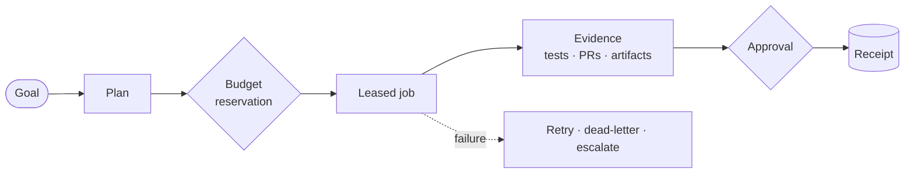

<p align="center">
  
</p>

<p align="center">
  <strong>The self-hosted control plane for AI software work.</strong><br>
  Give it a goal. Review the plan, the spend, and the evidence before anything leaves your machine.
</p>

<p align="center">
  <a href="https://github.com/seanventures/boss/releases/tag/v1.0-rc6.1"></a>
  <a href="LICENSE"></a>
  
  
</p>

<p align="center">
  <a href="https://boss.sean.network">Website</a> ·
  <a href="#deploy">Deploy</a> ·
  <a href="docs/community/QUICKSTART.md">Quickstart</a> ·
  <a href="https://boss.sean.network/docs/">Documentation</a> ·
  <a href="docs/community/FEATURES.md">Features</a> ·
  <a href="examples/README.md">Examples</a> ·
  <a href="CONTRIBUTING.md">Contributing</a>
</p>

---

AI agents can write code, open pull requests, call paid APIs, and touch infrastructure. BOSS is the layer that decides whether they should, and keeps the proof when they do.

Every goal you give BOSS becomes an auditable chain: a plan you can read, a budget reserved before any spend, a leased and heartbeated job, a decision whenever a person has to approve, and a receipt for every external effect. Drive it from the web console, the Metatron terminal, or straight from your coding agents over MCP. It runs on hardware you control, with model keys that never leave it.

```text
Goal  →  Plan  →  Budget  →  Work  →  Evidence  →  Decision  →  Receipt
```

## Why BOSS

**Nothing happens off the record.** Every external effect is recorded as a receipt with a unique dedupe key, so a retried step is recognized instead of repeated.

**Spend is reserved before it is spent.** Model and tool work goes through a quote, reserve, consume, and release cycle. A runaway agent hits a budget wall, not your credit card.

**People decide where it matters.** Gated steps land in an approval inbox with the context needed to decide. BOSS proposes changes to itself as pull requests and config diffs, never as silent writes.

**No silent failures.** Every job holds a lease with a TTL and heartbeat. A failure is retried, dead-lettered, or escalated to a person. It is never dropped.

**Yours to run.** Apache 2.0, self-hosted on your own infrastructure, bring your own models. Credentials live in a private `.env` on your server and never leave it.

## How it works



BOSS runs as a small set of services on one machine: **Postgres** as the durable system of record, a **FastAPI** control plane, a **worker** that leases jobs, and **Mission Control**, the web console. Everything the console does is an authenticated API call first, so the Metatron terminal, the CLI, and your MCP-connected agents all work against the same product.

## Deploy

BOSS runs on a server you control, and your team reaches Mission Control over HTTPS on your domain or your private network. A fresh Ubuntu 22.04/24.04 or Debian 12/13 VM works out of the box; the installer sets up Docker, generates credentials, starts the services, seeds your first project, and verifies everything is healthy.

**1. Pick an address.** Use a domain such as `boss.example.com` with a DNS record pointing at the server, or the server's private IP on your network, such as `192.168.1.50`.

**2. Install** on the server with one command. It installs the newest published release into `~/boss`, needs no answers, and finishes by installing the `boss` command:

```sh
curl -fsSL https://boss.sean.network/install.sh | bash -s -- --console-origin https://boss.example.com
```

Use `--console-origin https://192.168.1.50` for a private IP, and add `--yes` to skip the optional model-key question. The installer writes that address to `.env` as `BOSS_CONSOLE_PUBLIC_ORIGIN`, and BOSS uses it as its public address (a `BOSS_PUBLIC_URL` you set yourself takes precedence): every emailed link, passkey and SSO redirect uses it and never a request's `Host`, so without one BOSS sends no sign-in or reset emails. Setup shows the URL BOSS uses. The installer records the release, so reruns and `boss upgrade` never move it to `main`. Want to read the script first? `curl -fsSL https://boss.sean.network/install.sh -o install.sh`, then `bash install.sh`.

Prefer git? Clone the release and install it in place. `--ref` keeps the install on that release instead of moving it to `main`:

```sh
git clone --branch v1.0-rc6.1 https://github.com/seanventures/boss.git
cd boss
./install.sh --dir "$PWD" --ref v1.0-rc6.1 --console-origin https://boss.example.com
```

The `boss` command works from anywhere: `boss open`, `boss password`, `boss doctor`, `boss upgrade`.

**Deploying from your own machine instead?** Both commands above run on the server, and the server downloads BOSS from GitHub. If the server can't reach GitHub, or you're working from a private copy of the repository, deploy from a checkout on your own machine instead: `remote.sh` copies it to the server over SSH, runs the installer there, and backs up before every update. The server never needs GitHub access.

```sh
git clone https://github.com/seanventures/boss.git
cd boss
scripts/install/remote.sh --host user@your-server --dir '~/boss' --ref v1.0-rc1 install --yes -- --console-origin https://boss.example.com
```

Everything after `--` goes to the installer on the server, so `--console-origin` is the same address as step 2. Clone `main` and let `--ref` pick the release: `remote.sh` runs from your checkout and ships only the commit `--ref` names, and the copy in the `v1.0-rc1` tree takes `--dir '~/boss'` literally, installing into a folder named `~`.

Later, update or check that install from the same checkout:

```sh
scripts/install/remote.sh --host user@your-server --dir '~/boss' --ref v1.0-rc6.1 update --with-console
scripts/install/remote.sh --host user@your-server --dir '~/boss' smoke
scripts/install/remote.sh --host user@your-server --dir '~/boss' tunnel   # console at http://127.0.0.1:3000
```

Connect a Claude or Codex subscription from the same checkout. The credential goes over SSH on stdin, never on the command line. Storing a Claude token needs a build newer than `v1.0-rc1`:

```sh
claude setup-token        # then paste the token it prints at the next command's hidden prompt
read -rs T && printf %s "$T" | scripts/install/remote.sh --host user@your-server --dir '~/boss' subscription --provider claude_code; unset T
scripts/install/remote.sh --host user@your-server --dir '~/boss' subscription --provider codex < ~/.codex/auth.json
```

`--host` is anything `ssh` accepts, including an alias from `~/.ssh/config` (use one for a non-standard SSH port), and `--key PATH` picks a private key. `--dir` defaults to `/opt/boss`, which needs root; `~/boss` keeps it where the commands above install. Add `--secret-store infisical` to `install` for the bundled secret store. The [installer guide](scripts/install/README.md#remote-archive-installs) covers recovery and uninstall.

**3. Put HTTPS in front.** BOSS services listen only on the server itself, so nothing is exposed until your proxy is in place. [Caddy](https://caddyserver.com) handles certificates for you. On Ubuntu or Debian, `sudo apt install -y caddy`, replace the contents of `/etc/caddy/Caddyfile` with this block, then `sudo systemctl reload caddy`:

```caddy
boss.example.com {
    reverse_proxy 127.0.0.1:3000 {
        header_up Host boss.example.com
        header_up X-Forwarded-Host boss.example.com
        header_up X-Forwarded-Proto https
    }
}
```

On a private IP, use `https://192.168.1.50` as the site address and in the three header lines, and add `tls internal` inside the block. Caddy then issues the certificate from its own local authority, which each browser trusts once: copy `/var/lib/caddy/.local/share/caddy/pki/authorities/local/root.crt` from the server (`ssh user@your-server sudo cat …`) and add it to each device's trusted roots — on a Mac, `sudo security add-trusted-cert -d -r trustRoot -k /Library/Keychains/System.keychain root.crt`. Installed without `--console-origin`? [Add the address to a running install](docs/community/hostname.md#add-a-hostname-to-a-running-install).

**4. Claim and sign in** at your address. The first visit to `/claim` (for example `http://127.0.0.1:3000/claim`) claims the install: the password from `boss password` (or a one-hour link from `boss identity setup-link`) proves you are the operator, then you create your own Owner account with a passkey. `boss doctor` reminds you until it is done. Invite your team in **Identity › People**. BOSS opens on **Repo and models**: paste a GitHub token, connect a model, and open your first PR. Upgrading an existing install? [Upgrade to named accounts](docs/community/IDENTITY_UPGRADE.md) explains the claim and the 30-day window for the shared password.

Models found by the installer appear there already; `boss connect` does the same from a terminal. The [deployment guide](docs/community/hostname.md) covers nginx, publishing the API for remote clients, and adding a domain to a running install. Ports, flags, and recovery are in the [installer guide](scripts/install/README.md).

> [!TIP]
> **Just evaluating?** Skip the address and the proxy. Clone and install on your laptop or a dev box, then open `http://127.0.0.1:3000`. The [Quickstart](docs/community/QUICKSTART.md) walks you from there to your first goal. [Getting started](docs/community/GETTING_STARTED.md) goes on to your first project and a pull request BOSS built.

Optional host copies of the Claude Code, Codex CLI, and Grok Build binaries install with `--install-coding-clis`; you sign in to each one on the server.

## Four ways to drive BOSS

Every interface is a client of the same authenticated HTTP API, so the same permissions, budgets, approvals, and receipts apply no matter where a request comes from.

| Interface | Open it with | Guide |
| --- | --- | --- |
| **Mission Control** (web) | `https://boss.example.com`, or your server's private IP | [Console access](docs/community/CONSOLE_AUTH.md) |
| **Metatron** (terminal) | `make metatron` in the install directory | [Terminal and API](docs/community/TERMINAL_API.md) |
| **MCP** (agents) | `make mcp-setup`, then point your agent at `make mcp` | [MCP](docs/community/MCP.md) |
| **CLI and HTTP API** | `boss` on the host, or a personal API key from **My account › API keys** | [CLI](docs/community/cli.md) |

### Metatron: BOSS in your terminal

Metatron is a full terminal client for the control plane. Talk to BOSS in plain text, work the task list and decision inbox, and reach any API operation without leaving the keyboard.

```text
$ make metatron
metatron> /project boss-dogfood
metatron> /tasks
metatron> /task create launch-plan-1 Plan the community launch
metatron> /decisions
metatron> /decision approve dec-launch-1 Release gates reviewed
metatron> /ops budget
metatron> /describe <operation-id>
metatron> /op <operation-id> {"query": {"project_id": "boss-dogfood"}}
```

`/ops` searches the live operation catalog, `/describe` shows an operation's parameters and body without calling it, and `/op` invokes it. For scripts and CI, one-shot mode returns stable JSON:

```sh
python3 scripts/metatron_tui.py --exec '/api GET /v1/tasks?project_id=boss-dogfood' --json
```

See the [terminal and API reference](docs/community/TERMINAL_API.md) for every command, and the [capability matrix](docs/community/TERMINAL_CAPABILITY_MATRIX.md) for what the terminal can reach.

### MCP: plug BOSS into your agents

BOSS speaks the Model Context Protocol, so Claude Code, Codex, and any other MCP client can discover and drive governed work, with BOSS enforcing the rules on every call.

```sh
make mcp-setup   # once: creates a dedicated, project-scoped MCP member and key (never printed)
make mcp         # the stdio command your MCP client launches
```

- **Project-scoped by design.** Each MCP credential belongs to one project and one principal. The client cannot change the URL, headers, or credentials it calls with.
- **Full API reach, same guardrails.** Agents search, describe, and call the mounted BOSS API through a handful of tools, and every call passes the same permission, budget, approval, and receipt checks as the console.
- **People confirm the risky calls.** Sensitive actions require a separate human to approve the exact request, by digest, before the agent can run it once.
- **Native engine tools.** Engine-only sessions on the install machine expose typed tools for starting code tasks, steering runs, reading pull requests, and authoring workflows, with a `--read-only` mode for inspection.

Remote MCP over HTTP requires a bearer token in `BOSS_MCP_HTTP_TOKEN`. The [MCP guide](docs/community/MCP.md) covers transports, permissions, and the confirmation flow.

## What's inside

**Mission Control.** Start in **Command Center**. **Approvals** is where people decide, **Activity log** shows every receipt and failure, **Workflows** holds your runs (**Runs**) and what they follow (**Library**), and **Agent Studio** holds who does the work: the **Roster**, the planned **Team** and decision **Panels**. Add one with **+ New agent**; an agent's page shows its **Profile**, which you can test before it does anything.

**Software Factory.** Turn an outcome into a governed code task, from spec and architecture through implementation and tests to a pull request with evidence attached. Each run stops for the approvals, budget checks, and receipts it needs along the way.

**Agents and workflows.** A starter catalog of agent definitions, role and skill packs, and [five example workflows](examples/README.md) covering research, content preparation, and handoff to a person for approval. Installing a definition or a workflow never starts work on its own.

**Bring your own models.** OpenAI, Anthropic, and OpenAI-compatible endpoints, plus the Claude Code, Codex CLI, and Grok Build subscriptions you already have. See [Model connections](docs/community/MODEL_CONNECTIONS.md).

**GitHub.** Repository binding, branch policies, fenced branch leases, and pull request review packets.

The complete, status-tagged list is in [Features](docs/community/FEATURES.md).

> [!NOTE]
> **About this release candidate.** `v1.0-rc6.1` is a hotfix on `v1.0-rc6`: a faster console and a working Infra Deploy button ([release notes](docs/community/RELEASE_NOTES_v1.0-rc6.1.md)). `v1.0-rc6` adds **named accounts**: everyone signs in as themselves (passkeys, authenticator codes, Google and other SSO), with roles and permissions on every page and API, and agents that act on your behalf with less than you have. Upgrading from rc5: claim your install as its first Owner; the old console password keeps working as Operator for 30 days ([upgrade guide](docs/community/IDENTITY_UPGRADE.md)). Deploying an app to an SSH host goes through the governed path in **Infra › Deploys**: BOSS plans the deploy, a person approves it, BOSS applies it and writes a receipt, and a failed health check rolls it back. A few capabilities stay paused while their spend, recovery, and effect safeguards are finished: live debugging investigations, direct host changes made outside an approved plan, cloud-account deploy runs, auto-deploy, the agent host shell, and host-backed preview sandboxes. Investigation results and deployment records stay readable. Discovery web research runs as a governed job and needs a connected Claude Code subscription. From `v1.0-rc6` each person signs in with their own account; see the [draft release notes](docs/community/RELEASE_NOTES_v1.0-rc6.md) and [Upgrade to named accounts](docs/community/IDENTITY_UPGRADE.md).

## Documentation

| Guide | What it covers |
| --- | --- |
| [Getting started](docs/community/GETTING_STARTED.md) | From install to a first project and a pull request BOSS built |
| [Quickstart](docs/community/QUICKSTART.md) | Install, sign in, and run a first goal |
| [Deploy](docs/community/hostname.md) | HTTPS on your domain or private network, and publishing the API |
| [Use cases](docs/community/use-cases.md) | What a fresh install can do today |
| [Walkthroughs](docs/community/walkthroughs.md) | Guided tours of the console and terminal |
| [Interfaces](docs/community/interfaces.md) | Choosing between web, terminal, API, and MCP |
| [Terminal and API](docs/community/TERMINAL_API.md) | Every Metatron command, plus one-shot JSON for scripts |
| [MCP](docs/community/MCP.md) | Connecting agents, transports, and the human confirmation flow |
| [Control surfaces](docs/community/CONTROL_SURFACES.md) | How the API, terminal, and MCP fit together |
| [People and access](docs/community/PEOPLE_AND_ACCESS.md) | Invite people, roles, groups, service accounts, and your own account |
| [Sign-in setup](docs/community/SIGN_IN_SETUP.md) | Email, single sign-on, social sign-in, SCIM |
| [Agents and access](docs/community/AGENTS_AND_ACCESS.md) | What agents may do, acting for a person, GitHub access |
| [Build sandbox](docs/community/SANDBOX.md) | How builds are isolated, and hosts that cannot fence them |
| [Identity administration](docs/community/IDENTITY_ADMIN.md) | The security audit log, posture, policy, and the move to enforcement |
| [Upgrade to named accounts](docs/community/IDENTITY_UPGRADE.md) | Moving an existing install off the shared password |

Everything else is linked from the [documentation home](docs/community/README.md).

## Upgrade and uninstall

From any directory:

```sh
boss upgrade      # writes a private backup, then moves to the newest release (and rolls back if it cannot start)
boss uninstall    # stops BOSS, keeps data and credentials
```

Without the `boss` command, run `./scripts/install/upgrade.sh --dir "$PWD"` and `./scripts/install/uninstall.sh --dir "$PWD" --yes` from the install directory.

Deleting data takes a separate confirmation. See [upgrade, backup, and restore](scripts/install/README.md#upgrade--recover).

## What BOSS sends home

**A daily heartbeat, on by default, once a collector is set.** No collector is set in this release, so nothing is sent until you set one (`BOSS_TELEMETRY_URL`, or in Govern › Sharing); a later release names a public one. Once a day, one small request says only that this install is alive: a random install id, the BOSS version and edition, the install method, OS and CPU type, days since install (as a range), and whether any work ran in the last 24 hours. Nothing else.

**"Improve BOSS", off by default.** If you turn it on (at the end of setup, or in Govern › Sharing), the same daily request also carries how runs turned out, your ratings and which features you use, as names, counts and ranges. Never your code, prompts, briefs, file or repo names, or secrets.

Govern › Sharing shows the exact next payload before it is sent, a log of the last 30 sends, and buttons to export a batch, rotate the install id, and delete what was sent. To send nothing at all, heartbeat included, set `BOSS_TELEMETRY=off` (or the standard `DO_NOT_TRACK=1`) in `.env`. Details: [run scorecards and sharing](docs/product/RUN_SCORECARDS.md).

## Community

- **Bugs, install problems, and ideas:** open an issue with the bug, install, or feature form. The [feedback process](docs/community/FEEDBACK_LOOP.md) explains how a report becomes a shipped change.
- **Contributing:** start with [CONTRIBUTING.md](CONTRIBUTING.md). Small, focused pull requests with tests are the fastest way in.
- **Security:** report vulnerabilities privately to [boss@sean.net](mailto:boss@sean.net), never in a public issue. See [SECURITY.md](SECURITY.md).
- **Conduct:** everyone in project spaces follows the [Code of Conduct](CODE_OF_CONDUCT.md).

## License

BOSS Community is licensed under the [Apache License 2.0](LICENSE). Third-party components keep their own licenses; see [THIRD-PARTY-NOTICES.md](THIRD-PARTY-NOTICES.md).
