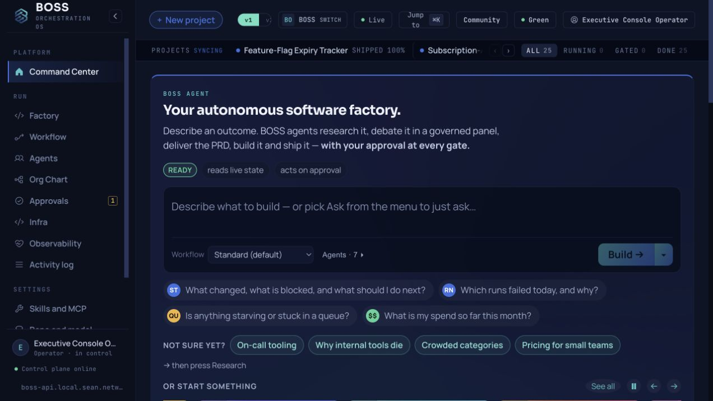
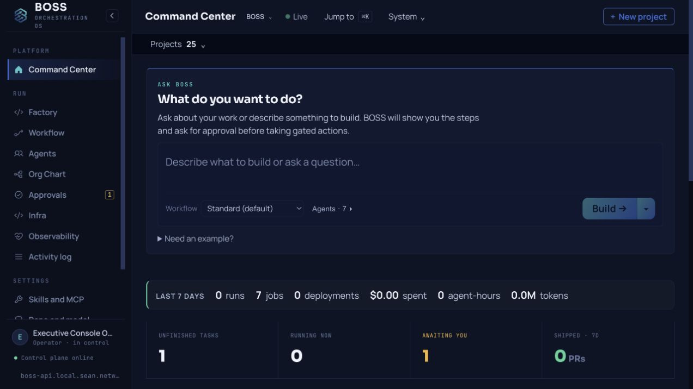
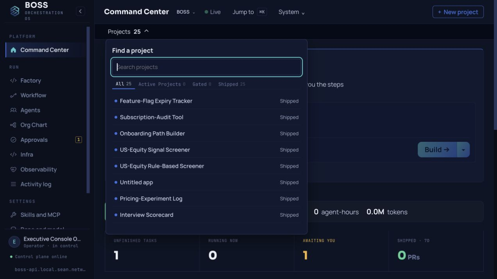
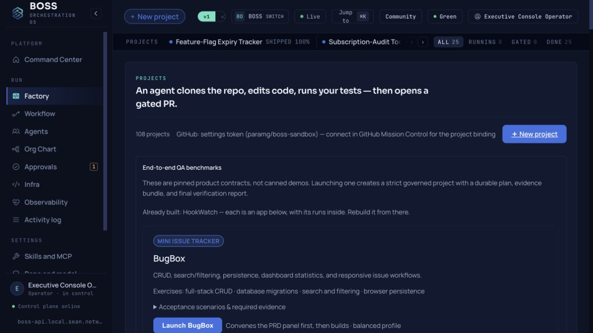
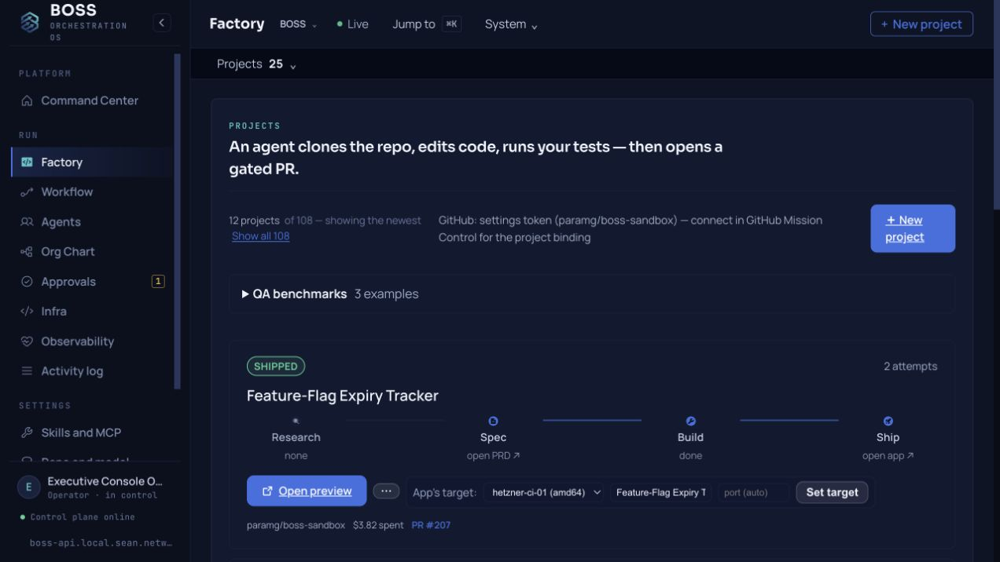
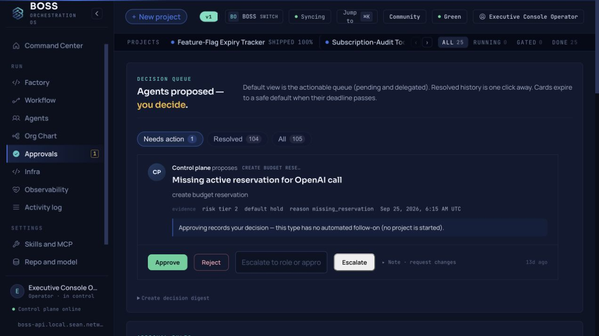
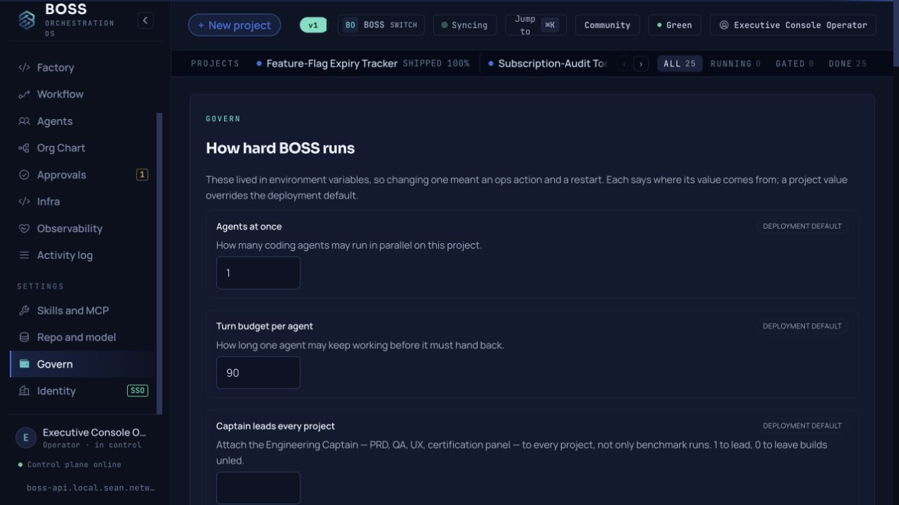
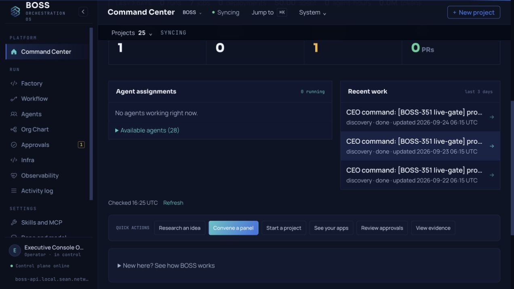
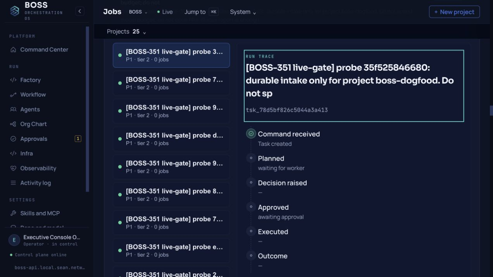

# BOSS Mission Control UI audit — 24 September 2026

Internal review evidence: screenshots include local hostnames and task data. Review or exclude this folder before any public Community export.

Scope: the live `boss.local.sean.network` Command Center, Factory, Approvals, and Govern screens, followed by a local preview of the proposed changes. Screenshots are from this audit run at a 1272 × 714 desktop viewport. The local preview used the same control-plane API and project `boss-dogfood`.

## Observed steps

1. **Open Command Center — needs work.** The original header contains nine competing status, edition, switch, and action controls. The moving project strip exposes only a few of 25 apps at once. The first screen is dominated by a promotional headline, three claims, suggestions, and idea chips; active work and approvals sit below it. The proposed view gives the operator a stable location, one main action, a short composer, and a collapsed project picker. Its first KPI now counts unfinished tasks from the displayed task lifecycle instead of calling every raw open record an outcome in flight. Small muted labels remain a contrast and legibility risk.

   
   

2. **Find one of many projects — improved.** The previous ticker required paging through status pills. The new picker opens with search focused and offers status filters in one vertical list. It exposes the full 25-app count without filling the persistent header. The result still needs keyboard and screen-reader testing beyond the browser's visible role tree.

   

3. **Open Factory — needs more cleanup.** The original first screen puts a long QA benchmark catalog ahead of the actual projects. The proposed view collapses that catalog so the project list is reached first. The screen still calls 108 code-task runs “projects” while the global picker calls 25 shipped apps “projects”; those counts describe different objects and need clearer labels.

   
   

4. **Review an approval — mixed.** The actionable queue is findable and the primary decision verbs are visible. A single card still mixes risk tier, reason code, default, deadline, explanatory note, three decisions, and an escalation input at nearly equal weight. The text is small and easy to skip before acting. A next pass should keep the decision and consequence together, place technical evidence behind disclosure, and state when approval merely records a decision.

   

5. **Change governance — needs work.** Repeated “deployment default” labels, long helper paragraphs, and full-width setting rows slow scanning. The visible “Turn budget per agent” control says “How long” but does not show a unit beside its value of 90. Group related controls, show units and effective scope inline, and put restart implications once near Save. Validate focus order and error messages with keyboard and screen-reader use.

   

6. **Check coordination — improved, with backend limits.** The proposed panel lists active assignments first, collapses idle agents, and links recent work to task traces. It polls the focused browser tab every five seconds, blocks overlapping requests, preserves the last snapshot if a feed fails, and shows the last check and failure. During inspection, the metrics feed called three historical probes “running” while the canonical task feed called them “done”; the new panel reconciles status from the canonical task feed. Polling is not push-based streaming, so a change may appear up to one interval plus request time later.

   

7. **Open a represented task — improved.** A recent-work row opens `area=work&task=<id>`. The Work board selects that ID and focuses its Run trace so the detail is immediately visible. The wider Work page remains dense and carries several adjacent sections; a later pass should make the task trace itself the primary destination.

   

## Next cleanup targets

1. **Navigation and naming.** Consolidate the 14 sidebar destinations around the operator's tasks; clarify the difference between an app, project, code-task run, and workflow. Command Center, Factory, and Work currently use overlapping labels.
2. **Factory and approvals.** Reduce benchmark cards and status badges within individual project details. Give approval cards a clear question, consequence, and evidence order.
3. **Settings.** Group Govern controls by purpose, put units next to values, and replace repeated deployment-default badges with a single scope explanation.
4. **Remaining chip usage.** A source inventory finds `pill`, `chip`, or `badge` references concentrated in `page.tsx` (35), `code-tasks-ui.tsx` (32), `ConsoleShell.tsx` (13), `discoveries-ui.tsx` (11), and `skills-ui.tsx` (11). These are search hits rather than a count of visible chips; inspect the rendered state before deleting a meaningful status or control.
5. **Data and freshness.** The task KPI uses the most recent 50 task records; when the feed reaches that limit it is labeled “Recent unfinished tasks.” Consider an aggregate endpoint for full-project lifecycle counts and a server event stream when backend support exists. Keep stale and failure states explicit.

## Evidence limits

This was a desktop audit of four live areas and the local revised flow. It does not establish accessibility compliance, mobile quality, or the behavior of every sidebar destination. Keyboard focus was observed for the project search and task trace; contrast, screen-reader announcements, and touch behavior need dedicated checks. The local preview is not a production deployment.

The new coordination endpoint relies on the single-operator web login gate tracked separately as BOSS-434. Keep that gate in place before a public Community deployment; this audit does not establish multi-user project authorization.
