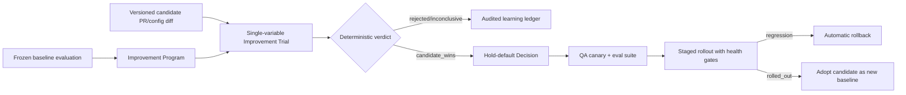

# Governed autonomous improvement loop

## Decision

BOSS should not embed one opaque "self-learning agent." It owns a deterministic improvement
control plane and uses replaceable open-source systems at narrow boundaries:

| Responsibility | Recommended project | What BOSS adopts |
| --- | --- | --- |
| Trace analytics, datasets, experiments, online/offline evaluation | [Langfuse](https://langfuse.com/docs) | Preferred optional evaluation/analytics integration through OpenTelemetry and APIs; BOSS remains the canonical ledger. |
| Metric-driven prompt/program optimization | [DSPy](https://github.com/stanfordnlp/dspy) | Optional candidate generator. It may propose a versioned prompt/config diff, never promote or apply it. |
| Durable long-running orchestration | [Temporal](https://docs.temporal.io/) | Reference and future executor adapter for timers, retries, signals, and human waits; BOSS policy, budget, receipt, and decision records remain authoritative. |
| Vendor-neutral telemetry | [OpenTelemetry](https://opentelemetry.io/docs/concepts/semantic-conventions/) | Canonical export boundary for traces, metrics, model usage, evaluation IDs, and verdict IDs. |

Langfuse is the strongest immediate integration target because its open-source core combines
traces, costs, metrics, datasets, experiments, and online/offline evaluation while accepting
OpenTelemetry-shaped data. DSPy is the strongest optimizer reference because optimization is
driven by explicit programs, datasets, metrics, and held-out evaluation instead of an agent's
self-assessment. Temporal is proven durable-workflow infrastructure, but replacing BOSS's
existing leased job and workflow ledgers would create two authorities; it belongs behind an
executor adapter if future scale requires it.

License boundary: Langfuse documents its core as MIT with separately licensed enterprise
features; BOSS integrates through a protocol/API boundary and does not vendor mixed-license
server code. DSPy and Temporal are MIT. Every dependency still goes through the normal pinned
source, license, security, and provenance review.

## BOSS-owned loop

The optimizer, model, or human may author a candidate. It cannot write production config or
the baseline. The trial service verifies:

1. control equals the program's frozen baseline;
2. control and candidate share a metric-contract hash;
3. configuration manifests differ in exactly the declared variable;
4. candidate evidence coverage meets both the program floor and control coverage;
5. hard gates hold, no dimension exceeds the regression tolerance, and overall delta meets
   the minimum;
6. the verdict, evidence references, and candidate change reference are durable and audited.

Promotion creates the existing `SelfImprovementProposal`; approvals, canary, rollout, and
rollback continue through existing BOSS services. Baseline adoption is a separate transition
that verifies the linked proposal actually reached `rolled_out`.

## Analytics integration contract

BOSS events expose stable correlation fields: `project_id`, `improvement_program_id`,
`improvement_trial_id`, control/candidate evaluation IDs, `metric_contract_hash`,
`verdict_hash`, candidate change reference, and proposal ID. The OpenTelemetry collector may
export those events and existing `llm_calls` cost/token/latency fields to Langfuse or another
backend. External analytics is a projection: loss or disagreement never overwrites the BOSS
Postgres ledger.

Candidate generators such as DSPy receive only a pinned dataset/spec revision, metric
contract, allowed configuration surface, budget envelope, and redacted prior evidence. Their
output is a candidate artifact or PR/config diff. It must enter the same trial endpoint as a
human-authored candidate.
