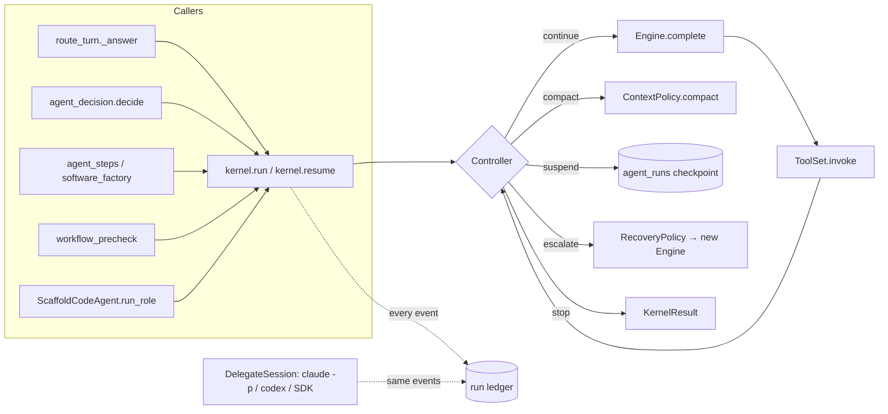
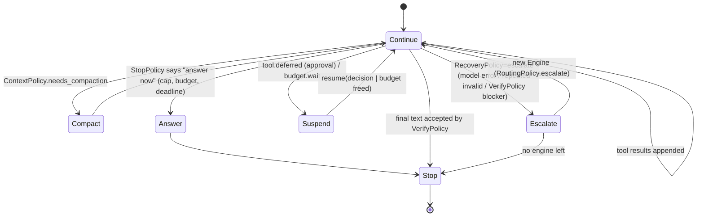
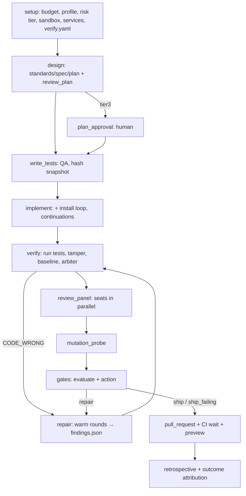
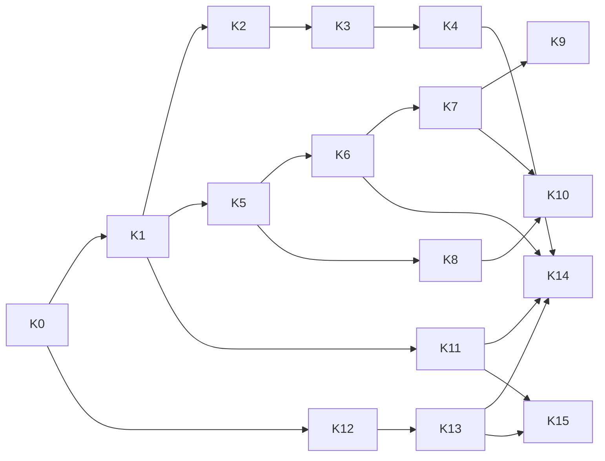

# Harness kernel: one loop, a run ledger, native frontier chat, a build task graph

*Design for BOSSAPP-961 (epic BOSSAPP-958, phase 2). Status: **draft for operator approval; nothing here is built.** Written 2026-11-10 against `origin/main` at 216ae9646 (v1.0-rc10.13). The key files are byte-identical to 6cdf117f2, the commit the harness inventory was read from, so the inventory's line numbers hold.*

**Conventions.** Paths are relative to `engine/boss_engine/services/` unless they start with another root. `gcts` = `governed_code_task_service.py`. `L` = line. "Today" means origin/main. Every claim about current code cites file:line. Nothing in this document has been run.

**Inputs.** `boss-harness-vs-exo.md` (the review, especially §9 "two modes"), `boss-harness-inventory.md` (BOSS from code), `exo-findings.md` and the Exo source (read only).

---

## 0. Summary and the decisions I need

The review found six tool loops, a chat brain that switches off Claude's native tool calling, no shared ledger agents can query, and a 5,600-line build function running inside an HTTP request. This design fixes them in this order, each step behind a flag and measured by the P0 benchmark:

1. **One kernel** (`boss_engine/kernel/`). It is a single loop: model → typed tool calls → results → model. Chat, decisions, workflow agent steps, the pre-check agent and the native coder all run on it, with five policies (context, tools, verify, recovery, stop) and one controller.
2. **Two modes, one contract.** *Scaffold*: the kernel owns the loop (open and weaker models, and any API-key chat). *Delegate*: a frontier CLI (Claude Code, Codex) owns its own loop, and BOSS wraps it with context, tools over MCP, budgets, verification and the ledger. BOSS never strips a frontier engine's native abilities.
3. **A run ledger.** It is built on `agent_acts`, `llm_calls`, `agent_turns` and `tool_call_audit`, plus one new append-only `run_events` table, a workspace snapshot per step, and a query tool agents can call.
4. **Native frontier chat.** On API-key installs: the Anthropic Messages API with native tool calling, through the existing model proxy. On subscription installs: the unmodified `claude` binary in a native session, with BOSS's tools served over MCP. The JSON-in-text protocol is deleted.
5. **Scoped tools.** Tool sets are scoped by role and stage, with a tool-search tool, instead of ~150 schemas on every chat call. Every schema is strict.
6. **A typed stage graph** for the build, executed by the worker rather than inside `POST /v1/code-tasks/step`.

**Decisions for the operator** (details in §9):

- **D1. Subscription chat.** Anthropic's policy forbids products that "route requests through … plan credentials on behalf of their users". It allows "an end user … signing in to the unmodified Claude Code binary with their own Claude subscription". I recommend native chat on subscription installs through the unmodified `claude` CLI with BOSS tools over MCP, and *not* the Agent SDK or a direct Messages API call on OAuth tokens. Separately, ask Anthropic sales to confirm BOSS's shape fits the carve-out.
- **D2. Messages API dependency.** Add the `anthropic` Python package (it is not in `engine/requirements.txt` today), or call `/v1/messages` with `httpx`? I recommend the package.
- **D3. Worker execution.** Builds move to the worker container. That container then starts as root with `NET_ADMIN` to fence sandbox uids, as `api` does today. Approve the security change, or keep builds in `api` but off the request thread.
- **D4. Default scaffold level before data exists.** I recommend: Claude and Codex coding = Delegate, chat = kernel (API key) or Delegate (subscription), all other engines = Scaffold-heavy. After that, the benchmark decides.
- **D5. Measurement budget.** Each migration step needs real builds. I propose 8 briefs × 2 engines × 2 seeds per step that touches the build path, which is about $150–$400 a step at today's per-build cost (§9.4). Approve a cap.
- **D6. Ledger retention.** Keep content for 30 days and metadata (tokens, cost, outcome, policy version) for 400 days? Content-free metadata is what fine-tuning and routing need.

---


> **Decisions (operator, 2026-11-10):**
> - **D1:** subscription chat uses the unmodified `claude` program with BOSS tools over MCP (K8). Confirm the carve-out with Anthropic, and review `_seed_claude_login`.
> - **D2:** add the `anthropic` package (default taken).
> - **D3:** builds move to the worker; the worker gets root + NET_ADMIN like `api`.
> - **D4:** Claude/Codex coding on Delegate, every other engine Scaffold-heavy, until the benchmark decides.
> - **D5:** $100 for the first slice (K0, K1, K2, K5, K7), then report before more spend.
> - **D6:** content kept 30 days, metadata 400 days (default taken).

## 1. Goals and non-goals

### Goals

1. **Frontier engines keep their native loops (Delegate mode).**
   - Claude Code, the Agent SDK and Codex run their own tool loop, sub-agents and compaction.
   - BOSS adds what they lack: the right context, independent verification, structured findings, budgets, governance and the ledger.
   - BOSS never sets `--tools ""`, never re-renders a conversation as text, and never asks a frontier model to emit tool calls as JSON in prose (as `claude_cli_adapter.py:205-244` does today).
2. **The kernel is the one shared loop** for chat (EngineAgent), decisions (`agent_decision._ask_reading`), workflow agent steps and the factory plan (`agent_loop._drive_run`), the pre-check (`workflow_precheck_agent.run_agent`) and the scaffolded coder (`NativeCodeAgent._run_tool_loop`). A fix to retry, caps, compaction, schema repair or budgets is made once.
3. **Model-agnostic in quality, not only in plumbing.** Weaker models get more structure:
   - small steps with few, scoped tools;
   - strict schemas;
   - plan and progress kept in files;
   - verification after each step, with typed findings;
   - mechanical choices made by code.

   How much structure each engine gets (`delegate | light | heavy`) is set per engine by the P0 benchmark, not by belief.
4. **Everything is measured.** Every model call, tool call, verification, finding, decision and outcome lands in one append-only ledger with tokens, cached tokens, USD, latency and the policy versions that produced it.
5. **Nothing is lost.** The parity table in §8.2 maps every current capability to its new home.

### Non-goals

- **No runtime self-editing of policy (Exo's headline).** That is phase 3, and it needs this ledger plus the activation gate.
- **No rewrite of verification.** `_run_verify`, the tamper hash, the baseline classification, the arbiter, the review seats and the gates (gcts:6041-8188) move into stage nodes unchanged.
- **No replacement of the engine contract.** `engine_contract.py` stays the coding seam (`EngineAdapter`, L255-266; `ContractedAgent`, L366-457). The kernel sits beside it for the loops BOSS owns.
- **No asyncio migration.** The kernel is synchronous and thread-safe, matching the rest of BOSS (inventory §9: no asyncio). Streaming uses callbacks.
- **No change to approvals, identity or reversibility.** `NEVER_SELF_EXECUTE` (`tools/registry.py:47-48`), `identity_gate` (registry.py:565) and the run suspension on approval (agent_loop.py:2880-2950) are reused as they are.
- **No P1 items.** These are tracked elsewhere: the reviewer engine family, the reviewer's Bash, `attribute_run` for builds, and memory pruning.

---

## 2. The kernel API

### 2.1 Shape



The package is `engine/boss_engine/kernel/`, a leaf package that does not import `services.*` at module import time. Its files are `types.py`, `engine.py`, `toolset.py`, `policies.py`, `controller.py`, `loop.py`, `delegate.py` and `ledger.py`.

### 2.2 Events, steps and turns

```python
# kernel/types.py
EventKind = Literal[
    "run.started", "run.resumed", "run.suspended", "run.completed", "run.failed", "run.cancelled",
    "model.request", "model.response", "model.retry", "model.error",
    "tool.requested", "tool.result", "tool.refused", "tool.deferred",
    "schema.invalid", "schema.repaired",
    "context.compacted", "context.window",          # token accounting snapshot
    "verify.result", "finding",                     # VerifyPolicy outputs (typed findings)
    "decision", "escalation", "budget.wait", "budget.stop",
    "workspace.snapshot", "workspace.rewind",
    "delegate.turn",                                # one row per native-loop turn of a CLI/SDK engine
    "outcome",                                      # terminal, attributable outcome of a run/stage
]

@dataclass(frozen=True)
class Usage:
    model: str
    input_tokens: int = 0            # new (uncached) input only, as llm_telemetry already does
    output_tokens: int = 0
    cache_read_tokens: int = 0
    cache_write_tokens: int = 0
    cost_usd_micros: int = 0
    billing: Literal["metered", "subscription", "local"] = "metered"
    price_estimated: bool = False

@dataclass(frozen=True)
class Event:
    kind: EventKind
    run_id: str                      # agent_runs.id (scaffold) or code_task_run_id (delegate)
    act_id: Optional[str]            # agent_acts span this belongs to
    seq: int                         # monotonic per run; (run_id, seq) is unique
    step: int
    at: datetime
    data: Mapping[str, Any]          # redacted, clipped; schema per kind (ledger §3.2)
    usage: Optional[Usage] = None
    latency_ms: int = 0
    policy: Mapping[str, str] = field(default_factory=dict)  # {"context": "ctx@3", "tools": ...}
    workspace_ref: Optional[str] = None  # git commit / tree sha when the step touched files

@dataclass
class ToolCall:
    id: str; name: str; arguments: dict; raw_arguments: str

@dataclass
class ModelTurn:                     # what Engine.complete returns
    text: str
    tool_calls: list[ToolCall]
    stop_reason: Literal["end_turn", "tool_use", "max_tokens", "refusal", "error"]
    usage: Usage
    raw: dict                        # provider-native assistant message, replayed verbatim

@dataclass
class Step:                          # one model round-trip and the tools it called
    index: int
    turn: ModelTurn
    results: list["ToolResult"]
    state: "ControllerState"
```

A **Turn** is what a caller asks for: one `kernel.run(...)`. A **Step** is one model round-trip inside it. This matches today's vocabulary: EngineAgent's `max_steps` (engine_agent.py:459) and agent_loop's `steps_cap` (agent_loop.py:2459).

### 2.3 Engine: the native tool-calling interface

```python
# kernel/engine.py
@dataclass(frozen=True)
class EngineTraits:
    native_tools: bool               # provider-side function calling
    strict_tools: bool               # grammar-constrained args (Anthropic strict, OpenAI strict)
    tool_search: bool                # provider-side deferred tools (Anthropic tool_search_*)
    prompt_cache: Literal["explicit", "automatic", "none"]
    context_window: int
    count_tokens: bool               # an exact counter exists (Anthropic /v1/messages/count_tokens)
    streams: bool
    family: str                      # "anthropic" | "openai" | "qwen" | ... (review independence)

@dataclass
class ModelRequest:
    system: list["Block"]            # ordered, cache-tagged blocks (§6.4)
    messages: list[dict]             # provider-neutral; the engine converts
    tools: list["ToolSchema"]        # already scoped and strict (§5)
    tool_choice: Literal["auto", "none", "required"] | str = "auto"
    max_output_tokens: Optional[int] = None
    response_schema: Optional[dict] = None   # final-answer structure (decisions)
    deadline: Optional[float] = None         # call_deadline.remaining() today

class Engine(Protocol):
    name: str
    traits: EngineTraits
    def complete(self, req: ModelRequest, *,
                 on_delta: Optional[Callable[[str], None]] = None,
                 cancel: "CancelToken") -> ModelTurn: ...
    def count(self, req: ModelRequest) -> int: ...   # exact where traits.count_tokens, else estimate
```

These implementations wrap existing transports and are not new clients:

| Engine | Wraps | Notes |
|---|---|---|
| `OpenAIChatEngine` | `OpenAIAdapter.create_chat_completion` (openai_adapter.py:568-640) | All OpenAI-compatible lanes (`_PROVIDER_LANES`, model_routing.py:408-421) |
| `AnthropicMessagesEngine` | **new**; `/v1/messages` through `model_proxy` (model_proxy.py:21-27 already allows `/v1/messages` and `count_tokens`) | API-key installs only (§4). Needs D2 |
| `ScriptedEngine` | `scripted_engine.py` | Conformance and benchmark plumbing |
| `GovernedEngine(engine)` | `model_routing.governed` (model_routing.py:837) | A decorator. Every call is reserved, receipted and settled. Applied by the kernel, never by call sites (today it is applied per call site; see inventory §1.2) |

The CLI brains (`ClaudeCliAdapter`, `CodexCliAdapter`) are **not** kernel engines. Their native form is a `DelegateSession` (§2.9).

### 2.4 ToolSet

```python
# kernel/toolset.py
@dataclass(frozen=True)
class ToolSchema:
    name: str; description: str; parameters: dict   # strict (§5.3)
    kind: Literal["read", "write"]; reversibility: str
    deferred: bool = False                          # offered only via find_tools / provider search

@dataclass
class ToolResult:
    call_id: str; name: str
    status: Literal["ok", "error", "refused", "deferred", "skipped"]
    content: Any                     # JSON-able; the kernel clips for the model, ledgers in full (redacted)
    untrusted: bool = False          # carried_untrusted / Ledger.remember (agent_loop.py:2915-2925)
    decision_id: Optional[str] = None

class ToolSet(Protocol):
    def schemas(self, *, step: int, state: "RunState") -> list[ToolSchema]: ...
    def invoke(self, call: ToolCall, *, run: "RunState") -> ToolResult: ...
```

These implementations are the existing gates, moved behind one interface:

- **`RegistryToolSet`** is BOSS's registry. `invoke` → `ToolRegistry.invoke` (registry.py:317), which already runs `identity_gate`. It keeps EngineAgent's write hold (`pending_writes` unless `allow_writes`, engine_agent.py:973-990) and the `propose_action` offer flow.
- **`AgentStepToolSet`** is today's bounded agent-step assembly:
  - held skills, repo bundles and held MCP servers filtered by `granted_tools` (agent_loop.py:2326-2457);
  - the identity refusal (L1895);
  - the untrusted-content hold before a sink (L2540-2560);
  - the MCP risk-tier deferral (L2880-2900).
- **`SandboxToolSet`** is `code_agent_tools.SandboxToolset` (read_file, list_dir, glob, grep, edit_file, write_file, bash) for the scaffolded coder.
- **`ReadOnlyToolSet(fn, tools)`** is `ReadPhase.tools/run` from agent_decision.py:110-121.
- **`Composite`** joins sets, plus the kernel's built-ins: `find_tools` (§5.2) and `read_run_ledger` (§3.5).

### 2.5 The policies

```python
# kernel/policies.py — every policy is a versioned value: name@version is written on each event.
class ContextPolicy(Protocol):
    version: str
    def assemble(self, run: "RunState") -> ModelRequest: ...          # ordering, clipping, cache tags
    def needs_compaction(self, run: "RunState", window: int) -> bool: ...
    def compact(self, run: "RunState", engine: Engine) -> "RunState": ...

class ToolPolicy(Protocol):
    version: str
    def select(self, run: "RunState", available: ToolSet) -> list[ToolSchema]: ...  # §5
    def max_parallel_calls(self) -> int: ...

class VerifyPolicy(Protocol):                    # after a step; returns typed findings, never prose
    version: str
    def after_step(self, run: "RunState", step: Step) -> list["Finding"]: ...
    def accept_final(self, run: "RunState", text: str) -> "Acceptance": ...  # schema + evidence check

class RecoveryPolicy(Protocol):
    version: str
    def on_model_error(self, run, exc) -> Literal["retry", "escalate", "fail"]: ...
    def on_tool_error(self, run, result, failures_for_tool: int) -> Optional[str]: ...  # nudge text
    def on_invalid(self, run, why: str, attempts: int) -> Literal["repair", "fail"]: ...

class StopPolicy(Protocol):
    version: str
    def decide(self, run: "RunState") -> Optional["StopReason"]: ...   # caps, budget, deadline, done

@dataclass(frozen=True)
class Finding:                                  # the one structured feedback shape (P1 item 3)
    source: Literal["test", "lint", "review", "gate", "schema", "tool", "verifier"]
    severity: Literal["blocker", "major", "minor", "info"]
    path: Optional[str]; line: Optional[int]; quote: str
    message: str; test_id: Optional[str] = None; assertion: Optional[str] = None
```

The defaults are today's behaviours, lifted out:

| Policy | Default reproduces | Cited |
|---|---|---|
| `StopPolicy.caps` | step caps 12/24 (agent_loop), 6 plus TurnBudget 16 calls and 180 s (EngineAgent), ReadPhase 4 turns and $0.30 (agent_decision), pre-check 8 turns and $0.50 | config.py:118, agent_steps.py:62, engine_agent.py:459, turn_budget.py:24-40, agent_decision.py:119-120, workflow_precheck_agent.py:577-578 |
| **Last step answers without tools** | in all four loops today, written four times | agent_loop.py:2960-2984, engine_agent.py:520, agent_decision.py:644-647, workflow_precheck_agent.py:621-624 |
| `RecoveryPolicy.transient` | `_with_transient_retry` (EngineAgent only today) plus the budget-deferral wait (pre-check only) | engine_agent.py:612-630, workflow_precheck_agent.py:625-638 |
| `RecoveryPolicy.empty` | 2 empty completions tolerated | engine_agent.py:708-718 |
| `RecoveryPolicy.same_tool_failures` | "stop retrying" nudge after 3 | engine_agent.py:785-809 |
| `RecoveryPolicy.refused_call` | a provider 400 on a malformed call is fed back, at most 3 times | agent_loop.py:2481-2513 |
| `VerifyPolicy.decision` | `_accept` plus the evidence-citation check, one re-ask | agent_decision.py:573-597, 686-695 |
| `ContextPolicy.clip` | 16k-char tool result (agent_loop) / 8k (ReadPhase) | agent_loop.py:2934, agent_decision.py:121 |

### 2.6 The controller



```python
class ControllerState(Enum):
    CONTINUE = "continue"; COMPACT = "compact"; ESCALATE = "escalate"
    SUSPEND = "suspend"; ANSWER = "answer"; STOP = "stop"

@dataclass
class KernelResult:
    status: Literal["completed", "suspended", "budget_wait", "failed", "cancelled"]
    text: str; structured: Optional[dict]
    findings: list[Finding]; pending: Optional[dict]   # decision_id, tool, args — as agent_runs.pending today
    usage: Usage; steps: int; run_id: str
    exhausted: str = ""                                 # AgentTurn.exhausted (engine_agent.py)

def run(spec: "RunSpec") -> KernelResult: ...
def resume(run_id: str, *, decision: Optional[dict] = None) -> KernelResult: ...
def cancel(run_id: str, *, by: str) -> None: ...
```

`RunSpec` bundles the engine (or a routing request), the ToolSet, the five policies, the identity (project, actor, run token), `persist: bool` and `on_event`. Each step runs `StopPolicy` → `ContextPolicy.assemble` → `Engine.complete` → schema check → `ToolSet.invoke` (parallel reads, serial writes) → `VerifyPolicy.after_step` → controller transition.

### 2.7 The suspend/resume contract

- **Persistence.** Durable runs (`persist=True`) save a checkpoint after every step into `agent_runs`: messages, transcript, usage, step, pending and finalize_ctx (schema.sql:3414-3428). This is exactly `_save_run` today (agent_loop.py:2958). Chat turns run with `persist=False` unless they suspend; a suspension always persists.
- **Suspend.** `ToolResult.status == "deferred"` (approval: `create_blocking_decision`, agent_loop.py:2880-2905) or `budget.wait` (L2928-2943) moves the controller to SUSPEND. Calls still pending in the same step are recorded as `skipped` with the note "a prior action this turn awaits approval", as L2546 does now.
- **Resume.** `resume(run_id, decision=…)` reloads the checkpoint, runs the held call **without re-asking identity or the untrusted hold** (the existing rule at L2537-2540), appends its result, and continues. `resume_agent_run` (agent_loop.py:1970) becomes a thin call to it.
- **Idempotency.** Every write tool call carries `(run_id, step, call_id)` as an idempotency key in `tool_call_audit` (schema.sql:11645). Resuming twice never runs a write twice.
- **Orphan repair**, borrowed from Exo (`harness/index.ts:698`). On resume after a crash, a `tool.requested` event with no `tool.result` gets a synthetic `{status:"error", note:"did not complete before the process stopped"}`. The transcript can never be malformed.

### 2.8 Budget, governance, schemas, streaming, cancellation, retry

- **Budget.** `GovernedEngine` reserves before each call and settles after it (`governed`, model_routing.py:837). `StopPolicy` reads the run's spend from the ledger (§3.5), not from a local counter. A `ModelSpendDeferred` becomes `budget.wait` (durable runs) or a bounded in-place wait (`deferred_wait`, workflow_precheck_agent.py:563-571), chosen by the caller's `RunSpec.wait_mode`.
- **Governance.** Identity is enforced once, in `ToolSet.invoke`. Routing happens once per run and is sticky, as `_agent_purpose` (agent_loop.py:3030-3055) does today.
- **Strict schemas with one repair:**
  - Tool arguments are validated against the strict schema (§5.3) before `invoke`. If invalid, the kernel emits `schema.invalid`, returns a `refused` result naming the failing JSON pointer, and lets the model try again. That is **one** repair per call id, then `fail` for that call. Today's provider-400 path (agent_loop.py:2481-2513) becomes the same event.
  - Final answers with a `response_schema` (decisions, the pre-check items) are validated the same way, with one re-ask, as `agent_decision._refused_again` (L598, L690-694) does now.
- **Streaming.** `Engine.complete(on_delta=…)` streams text deltas. `EngineAgent`'s `on_step` labels (engine_agent.py:460-463) become `tool.requested` events mapped to labels by the caller. `stream_answer` (engine_agent.py:405) stays as the tool-less discuss path, served by the same engines.
- **Cancellation.** A `CancelToken` is checked before each model call and each tool call. It is set by `kernel.cancel`, by the code-task stop row (`code_task_stop_requests`, schema.sql:7441), or by a deadline (`call_deadline`). A cancelled run persists its checkpoint and ends `cancelled`.
- **Transient retry.** This now covers every kernel caller: exponential back-off on 429/5xx/timeouts for ≤3 tries inside the call deadline (today `_with_transient_retry` covers only EngineAgent, inventory §1.1). Each retry is a `model.retry` event, so retries become visible cost.

### 2.9 Delegate mode: the same events from a native loop

```python
# kernel/delegate.py
class DelegateSession(Protocol):
    engine: str                                   # "claude_code" | "claude_agent_sdk" | "codex"
    def start(self, brief: "DelegateBrief", *, on_event: Callable[[Event], None],
              cancel: CancelToken) -> "DelegateResult": ...
    def resume(self, session_id: str, message: str, **kw) -> "DelegateResult": ...

@dataclass
class DelegateBrief:
    prompt: str; shared_context: str              # → --append-system-prompt (cache prefix, code_agent.py:1216-1218)
    cwd: Path; read_only: bool
    mcp: Optional["HarnessMcp"]                   # BOSS tools as MCP (code_task_mcp.py)
    max_turns: int; max_budget_usd: Optional[float]
    allowed_tools: str; model: Optional[str]; effort: Optional[str]
```

- **Coding.** `ClaudeCodeAgent._invoke` (code_agent.py:1106-1229) and the codex/SDK equivalents *are* delegate sessions already. The change is that every stream-json turn they emit (today `agent_turns` rows via `StreamParser`, agent_turns.py:133) is **also** written as a `delegate.turn` ledger event. `max_budget_usd` is finally passed: it is supported at L1192, but the governed pipeline never passes it (inventory §2).
- **Chat on subscription installs** is a new `ClaudeChatSession` (§4.2).

Delegate mode never adds prompts that switch off native features. The scaffold-level table (§2.11) decides *which* mode an engine gets per job.

### 2.10 How the six loops map onto the kernel

| # | Loop today | Keeps (caller-side) | Moves into the kernel | Deleted |
|---|---|---|---|---|
| a | `agent_loop._drive_run` (agent_loop.py:2281-2990) | MCP discovery and reachability memory (L2342-2400), skill resolution and on-demand loader (L2402-2457), `finalize_ctx` semantics, `attribute_shown_facts` (L2990), the `agent.*` events | the loop (L2476-2958), the refused-call feed-back, the untrusted ledger hold (as `AgentStepToolSet`), deferral and suspend, budget wait, `_save_run` checkpointing, the "answer from what you found" step (L2960-2984) | its own loop body, `add_usage` (L2462-2470), its missing transient retry |
| b | `EngineAgent.chat` (engine_agent.py:449-829) | the router's system prompt and remembered context, `pending_writes` presentation, the `propose_action` offer and button labels (L126-151), `AgentTurn` shape | loop, TurnBudget, transient retry, empty-completion retry, protocol re-ask, same-tool nudge, the forced answer step with offer schemas (L527-532) | its loop body and `_prose_again` duplicate (L831-907) |
| c | `agent_decision._ask_reading` (L624-697) | candidates, `_accept`, the evidence corpus, Jev routing (L394-457) | read phase as `ReadOnlyToolSet` + `StopPolicy(max_turns, max_usd)`; final answer as `response_schema` with one repair | the loop (L640-695) |
| d | `workflow_precheck_agent.run_agent` (L574-~700) | `SYSTEM_PROMPT`, evidence pack, item parsing | loop, caps, budget wait | the loop |
| e | `NativeCodeAgent._run_tool_loop` (code_agent.py:1795-~1999) | `NativeCodeAgent` as an `EngineAdapter` (contract unchanged), `SandboxToolset`, the repo guide | loop, deadline, per-turn transcript (`record_agent_turns` → ledger), cost estimate | the loop; renamed `ScaffoldCodeAgent` |
| f | CLI engines' own loops (code_agent.py:1106-1229, agent_sdk_engine.py:503-660, codex_code_agent.py) | **all of it.** They stay native (Delegate) | emits ledger events; receives `max_budget_usd` and BOSS tools over MCP | nothing |
| (g) | Chat brains `ClaudeCliAdapter` / `CodexCliAdapter` / `AgentSdkChatAdapter` text protocol (claude_cli_adapter.py:199-327, agent_sdk_engine.py:675-733) | `create_plain_answer`, `stream_text_response` for tool-less generation (meetings, PRD) | n/a | **the JSON-in-text tool protocol** (`_build_prompt` with tools, `_render_tools`, `_first_json_object` parsing for tool calls), replaced by §4 |

### 2.11 Scaffold levels per engine

```python
ScaffoldLevel = Literal["delegate", "light", "heavy"]
# light: kernel loop, full ToolPolicy set, compaction, one verify per stage.
# heavy: kernel loop, ≤8 tools per step, plan/progress files mandatory, verify after every
#        write step, typed findings, decisions forced to response_schema, smaller steps
#        (implement split into per-file sub-steps from the plan file).
```

The level is stored per `(engine, model, job)` in the routing store (`model_router/store.py`) as `scaffold_level`. It defaults per D4. The P0 benchmark writes the measured best level (success first, then cost and time), and an operator can pin it in Setup › Advanced (rule: setup keeps advanced options).

---

## 3. The run ledger

### 3.1 What exists, and what is added

The ledger is **one view over five tables**, four of which exist:

| Table | Exists | Role in the ledger |
|---|---|---|
| `agent_acts` (schema.sql:7392-7418) | yes | **The span tree**: run → stage → seat/step → chat. It has `parent_act_id`, `root_act_id`, tokens and cost on close, a `scope` column, and links to code_task_run / workflow run / thread. Every ledger row carries `act_id`. |
| `llm_calls` (schema.sql:4010-4034, +role/cache 5589-5592, +act_id 7424, +route_id 9138) | yes | One row per model invocation (a CLI session is one row). Add `run_id`, `seq`, `policy`, `scaffold_level` and `snapshot_ref`. |
| `agent_turns` (schema.sql:4047-4087, +act_id 7425) | yes | Transcript content per turn, redacted and truncated, retention-bound. Unchanged. |
| `tool_call_audit` (schema.sql:11645-11682) | yes, append-only by trigger | One row per tool call decision. Add `act_id`, `seq` and `idempotency_key`. |
| `run_events` | **new** | Every kernel/delegate event that is not a model call or a tool call: `finding`, `verify.result`, `decision`, `escalation`, `context.compacted`, `workspace.snapshot`/`rewind`, `budget.*`, `outcome`. |

I chose this over "one big new events table" because `llm_calls` already drives budgets, routing (`model_router/store.py`) and cost screens, and `agent_turns` drives Activity. A second copy of each would drift. The new table holds only what has no home today.

### 3.2 Schema

```sql
CREATE TABLE IF NOT EXISTS run_events (
  id TEXT PRIMARY KEY,                       -- 'evt_' + ulid (time-ordered, like Exo's UUIDv7)
  project_id TEXT NOT NULL,
  run_id TEXT NOT NULL,                      -- agent_runs.id | code_task_runs.id | workflow step run
  act_id TEXT,                               -- agent_acts span
  root_act_id TEXT,                          -- denormalised for "whole build" queries
  seq BIGINT NOT NULL,                       -- monotonic per run_id
  step INT NOT NULL DEFAULT 0,
  stage TEXT,                                -- build stage node, NULL for chat
  kind TEXT NOT NULL,                        -- EventKind (§2.2)
  data JSONB NOT NULL DEFAULT '{}'::jsonb,   -- redacted + clipped; per-kind shape below
  content_ref TEXT,                          -- agent_turns.id / artifact path for large bodies
  input_tokens BIGINT NOT NULL DEFAULT 0, output_tokens BIGINT NOT NULL DEFAULT 0,
  cache_read_tokens BIGINT NOT NULL DEFAULT 0, cache_write_tokens BIGINT NOT NULL DEFAULT 0,
  cost_usd_micros BIGINT NOT NULL DEFAULT 0, included_in_subscription BOOLEAN NOT NULL DEFAULT false,
  latency_ms INT NOT NULL DEFAULT 0,
  engine TEXT, model TEXT, scaffold_level TEXT,
  policy JSONB NOT NULL DEFAULT '{}'::jsonb, -- {"context":"ctx@3","tools":"tools@2","prompt:implement":"sha256:…"}
  workspace_ref TEXT,                        -- git commit sha or tree sha after this step
  attempt INT NOT NULL DEFAULT 1,            -- code_task attempt / retry lineage position
  lineage_id TEXT,                           -- first run of a retry chain (survives retries)
  recorded_at TIMESTAMPTZ NOT NULL DEFAULT now(),
  UNIQUE (run_id, seq)
);
CREATE INDEX IF NOT EXISTS idx_run_events_run     ON run_events (run_id, seq);
CREATE INDEX IF NOT EXISTS idx_run_events_root    ON run_events (root_act_id, recorded_at);
CREATE INDEX IF NOT EXISTS idx_run_events_lineage ON run_events (lineage_id, kind, recorded_at);
CREATE INDEX IF NOT EXISTS idx_run_events_kind    ON run_events (project_id, kind, recorded_at DESC);
CREATE INDEX IF NOT EXISTS idx_run_events_policy  ON run_events USING GIN (policy jsonb_path_ops);

ALTER TABLE llm_calls        ADD COLUMN IF NOT EXISTS run_id TEXT, ADD COLUMN IF NOT EXISTS seq BIGINT,
                             ADD COLUMN IF NOT EXISTS policy JSONB, ADD COLUMN IF NOT EXISTS scaffold_level TEXT,
                             ADD COLUMN IF NOT EXISTS lineage_id TEXT;
ALTER TABLE tool_call_audit  ADD COLUMN IF NOT EXISTS act_id TEXT, ADD COLUMN IF NOT EXISTS seq BIGINT,
                             ADD COLUMN IF NOT EXISTS idempotency_key TEXT;
CREATE UNIQUE INDEX IF NOT EXISTS uq_tool_call_idem ON tool_call_audit (idempotency_key)
  WHERE idempotency_key IS NOT NULL;

CREATE TABLE IF NOT EXISTS policy_versions (   -- what "ctx@3" means, immutable
  id TEXT PRIMARY KEY,                          -- 'ctx@3', 'prompt:implement@sha256:…'
  kind TEXT NOT NULL, body JSONB NOT NULL, source TEXT NOT NULL,  -- file path + git sha
  created_at TIMESTAMPTZ NOT NULL DEFAULT now()
);

CREATE OR REPLACE VIEW run_ledger AS          -- the one read surface
  SELECT 'model' AS src, id, project_id, run_id, act_id, seq, stage, 'model.response' AS kind, ...
    FROM llm_calls
  UNION ALL SELECT 'tool', id, project_id, run_id, act_id, seq, NULL, 'tool.result', ... FROM tool_call_audit
  UNION ALL SELECT 'event', id, project_id, run_id, act_id, seq, stage, kind, ... FROM run_events;
```

The `data` shape per kind is validated in `kernel/ledger.py` by a dataclass per kind. The important ones:

- `finding`: `{source, severity, path, line, quote, message, test_id, assertion, fixed_in_seq}`
- `verify.result`: `{command, exit, passed, failed, preexisting_failed, tamper_ok, duration_ms}`, from `_run_verify` (gcts:6041), baseline_verify and the tamper check (gcts:7210-7240)
- `decision`: `{question, candidates, chosen, confidence, by, evidence_ids}`, from `AgentDecision` (agent_decision.py:143-163)
- `outcome`: `{scope: run|stage, result: pass|fail|shipped_failing|merged|reverted, gates:{…}, pr_url, followups}`

### 3.3 Append-only enforcement

- **`run_events`** gets the same trigger pattern as `tool_call_audit` (schema.sql:11663-11682): `BEFORE UPDATE OR DELETE … RAISE EXCEPTION`. The only exception is the retention job, which runs as a dedicated role that drops whole **partitions**. `run_events` is range-partitioned by month on `recorded_at`, so retention never needs a row `DELETE`.
- **`llm_calls`** is *almost* insert-only: `record_llm_call` only inserts (llm_telemetry.py:205), but `agent_acts` back-fills `act_id` on reconstructed stages (`UPDATE llm_calls SET act_id`, agent_acts.py:3290), and the BOSS-280 backfill (schema.sql:5597) updates `role`. So the trigger on `llm_calls` refuses updates to every column except a NULL → value write of `act_id`/`run_id`/`seq`, and the one-off backfills run before it is created.
- **`agent_acts`** is "append-only, except status, ended_at, tokens, cost and artifacts, which are written once on close" (schema.sql:7388-7391). It stays as is, and a trigger enforces "close once": updates are allowed only while `ended_at IS NULL`.
- **Agents cannot touch any of it.** No tool writes these tables directly. `read_run_ledger` is read-only. Mechanism, not policy (review §6).

### 3.4 Surviving retries and rewinds

- **Lineage.** `lineage_id` is the first run id of a retry chain. `retry_code_task` (code_task_service.py:1917), the shepherd and cold repair child runs (gcts:9210-9315) all inherit it. "What did I already try" is therefore asked of the lineage, not of the run.
- **Workspace snapshot per step.**
  - Scaffold coder: after every step that wrote files, the kernel records `git write-tree` (cheap, no commit) as `workspace_ref`.
  - At stage ends the existing `_checkpoint` (gcts:5444-5490) commits and pushes, and its sha is recorded as a `workspace.snapshot` event.
  - Delegate coder: a tree sha after each session (no per-turn snapshot; the CLI owns the turns).
- **Rewind.** `kernel.rewind(run_id, to_seq)` restores the worktree to that step's tree (`git read-tree -u --reset <tree>`). It appends `workspace.rewind` and **keeps every event**. The next prompt's "already tried" block (§6.3) is built from the rewound-over steps, so a failed attempt becomes evidence rather than amnesia (Exo's `rewind_sandbox` rule, exo-findings §2.4).
- **Retries of a whole run** (lease reclaim, shepherd) read the lineage's events and the existing `completed_stages` (gcts:336-360, 6453-6470). They skip stages whose outcome events say `pass`.

### 3.5 Query API

```python
# kernel/ledger.py — the one reader; services and tools call this, never raw SQL
def spend(scope: "Scope") -> Usage: ...                          # run | act | lineage | stage
def tried(scope: Scope, *, kinds=("tool.result", "verify.result", "finding", "escalation"),
          limit: int = 40) -> list["Attempt"]: ...              # deduped by (tool, args_sha256)
def open_findings(scope: Scope) -> list[Finding]: ...           # findings with no fixed_in_seq
def compare(policy_a: str, policy_b: str, *, kind: str, since: datetime) -> "PolicyDelta": ...
def timeline(scope: Scope, *, after_seq: int = 0, page: int = 200) -> list[Event]: ...
```

The agent tool is `read_run_ledger(scope: "run"|"lineage"|"stage", question: "spend"|"tried"|"open_findings"|"timeline", stage: str|null, after_seq: int|null)`, which is strict and read-only. It is offered to every kernel run and over MCP to delegate sessions. It answers "What did I already try, and what did it cost?" in ≤2k tokens, e.g. *"implement attempt 2: 3 edits to api/tickets.py, tests 14/17 passing, failing: test_assign_requires_role (AssertionError: 403 != 200); cost $1.84, cached 71%."*

The existing `read_run_turns` and `diagnose_run` (tools/builtin.py:6573-6765) are re-pointed at `ledger.timeline` and `ledger.spend`, which removes their private SQL.

### 3.6 Retention and redaction

- **Redaction on write.** Every `data` and `content` passes `redaction.redact_secrets`, the same function `_ask_reading` already uses (agent_decision.py:631). Also `model_proxy` tokens are registered with the log redactor at mint (model_proxy.py:17-18).
- **Clipping.** `data` is ≤8 KB. Larger bodies go to `agent_turns` (already clipped by `agent_turns._clip`, L82) and are referenced through `content_ref`.
- **Retention (D6).** Content (`agent_turns`, `run_events.data` bodies) follows `activity_retention` (schema.sql:4045 comment), proposed at 30 days. Metadata (tokens, cost, kinds, policy, outcome, findings without quotes) is kept for 400 days by dropping monthly partitions. A redacted export for fine-tuning (review §9 "training") is a separate opt-in job, out of scope here.
- **Tenancy.** Every query is filtered by `project_id` through the caller's identity. `read_run_ledger` uses `pinned_project` (registry.py:120-123).

---

## 4. Native frontier chat

### 4.1 What changes and why

Today a subscription chat step works like this:
- it runs `claude -p` with `--strict-mcp-config --disable-slash-commands --tools ""` (claude_cli_adapter.py:426);
- the whole conversation is re-rendered as text;
- every tool schema is dumped into the prompt;
- a single JSON object is parsed back out (L199-327).

The code's own comment records that this broke above ~53 tools (L218-227). The Agent SDK chat adapter inherits the same protocol (`AgentSdkChatAdapter(ClaudeCliAdapter)`, agent_sdk_engine.py:683). The JSON protocol goes; what replaces it depends on the credential.

### 4.2 The matrix

| Install credential | Chat engine | Loop owner | Tools reach the model as | Constraint |
|---|---|---|---|---|
| **Anthropic API key** (console vault or `ANTHROPIC_API_KEY`) | `AnthropicMessagesEngine` in the **kernel** | BOSS kernel | native `tools` with `strict: true`; provider tool search for deferred tools | none; key injected by `model_proxy` (model_proxy.py:12-27) |
| **Claude subscription** (OAuth login, `CLAUDE_CODE_OAUTH_TOKEN`) | `ClaudeChatSession` (**Delegate**): the unmodified `claude` binary, `-p --input-format stream-json --output-format stream-json` | Claude Code | BOSS tools over **MCP**: an `--mcp-config` pointing at a per-session, scope-filtered instance of `boss_engine/mcp/server.py`; `--strict-mcp-config` | policy (below); no `--bare` (bare mode does not read OAuth credentials) |
| **OpenAI-compatible key** (native, azure, openrouter, groq, deepseek, gemini, xai, vllm, ollama) | `OpenAIChatEngine` in the kernel | BOSS kernel | native function calling, already (openai_adapter.py:568-640); `strict` where the provider supports it | none |
| **Codex / ChatGPT login** | `CodexChatSession` (Delegate): `codex exec --json` with BOSS's MCP server configured | Codex | MCP | **spike needed**: codex's per-invocation MCP config and its approval policy flags. Until the spike passes, codex chat stays on the current text protocol behind the flag |
| **Agent SDK on an API key** (`claude_agent_sdk`) | Kernel on `AnthropicMessagesEngine` for chat. The SDK engine stays the *coding* Delegate (agent_sdk_engine.py:433-660) | — | — | SDK chat adapter (L675-733) deleted; same key, simpler path |

**Subscription auth: the constraint, stated plainly.** Anthropic's documentation (code.claude.com/docs/en/legal-and-compliance, "Authentication and credential use", and the Agent SDK overview note) says:

> "Unless previously approved, Anthropic does not allow third party developers to offer claude.ai login or rate limits for their products, including agents built on the Claude Agent SDK."

> "Anthropic does not permit third-party developers to offer Claude.ai login into their own applications, or to route requests through Free, Pro, Max, or Ultra plan credentials on behalf of their users. Moreover, developers may not collect, store, or intermediate Claude.ai credentials or session tokens."

> Carve-out: this does not "prevent an end user from signing in to the unmodified Claude Code binary with their own Claude subscription".

What follows from this:

1. **The Agent SDK on subscription auth is out.** BOSS already chose that: agent_sdk_engine.py:25-27 uses the API key only, "never the subscription login".
2. **Direct Messages API calls with an OAuth token are out.** The API's auth page lists only API keys, Workload Identity Federation and App Attest.
3. **The only native path on a subscription is the operator's own login in the unmodified `claude` binary,** which is what BOSS's coding and chat already shell out to. This design does not change *how* the credential is held.

**Honest caveat.** BOSS today copies an OAuth access token into the sandbox HOME (`_seed_claude_login`, sandbox_identity.py:535), and its installer runs the login flow. Whether "BOSS, self-hosted by the subscriber, launching their signed-in CLI" falls inside the carve-out is **not documented**. That is decision D1: ask Anthropic, and in the meantime keep subscription use to the operator's own install, which is the community model today. This design does not make the exposure larger. It makes chat use the same mechanism coding already uses.

**The `ClaudeChatSession` contract:**
- **One process per chat turn**, with a **multi-turn conversation via `--resume <session_id>`**. The session id is stored on the thread. Multi-turn over stdin in one long-lived process is implied by the docs but not stated, so it is a spike and not a dependency.
- **Built-ins off, MCP on.** `--tools ""` removes built-ins and, per the CLI reference, "doesn't affect MCP tools". So BOSS's tools stay available natively and Claude's file and shell tools stay off for chat. This is the one native ability we deliberately do not offer in chat, because chat on the control plane has no sandbox. It is a scope choice, not a protocol hack: the model calls tools through its own mechanism.
- **Approvals.** BOSS's MCP server already refuses `NEVER_SELF_EXECUTE` tools with `confirmation_required` (registry.py:47-48) and turns them into `propose_action` buttons. Writes outside the turn's `allow_writes` are held the same way. No in-session permission prompt is needed. `--permission-prompt-tool mcp__boss__approve` is the fallback if a held-and-resume flow inside the session is needed later.
- **Ledger.** stream-json turns → `delegate.turn` events, plus one `llm_calls` row with `cache_read_tokens` from `result.usage` (claude_cli_adapter.py:755-788 already parses it).
- **Budget.** `--max-turns` from `TurnBudget.model_calls`, `--max-budget-usd` from the turn's reservation, and the turn's wall deadline enforced by the existing child-process timeout.
- **Tool scope.** The MCP server instance is started with the turn's `ToolPolicy.select(...)` result (§5) as its allow-list. The same scoping as the kernel path applies, so the model sees ~15–25 tools, not 150.

### 4.3 Prompt caching: a stable prefix, the changing state last

The order is the same for every engine. The kernel tags cache breakpoints where the engine supports it (Anthropic: at most 4 `cache_control` breakpoints; order tools → system → messages; "Modifying tool definitions … invalidates the entire cache").

| # | Block | Changes when | Breakpoint |
|---|---|---|---|
| 1 | Tool schemas: the **core** set for the surface/role, sorted by name; deferred tools marked `defer_loading` | role or policy version | after tools |
| 2 | Static primer (`_baseline_primer`, intent_router.py:2603) + kernel rules | release | — |
| 3 | Role identity + persona L0-L3 (agent_persona.py:12-20) | role edit | after system |
| 4 | Remembered context (memory, ledger summary of the *thread*) (intent_router.py:2612) | per thread, slowly | — |
| 5 | Conversation history, oldest first; compacted summaries replace old turns *in place* | each turn (append-only) | rolling: last history message |
| 6 | **Changing state**: "already tried" ledger digest, progress, budget left, the decision note (intent_router.py:2671-2673 today *prepends* it to system, which breaks the prefix → moved here), then the new user message | every step | none |

Two rules make this hold:
- **Tools found by `find_tools` are appended to the tool list for the rest of the run, never inserted.** On Anthropic they are always present as `defer_loading: true` and the search reveals them, so the list never changes mid-run.
- **The coding Delegate keeps `_ctx_block`** (gcts:1970-1990) in `--append-system-prompt` (code_agent.py:1216-1218) and `--exclude-dynamic-system-prompt-sections`. It already does this right.

**Target, measured by P0.** Chat cached-input share ≥70% on turns 2+ of a thread. The ledger reports `cache_read / (input + cache_read + cache_write)` per surface.

---

## 5. Tool exposure

### 5.1 Declaring scope

`ToolSpec` (registry.py:83-138) gains one field:

```python
@dataclass(frozen=True)
class Exposure:
    surfaces: frozenset[str] = frozenset({"chat"})     # chat | agent_step | decision | build | mcp
    tags: frozenset[str] = frozenset()                 # "runs", "deploy", "kg", "github", "costs", ...
    core_for: frozenset[str] = frozenset()             # roles/surfaces that always see it un-deferred
    stages: frozenset[str] = frozenset()               # build stage nodes allowed (empty = none)
    search_hint: str = ""                              # extra words for find_tools ranking

ToolSpec.exposure: Exposure = Exposure()
```

- **Grants stay where they are.** `role_skills` and `role_mcp_servers` hold what an agent may use (agent_loop.py:2326-2340; memory "agents hold skills"). `Exposure` says where a tool is *relevant*. The offered set is **grant ∩ surface ∩ (core ∪ found)**. A tool is never offered that the identity gate would refuse.
- **A lint test.** It requires every registered tool to declare a non-default `Exposure`, and caps `core_for` sizes: chat core ≤20, agent step core ≤12, scaffold-heavy ≤8.

### 5.2 Tool search

- **Kernel tool `find_tools(query: str, limit: int|null)`.** It runs BM25 over name, description, tags and `search_hint` of the *granted, surface-eligible, non-core* tools, and returns ≤5 schemas. These are added to the run's tool list from the next step on. It is model-agnostic, so it works for every engine, the scaffold path included.
- **Anthropic engines.** The kernel instead sends every eligible tool with `defer_loading: true` plus `tool_search_tool_bm25_20251119`, so the model searches natively and the cache prefix never changes. The search tool itself is never deferred, and deferred tools carry no `cache_control` (the API refuses that combination).
- **MCP (subscription chat).** Claude Code already defers MCP tools behind its own tool search. BOSS passes only the scoped allow-list, so the deferral works on a small, relevant set.
- **Coding Delegate.** No change: the CLI's own tools plus the agent's reviewed MCP servers (code_task_mcp.py).

The expected effect is that a chat call carries ~20 core schemas plus search, instead of ~150 (engine_agent.py:490-491). That cuts prompt tokens on every call and removes the >53-tool failure class for good.

### 5.3 Strict schema format

These are Exo's rules, plus provider strict modes:

- `type: "object"`, `additionalProperties: false` at every level;
- every property listed in `required`;
- optional properties typed as nullable (`["string","null"]`);
- no `default`, `oneOf` or `format`, which the strict subsets reject;
- enums used for closed sets (e.g. `load_on_demand_skill.skill_id`, agent_loop.py:2440-2452, already does this).

`strict_schema(spec) -> dict` derives this from today's schemas: it makes non-required properties nullable and adds them to `required`. Handlers already treat missing as `None`, and the derivation test checks that by invoking every tool with all-null optionals. The schema is sent with `strict: true` (Anthropic) or `strict: True` (OpenAI function calling) where `EngineTraits.strict_tools` is set. Elsewhere the kernel's own validator plus one repair (§2.8) enforces it.

MCP tools from third-party servers are passed through unchanged, because BOSS does not own them. They are validated by the kernel validator, and a schema-hash change still quarantines the tool (tool_catalog).

---

## 6. Context policy

### 6.1 Token accounting per engine

- **Counting.**
  - `Engine.count(req)` is exact for Anthropic (`/v1/messages/count_tokens`, allowed by model_proxy).
  - For OpenAI-compatible engines it uses the last response's `usage.prompt_tokens` plus a chars/4 estimate of what was appended since (token_efficiency.py's heuristic, now calibrated per model from ledger pairs of estimate vs actual).
- **Window.** The context window per model comes from a table in `model_router/tiers.py`, with `EngineTraits.context_window` as fallback. Groq/Qwen limits already exist (`groq_qwen_context_limits`, openai_adapter.py).
- **Events.** Every step writes a `context.window` event: `{used, window, by_block: {tools, system, history, state, tool_results}}`. This is the "context composition" report Exo's paper describes and its HEAD lacks.

### 6.2 Compaction

| Trigger | Action |
|---|---|
| `used > 0.70 × window` (light) / `0.55` (heavy) | Replace the oldest *tool results* beyond the last 6 steps with one-line digests ("read_logs(run=crun_x) → 214 lines, 3 errors: …"). The full bodies stay in the ledger |
| still `> 0.80` | Summarise the oldest half of the history into one "Earlier in this run" block written by the same engine at `max_output_tokens=600`, recorded as `context.compacted` with before and after token counts |
| tool result `> clip` | **head + tail** clip (today head only, tool_result_text.py:16-25), with the ledger `content_ref` named so the model can page it with `read_run_ledger(timeline)` |
| chat thread | the hard `messages[-12:]` window (intent_router.py:2674-2682) becomes the policy's budget-based window; the dropped turns are summarised into block 4, not discarded |

Compaction never touches blocks 1-3, so the cache prefix survives it.

### 6.3 The "already tried" summary

Before every step after the first, `ContextPolicy` puts `ledger.tried(scope=lineage)` and `ledger.open_findings` in block 6, at ≤1,500 tokens, deduplicated by `(tool, args_sha256)`, newest first, each with its result class and cost. This also replaces:
- EngineAgent's same-tool failure nudge (engine_agent.py:785-809), which becomes a generic rule: three identical failing calls = a `finding(source="tool", severity="major")`;
- the prose `fix_note` hand-off into cold repair runs (gcts:9210-9315 → code_task_service.py:2042).

### 6.4 Plan and progress files for coding

Scaffold and Delegate coders both get these files, under `.boss/` in the worktree. They are added to `.git/info/exclude` so they never enter the diff or the PR:

| File | Written by | Read by |
|---|---|---|
| `.boss/plan.md` | the design/plan stage node, or the approved PRD's solution (gcts:6299-6441 today: prose passed forward in prompts, L6372-6381) | every later stage; the prompt says "read .boss/plan.md" instead of pasting it |
| `.boss/progress.md` | the kernel, after each step (scaffold), or BOSS after each stage (delegate): done / next / blocked | the next step or stage, retries, rewinds |
| `.boss/findings.json` | VerifyPolicy and the review seats: the `Finding` list (strict JSON) | repair rounds: the structured replacement for the 3,000-char test tail (gcts:2350, 2832) |
| `.boss/tried.md` | rendered from the ledger at stage start | the delegate coder, which cannot call `read_run_ledger` unless given MCP |

**Integrity.** The tamper check (gcts:7210) must ignore `.boss/`. A gate asserts that `.boss/` is absent from the PR diff.

---

## 7. The build task graph

### 7.1 Today

`_run_governed_code_task` (gcts:4355-~9990) is one function with 32 nested closures (e.g. `_agent_for` L4674, `_guest_stage` L4892, `_checkpoint` L5444, `_stop_if_cap_reached` L5306), 33 `run_role` call sites, and stage outputs passed as Python locals and prose. It already has two resume pieces: `mark_stage_done` → `finalize_ctx.completed_stages` (gcts:336-360) and `_checkpoint` pushes after each stage (L5444-5490). Re-entry honours them (L6453-6470).

The whole thing runs inside `POST /v1/code-tasks/step` (apps/api/app/main.py:8305-8340), called by the worker's `code.task` handler (apps/worker/boss_worker/runner.py:821-833).

### 7.2 Stage nodes

```python
# services/build_graph/node.py
@dataclass(frozen=True)
class StageIO:            # every field JSON-serialisable; persisted per node run
    run_id: str; lineage_id: str; project_id: str
    workspace_ref: str                 # tree/commit the node starts from
    artifacts: dict[str, str]          # name → path in worktree or artifact store

class StageNode(Protocol):
    name: str
    needs: tuple[str, ...]             # upstream node names
    mode_for: Callable[["EngineChoice"], ScaffoldLevel]   # delegate | light | heavy, per engine
    def should_run(self, ctx: "BuildCtx") -> bool: ...    # tier/profile/fix-lane rules, moved verbatim
    def run(self, ctx: "BuildCtx", inp: StageIO) -> "StageResult": ...

@dataclass
class StageResult:
    status: Literal["pass", "fail", "skip", "suspend", "ship_failing"]
    out: StageIO; findings: list[Finding]; usage: Usage
    next_hint: Optional[str] = None    # e.g. "repair" with the findings
```



| Node | Today (gcts) | Inputs | Outputs (persisted) | Default mode |
|---|---|---|---|---|
| `setup` | 4355-4660 | brief, PRD, project settings | profile, `risk_tier`, sandbox ref, pinned verify.yaml, base sha | code only |
| `design` | 6299-6441 | brief, PRD, repo | `.boss/plan.md`, design artifact, review verdict | Delegate (frontier) / heavy (others) |
| `plan_approval` | 6436 | plan | decision id → suspends graph | n/a (human) |
| `write_tests` | 6593-6803 | plan, repo | test files commit, test hash snapshot (L6823), red-first record | Delegate / heavy |
| `implement` | 6995-7181 | plan, tests ref, findings | impl commit, session id (for warm repair) | Delegate / heavy (per-file sub-steps) |
| `verify` | `_run_verify` 6041, tamper 7210, baseline 7235, arbiter 6954 | workspace ref | `verify.result` + `findings.json` | code only (+ arbiter model call) |
| `review_panel` | 7551-7826 | diff, PR-integrity evidence (L5824) | per-seat verdicts + findings | Delegate read-only / light |
| `mutation_probe` | 7828-7895 | diff, tests | survived/killed | light |
| `gates` | 7927-8188; action `_gate_failure_action` 1445-1455 | all findings + verify | gate map + action (ship, repair, ship_failing, ask) | code only |
| `repair` | 8364-9315 (warm rounds, cold child, run supervisor 8925-9040) | findings.json, session id | new workspace ref | Delegate warm (`--resume`) / heavy |
| `pull_request` | 9464-9630, CI 9639 | branch, gates | PR url, CI result → **a CI failure becomes findings and one bounded repair** (P1 item 3) | code only |
| `retrospective` | 9670 | ledger | retrospective + `outcome` events + `attribute_run` for builds | code only |

**Persistence.** A new `build_stage_runs` table holds `(run_id, node, attempt, status, input jsonb, output jsonb, started_at, ended_at, act_id)`. It is append-only per attempt. `completed_stages` becomes a view over it, so `build_detail.py:108`, `shepherd_service.py:140-201` and `lineage_sandbox.py:207` keep reading the same shape.

**Resume.** The graph runner loads the last `pass` per node and restores the workspace from the node's output `workspace_ref`, the commit `_checkpoint` already pushes. It then runs the first node whose inputs changed or that has no `pass`. The plan-approval suspend uses the same `build_stage_runs` row with `status=suspend` and resumes on the decision. That replaces the special-case wait at gcts:6436.

**The closures.** These become explicit services on `BuildCtx`: `ctx.route(step)` (L4797), `ctx.agent_for(engine)` (L4674), `ctx.checkpoint(label)`, `ctx.cancel_guard()` (L5249), `ctx.cap_guard()` (L5306), `ctx.commit(files, msg)` (L4974) and `ctx.timing(...)` (L5105). The UnboundLocal incidents recorded at gcts:8143-8150 and 8176-8178 are the reason for this.

### 7.3 Execution moves to the worker

**What is actually missing (corrects the inventory).** main.py:8359 says builds run in the API "because the Claude Code CLI is installed in this image and not in the worker's". That is **no longer true of the image**:
- `Dockerfile.community` installs `@anthropic-ai/claude-code@2.1.197 @openai/codex@0.158.0 @xai-official/grok` in the shared `python-runtime` stage (L122, L165);
- both `api` (L268) and `worker` (L276) build `FROM python-runtime`;
- compose already mounts the shared CLI homes into the worker (`boss_community_claude_home:/home/boss/.claude`, community-compose.yml:737; api mounts it at L498);
- `model_proxy` already runs "in their own worker process" on remote hosts (model_proxy.py:38-39).

What differs is **the sandbox boundary**:

| | api (community-compose.yml) | worker |
|---|---|---|
| start user | `user: "0:0"` + `cap_add: NET_ADMIN` (L228-230) to fence sandbox uids, then drops to boss (`boss-entrypoint`, Dockerfile.community:272) | `entrypoint: recovery_guard.py` (L532); "runs no builds itself" (L539) |
| `BOSS_SANDBOX_ISOLATION` | required | required (L593), but never exercised |

**Changes:**

1. **Image.** The `worker` target uses `boss-entrypoint` (the fence, then drop to boss) instead of `recovery_guard`, with the recovery check called from inside the entrypoint. No new binaries. `test_every_engine_binary_is_in_the_image` already holds the stage to `RuntimeBinary` declarations (Dockerfile.community:146-148).
2. **Compose.** The worker gets `user: "0:0"`, `cap_add: [NET_ADMIN]`, the sandboxes volume and the build-services network, the same as api (D3).
3. **Jobs.** `code.task` becomes `code.stage` jobs, one per graph node, `dedupe_key = run_id:node:attempt`. The worker runs `build_graph.run_node` **in-process**, holds the lease with the existing heartbeat (jobs.py:1006-1069), and fences writes with the lease token (runner.py:821-826 already passes it). Lease reclaim resumes at the node (§7.2).
4. **The API endpoint** `POST /v1/code-tasks/step` stays for one release as a shim that enqueues the first node and returns. It is deleted afterwards.
5. **Slots.** A build node is long, so `MAX_WORKER_SLOTS` (apps/worker/boss_worker/main.py:692) gets a separate `build` workload class with its own cap (default 2), so builds cannot starve the ambient ticks.

---

## 8. Migration plan

### 8.1 Steps

Every step:
- is behind its own flag, default off;
- is reversible by flipping it;
- lands on the release branch;
- passes the affected tests plus the **P0 benchmark** (`scripts/harness-bench`, being built on feat/958-p0-measure) with "no worse than baseline" on success, wall time, tokens, cached share and USD.

"Plumbing" means the scripted engine; "real" means one real engine.

| # | Step | Flag | Proof | Reversible by |
|---|---|---|---|---|
| **K0** | Ledger tables: `run_events` (partitioned, trigger), new columns, `policy_versions`, `run_ledger` view, `kernel/ledger.py` writer and reader. Dual-write from `record_llm_call`, `record_tool_call` and `agent_turns`. No reader yet | `BOSS_LEDGER_EVENTS` | schema tests; append-only trigger test; a P0 plumbing run produces a complete ledger (every llm_calls row has run_id/seq) | flag off; tables unused |
| **K1** | Kernel package with the policies, controller and `OpenAIChatEngine` + `ScriptedEngine`. A conformance suite runs the *same* scenarios through the kernel and through each old loop (caps, last-step answer, refused call, empty completion, suspend/resume, budget wait) | none (library only) | `test_kernel_conformance.py`: identical transcripts on scripted engine | n/a |
| **K2** | `agent_decision._ask_reading` → kernel (smallest loop, typed output) | `BOSS_KERNEL_DECISIONS` | decision evals (`evals/task_rigor`, which gets a failing threshold in P0) + step_recovery tests; P0 plumbing | flag |
| **K3** | `workflow_precheck_agent.run_agent` → kernel | `BOSS_KERNEL_PRECHECK` | test_workflow_precheck_agent.py | flag |
| **K4** | `agent_loop._drive_run` → kernel (`AgentStepToolSet`, durable suspend/resume) | `BOSS_KERNEL_AGENT_STEPS` | agent_steps/agent_loop tests, the approval resume e2e, the video workflow battle scenario; P0 real (workflow brief) | flag; `agent_runs` rows are shape-compatible |
| **K5** | Tool exposure: `Exposure` on every ToolSpec, `strict_schema`, `find_tools`, the lint test. Used by the kernel only | `BOSS_SCOPED_TOOLS` | lint test; agent-battle chat scenarios (tests/agent-battle) on scripted + real; tokens/call down ≥60% | flag |
| **K6** | `EngineAgent.chat` → kernel on OpenAI-compatible engines | `BOSS_KERNEL_CHAT` | test_one_agent_pipeline + chat tests + agent-battle; console 240 s stall test (tests/test_a_turn_ends_before_the_console_gives_up.py) | flag |
| **K7** | `AnthropicMessagesEngine` (D2) via model_proxy, strict tools, native tool search, cache breakpoints. API-key chat → kernel | `BOSS_CHAT_ANTHROPIC_NATIVE` | P0 chat suite: cached share ≥70% turn 2+, success ≥ baseline | flag → old SDK text adapter |
| **K8** | `ClaudeChatSession` (Delegate, subscription) with the scoped MCP server; spike first (stream-json, `--resume`, `--tools ""` + MCP) | `BOSS_CHAT_CLAUDE_NATIVE` | spike report; P0 chat suite on a subscription install (laptop) | flag → JSON protocol |
| **K9** | Context policy: token accounting, compaction, the "already tried" block, cache-stable ordering (move the decision note, intent_router.py:2671-2673) | `BOSS_CONTEXT_POLICY` | P0: cached share up, no success drop on long threads; a new long-thread battle scenario | flag |
| **K10** | Delete the JSON-in-text protocol, after K7+K8 have run a release with no fallbacks | — | grep test: no `tool_calls` parsing in claude_cli_adapter | revert commit |
| **K11** | `NativeCodeAgent` → `ScaffoldCodeAgent` on the kernel, with `.boss/` plan/progress/findings files, levels light/heavy | `BOSS_SCAFFOLD_CODER` | e2e gate Tier A (scripted engines, poorest/richest profiles) + P0 real on an open model lane (Qwen coder via OpenRouter) vs today's native loop | flag |
| **K12** | Build graph, part 1: extract nodes from `_run_governed_code_task` **in place** (same process, same order), `build_stage_runs`, `completed_stages` view. One node per PR, starting from the leaves (`retrospective`, `pull_request`, `gates`, `verify`) | `BOSS_BUILD_GRAPH` (runner) | gcts tests + e2e gate Tier A after each node; P0 real after `implement` and `repair` move | flag selects old function (kept until K14) |
| **K13** | Build graph, part 2: the worker executes nodes (`code.stage` jobs; image and compose per §7.3, D3) | `BOSS_BUILD_IN_WORKER` | e2e gate Tier B on boss-1 and laptop; lease-reclaim mid-node test; sandbox fence test in the worker | flag → API endpoint path |
| **K14** | Delete the old function, the old loops (a-e bodies) and the API execution path, after one release at default-on | — | full suites + P0 real across engines | revert |
| **K15** | Scaffold levels per engine written by the benchmark (§2.11); Setup › Advanced shows and pins them | `BOSS_SCAFFOLD_LEVELS` | benchmark matrix run; the dashboard row | flag |



K0, K1, K5 and K12 can start in parallel. K12 does not depend on the kernel: the graph is a refactor of the pipeline, and the nodes call `run_role` exactly as before.

### 8.2 Parity table: old capability → new place

| Capability today | Where | New place |
|---|---|---|
| Durable save after every step, suspend on approval, resume | agent_loop.py:2958, 2944-2950, 1970 | kernel checkpoint + `resume` (§2.7) |
| Budget wait instead of failing the step | agent_loop.py:2928-2943 | controller SUSPEND(`budget.wait`) |
| Bounded run gets no native tools, only held skills/MCP | agent_loop.py:2316-2324 | `AgentStepToolSet` |
| MCP reachability memory, unreviewed-server deferral, risk-tier deferral | agent_loop.py:2342-2400, 2880-2905 | `AgentStepToolSet` (unchanged code) |
| Untrusted-content hold before a sink; phrase-screen hold | agent_loop.py:2540-2560, 2915-2925 | `ToolSet.invoke` wrapper, all kernel runs (today agent_loop + EngineAgent only) |
| On-demand skill loader | agent_loop.py:2423-2457 | `find_tools` over skills + the loader kept as a tool |
| Provider-refused malformed call fed back (≤3) | agent_loop.py:2481-2513 | `schema.invalid` → one repair per call (stricter) + RecoveryPolicy |
| Answer from findings when steps run out | agent_loop.py:2960-2984; engine_agent.py:520 | StopPolicy ANSWER state (one implementation) |
| Router picks model once per run, sticky | agent_loop.py:2301-2308, 3030-3055 | `RunSpec.route` (sticky) |
| Governed spend (reserve/receipt/settle) | `governed()` at agent_loop.py:2307, step_recovery 685-698 | `GovernedEngine`, all kernel runs (adds router answer, meetings later) |
| KG pack ≤400 tokens; attribute shown facts | agent_loop.py:1862, 2990 | ContextPolicy block 4; `outcome` event → attribution |
| Transient retry, empty-completion retry, protocol re-ask, same-tool nudge | engine_agent.py:612-630, 708-718, 676-692, 785-809 | RecoveryPolicy (now everywhere) |
| Writes held as `pending_writes` unless allowed; propose_action buttons; forced-answer offer | engine_agent.py:973-990, 126-151, 527-532 | `RegistryToolSet` + StopPolicy ANSWER with offer schemas |
| TurnBudget (seconds, calls, answer reserve) | turn_budget.py:24-40 | StopPolicy (TurnBudget object kept) |
| `on_step` progress labels | engine_agent.py:460-463 | `on_event` → labels |
| Decision: candidates, evidence citation check, re-ask once, Jev | agent_decision.py:573-597, 394-457 | VerifyPolicy.accept_final + response_schema; Jev unchanged |
| Pre-check budget-deferral wait | workflow_precheck_agent.py:625-638 | RecoveryPolicy `wait_mode="inline"` |
| Native coder deadline, transcript rows, cost estimate | code_agent.py:1840-1870 | kernel + ledger; transcript rows still to `agent_turns` |
| CLI coder: argv, turn caps, effort, MCP, resume, cache prefix, proxy, sub-agents | code_agent.py:1106-1229 | unchanged (Delegate); adds `max_budget_usd` + ledger events |
| Engine contract fallbacks (session seed, read-only copy, working rules) | engine_contract.py:278-457 | unchanged |
| Repo context pack + repo guide | code_agent.py:588-618, 1044-1090 | unchanged; plus `.boss/plan.md` |
| Stage resume (`completed_stages`) + per-stage checkpoint push | gcts:336-360, 5444-5490, 6453-6470 | `build_stage_runs` (+ view with the old shape) |
| Stop request honoured at stage boundary | `code_task_stop_requests` (schema.sql:7441) | CancelToken, checked per step too |
| Lease fencing token | runner.py:821-826 | the same token, now held by the executing worker |
| Every gate, verdict parse, quorum, advisory floor | gcts:3117-3351, 1445-1455, 7927-8188 | `gates`/`review_panel` nodes, code moved verbatim |
| Retrospective, follow-up for deferred findings | gcts:9670, 9464-9630 | `retrospective` / `pull_request` nodes |
| Chat transcript window 12, remembered context, primer first | intent_router.py:2674-2682, 2598-2615 | ContextPolicy (budget window + summaries) |

### 8.2a What K0/K1 changed against this design (built 2026-11-10, feat/958-kernel)

Corrections made while building, each because the design as written would not hold:

1. **§3.2 `UNIQUE (run_id, seq)` cannot exist on `run_events`.** A partitioned table's unique
   constraint must include the partition key, and a per-run counter row would serialise every
   writer of a run behind its longest open transaction. `seq` now comes from one global sequence
   (`run_ledger_seq`): unique everywhere, increasing within every run, never waiting and never
   rolled back. The `(run_id, seq)` index stays for the read path.
2. **§3.3 the `llm_calls` trigger allows NULL→value fills of more columns than listed.** Besides
   `act_id`/`run_id`/`seq`, the live code also back-fills `role` (the BOSS-280 backfill and
   `STAGE_ROLES`), and the ledger adds `lineage_id`, `policy`, `scaffold_level` and
   `workspace_ref`. The trigger (`llm_calls_fill_once`) permits exactly those columns, fill-once,
   and a purge must say `SET LOCAL boss.ledger_purge = 'on'` (the existing ledger convention)
   rather than running as a dedicated role.
3. **§3.2 `id` alone cannot be the primary key** of a partitioned table; it is
   `(id, recorded_at)`. Partitions for this month and the next two are created at every schema
   apply (`run_events_ensure_partitions`), with a DEFAULT partition so a write never fails for
   want of one.
4. **§3.5 `read_run_ledger` is a kernel built-in, not a registry tool.** Chat and MCP have no
   run to scope it to, and scoping is what makes it safe: the kernel binds it to the calling
   run's own id/lineage/project (the model passes no run id at all). Delegate sessions get it
   over their per-session MCP instance when K8/K11 build those.
5. **§3.6 redaction is done on the JSON text first**, then per leaf: `{"password": "x"}` is a
   secret only because of the key beside the value, which a leaf-by-leaf pass never sees.
6. **§2.9/§3.1 `delegate.turn` events are written by `agent_turns.record_turns`** (the one
   writer of the transcript), one event per stored turn with `content_ref` naming the
   `agent_turns` row — not by a new parser beside it.

### 8.2b What K2 changed against this design (built 2026-11-10, feat/958-kernel)

K2 is live behind `BOSS_KERNEL_DECISIONS` (default off, byte-identical off): `agent_decision.
decide`'s READ PHASE and final choice run on `kernel.run` with `presets.decision`, a
`ReadOnlyToolSet` over the caller's ReadPhase tools, and `_accept` (the candidate/arguments/
evidence check plus the caller's own `check`) as the VerifyPolicy's `accept_final`, re-asked
once (`_ask_reading_on_kernel`, agent_decision.py). Jev, candidates, hints, the confidence bar
and the no-model reply stay caller-side. Corrections made while building:

1. **§2.3 "GovernedEngine … applied by the kernel, never by call sites" is narrowed to the
   runs the kernel OWNS the adapter for.** When `decide` routes the model itself, the kernel's
   `GovernedEngine` reserves/receipts/settles each call through the SAME `GovernedChatAdapter`
   that `_routed` builds (`kernel/governance.AdapterGate`), and the engine wraps the raw
   adapter. An adapter the CALLER hands in keeps whatever governance it came with (it may
   already be governed, or be a test stub) — wrapping it in a second gate would reserve twice.
2. **§8.1 K2's proof line names `evals/task_rigor`, which lives on feat/958-p0-measure** and
   scores the keyword rules without touching `decide`. K2 is proven instead by the conformance
   suite's decision scenarios (flag-independent) plus `test_kernel_decisions.py` at the
   `decide` seam, and the decision/recovery/stuck-work/incident-squad suites run with the flag
   on and off.
3. **One pinned edge:** a model that answers the no-tools closing turn with tool calls ends the
   run through the kernel's `closing_offer` (completed, no structured answer); the caller maps
   that to the old loop's refusal words ("not the JSON object asked for") so the AgentDecision
   a caller reads is the same.
4. **Ledger:** a kernel decision run hands `kernel.run` a `DbSink` only while
   `BOSS_LEDGER_EVENTS` is on and the caller has a connection (`_ledger_sink`); a decision
   without a database still decides, with events on the result only.

### 8.2c What K5 changed against this design (built 2026-11-10, feat/958-kernel)

K5 is live behind `BOSS_SCOPED_TOOLS` (default off): every registry tool declares an `Exposure`
at its registration (`tools/registry.Exposure`, 177 tools classified), `ToolSpec.strict_schema()`
derives the strict form, `find_tools` searches the rest, and the kernel's `ScopedTools`
ToolPolicy (kernel/scoped_tools.py) plus `RegistryToolSet`'s deferred marking are the ONLY
consumers — no old loop reads the flag. Corrections made while building:

1. **§5.1 `Exposure.surfaces` defaults to `{"chat", "mcp"}`, not `{"chat"}`.** Chat and MCP see
   every registry tool today; a declaration must never silently take a tool away from a surface
   that has it. The conservative default means classification can only NARROW what rides in the
   schema block (`core_for`), never what is reachable.
2. **§5.1 the lint caps as built:** the chat core is pinned at exactly 20 (`find_tools`
   included) and the count of tools per surface is asserted (test_tool_exposure.py), so a new
   tool fails the lint until its registration declares `exposure=` and the counts are updated
   consciously. The agent-step (≤12) and scaffold-heavy (≤8) cores arrive with K4/K11, when
   those surfaces run on the kernel; until then only `find_tools` is exposed to them.
3. **§5.2 `find_tools` is a registry tool, not a kernel built-in, and the ranking is ranked
   word hits** over name (4) + tags (3) + search_hint (2) + description (1), not BM25 — the
   corpus is 177 short strings; a scorer without a dependency answers in microseconds and the
   lint keeps tags honest. It is registered per registry (the discuss registry re-registers it
   over itself), so a scoped surface finds only what that surface may call. The kernel side
   reads what it returned from the run's own TRACE (`scoped_tools.found_names`), so a resumed
   run keeps its found tools and §4.3 holds (found tools are appended, never inserted).
4. **§5.3 as built:** `strict_parameters` makes every property required, optionals nullable (a
   typed optional gains `"null"`, an optional enum gains `None`), `additionalProperties: false`
   at every level, and drops `default`/`format`. §9.5's derivation test validates, for all 177
   tools, calls built from each tool's own schema (required-only and every-property, completed
   with nulls the way a strict model writes them) against the strict form — rather than
   invoking every handler, which would need a live database per tool. No engine SENDS strict
   schemas yet; K7 flips `EngineTraits.strict_tools` and pays that bill with an exact test.
5. **Decision runs keep the caller's ReadPhase tools.** A K2 decision run has no registry in
   hand, so "scoped set + find_tools" applies to registry-backed runs (chat at K6, steps at
   K4); the decision surface's exposure exists for them.
6. **Measured (test_scoped_tools.py, scripted chat turn pair: one find_tools call + answer):**
   schema tokens 74,326 flag-off → 8,683 flag-on, an 88.3% cut (bar: ≥60%), asserted in CI.

### 8.4 Intended differences pinned by the K1 conformance suite

`engine/tests/test_kernel_conformance.py` holds the kernel byte-equal to each old loop on the
scripted engine — the request streams (messages and offered tools) and outcomes — except for
these, each one the stricter or safer behaviour of §8.2, and each asserted so it cannot widen
silently:

| # | Difference | Old behaviour | Kernel | Why |
|---|---|---|---|---|
| D1 | Transient provider errors | retried in chat only; agent_loop, decisions and the pre-check die | retried (≤3, backoff) everywhere | §8.2 "Transient retry … now everywhere" |
| D2 | Empty completion | agent_loop completes with an empty answer | pressed twice, as chat does | an empty reply is a provider hiccup, not an answer |
| D3 | Malformed tool arguments | parsed to `{}` and the tool RUNS | refused before the tool runs, JSON pointer named, one repair per tool | §2.8 strict schemas; running a tool on `{}` is how a video edit got deadlettered |
| D4 | Refused-call feedback exhausted | agent_loop raises out of the loop | the run ends `failed` carrying the provider's words | a caller reads a result, not a traceback |
| D5 | Model call deferred by the budget | an agent step fails (only its TOOL calls waited) | the run parks as `budget_wait` and resumes | §2.8: a deferral frees itself; failing the step wastes the work |
| D6 | The native coder's turn-cap marker | the loop decorates its summary with PARTIAL_MARKER | the kernel reports `stopped="steps"`; the K11 ScaffoldCodeAgent writes the marker | a loop outcome is data; the sentence is the caller's |
| D7 | Cancellation | no loop can stop between calls (stop honoured at stage boundaries only) | every run checks its CancelToken before each model and tool call | §2.8 |

Two smaller ones, also asserted: the pre-check's "malformed" stop reason is reported by the
kernel as a refused final answer (`stopped="refused"`); and a chat answer step that still asks
for tools returns the trace on the result instead of EngineAgent's rendered trace report — the
caller renders it (K6 keeps `_report_from_trace` caller-side).

### 8.3 Widening test_one_agent_pipeline.py

Today `SIGNS` (L24-31) cannot see the coding family (inventory §1.2). The changes:

1. **Add signs:**
   - `run_role`, `run_research`, `make_code_agent`, `ClaudeCodeAgent(`: "drives a coding engine";
   - `stream_text_response`, `create_plain_answer`: "calls a model (text)";
   - `TypeSafeDecider`: "builds a decision model";
   - `kernel.run`/`kernel.resume`: "runs the kernel".
2. **Add a category `KERNEL`** ("runs through the one loop"). After K14, a module that calls `create_chat_completion` with `tools=` anywhere outside `boss_engine/kernel/` fails the test. That is the "six loops" class, enforced.
3. **WORKER entries for coding callers.** Each gets a reason, e.g. self_fix_build.py ("builds a self-fix through the coding contract"), docs_agent.py, debug_session.py, discovery_service.py, verifier_debate.py and review_seats.py. Wherever a caller builds an engine outside `make_code_agent`, it is marked MIGRATE (debug_session.py:983/1089 constructs `ClaudeCodeAgent` directly).
4. **An AST check.** `make_code_agent` is the only constructor of a `CodeAgent` outside `code_agent.py`, `harness_registry.py` and tests.
5. **Ledger coverage test.** Every module allowed to make a model call must do it through a path that writes `llm_calls.run_id`. It is checked with the scripted engine by running one call through each listed caller.

---

## 9. Risks and open questions

### 9.1 Subscription auth (D1)

- **The risk.** Anthropic's policy language above. Native chat on subscriptions depends on the "unmodified binary, own subscription" carve-out. If Anthropic says BOSS's shape is not covered, **subscription installs lose model-backed chat and agent steps**, not just native chat, because the current text protocol uses the same credential the same way.
- **Mitigation.** Ask now. Keep the API-key path first-class (K7 before K8). The scripted engine and OpenAI-compatible lanes keep working.
- **Out of scope but noted.** `_seed_claude_login` copying the OAuth token into a sandbox HOME (sandbox_identity.py:535) is the piece most likely to read as "storing or intermediating" a session token. A review of that is recommended.

### 9.2 Python 3.11 in the images

- The images are `python:3.11-slim-bookworm` (Dockerfile.community:14-122). `claude-agent-sdk` needs ≥3.10 (pinned 0.2.166, engine/requirements.txt), and `anthropic` supports 3.8+. So there is no blocker.
- The laptop runs 3.13 (memory: *Laptop Python newer than image*). The kernel must avoid 3.12+ syntax (PEP 695 generics, `type` aliases), and the existing compileall gate (Dockerfile.community:242) catches it. Use `typing.Protocol`/`TypeVar`, not `class Foo[T]`.

### 9.3 Performance

- **Chat latency.** Today each step spawns a `claude -p` process (~2-4 s of start-up before model time). The kernel on the Messages API removes the spawn; `ClaudeChatSession` keeps one spawn per *turn* instead of per *step*. The turn must still end inside the console's 240 s stall line (turn_budget.py:35-40).
- **Ledger write volume.** A 90-turn build already writes ≤600 `agent_turns` rows (inventory §11). `run_events` adds ~1 row per step plus findings: roughly 2× `llm_calls` volume, all batched per step in one transaction. Monthly partitions bound the index sizes.
- **Worker capacity.** Moving builds to the worker makes it a fate-sharing point for builds instead of the API. That is intended (the API stays responsive), but `MAX_WORKER_SLOTS` must not let a build starve the minute ticks (§7.3 item 5).
- **Tool search.** It adds a round-trip when the model needs a non-core tool. If the core set is wrong, success can drop. That is measured in K5, and the core sets are tuned from ledger counts of `find_tools` hits.

### 9.4 The cost of measuring

- A real HelpDesk-class build costs a few dollars to ~$30 and 25-45 min (memory: *builds test lean*, *E2E gate*). 8 briefs × 2 engines × 2 seeds is 32 builds a step, roughly $150-$400 and about 6-10 machine-hours on boss-1.
- Steps K2-K6, K9 and K10 touch only chat and decisions, so they run the cheaper chat and battle suites (~$5-$20).
- **Only K11-K15 need full build runs.** Two seeds detect large regressions only. Variance between runs of the same brief is not yet known; P0 should measure it first, or "no worse than baseline" is noise.

### 9.5 Other risks

- **Behaviour drift in the extraction.** The four loops have small, deliberate differences: the step-cap answer wording, offer handling, read-phase spend accounting. K1's conformance suite exists to pin them. Any intended unification is listed in the PR, not slipped in.
- **The 5,600-line extraction (K12)** is where incidents are likeliest; the comments at gcts:8143-8150 already record UnboundLocal and NameError breakage. The mitigation is one node per PR, leaves first, the old function kept behind the flag until K14, and e2e gate Tier A after each.
- **Strict-schema derivation** may change the meaning for tools whose handlers distinguish "missing" from `null`. The derivation test invokes every tool with all-null optionals before the flag flips.
- **Codex native chat** is unproven (spike in K8's slot). Codex chat keeps the text protocol until the spike passes, so K10 deletes it only for Claude engines if the spike fails.
- **Multi-turn `claude -p` over stdin** is inferred from the docs, not stated. The design relies on `--resume` (documented) instead.
- **Prompt files and versions.** `policy_versions` records prompt hashes, but the prompts are still inline Python strings (gcts:1253-3983). Moving them to files is phase 2.5 (review §7) and not in this epic. Until then the "version" is the sha256 of the rendered template.

### 9.6 Open questions

1. Should chat on API-key installs prefer the kernel (BOSS owns the loop, full governance per call) or a Delegate SDK session (Claude's own loop)? **I recommend the kernel:** chat tools are BOSS's tools, and per-call identity and holds matter more there than native sub-agents.
2. Does `find_tools` count as a "step" against the caps? I propose no, up to 2 per run.
3. Should a delegate coding session get `read_run_ledger` over MCP (more tokens, better self-awareness) or only `.boss/tried.md`? I propose the file by default and MCP at heavy level, then measure.
4. Fine-tuning export from the ledger: who owns consent and redaction review? This is not needed for this epic.

---

## 10. Effort estimate

The estimates are in **build-agent days**: a BOSS agent implementing, plus review and repair rounds. They assume the P0 benchmark exists. Measurement wall time is separate.

| Step | Size | Estimate | Measurement |
|---|---|---|---|
| K0 ledger | M | 3 d | plumbing only |
| K1 kernel + conformance suite | L | 5 d | plumbing only |
| K2 decisions | S | 1.5 d | evals + battle (~$10) |
| K3 pre-check | S | 1 d | unit + plumbing |
| K4 agent steps | M | 3 d | 1 real workflow run (~$15) |
| K5 tool exposure + strict + search | M | 4 d (tagging ~180 tools is most of it) | battle (~$20) |
| K6 chat (OpenAI-compatible) | M | 3 d | battle + stall test (~$20) |
| K7 Anthropic Messages engine | M | 3 d | chat suite (~$20) |
| K8 Claude subscription chat session (incl. spike) | M | 4 d (1 spike) | chat suite on laptop (subscription) |
| K9 context policy | M | 4 d | long-thread battle (~$30) |
| K10 delete text protocol | S | 0.5 d | grep test |
| K11 scaffold coder + .boss files | L | 5 d | P0 build matrix incl. open model (~$150-$400) |
| K12 graph extraction (12 nodes) | XL | 10-12 d | Tier A per node; P0 real ×2 (~$300-$800) |
| K13 worker execution + image/compose | M | 4 d | Tier B on boss-1 + laptop (~$60) |
| K14 deletions | S | 2 d | full suites + P0 (~$200-$400) |
| K15 scaffold levels from benchmark | M | 3 d | the benchmark matrix (~$300+) |
| **Total** | | **~57-59 agent-days** | **~$1.2k-$2.4k model spend** |

On the critical path (K0 → K12 → K13 → K14) with three parallel streams (kernel, tools/chat, graph), that is about 4-5 calendar weeks. The review's "2-4 weeks" for phase 2 was optimistic by about one week, mostly because of K12.

**First approval slice (if the operator wants it smaller):** K0, K1, K2, K5 and K7. That is the ledger, the kernel with decisions on it, scoped strict tools, and native Anthropic chat on API keys: ~16 agent-days and <$100 of measurement, and every later step builds on it.
