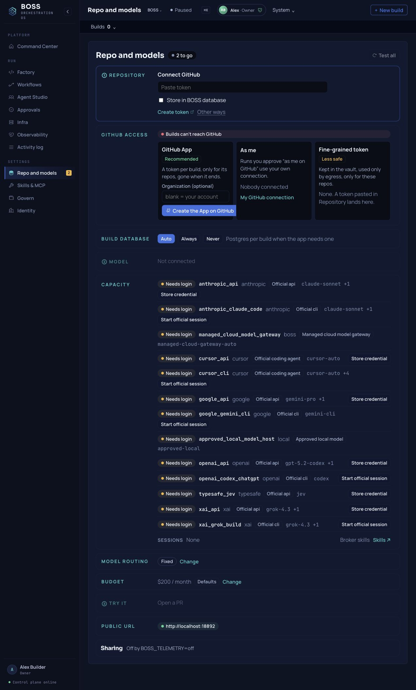

# Your first useful software change

The [path](QUICKSTART.md) installs v1.0-rc10.13, claims the Owner, and connects one repository and one model. This page continues from there: one change you would otherwise make yourself, small enough to review, from the plan to the exact revision.

This is an operator guide for the release candidate. It describes the controls and the evidence to collect. It is not a transcript of a completed live-provider result. The [v1.0-rc10.13 notes](RELEASE_NOTES_v1.0-rc10.13.md) and the [validation records](RC9_VALIDATION.md) say what has been checked, and what has not.

## 1. Check your installation and access

Install from the [pinned release checkout](QUICKSTART.md#install), then run these on the installation host:

```sh
boss status
boss doctor
boss open
```

Check that the required services are healthy. `boss doctor` checks configuration without a model completion by default; a healthy API does not prove a model or repository can do the task.

Claim the first **Owner** through the link from this host command, then sign in as yourself:

```sh
boss identity setup-link
```

Save your recovery codes. Keep the link, `.env`, keys and backups private. [Console access](CONSOLE_AUTH.md) explains SSH forwarding, named accounts and sign-in. [The installer guide](https://github.com/seanventures/boss/blob/v1.0-rc8/scripts/install/README.md) covers protected backup and recovery.

## 2. Connect one repository and one model

In **Repo and models**, select a GitHub repository you own or are authorized to change. Use the connection flow and review the permissions GitHub actually granted. Choose a non-production repository for your first attempt. Never paste a token into a task description.

{ .boss-walk-shot }

This unedited screen shows a new Owner's setup page on the disposable RC8-image baseline. The listed model routes need login; their presence is not a working provider connection. [Capture details](assets/screenshots/provenance.json)

Connect one model using [Model connections](MODEL_CONNECTIONS.md). Read the distinction between saving credentials, a connection proof and actual governed task work. Some Connect actions make a real, budgeted provider test call; configuration alone is not live execution proof. Hosted models receive the authentication and selected task data needed for the calls you authorize.

Keep personal coding subscriptions within their authorized owner/single-tenant use. A local model can keep inference on your machine, but it still needs sufficient capacity and the selected workflow's capabilities. Standard Product Delivery's web research requires a usable Claude Code subscription; without it, that research is recorded as skipped and the panel works from your request.

**Before continuing:** the selected project must have the intended repository, model route and your authority to act. Read any permission or budget hold rather than switching credentials or broadening access to get around it.

## 3. Write a bounded work agreement

Choose a documentation correction or a small bug in an existing codebase. Name the current problem, the file or behavior in scope, the checks, the allowed external effect and what should wait for you.

Use this structure in your own words:

```text
Goal: Correct [one specific error] in [repository and file/behavior].
Acceptance: [the observable result and exact checks I will run].
Scope: [allowed files or behavior]; [work that needs a new decision].
Delivery: A reviewable repository change with the checked revision and evidence.
Authority: Work only in the connected repository and assigned branch.
Spend: Use the configured route and approved budget; hold if unavailable.
Stop point: I will review the result before any merge or deployment.
```

For example, correct one installation command that you have already reproduced as wrong. Give BOSS the failing command and the successful replacement, and ask it to check the relevant documentation links and shell syntax. That is a task shape, not a claim that BOSS has performed it on your repository.

Set a budget allowance you can afford, and keep provider-side limits appropriate to the account. The quote and reservation control admission; they do not guarantee the final provider invoice. Plan for observed or unknown exposure before retrying.

## 4. Start the existing path and read its decisions

Open **Command Center** and choose **Build** for the task. The default path is **Standard Product Delivery**. Do not assume a faster workflow is suitable: for example, a workflow for an existing BOSS app may require an app you have already shipped.

RC9 source changes the Command Center entry to **Review build**. Read the server-issued work agreement, including the exact brief, selected workflow, current repository suggestion, planned paths and explicit unknowns. **Cancel** retains your draft; **Confirm and start workflow** is the separate start action. A failed or expired preview needs a fresh review. The [work agreement guide](WORK_AGREEMENT.md) explains the binding and financial labels. The published RC8 entry predates this sheet.

Follow the actual run in **Workflows**. The standard sequence includes research, a panel/PRD, specification review, build, preview/readiness, reporting and a deployment gate. Its default does not include a separate Architecture step. The [Getting started workflow section](GETTING_STARTED.md#6-follow-the-governed-path) gives the current sequence and prerequisites.

On an enforced install, PRD automatic approval is off by default. Read the drafted PRD in **Approvals** and check that it preserves your scope and acceptance criteria. If the Owner explicitly enables automatic approval, the record says **AUTO-APPROVED**; a recorded automatic decision is not evidence that you reviewed it.

If the plan changes the task materially, ask for a bounded correction before approving. A model recommendation, panel agreement or green job state does not establish usefulness.

## 5. Review the deliverable and exact revision

Open the work in **Factory** and follow its real pull request or artifact link. Compare the output with your original checks, not just the generated PRD.

Before accepting, inspect:

- **The actual change:** read the diff, document or running behavior. Does it solve the original need without unrelated changes?
- **The checked revision:** confirm that the test evidence applies to the exact delivered commit or artifact. Later edits need the affected checks again.
- **The declared checks:** run them yourself where appropriate. Missing tests or unavailable browser evidence remain gaps.
- **The work and decisions:** match the result to this project, task/run, required approval and attributed actor.
- **The cost and effects:** inspect applicable reservations, observed usage and receipts. A created pull request is an effect; it is not a merge or deployment.

For a GitHub result, check out its exact commit in a fresh local directory. Replace all three values with the ones you verified on your pull request:

```sh
REPOSITORY_URL="https://github.com/YOUR-OWNER/YOUR-REPO.git"
DELIVERED_COMMIT="COPY-THE-FULL-COMMIT-SHA-FROM-YOUR-PR"
git clone "$REPOSITORY_URL" first-result-review
cd first-result-review
git fetch origin "$DELIVERED_COMMIT"
git checkout --detach "$DELIVERED_COMMIT"
# Run the acceptance commands you declared for this repository.
```

RC9 source adds **Review the result** in the Factory cockpit. Where that card is available, inspect its recorded delivery, evidence and costs, then choose **Accept as useful** to record your assessment of that revision. Acceptance records usefulness; it does not pass a technical check, waive a failed gate, approve a merge or deployment, release a reservation or start more work. [Review a result](RESULT_REVIEW.md) explains the permissions, evidence labels and saved review history.

If the result needs revision, state only the gap and keep the original scope/checks. **Request a change** saves the review first, then opens the existing **Change it** sheet with the recorded revision and your note. Edit the bounded follow-up, choose **Propose**, inspect its proposal and choose **Start** only when you intend to run it. Saving a review does not automatically propose, dispatch or spend on another build. The branch may have moved since the reviewed commit.

The RC8 screenshots and published RC8 release predate these controls. On an earlier install, record whether the result solves the need, what you checked and the revision with your repository review or work record. Keep any follow-up bounded and separately authorized. A merge or deployment always remains its own decision.

## If work stops or the outcome is uncertain

| What you see | Safe next action |
| --- | --- |
| Setup, permission or budget hold | Open the stated record. Correct the specific missing prerequisite, then recheck it. |
| A failed step with a known cause | Read its failure and artifacts. Fix that cause and use the offered retry only when prior external outcomes are known. |
| An unanswered provider call or held receipt | Preserve its IDs and observed usage. Reconcile what the provider accepted before another attempt. Ask for help if the record has no safe resolution. |
| Stop requested | Check the run and linked jobs for the actual stopping state. A request already submitted may complete and charge; a Stop button is not proof of zero remaining work. |
| Cleanup pending | Keep the pending state visible and inspect the cleanup evidence. Do not treat it as released capacity or successful cleanup until confirmed. |
| A restored backup predates external work | Keep the [restored startup hold](RESTORED_STATE_HOLD.md) while checking the [provider recovery evidence](PROVIDER_RECOVERY.md). Restored local records cannot prove that later provider effects did not happen. |

The [Architecture spending guide](ARCHITECTURE_GOVERNANCE.md), [sandbox guide](SANDBOX.md) and [RC8 validation](RC8_VALIDATION.md) describe current limits. Do not use a blind full rerun to resolve an uncertain attempt.

## Return for a second useful task

Keep the original task, accepted revision, checks, cost evidence and any unresolved decision. When you return, open the actual run or deliverable from **Workflows**, **Factory** or the Home next action; verify its current state before continuing.

Choose another small task only after the first result is accepted or its failure is understood. Reuse your checks where they still apply, and change them when the new task needs different evidence. A template or installed agent definition does not start work.

For your own evaluation, record the elapsed time, active supervision, provider wait, rework and developer assistance. Compare the accepted result with how you would do the task today. Repeat usefulness and lower supervision are evaluation questions, not measured benefits of this release.

Use local **Help** for page guidance, and [report a problem](FEEDBACK_LOOP.md) with the release, failing step and redacted IDs. Do not publish credentials or private task content.
