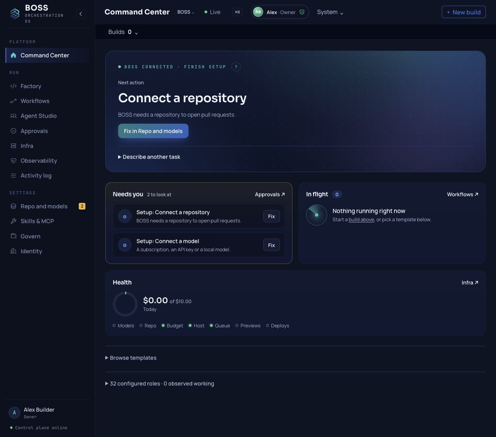

BOSS Community · Self-hosted · Apache 2.0

# Delegate one useful software change

Know what ran, what it cost, what needs your decision, and how to continue safely.

BOSS keeps the plan, work history, decisions and evidence around an AI-assisted repository change. Start with one Owner, one repository, one model and a change you can check yourself.

[Start a useful change](FIRST_USEFUL_CHANGE.md){ .md-button .md-button--primary }
[Install the release](QUICKSTART.md){ .md-button }

## A place to return to the work

Use **Command Center** for the current next action, **Approvals** for decisions, **Workflows** for a run's steps and **Factory** for code work and its deliverable. **Activity log** links recorded events, jobs, receipts and failures. A completed job is a record to inspect; accepting its result is your decision.

Actual console capture after named Owner sign-in on a fresh disposable install using the qualified RC8 API and web images. This shows setup actions and no in-flight work, not a completed provider-backed software change. [Screenshot provenance](assets/screenshots/provenance.json)

## What you need before delegating

You should be comfortable administering a single-tenant Linux/Docker installation, reviewing a GitHub diff and running your repository's checks. Allow time for installation, named Owner enrollment, repository permissions and model setup. A CPU-only local model can be slow; the [Getting started transcript](GETTING_STARTED.md) gives historical timings, not a current performance guarantee.

Choose a small correction or bug fix with a clear result. The [first useful change guide](FIRST_USEFUL_CHANGE.md) helps you define the task, follow the existing workflow, review the exact output and handle a hold or uncertain attempt.

## The operating contract

| You need to know | Where to look | What the record means |
| --- | --- | --- |
| What will run | The selected workflow and drafted PRD | Read the scope and checks before required approval. The default Standard path has no separate Architecture step. |
| What needs you | Command Center and Approvals | Open the actual decision and its evidence; a recommendation is not permission. |
| What it cost | The run report, budget and receipt evidence | Estimated, reserved, observed and reconciled amounts are different. A reservation is not a hard ceiling on a provider invoice. |
| What happened | Workflows, Factory and Activity log | Inspect the deliverable, checked revision and receipt together. A dedupe key alone cannot resolve an ambiguous external outcome. |
| How to continue | The failed or held step and its linked records | Fix the stated cause. Reconcile an uncertain accepted effect before retrying. Stop may leave usage or budget held. |

See [Architecture approval and spending](ARCHITECTURE_GOVERNANCE.md), [build isolation](SANDBOX.md) and [release validation](RC8_VALIDATION.md) for the controls and their current limits.

## Choose your entrance

| I want to | Read |
| --- | --- |
| Delegate and review one bounded repository change | [First useful change](FIRST_USEFUL_CHANGE.md) |
| Install, claim the Owner account and check the services | [Quickstart](QUICKSTART.md) |
| Follow the longer recorded installation and build transcript | [Getting started](GETTING_STARTED.md) |
| See the console and terminal controls | [Walkthroughs](walkthroughs.md) |
| Connect a model or coding subscription | [Model connections](MODEL_CONNECTIONS.md) |
| Serve my install over HTTPS | [Deploy](hostname.md) |
| Invite people or control agent authority | [People and access](PEOPLE_AND_ACCESS.md) · [Agents and access](AGENTS_AND_ACCESS.md) |
| Work from the keyboard or my existing coding agent | [Terminal and API](TERMINAL_API.md) · [MCP](MCP.md) |
| Inspect the full capability list | [Features](FEATURES.md) · [Use cases](use-cases.md) |
| Upgrade, back up or recover an install | [Installer guide](https://github.com/seanventures/boss/blob/v1.0-rc8/scripts/install/README.md) |

## Release status and help

The [RC8 source release](https://github.com/seanventures/boss/releases/tag/v1.0-rc8) is available. The [validation record](RC8_VALIDATION.md) separates source tests, disposable installed-runtime checks, live provider work, supported clean-host qualification and hosted deployment. A useful live-provider result, independent first use and safe reconciliation remain release qualification work. This guide does not claim those outcomes have been observed.

Use local **Help** without losing the page you are on. [Report a problem](FEEDBACK_LOOP.md) with your version, the failing step and redacted record IDs. Keep credentials and private task data out of public issues. Report suspected vulnerabilities privately through the [security policy](https://github.com/seanventures/boss/blob/main/SECURITY.md).

BOSS Community is licensed under the Apache License 2.0. [View the source](https://github.com/seanventures/boss) or read the [contributing guide](https://github.com/seanventures/boss/blob/main/CONTRIBUTING.md).
