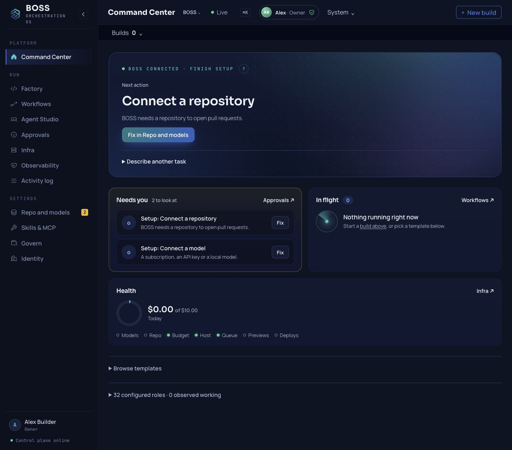
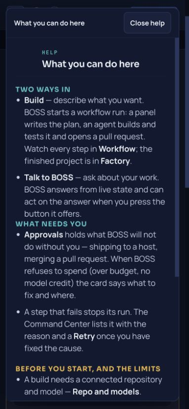

# Walkthroughs

Start with [one useful software change](FIRST_USEFUL_CHANGE.md), then use these walks to find the installation, console and terminal controls. Each walk uses real commands and names the console areas you will see.

For the task-oriented view of the same features, see [use cases](use-cases.md). Install details not repeated here are in the [quickstart](QUICKSTART.md) and the [installer guide](https://github.com/seanventures/boss/blob/main/scripts/install/README.md).

## Install from a checkout

From a checkout on the machine you are installing onto, run:

```sh
./install.sh --dir "$PWD"
```

The installer runs entirely on that machine. It binds the API and the console to `127.0.0.1` and writes credentials to `.env` locally. Keep `.env` private and out of version control.

During install you can enter a model key you already have, or press Enter to connect one later. The installer expects a supported Ubuntu or Debian host with `sudo`, as described in the installer guide.

!!! warning
    Never put a key on the command line. Use the installer's hidden prompt or the process environment instead.

For a release candidate, start from the [pinned release checkout](QUICKSTART.md#install). The website installer and hosted manual are deployed separately; a source release alone does not verify their version.

### Sign in

When the installer finishes, open [http://127.0.0.1:3000](http://127.0.0.1:3000) on the same machine. You should see the console sign-in page.

If BOSS runs on a VM you administer and you are at another computer, open an SSH tunnel to your VM:

```sh
ssh -L 3000:127.0.0.1:3000 -L 8000:127.0.0.1:8000 user@your-vm
```

Leave the tunnel open, then open [http://127.0.0.1:3000](http://127.0.0.1:3000) on the computer that started it. The ports on the VM stay bound to loopback.

The first time, the console asks you to **claim** BOSS: you become its first Owner. The console password created on the install machine proves it is you. From the install directory, show it in a terminal (so it is not piped into a log):

```sh
boss password
```

Then enter it on the claim screen with your name and email, and add a passkey. From then on you sign in as yourself, and invite your team in **Identity › People**. Never paste the password or a key into a ticket.

Single sign-on against an identity provider you run can be set up later: see [Sign-in setup](SIGN_IN_SETUP.md).

## Submit a first goal in Command Center

1. Sign in at [http://127.0.0.1:3000](http://127.0.0.1:3000) and open **Command Center**.

    The top of the page is **Ask BOSS**, titled "What do you want to do?" with the line "Gated actions require your approval." The input reads "Describe what to build or ask a question…"

2. Type one concrete goal and choose a path.

    **Talk to BOSS** answers and starts nothing unless you say so. **Build** follows the governed path: a panel drafts a PRD, and code is written only after the PRD is approved. On an enforced install, PRD automatic approval is off by default and an authorized person reviews it. An Owner can explicitly enable automatic approval; that decision is then recorded as **AUTO-APPROVED**. The build itself needs a connected GitHub repository; [Getting started](GETTING_STARTED.md) covers the whole path. The research step that opens the default path runs governed web research when a Claude Code subscription is connected. Without one, it shows as skipped with the reason, and the run goes on to the panel. If no model is connected, model work shows as unavailable while the control plane stays up.

3. Follow the actual run.

    Open its steps in **Workflows** and its code work in **Factory**. Work can proceed within the selected policy and approved authority. A preview or sandbox record alone does not mean a live app has opened. Review the delivered revision and its checks before accepting the result.

4. Open **Approvals**.

    The decision queue is headed "Agents proposed — you decide." **Needs action** lists pending and delegated cards. Each card is a question, not a completed effect; approve or reject it yourself. When nothing is waiting, the queue shows "Queue is clear" and "Nothing needs your signature." Further down, the approval rules are headed "What requires your approval — and why."

5. Open **Activity log**.

    Under the heading, the page reads "Central log of events, steps, jobs, receipts, and deadletters." It shows only rows BOSS recorded for this project. An empty log means no records exist yet. If the log cannot load, it says so explicitly and shows no placeholder rows. A row here records that something happened; it does not prove later work finished.

### The installed console

{ .boss-walk-shot }

This unedited capture shows a new named Owner's Home on a fresh disposable install using the qualified RC8 API and web images. It does not show a completed live-provider task. **Fix in Repo and models** opens the missing repository setup; the model setup hold is also visible.

{ .boss-walk-shot }

Local **Help** explains the current page. This capture demonstrates the drawer, not the completed workflow described in its text. [Capture provenance](assets/screenshots/provenance.json)

### Other areas you will see

- **Workflows → Runs** lists the work in flight and what each run did. After a first goal it may still be empty.
- **Workflows → Library** holds every workflow you can start, yours and the standards BOSS ships. Open one to edit it; a standard saves as your own copy.
- **Agent Studio → Roster** lists every agent and what it holds. An agent's page shows its **Profile**, which you can test.
- **Agent Studio → Team** shows the planned role layout and observed handoffs. Changing the plan does not route tasks.
- **Agent Studio → + New agent** makes an agent, blank or from a starter template. Installing a template, or the five example workflows under `examples/`, only writes definitions you can change or delete. It does not start work.

## Ask the terminal

The Metatron terminal gives you command-line access to the same API. There are two ways to open it, and neither prints the API key.

From the install directory:

```sh
make metatron
```

This opens the terminal inside the API container using the host tools' key and the install's project.

From a checkout where `BOSS_API_URL`, `BOSS_PROJECT_ID` and your own key in `BOSS_API_KEY` are set in the environment:

```sh
python3 scripts/metatron_tui.py
```

At the `metatron>` prompt, work through these commands in order:

1. **`/projects`** lists the projects the API returns on this machine. A standard install seeds a local project named `boss-dogfood`. Select a project with `/project` followed by its id.
2. **`/ops`** lists the product domains on the running API. `/ops budget` searches budget reads and writes, `/ops receipts` searches receipt reads, and `/ops * --page 1` browses one page of the full list.
3. **`/describe`** followed by an operation id from that list shows the operation's parameters and body. Copy the id exactly as the terminal printed it.
4. **`/op`** followed by the same id sends one request. Add JSON only when `/describe` shows that the call needs `path`, `query`, or `body`.

!!! note "What a successful `/op` means"
    A successful `/op` means the API accepted that one call. It does not confirm that a later job, model turn, deploy, or external send finished, and the API can still deny or hold a call for permission, budget, or approval. After a write, check **Approvals**, **Activity log**, and a budget or receipt read before treating the work as done.

For the full command reference, see [terminal and API access](TERMINAL_API.md). For how the terminal relates to the HTTP API and MCP, see [control surfaces](CONTROL_SURFACES.md).

## Report a vulnerability

Report suspected vulnerabilities privately to [boss@sean.net](mailto:boss@sean.net). Do not open a public issue, and do not include credentials in the report. See [SECURITY.md](https://github.com/seanventures/boss/blob/main/SECURITY.md).
