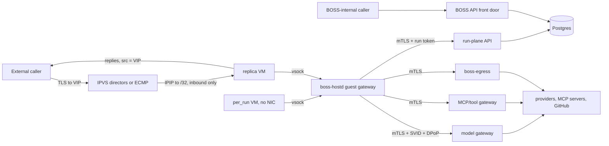

# P8: Agent hosts and the microVM runtime: low-level design (for the build agents)

**Human-readable version:** [`AGENT_HOSTS.md`](AGENT_HOSTS.md) in the same folder. Read that first. This file is the engineering detail.
Supersedes the 2026-11-14 layered draft (§0–15 + Appendix A).

**Operator decision, 2026-11-14 (binding for the build):**
- **`replica` mode is the activated mode.**
- **`per_run` mode is built completely** (warm pool, no-NIC boot, setup cache, every P8 test), but it stays **off by default** behind the existing `microvm_claims_frozen` switch, as today.
- Enabling `per_run` is an operator setting. Coding tasks stay on `runtime: local` by default.
- The priority is autonomous replica agents.

| | |
|---|---|
| **Status** | Design for operator review. Nothing here is built yet. |
| **Date** | 2026-11-14 |
| **Base** | `seanventures/boss` main at `275a3f556` (Merge PR #100, `feat/ap-p7-subagents`). On 2026-11-14 the remote `main` still points at this commit, and every `path:line` citation below was re-read there. |
| **Builds on** | [`AGENT_PLATFORM.md`](AGENT_PLATFORM.md) (P0–P7, merged as PRs #93–#101). The Paperclip microVM work (BOSSAPP-823/824, PR #57). |
| **Related tickets** | BOSSAPP-1061 (the microVM credential defects in §1.2, fixed by phase P8-pre). The P8 phase tickets are created once the operator approves this design. |

---

## How to read this document

**Shape.** The document has five parts, in the order an engineer needs them:

1. **Requirements** (§1): what exists, what is wrong with it, and what P8 must achieve.
2. **High-level design** (§2): the architecture, every major choice with a "Why this choice" block, and the reliability and performance chapters.
3. **Low-level design** (§3): one self-contained subsection per component.
4. **Phased implementation** (§4): P8-pre and P8a–P8e, each with scope, fixes, tests and exit criteria.
5. **Open decisions** (§5): one table, D1–D22.

Appendices hold the operator Q&A log, the provider research detail, a glossary and the references.

**Readers short on time** should read the executive summary below, §2.1 (the picture), §2.14 (reliability), §2.15 (performance), §2.17 (trade-offs) and §5 (decisions).

**Citations.** BOSS code is cited as a repo-relative `path:line`. After its first full mention, a Go file in `services/sandbox-service/` is cited by its file name:

| Short name | Full path |
|---|---|
| `firecracker.go` | `services/sandbox-service/internal/backend/firecracker.go` |
| `backend.go` | `services/sandbox-service/internal/backend/backend.go` |
| `job.go` | `services/sandbox-service/internal/job/job.go` |
| `run.go` | `services/sandbox-service/internal/run/run.go` |
| `server.go` | `services/sandbox-service/internal/httpapi/server.go` |
| `contract.go` | `services/sandbox-service/internal/contract/contract.go` |
| `main.go` | `services/sandbox-service/cmd/sandbox-service/main.go` |

Python files under `engine/boss_engine/` are often cited from `services/`, `identity/` or `kernel/` downward. External facts carry inline links. Appendix D lists every source.

**Decision numbers.** D1–D22 are this document's decisions (§5). AGENT_PLATFORM.md has its own D1–D14; when this document means one of those, it writes **AP-D4**, **AP-D7** or **AP-D11**. The most important is **AP-D11**: "write-capable agents may not be exposed over A2A until strong isolation exists", enforced today by `strong_isolation()` returning `False` (`engine/boss_engine/services/a2a_server.py:64-67`). P8 is the strong isolation AP-D11 waits for.

**Other numbers.** FR-n and NFR-n are requirements (§1.5, §1.6). OR-n are the operator's own requirements (§1.4). S1–S22 are concrete code fixes, each folded into the phase that lands it (§4). Tests are named by phase, for example P8b-T10.

**How numbers are labelled.** Every performance or reliability number carries one of three labels:
- **[measured]**: observed on a BOSS install.
- **[vendor]**: published by the project or vendor, with a link.
- **[estimate → P8x-Tn]**: an engineering estimate, with the phase test that will confirm or correct it.

---

## Executive summary

**The problem.** Today a deployed BOSS agent runs inside a BOSS worker container that also holds the database connection and every credential. The Firecracker lane that should give real isolation exists but is frozen behind `BOSS_MICROVM_CLAIMS_FROZEN`. It runs one coding task at a time per host, through an in-memory job store and one shared static token. It also has a worse problem: it sends the git token and model keys **into** the guest. That makes the lane with the strongest boundary the one that leaks the most secrets.

**What P8 builds.**

- **One Go service per Linux KVM host, `boss-hostd`**, refactored from the existing `sandbox-service`. It runs hundreds of Firecracker microVMs from signed images and warm snapshot pools.
- **Per-deployment placement.** Each deployment chooses `runtime: local` (today's worker path, kept for laptops and tests) or `runtime: microvm` (the KVM host pool).
- **Two VM modes:**
  - **`replica`**: long-lived, serves callers, and runs several runs at once. It has an **inbound-only** tap with a routable /32 address. That address is registered as a real server behind the agent's own virtual IP (VIP). The tap carries caller connections in and replies out, and nothing else.
  - **`per_run`**: one task, then destroyed. It has **no network device at all**, only `lo` and vsock.
- **All guest-originated traffic goes over vsock to a guest gateway inside `boss-hostd`.** That covers model calls, MCP and tool calls, git and HTTP, and the run plane. The gateway:
  - checks the opaque per-run handle (`boss_mdl_`, `boss_mcpgw_`, `boss_egr_`) against the VM that owns the socket;
  - attaches host-held, DPoP-bound tokens;
  - forwards to the central model gateway, MCP/tool gateway or boss-egress;
  - writes one audit row per call.
- **Real keys live only in the central gateways.** Hosts hold identity, not keys. The guest holds only handles that are worthless anywhere else.
- **External callers reach an agent at the network layer.** Each agent has its own VIP:
  - Phase P8b: Linux IPVS, per-connection round robin in IPIP mode, on a keepalived VRRP director pair programmed by `boss-lbd`.
  - Phase P8e: BGP anycast with ECMP, announced by each host through GoBGP, with no director.
  - TLS passes through and terminates inside the VM with the agent's own certificate.
- **Postgres stays the only source of truth.** Hosts keep a rebuildable bbolt cache. VMs never touch the database. They admit runs, write checkpoints and call governance through the **run-plane API**, where every write is fenced by the job's lease epoch.
- **Self-healing in two layers:**
  - a deterministic Go watchdog that withdraws a dead VM from its VIP in under a second;
  - the model-driven Fleet doctor bot for diagnosis and repairs that need judgement.
- **Production HA:** `replicas ≥ 2` on at least two active hosts.

**What the operator gets.**

- AP-D11 unlocks. `strong_isolation(deployment)` becomes a checked fact rather than a hard-coded `False`. It is true only for a `microvm` deployment whose hosts attest a live Firecracker, the jailer, `strict_secrets` and the inbound-only/no-NIC network policy.
- Write-capable agents can then be offered over A2A to outside callers.
- The microVM lane goes from the least safe lane to the only lane that can truthfully say "no real credential is inside the sandbox".

**How it compares to the industry.** Every major provider studied converges on one rule: a credential the sandbox can read is a credential the agent can leak. Anthropic's own Agent SDK guide names BOSS's exact topology (a Firecracker VM with no NIC, vsock to a host proxy that injects credentials) as its high-assurance option (§2.9).

**Reliability and performance in one paragraph.**
- A dead VM is withdrawn from its VIP in under 1 s, and a dead host in about 2 s with IPVS or 50–300 ms with BGP.
- An in-flight run resumes elsewhere from its last checkpoint in about 35 s or less, with no double effects.
- Postgres is the remaining single point of failure until P8d adds a synchronous standby.
- One production host (64 vCPU, 256 GiB) plans for about 350 `agent` replicas or 55 `coder` VMs.
- The gateway hop adds well under a millisecond on the host and one LAN round trip. Model calls take hundreds of milliseconds to seconds, so the hop is noise.

§2.14 and §2.15 give the numbers, their sources and the tests that will confirm them.

**What is still open.** Subscription logins (Claude and Codex subscriptions, as opposed to API keys) are the one credential this design cannot yet keep out of the guest. Until a one-day spike proves host-side injection, `strict_secrets` hosts refuse them, and those runs stay on the local lane with a visible reason (§3.22, D16).

**The work.**

| Phase | What lands | Size |
|---|---|---|
| **P8-pre** | Five small fixes to today's code (BOSSAPP-1061). Not gated on approval, because the lane is frozen but its defects affect anyone who unfreezes it. | S |
| **P8a** | Fleet shape, local parity, run-plane API, guest gateway skeleton, inbound-only taps | M |
| **P8b** | Snapshots, contract v1.1, central gateways, jailer, in-VM TLS, IPVS VIP routing, AP-D11 predicate | L |
| **P8c** | HA: anti-affinity, active-active directors, two API instances, Fleet doctor | M |
| **P8d** | Production hardening and Postgres HA | M |
| **P8e** | BGP anycast with ECMP | M |

---

## 1. Requirements

### 1.1 Context: what exists today

**The agent platform (P0–P7).** AGENT_PLATFORM.md converged BOSS agents onto one governed runtime:
- versioned agent specs and the P1 kernel;
- durable threads with checkpoints and typed interrupts (P2);
- deployments, bots and per-agent endpoints (P3);
- traces (P4);
- MCP and A2A v1.0 serving (P5).

A deployed agent today executes on a BOSS worker. `thread_runs.admit` writes the run and its job in one transaction (`engine/boss_engine/services/thread_runs.py:10-13,110`). A worker leases the job, and the kernel checkpoints to Postgres under that lease (`engine/boss_engine/kernel/durable.py:25-27,64-110`; `engine/boss_engine/services/agent_run_worker.py:46-54`).

**Three ways into a deployed agent already exist** (details in Appendix A, A1):

| Way | Standard | Entry |
|---|---|---|
| REST + streaming | Agent Protocol (threads, runs, SSE) | `POST /v1/agents/{agent}/threads` with a service key holding `agent:invoke` |
| MCP | MCP 2024-11-05, 2025-11-25 and stateless 2026-07-28 | Each deployed agent appears as the tool `agent_<name>` |
| A2A | A2A v1.0 | Signed agent card at `/a2a/{agent}/.well-known/agent-card.json` |

A2A is off by default per deployment. It is **refused for any agent holding a write-capable tool** until strong isolation exists (AP-D11; `a2a_server.py:16-20,145-162`).

**The Paperclip microVM lane.** BOSSAPP-823/824 (PR #57) delivered:
- a Go `sandbox-service` with `process` and `firecracker` backends;
- the v1.0 Python↔Go contract ([`docs/infra/PYTHON_GO_SANDBOX_CONTRACT.md`](../infra/PYTHON_GO_SANDBOX_CONTRACT.md));
- setup and end-to-end scripts (`scripts/sandbox/microvm-setup.sh`, `scripts/sandbox/microvm-e2e.sh`);
- [`docs/infra/MICROVM_ENABLE.md`](../infra/MICROVM_ENABLE.md).

It ran on boss-1 on 2026-11-13 (`backend=firecracker ready=true firecracker_live=true`) **[measured]**. `/dev/kvm` is present there, and the `dev` user is in the `kvm` group.

**Why the lane is "frozen".** `BOSS_MICROVM_CLAIMS_FROZEN=true` is the default on every install (`engine/boss_engine/config.py:1731-1736`; on the host `main.go:89-90`). No install claims microVM isolation until an operator enables it. Frozen is a safety default, not missing work. What is not yet in place:
- The sandbox-service is not a persistent service on boss-1, and BOSS there is not pointed at it.
- The Alpine rootfs that `microvm-setup.sh` bakes has no Claude Code CLI, so only the `echo` and `openai` guest engines work (`docs/infra/MICROVM_ENABLE.md:32-34`).
- The operator's laptop (macOS) has no KVM, so it cannot run Firecracker.

### 1.2 Findings that shape the design

Three findings each change code that exists today.

#### Finding 1: credentials enter the VM today

The v1.0 contract sends `git_token` and the model credentials (`engine_env`) into the guest:
- `contract.go:42,47,184-193`;
- `engine/boss_engine/services/sandbox_contract.py:74-85,93,104,109`;
- `docs/infra/PYTHON_GO_SANDBOX_CONTRACT.md:40-41`.

**The local lane already does better.** Each local run gets a per-run uid, an iptables owner-match fence and a deny-by-default environment (`services/sandbox_identity.py:1-27,168-201`; `scripts/sandbox/entrypoint.sh:1-26,93-117`). Git uses a `boss_egr_` handle through a shim socket (`identity/runs.py:603-634,661-716`). Model API keys go through a loopback proxy that hands the CLI only a `boss_mdl_` handle (`services/model_proxy.py:1-25`). The legacy Python `sandbox-host` is the worst of the three: it runs `docker run` on the default bridge with unrestricted egress (`sandbox-host/sandbox_agent.py:216-232`).

**Secret flow today, per lane:**

| Secret | Stored | Local lane | microVM lane | Gap |
|---|---|---|---|---|
| GitHub App installation token | Minted per run in egress memory (`apps/egress/boss_egress/proxy.py:13-14`; `services/secret_backends.py:896-903`) | **Safe:** the agent holds `boss_egr_` only | Not delivered (defect 2) | Only GitHub has an egress route (`proxy.py:1-17`) |
| Shared GitHub / Bitbucket `token` | Settings or secret ref | Not used when identity is on | **Exposed:** `git_token` → `spec["token"]` → clone URL (`sandbox_contract.py:104`; `contract.go:242-243`; `sandbox-host/guest/in_guest_agent.py:59,62`) | Defects 3–5 |
| `boss_egr_` handle | Hashed, ≤ 1 h, bound to the run (`identity/runs.py:429-437`) | **Handle**, via the SO_PEERCRED shim | **Dropped** by the contract (defect 2) | — |
| Anthropic API key | Store via `stored_credential` or env (`services/claude_credential.py:47-60`) | **Safe:** `boss_mdl_` proxy (`services/code_agent.py:1066-1076`) | **Dropped** by Go (defect 1) | The read bypasses audit (below) |
| Claude subscription `CLAUDE_CODE_OAUTH_TOKEN` (1 year) | Secret store | **Exposed** in the child env; "not proxied" (`model_proxy.py:48-53`) | **Exposed:** guest `os.environ` (`in_guest_agent.py:200`) | The highest-value exposure in any lane |
| Claude CLI login (about 8 h access token) | `$CLAUDE_CONFIG_DIR/.credentials.json`, refreshed only by BOSS (`services/claude_login.py:1-35`) | **Exposed:** access token copied, refresh token withheld (`sandbox_identity.py:535-547`) | n/a | — |
| Codex ChatGPT login | Operator's `CODEX_HOME` | **Exposed:** a copy with a dummy refresh token (`sandbox_identity.py:442-449`) | n/a | — |
| OpenAI / Azure keys | Settings or project ref | **Safe** where an adapter exists (`model_proxy.py:97-160`) | **Exposed:** sent even when the engine is `claude_code` (`services/code_task_service.py:3379-3385`) | — |
| LLM gateway key | Store (`services/llm_gateway.py:24-26`) | **Safe** (`llm_gateway.py:360-405`) | Not routed | — |
| MCP upstream auth | Identity vault per `connection_credentials` (`services/connection_credentials.py:1-30`) | **Exposed** in a 0600 `mcp.json` by default (`services/code_task_mcp.py:1-19,149-167`). **Handle** with the gateway on (`services/mcp_gateway.py:1-37`) | No MCP field at all | The gateway is "off unless set" (`mcp_gateway.py:104-106`) |
| OBO run token (DPoP-bound) | Shim; the DPoP key is "never written" (`identity/runs.py:1-12`) | **Safe** | Stated intent: the shim is "a separate uid inside the VM" (`runs.py:7-9`) | That would put the DPoP key in the guest |

**Six concrete microVM defects** sit under Finding 1. They were re-read at `275a3f556` and are filed as BOSSAPP-1061. Three of them are bugs even if the secrets were meant to be in the guest.

| # | Defect | Evidence | Effect |
|---|---|---|---|
| 1 | **Anthropic API key silently dropped.** Python maps `ANTHROPIC_API_KEY` into `engine_env`, but Go's `engineEnvToSpec` has no entry for it, and the guest never reads `anthropic_api_key`. | `sandbox_contract.py:77`; `contract.go:184-193`; `in_guest_agent.py:199-200` | A `claude_code` microVM run on the API-key credential has no credential. |
| 2 | **Identity lane broken.** With an identity run, `token` is emptied and `guest_spec["egress"]` is built, but `build_submit_request` enumerates its body fields and never copies `egress`. The guest has no shim (a README TODO only). | `code_task_service.py:3351-3368,3396-3402`; `sandbox_contract.py:95-123`; `sandbox-host/README.md:43-45` | The guest clones anonymously, private repos fail, and it cannot push through egress. |
| 3 | **Token persisted in the guest's `.git/config`.** The clone URL embeds `x-access-token:{token}@github.com` (or `x-token-auth` for Bitbucket), and the remote is never reset. | `in_guest_agent.py:52-64` | The agent's `Bash` tool can read it with `git remote -v`. This is the shape of the March 2026 Codex incident (§2.9). |
| 4 | **World-readable spec on the host.** The Firecracker backend rewrites `spec.json` (token plus keys) to `workstage/spec.json` at **0644** and bakes it into `work.ext4`. `vm.json` is also 0644. | `firecracker.go:151-167` (write at `:160`); `:203` | Any host user can read every task's credentials. |
| 5 | **Retained workspaces keep and serve secrets.** Failed and timed-out tasks are kept for 2 h. The repo, with its `.git/config`, is dumped to `<TaskDir>/work/repo` and served by the `fs` endpoint. | `job.go:16-18,300-312`; `firecracker.go:234-237`; `server.go:223-247` | The token is readable over the host API for 2 h after any failure. |
| 6 | **The guest network is unfenced.** There is one optional shared tap (`BOSS_SANDBOX_FC_TAP`) and no nftables or allowlist code in the Go service. The jailer is not used (`--no-api`, `firecracker.go:212`). The Python outbound guard explicitly exempts the relay so that "any host credential may go to" it. | `firecracker.go:39-41,173-179,212`; `services/env_refs.py:223-227` | A guest-held token can be sent anywhere the host routes. |

**The audit bypass.** `resolve_secret_ref` is documented as "THE place a stored reference becomes a value". It checks scope and provider binding, writes `secret_access_events`, and registers the value with run redaction (`services/secret_backends.py:1143-1217`). The CLI credential path does not use it:
- `cli_harness.stored_credential` reads the process env first, then calls `store.get(key)` on the backend directly (`services/cli_harness.py:690-708,712-759`);
- `claude_credential._store_lookup` calls it (`claude_credential.py:176-179`).

So **"which run read the Anthropic key or the subscription token" cannot be answered from `secret_access_events` today**, and no scope check applies to model-credential reads.

**What P8 must therefore replace.** Contract v1.1 carries only per-run handles: `boss_egr_` (`identity/runs.py:430`), `boss_mdl_` (`model_proxy.py:1-25`), `boss_mcpgw_` and a run handle. The guest reaches every credentialed service through `boss-hostd` (§2.9, §3.8).

#### Finding 2: the kernel's checkpointer writes Postgres directly

**Today.** The checkpointer writes under the worker's job lease (`kernel/durable.py:25-27,64-110`; `agent_run_worker.py:46-54`). The fence is `jobs.require_active_lease` (`engine/boss_engine/services/jobs.py:1873`), checked `FOR UPDATE` before every write.

**Why it matters now.** A VM must not hold database credentials. External callers also land on the VM itself, so the VM must **admit** runs, not only execute them.

**What P8 does.** The run-plane API (§2.7, §3.13) is a remote admit, a remote `CheckpointStore` and remote governance. It is fenced exactly as the local path is: one code path, two transports.

#### Finding 3: the host service is single-slot and not routable

- The job store is an in-memory map (`job.go:48-69`).
- Health hard-codes `capacity = 1` (`server.go:83-86`).
- Each task pays a full sparse rootfs copy (`firecracker.go:145-149`).
- Networking is one fixed tap and one fixed MAC, `AA:FC:00:00:00:01` (`firecracker.go:173-179`).
- Firecracker is started without the jailer (`firecracker.go:212`).
- Auth is one shared static token (`server.go:51-60`; `config.py:1725`).

### 1.3 Goals and non-goals

**Goals**

| # | Goal |
|---|---|
| G1 | **Placement per deployment.** `runtime: local` (today's worker path; for laptops and tests) or `runtime: microvm` (a remote KVM host pool). |
| G2 | **One Go service per host runs hundreds of VMs.** It handles provisioning, snapshot and warm-pool boot, resource caps, per-VM networking, logs and metrics, health, and VIP registration. |
| G3 | **VMs are cattle.** Postgres is the source of truth, and a host's local store can be rebuilt from it. |
| G4 | **No real credential ever enters a VM.** The guest holds only opaque per-run handles. `boss-hostd` checks each handle against the vsock socket it arrived on, and the central gateways attach the real keys. |
| G5 | **External callers reach an agent at its own VIP.** L4 routing across replicas, per-connection balancing, TLS terminated in the VM, and no L7 proxy in the path. |
| G6 | **Production HA.** At least 2 replicas on at least 2 hosts. Any replica can take any thread, and the P2 lease plus fencing keep failover safe. |
| G7 | **Self-healing.** A deterministic watchdog plus the Fleet doctor bot, with every action traced. |
| G8 | **AP-D11.** Write-capable agents may be exposed over A2A only on `runtime: microvm`, and only while the host facts behind strong isolation hold. |
| G9 | **Local parity.** The host contract can be tested without KVM or IPVS, on a laptop and in CI. |

**Non-goals (P8)**

- **Kubernetes, e2b or Daytona drivers.** They stay "recognised, not implemented" (`services/sandbox_provider.py:630-660`).
- **Multi-region.** §2.16 shows how the design extends to it later.
- **GPU VMs.**
- **Live VM migration.** Failover is "resume from checkpoint elsewhere".
- **An L7 load balancer or service mesh for agent traffic.**
- **eBPF/XDP data paths** (Cilium, Katran). They are the escalation path if IPVS or ECMP measurably runs out (§2.15).
- **A native Claude Code loop in the kernel.** AP-D4 stands: the CLI is a delegated harness inside the VM.

### 1.4 The operator's requirements

These come from the operator's questions and decisions on 2026-11-14 (Appendix A). Each is phrased as a requirement, with its provenance.

| # | Requirement | Provenance | Met by |
|---|---|---|---|
| OR-1 | Each deployment chooses where it runs: `local` for testing, `microvm` on remote KVM hosts. | operator, A3 | §2.4 |
| OR-2 | The host management service is a lightweight, separate service; the language is Go. | operator, A3 | §2.5 |
| OR-3 | No database server on hosts. BOSS Postgres is the source of truth; a host keeps only a rebuildable local store. | operator, A4 | §2.5, §3.1 |
| OR-4 | An always-on self-healing agent: a deterministic watchdog for fast fixes, plus a Fleet doctor bot for diagnosis, with automatic low-risk fixes and approval for the rest. | operator, A4 | §2.11, §3.16 |
| OR-5 | HA for production: `replicas ≥ 2`, spread across hosts, all active, with safe failover. | operator, A4 | §2.8, §2.14 |
| OR-6 | External callers (other companies' agents and apps) call agents over HTTP or streams, authenticated with certificates. | operator, A5 | §2.8, §3.17 |
| OR-7 | Routing at the network layer, without a traditional load balancer. | operator, A5 | §2.8, §3.14 |
| OR-8 | One virtual endpoint (VIP) per agent that round-robins to microVMs on two or more active hosts. | operator, A5 | §2.8 |
| OR-9 | Each serving (`replica`) microVM's tap is registered behind the agent's virtual endpoint ("taps registered to VNICs"). | operator, A5 | §2.6, §3.7 |
| OR-10 | microVM agents start empty, so they must reach models, tools, APIs and secrets from outside, over API, MCP or REST. | operator, A6 | §2.9 |
| OR-11 | Model tokens and other secrets stay on the host side, hardened, never inside the guest. | operator, A6 | §2.9, §3.8–§3.12 |

### 1.5 Functional requirements

| # | Requirement |
|---|---|
| FR-1 | A deployment has `runtime ∈ {local, microvm}`, default `local`. Changing it is a versioned deployment change with promotion and rollback. |
| FR-2 | A `microvm` deployment has `vm_mode ∈ {replica, per_run}`, `replicas`, `resources`, `image_digest` and `placement`. |
| FR-3 | Hosts enrol with a one-time join token, receive a short-lived client certificate and a VM address prefix, and appear in a fleet inventory. |
| FR-4 | `boss-hostd` converges each host to its desired state (replicas, pools, images) and reports observed state every 2 s. |
| FR-5 | `replica` VMs serve on their deployment's VIP and ports. `per_run` VMs serve no inbound traffic. |
| FR-6 | `boss-hostd` registers and withdraws each serving replica as a real server behind its VIP (IPVS in P8b, BGP in P8e, cloud L4 target registration in `routing: cloud_l4`). |
| FR-7 | A VM admits runs, leases them, checkpoints, raises interrupts, reserves budget, writes ledger rows and spans, and invokes BOSS-state tools **only through the run-plane API**. |
| FR-8 | Every run-plane write carries the run's fence epoch, and the server refuses stale epochs with `409 fenced`. |
| FR-9 | The guest reaches models, MCP servers, git, REST APIs and package registries **only over vsock** through the guest gateway in `boss-hostd`. |
| FR-10 | The guest gateway resolves each opaque handle to `(run, epoch, vm_id)`, refuses a handle presented from any other VM, revokes it, and records the event. |
| FR-11 | Real credentials are attached only in the central model gateway, MCP/tool gateway and boss-egress. |
| FR-12 | Each VM has a host-minted workload identity (SPIFFE format). Each run has a down-scoped OBO token, DPoP-bound to a key held by `boss-hostd`. |
| FR-13 | Every forwarded guest call writes one `guest_calls` audit row. Every model-credential read writes a `secret_access_events` row. |
| FR-14 | TLS terminates inside the VM with a per-replica key generated in the VM and a certificate issued by BOSS. |
| FR-15 | Callers authenticate with an mTLS client certificate or a bearer token. Authorization is decided by the BOSS PDP at admit, never locally. |
| FR-16 | Any replica can receive a connection for any thread. A replica that does not hold the thread's lease forwards the stream internally or tails the run's events. |
| FR-17 | `strong_isolation(deployment)` is computed per request from facts, with no flag (AP-D11). |
| FR-18 | `BOSS_MICROVM_CLAIMS_FROZEN` remains the master switch. While frozen, nothing is placed on `microvm` and VIPs are withdrawn. |
| FR-19 | The Fleet doctor diagnoses fleet faults and applies low-risk fixes automatically, with approval for the rest, and every action traced. |
| FR-20 | The legacy coding lane (`/v1/sandbox/tasks*`) keeps working, byte-compatible, until P8d retires its static token. |
| FR-21 | Images are built by a BOSS workflow, signed, verified by hosts before first boot, and promoted through an approval gate. |
| FR-22 | Deployed agents keep the same REST, A2A and SSE routes and schemas whether they run on `local` or `microvm`. |

### 1.6 Non-functional requirements

| # | Area | Requirement |
|---|---|---|
| NFR-1 | HA | Production deployments run `replicas ≥ 2` with hard anti-affinity across at least 2 active hosts. Fewer ready hosts shows `degraded`; replicas are never silently co-located. |
| NFR-2 | Failover: connections | A dead VM is withdrawn from its VIP in under 1 s. A dead host is withdrawn in about 2 s (IPVS) or 50–300 ms (BGP with BFD). |
| NFR-3 | Failover: runs | An in-flight run resumes elsewhere from its last checkpoint within about 35 s (30 s lease plus restore), with no repeated irreversible effect. |
| NFR-4 | Failover: directors | A director failure moves its VIPs in about 3 s, and synced established connections survive. |
| NFR-5 | Data safety | No committed lease, epoch or checkpoint is lost on a Postgres failover (synchronous standby, P8d). At most one ambiguous tool call per failover, parked as unknown-outcome. |
| NFR-6 | Security: secrets | No real credential exists in a `strict_secrets` VM: not in env, `/proc/*/environ`, files, MMDS or the work drive. No host file holding a credential is world-readable. |
| NFR-7 | Security: isolation | Every VM runs under the Firecracker jailer with default seccomp, a unique uid/gid, its own namespaces and cgroup v2 limits. No VM-to-VM traffic is possible. |
| NFR-8 | Scale | One production host (64 vCPU, 256 GiB) runs about 350 `agent` replicas or 55 `coder` VMs. The VM address plan supports 510 VMs per host. |
| NFR-9 | Latency: start | Warm claim p95 under 300 ms. Cold boot p95 under 3 s. |
| NFR-10 | Latency: gateway | The guest gateway adds at most 2 ms p95 per call on the host, excluding the upstream round trip, and never buffers a streamed response. |
| NFR-11 | Observability | Host, director and VM metrics are exported to Prometheus. External callers' W3C `traceparent` continues through admit, kernel, tool and host spans. |
| NFR-12 | Audit | Every guest-originated call has exactly one `guest_calls` row. Every model-credential read has a `secret_access_events` row. |
| NFR-13 | Operability | A host installs from the README alone. A host's local state can be deleted and rebuilt with one resync. Every watchdog and doctor action is a `host_events` row in the trace. |
| NFR-14 | Local parity | The full host contract runs on macOS and in CI through the `process` backend, without KVM or IPVS. |
| NFR-15 | Headless survival | If the control plane is unreachable, hosts keep serving their last desired state for up to 24 h; new admissions fail cleanly with 503. |
| NFR-16 | Availability | Proposed targets (operator to confirm): external VIP reachability 99.95 % per month for production agents; run admission 99.5 % until Postgres HA lands in P8d, then 99.9 % (§2.14). |

### 1.7 Constraints

- **Firecracker needs Linux with KVM.** macOS laptops cannot run it, hence the `process` backend for parity (G9).
- **boss-1 is small:** 8 vCPU, 16 GiB, native Docker. It is the first real KVM test host. A second host or a nested-KVM VM is needed from P8c onward.
- **Postgres is a single container today** (`scripts/install/community-compose.yml:10-42`, with AGE and pgvector preloaded at `:18-21`).
- **Public clouds** generally do not allow gratuitous-ARP VIPs or customer BGP into the VPC fabric (§3.14).
- **BGP anycast** needs a BGP-capable router with ECMP and resilient hashing. On-prem networks usually have one; the operator must confirm it with the network team.
- **The Go service has zero third-party dependencies today** (`go.mod` is 3 lines). P8 adds a small, named set (netlink, IPVS, bbolt, GoBGP).
- **AP-D4** keeps the Claude Code and Codex CLIs as delegated harnesses: their loops run inside the VM.
- **The microVM lane stays frozen by default** until the operator enables it on an install.
- **No real credential may be printed** in logs, events or test output. Redaction patterns for handles already exist (`identity/redaction.py:9`).

---

## 2. High-level design

### 2.1 Architecture

```
  EXTERNAL callers (A2A / REST / SSE; TLS or mTLS)               BOSS-internal callers
  agent-x.agents.example.com → VIP 203.0.113.17:443              (console, workflows,
               │                                                  MCP, internal A2A)
  ┌────────────▼───────────────────────────┐                             │
  │ P8b: director pair (keepalived VRRP)   │  P8e: no director — hosts   │
  │  IPVS rr per connection, IPIP          │  announce VIP/32 via GoBGP, │
  │  boss-lbd (Go) programs IPVS           │  ToR spreads by ECMP + BFD  │
  └────────┬───────────────────────┬───────┘                             ▼
     IPIP to the replica's /32     replies go VM → client,     ┌────────────────────────┐
           │                       never via the director      │ BOSS API ×2            │
  ┌────────▼─────────────────────────────────────────────┐     │ front door (REST/MCP/  │
  │ KVM host: boss-hostd (Go)                            │     │ A2A), PDP, scheduler,  │
  │  reconciler + watchdog · netlink · bbolt cache       │◄───►│ run-plane API, CA      │
  │  warm pools · jailer per VM                          │mTLS └───────────┬────────────┘
  │                                                      │                 │
  │  ┌───────────────────────┐   ┌──────────────────┐    │       ┌─────────▼───────────┐
  │  │ replica VM 10.200.4.7 │   │ per_run VM       │ ×N │       │ Postgres primary ══►│
  │  │ inbound-only tap      │   │ NO NIC: lo+vsock │    │       │ sync standby (P8d)  │
  │  │ VIP on tunl0          │   │ coding task      │    │       └─────────────────────┘
  │  │ TLS ends here         │   │                  │    │
  │  │ boss-runtime          │   │                  │    │
  │  └──────────┬────────────┘   └────────┬─────────┘    │
  │       vsock │ (all guest-originated   │ vsock        │
  │             ▼  traffic, both modes)   ▼              │
  │  guest gateway: identify VM by socket → resolve      │
  │  handle → policy → strip auth, attach SVID + DPoP    │
  │  + run token → one guest_calls audit row             │
  └──────────────────────────┬───────────────────────────┘
                             │ mTLS (host → gateways; never from the guest)
     ┌───────────────────────┼───────────────────────┬──────────────────────┐
     ▼                       ▼                       ▼                      ▼
  model gateway ×2       MCP/tool gateway ×2     boss-egress ×2          run-plane API
  (provider keys,        (upstream OAuth/keys,   (GitHub App key,        (admit, lease,
   streaming, budgets)    tool policy, receipts)  git/REST, CONNECT       checkpoints,
                                                  allowlist)              governance)
     └──────────────► model providers, MCP servers, GitHub, registries ◄──────┘

  Taps exist only on replica VMs. They carry inbound VIP traffic and its replies only.
```

The same picture as a flow chart:



### 2.2 Components and responsibilities

| Component | Runs where | Language | Responsibility | State |
|---|---|---|---|---|
| **BOSS API** (×2 in prod) | Control plane | Python | Front door for BOSS-internal callers (REST, MCP, A2A); PDP; scheduler (leader-elected); run-plane API; agent and host certificate authority | Stateless per request; all state in Postgres |
| **Postgres** | Control plane | — | The only source of truth: deployments, hosts, replicas, VIPs, threads, runs, jobs, leases, epochs, checkpoints, audit | Primary + sync standby from P8d |
| **`boss-hostd`** | One per KVM host | Go | Enrol; heartbeat; watch desired state; run VMs under the jailer; snapshots and warm pools; per-VM networking; guest gateway; VIP member register and withdraw; watchdog; BGP announce (P8e) | bbolt cache, rebuildable |
| **Guest gateway** | Inside `boss-hostd` | Go | The only exit for guest-originated traffic: identify the VM by its vsock socket, resolve handles, enforce routes, attach host-held identity and tokens, audit | Per-run DPoP keys and tokens in memory |
| **`boss-lbd`** | Each director node (P8b–P8d) | Go | Program IPVS from desired state; accept host withdraw pushes; health checks; IPVS connection sync; director lease | None durable |
| **keepalived** | Each director node | C (stock) | Float VIPs with VRRP only | None |
| **Model gateway** (×2) | Control plane, beside egress | Python | Hold provider keys and the subscription token (if D16 allows); inject or sign; per-run budget; model and path allowlists; streaming; ledger accounting | Keys read via `resolve_secret_ref` |
| **MCP/tool gateway** (×2) | Control plane | Python | Hold MCP upstream credentials; tool policy; receipts; decisions for Ask tools; run STDIO servers that need secrets | Credentials via `connection_credentials` |
| **boss-egress** (×2) | Control plane | Python | GitHub App key; git smart-HTTP and REST injection with push rules; allowlisted opaque CONNECT for registries | Installation tokens in memory |
| **`boss-runtime`** | Inside each VM | Python | TLS listener (replicas), Agent Protocol and A2A handlers, the P1 kernel, governance bound to the run plane, delegated CLIs | Handles only; `/work/<run>` wiped at run end |
| **`/sbin/boss-init` + `boss-vsockd`** | Inside each VM | — | Read bootstrap over vsock, reseed, set up the VIP (replicas), bridge `127.0.0.1:71xx` to vsock ports | Holds nothing |
| **Fleet doctor** | `runtime: local`, `replicas: 2` | Python (P3 bot) | Diagnose fleet faults; automatic low-risk fixes; propose the rest for approval | Traced, ledgered |

### 2.3 Planes

Five planes, each with one owner:

| Plane | Path | Owner | Notes |
|---|---|---|---|
| **Data, external** | VIP → IPVS or ECMP → replica VM; replies go straight back to the client | Linux kernel | §2.8, §3.14 |
| **Data, BOSS-internal** | BOSS front door → admit in Postgres → a replica pulls the run | BOSS API | §3.14 |
| **Control** | Control plane ↔ `boss-hostd` (mTLS) ↔ VM (vsock port 5000); control plane ↔ `boss-lbd` | BOSS API, `boss-hostd` | §3.2 |
| **Run** | VM → vsock → `boss-hostd` → run-plane API | `boss-hostd` attaches the replica or run token (DPoP-bound, never in the guest) and the fence epoch | §2.7, §3.13 |
| **Egress** | VM → vsock → `boss-hostd` → model, MCP/tool or egress gateway | Central gateways attach real credentials | §2.9, §3.8–§3.11 |

### 2.4 Runtime placement and the isolation technology

Each deployment chooses `runtime: local` or `runtime: microvm` (OR-1).
- **`local`** is today's worker path, unchanged. It is used on laptops, in CI, and for agents that need nothing stronger. Local deployments get no VIP, and AP-D11 stays as it is for them.
- **`microvm`** places the deployment's VMs on a pool of Linux KVM hosts run by `boss-hostd`.

`execution_environments.driver` already admits `'microvm'` (`db/schema.sql:12428-12429`). Each host pool registers as an environment row, so the existing `probe()` (`sandbox_provider.py:183-196`) and the console cover the fleet.

> **Why this choice: Firecracker microVMs, not containers, gVisor or Kata**
>
> **Problem.** P8 runs model-driven code that executes shell commands and generated code, holds write tools, and (once AP-D11 opens) serves callers from other companies. The boundary between that code and the host, and between two tenants, must survive a kernel exploit inside the sandbox. The same boundary must start fast and pack hundreds of instances per host.
>
> **Alternatives considered.**
> - **Containers (runc) with a per-run uid and iptables**, as the local lane does today. They share the host kernel, so one kernel exploit reaches the host and every neighbour. That is fine for a laptop, but it cannot honestly back AP-D11's "strong isolation".
> - **gVisor** (Modal's choice). A user-space kernel that filters syscalls well. Rejected because I/O-heavy builds pay its syscall overhead; its networking has gaps (Modal documents that gVisor limits low-level network operations such as Docker-in-sandbox, [Modal networking](https://modal.com/docs/guide/sandbox-networking)); and Modal cannot combine its secret injection with memory snapshots ([Modal](https://modal.com/docs/guide/sandbox-secret-injection)).
> - **Kata Containers** with QEMU or Cloud Hypervisor (Northflank's primary choice). A real VM boundary with OCI compatibility, but a heavier VMM, a containerd shim and a Kubernetes-shaped operating model, which is a P8 non-goal.
> - **Full QEMU VMs.** Too heavy to run hundreds per host.
>
> **Why Firecracker.**
> - A minimal device model (virtio-net, virtio-block, vsock, serial) means a small attack surface.
> - It boots in under 125 ms with under 5 MiB of VMM overhead **[vendor]** ([Agent SDK secure deployment](https://code.claude.com/docs/en/agent-sdk/secure-deployment)).
> - It has full memory snapshots for warm pools, a production jailer, and vsock, which the no-NIC design depends on.
> - It is the industry's sandbox norm: E2B, Vercel, Fly Machines and Sprites, Cloudflare Containers and AWS AgentCore all use microVMs (Appendix B).
> - BOSS already has a working Firecracker backend, setup scripts and a live run on boss-1.
>
> **What it costs.**
> - Linux with KVM only: no macOS, so local parity needs the `process` backend (G9).
> - No GPU passthrough.
> - BOSS owns the image pipeline, snapshot hygiene and jailer configuration that a managed platform would hide.
> - In public clouds it needs bare-metal or nested-virtualisation instance types.
>
> **How it helps later.**
> - `VMManager` (§3.24) is an interface. Cloud Hypervisor could slot in beside Firecracker if GPU agents ever arrive, without changing the control plane.
> - The Kubernetes, e2b and Daytona drivers stay "recognised" and can be added as other `runtime` values.
> - More regions mean more host pools, not a new runtime.

### 2.5 The host service: Go, and no database on hosts

`boss-hostd` is the existing `sandbox-service` refactored into a fleet-shaped service, not a rewrite (OR-2). §3.24 lists every piece that is kept, changed or added.

> **Why this choice: Go for `boss-hostd` (and `boss-lbd`)**
>
> **Problem.** A privileged per-host agent must supervise hundreds of VMM processes, listen on hundreds of vsock sockets, program netlink (taps, routes, nftables), IPVS and BGP, and stream logs. It must do this with a small, predictable footprint, as a single binary that installs from a README.
>
> **Alternatives considered.**
> - **Python** (BOSS's control-plane language). A heavy runtime on every host, the GIL for hundreds of concurrent socket relays, and no mature netlink, IPVS or BGP libraries.
> - **Java.** Workable, but a JVM costs hundreds of MiB per host and starts slowly, and its netlink ecosystem is thin.
> - **Rust.** Firecracker itself is Rust, and Rust is the safest choice for a privileged daemon. Rejected for now because the existing service, `firecracker-go-sdk`, firecracker-containerd, Kata's runtime, GoBGP, `moby/ipvs` and `vishvananda/netlink` are all Go, and the team's velocity is in Go.
> - **C.** Memory-safety risk in a root daemon that parses guest input. Rejected outright.
>
> **What it costs.** Two languages in the repository. The Python↔Go contract must stay in sync; the existing pattern of embedding the guest agent and asserting byte-identity in a Go test (`backend.go:21-26`) is extended to contract v1.1.
>
> **How it helps later.**
> - Goroutines make one relay per guest connection cheap, so density is bounded by the VMs, not by the agent.
> - GoBGP embeds directly for P8e.
> - `cilium/ebpf` gives an XDP path in the same language if IPVS ever runs out.
> - A static binary per architecture keeps host installs simple on-prem and in clouds.

> **Why this choice: no database on hosts — bbolt as a rebuildable cache**
>
> **Problem.** Each host needs fast local state: which VMs exist, their sockets, addresses, snapshot files and pool depth. A second source of truth on the host would split-brain with Postgres after a partition.
>
> **Alternatives considered.**
> - **Postgres or another server database per host.** The operator ruled it out (OR-3). It would be a second fleet of databases to run, back up and reconcile.
> - **An etcd cluster for the fleet.** Another consensus system to operate, and it duplicates what Postgres already decides.
> - **SQLite.** Workable, but cgo or a heavier pure-Go port, for a single-writer cache that needs no SQL.
> - **In memory only** (today's `job.go:48-69`). A restart loses track of running VMs and leaves orphans.
>
> **Why bbolt.** Pure Go with no cgo, a single file, transactional, and exactly enough for a single-writer cache. It is never authoritative for leases or ownership. If it is lost, one desired-state resync plus `/proc` and netlink scans rebuild it (§3.21).
>
> **What it costs.** A host cut off from the control plane cannot make new decisions. It runs headless on its last desired state for up to 24 h (NFR-15), and new admissions fail with 503.
>
> **How it helps later.** Hosts are cattle. Adding capacity is "enrol and receive desired state". In a multi-region future, each region's hosts follow that region's control plane with no host-side migration.

### 2.6 The two VM modes

| | `replica` (default) | `per_run` |
|---|---|---|
| Lifetime | Long-lived; a real server for its deployment's VIP | One run, then destroyed |
| Start | Snapshot restore at placement | Restore at claim, from the warm pool |
| Concurrency | `slots` concurrent runs (default 4; the loop is I/O-bound) | 1 |
| Isolation unit | Deployment version (one project, one agent) | Run |
| Inbound | Accepts connections on VIP:ports | None. Reached through a replica's run hand-off or the internal front door. |
| Network device | **Inbound-only tap** with a routable /32: VIP traffic in, replies out, nothing else | **None.** Only `lo` and vsock. |
| Guest-originated traffic (models, tools, git, run plane) | vsock → `boss-hostd` guest gateway | vsock → `boss-hostd` guest gateway |
| MMDS | V2, non-secret data only (vsock bootstrap preferred) | Off (no NIC, so no MMDS) |
| Use | Chat and API agents, bots, externally called agents | Coding tasks (today's lane); untrusted or public write runs (D5) |

Within a replica, each run gets its own uid and `/work/<run_id>`, wiped at run end.

**"Taps registered to VNICs" (OR-9).** Each serving replica's tap carries a routable /32. `boss-hostd` registers that /32 as a real server behind the agent's VIP, the "virtual NIC" endpoint callers see. A `per_run` VM has nothing to register, because nothing calls it from outside.

> **Why this choice: two modes, not one**
>
> **Problem.** Two workloads pull in opposite directions:
> - Chat, API and A2A agents serve many short calls. They want low latency, high density and a stable endpoint.
> - Coding tasks and public write runs want a fresh kernel per run, large toolchains, and nothing shared between callers.
>
> **Alternatives considered.**
> - **`per_run` only.** Every call pays a warm claim (about 300 ms p95 target) and a whole VM per run. Density drops sharply, and there is no stable real server to register behind a VIP.
> - **`replica` only.** Callers of one deployment share a guest kernel. Coding tasks with 1.5 GB toolchains would sit in long-lived VMs, and separate public callers of a write-capable agent would share a guest.
>
> **What it costs.** Two lifecycles in `boss-hostd`. Runs inside one replica share a guest kernel; that is mitigated by a uid and work directory per run, and by limiting a replica to one deployment version (one project, one agent).
>
> **How it helps later.**
> - D5 lets a replica hand a public write run to a `per_run` VM (warm claim, about 300 ms), so authenticated callers keep replica latency while anonymous or public write runs get a fresh kernel.
> - The mode is a deployment field, so an agent can move between modes through a normal promotion.
> - `per_run` with no NIC is the strongest shape the industry documents (§2.9). New high-risk workloads can adopt it with no new infrastructure.

### 2.7 The run plane and lease-epoch fencing

A VM never touches Postgres. It admits runs, takes leases, checkpoints, raises interrupts, reserves budget, writes ledger rows and spans, and calls BOSS-state tools **through the run-plane API**, served by the BOSS API instances (FR-7). The VM reaches it over vsock through `boss-hostd`, which attaches the replica or run token. The guest never holds either token (§2.9).

Every run-plane write carries the run's `fence_epoch`. The server checks it with `require_active_lease` (`jobs.py:1873`), `FOR UPDATE`, in the same transaction as the write, exactly as the local worker does through the kernel's `fence` hook (`agent_run_worker.py:53-54,82`). Each handover of a job increments `jobs.fence_epoch` (`db/schema.sql:982-987`), so "a commit from an older epoch matches 0 rows at the database boundary".

> **Why this choice: a run-plane API, not database access from the VM**
>
> **Problem.** The VM must admit, checkpoint and govern, which today means direct Postgres writes under a worker's lease (Finding 2).
>
> **Alternatives considered.**
> - **A scoped database role inside the VM** (D1 option b). It puts a database credential in the guest, which breaks G4 and AP-D11. Row-level security would have to reproduce every governance check. Connection count also explodes: 350 VMs per host times N hosts, each with its own connections. And the tool policy engine would no longer see every BOSS write.
> - **A message queue between VMs and the control plane.** New infrastructure to run and make HA, and it still needs a fenced writer on the other side.
>
> **Why the run plane.** It wraps the same functions the worker already calls (`thread_runs.admit`, `require_active_lease`, `PgCheckpointStore`, `DecisionService`, budget and ledger) behind HTTP. `RemoteCheckpointStore` keeps the `CheckpointStore` interface, so the kernel cannot tell the difference. One code path, two transports. AGENT_PLATFORM Phase 2's crash, deploy, interrupt and fork tests become the parity suite (P8a-T3).
>
> **What it costs.** One LAN round trip per call, about 1 ms **[estimate → P8a-T5]**, against model steps that take seconds. The API instances join the critical path for new runs, so P8c runs two of them.
>
> **How it helps later.** The run-plane protocol is the contract any future runtime implements: a Kubernetes driver, a customer-hosted host pool, or a second region. Connection pooling and write batching happen in one place (§2.15).

> **Why this choice: lease-epoch fencing**
>
> **Problem.** Failover means two executors can briefly both believe they own a run: a partitioned host, a paused VM, a slow garbage-collection pause. Timeouts alone do not stop the old one.
>
> **Alternatives considered.**
> - **Lease timeout only.** An old executor that wakes after its lease expired keeps writing over the new holder.
> - **A distributed lock service.** Another system, and locks without fencing tokens have the same wake-up problem.
> - **Killing the old VM first (STONITH).** Impossible when its host is partitioned, which is exactly the case that matters.
>
> **Why fencing.** A monotonically increasing epoch per handover is checked inside the write's own transaction. A stale executor's write matches zero rows and gets `409 fenced`. P8 extends the same epoch to the edges: `boss_egr_` and `boss_mdl_` are bound to `(run, epoch)`, and the guest gateway refuses a fenced epoch's handles within one request (S17). A fenced replica loses the database, GitHub and the models together.
>
> **What it costs.** A row lock and a comparison on every write, which Postgres handles easily at the rates in §2.15.
>
> **How it helps later.** The rule "execution belongs to whoever holds the lease, and every write is fenced" makes routing irrelevant to correctness. IPVS, BGP, cloud L4 and multi-region routing can all change without touching the safety argument.

### 2.8 Routing and HA overview

**Two entry paths, one admission.**

| Caller | Entry | Balancing |
|---|---|---|
| **External** (other companies' agents, apps, A2A clients) | `https://<agent>.agents.<domain>` → **the agent's VIP** | L4 in the kernel: IPVS (P8b) or ECMP (P8e), per connection |
| **BOSS-internal** (console, workflows, MCP, internal A2A, parent → sub-agent) | BOSS API front door (`apps/api/app/routers/agent_platform.py`, `services/a2a_server.py`) | Admit in Postgres; the deployment's replicas take the job through the run-plane pull loop (`POST /run-plane/next`, long-poll). No VIP is needed. |

Both paths end in the same `thread_runs.admit` and the same lease, so a thread can be driven from either.

**The external path in four steps.**
1. Each production agent gets one VIP from a `vip_pool` (D8) and a DNS name.
2. **P8b:** two director nodes float VIPs with keepalived VRRP. `boss-lbd` programs IPVS on them: per-connection round robin, IPIP to each replica's /32, persistence off. Replies leave the VM with source = VIP and go straight to the client.
3. **P8e:** each host announces the VIP /32 over BGP while it has a serving replica. The top-of-rack router spreads connections with ECMP; BFD withdraws a dead host in 50–300 ms. No director remains.
4. TLS passes through untouched and terminates in the VM with the agent's own certificate.

**HA in three rules.**
- Production deployments have `replicas ≥ 2` with **hard anti-affinity** across hosts (NFR-1).
- Any replica can take any connection; the run plane decides who executes (§3.14).
- Routing never decides ownership. Leases and fencing do, so a routing fault can reset connections but cannot corrupt a run.

> **Why this choice: routed /32 per replica, not a bridge**
>
> **Problem.** Replica VMs must be reachable as distinct real servers from directors or routers, with no path from one VM to another.
>
> **Alternatives considered.**
> - **A Linux bridge with all VMs on one L2 segment.** It is simple and DR-mode friendly, but it gives every VM ARP and L2 reach to every other VM, makes spoofing a constant concern, and puts every host's VMs in one broadcast domain.
> - **NAT per VM** (today's single tap with NAT). VMs are not individually addressable, so they cannot be real servers.
>
> **Why routed /32.** Each replica is a /32 routed through its own tap, with proxy-ARP for a link-local gateway (the Calico pattern). There is no shared L2 and no ARP between VMs. The host's /23 `vm_prefix` is the only route upstream. Directors need only one static route per host, and BGP needs only one prefix per host.
>
> **What it costs.** Direct Routing mode is not available (it needs L2 adjacency), so IPVS uses IPIP (D2). Reverse-path filtering must be relaxed on taps for VIP-sourced replies, with host and ToR rules that still allow only replies (§3.7).
>
> **How it helps later.** The same addressing works unchanged for IPVS, BGP and cloud L4 (ENI prefix delegation). A multi-region fleet is just more `vm_prefix` blocks.

> **Why this choice: kernel L4 routing (IPVS, IPIP), not an L7 load balancer or DNS round robin**
>
> **Problem.** The operator asked for routing at the network layer, one endpoint per agent, round robin across active hosts, without a traditional load balancer (OR-7, OR-8). External callers bring their own TLS and mTLS, so whatever sits in the path must not need to decrypt.
>
> **Alternatives considered.**
> - **An L7 proxy** (Envoy, HAProxy, nginx). It must terminate TLS, so it holds every agent's private key. It becomes a stateful, CPU-heavy hop that carries every streamed byte. It also contradicts OR-7.
> - **DNS round robin.** Clients cache answers, so a dead VM stays in rotation for the TTL, and there is no sub-second withdraw. Spread is per client resolver, not per connection.
> - **IPVS in NAT mode.** Return traffic goes back through the director, which doubles its load and puts it on the path of every streamed response.
> - **IPVS in Direct Routing mode.** Needs the VMs on the director's L2 segment, which conflicts with routed /32s.
>
> **Why IPVS with IPIP.** IPVS is the in-kernel L4 balancer that kube-proxy uses. It schedules at SYN and pins the 5-tuple, so balancing is per connection and packets are never sprayed. IPIP works across L3. Only inbound packets cross the director, and responses (usually far larger, especially SSE streams) go straight from VM to client. State is about 300 B per connection, so 1 M concurrent connections need about 300 MB **[estimate → P8b-T13]**. Go only programs it; the data path is the kernel.
>
> **What it costs.** A director pair to run in P8b (a SPOF pair until P8e). The VM must decapsulate IPIP and own the VIP on `tunl0`.
>
> **How it helps later.** Because TLS ends in the VM, the routing layer can be swapped (IPVS → BGP/ECMP → cloud L4 → XDP) without touching certificates or the runtime. The same `PUT/DELETE /v1/vips/{vip}/members/{replica}` call drives every variant.

> **Why this choice: keepalived VRRP directors first, BGP anycast with ECMP later**
>
> **Problem.** The VIP must stay reachable when a node fails. P8 must work on networks the operator does not control on day one, and scale on networks they do.
>
> **Alternatives considered.**
> - **BGP from day one.** It needs a BGP-capable router with ECMP max-paths, resilient hashing and BFD, plus network-team sign-off. That is a hard dependency for a first release.
> - **One VRRP instance per VIP.** Thousands of VRRP adverts, and slow, noisy failover.
> - **keepalived owning the IPVS `virtual_server` config.** Withdraws then wait on config reloads instead of a push (D3).
>
> **Why this order.** P8b needs only two small Linux nodes and a route to each host's prefix, which works in almost any on-prem network. keepalived floats VIPs only, grouped into a few VRRP instances (about 50 VIPs each). `boss-lbd` programs IPVS and accepts sub-second withdraw pushes from hosts. VIPs are split between the two directors (half MASTER on each), so both carry traffic.
>
> **When to move to BGP (P8e).** Move when any of these is true:
> - the director pair's connection rate or bandwidth nears its measured limit (P8b-T13);
> - the operator wants to remove the director SPOF pair;
> - the network team offers eBGP peering with resilient ECMP.
>
> **What it costs.** In P8b both directors down means external VIPs are unreachable (internal callers still work). A VRRP split brain can reset connections for up to 5 s (§3.14).
>
> **How it helps later.** BGP removes the middle hop entirely: each host announces only while it has a serving replica, and the router does the spreading. The doctor and the watchdog withdraw through the same interface in both phases.

> **Why this choice: TLS passthrough, terminating in the VM**
>
> **Problem.** External callers authenticate with certificates (OR-6). Agents need their own verifiable identity. The routing layer must not become a key store.
>
> **Alternatives considered.**
> - **Terminate at the edge and re-encrypt to the VM.** The edge then holds every agent's key and sees every plaintext body. That is an L7 proxy by another name.
> - **Terminate at the edge and send plaintext to the VM.** Plaintext crosses the network inside the data centre, and the agent's identity is the edge's, not its own.
>
> **Why passthrough.** IPVS and ECMP never see plaintext. Each replica generates its TLS key inside the VM at restore, and the key never leaves it. BOSS issues a 24 h certificate bound to the agent's signed A2A card and JWKS. mTLS client certificates are verified in the VM against the BOSS client CA.
>
> **What it costs.**
> - The VM is now internet-facing, so the in-VM runtime is a security-critical PDP client (§3.17).
> - A compromised guest sees the bearer tokens of the callers it serves (§3.23), which is why authz is never local and mTLS is preferred for service callers.
> - Certificate issuance depends on the control plane, with 24 h of headroom.
>
> **How it helps later.** Per-deployment ACME certificates (D7) and customer CAs plug in without touching routing. New protocols on the same port (a future A2A revision, MCP over HTTP) need only the in-VM library to change.

> **Why this choice: thread affinity by internal forwarding, not sticky routing**
>
> **Problem.** L4 routing cannot see thread ids, so a caller's second request for a thread can land on a replica that does not hold the thread's run.
>
> **Alternatives considered.**
> - **Sticky sessions** (IPVS persistence or source hashing). They break round robin, pin all of a NAT'd company's traffic to one VM, and still fail on any replica change.
> - **L7 routing by thread id.** Needs TLS termination at the edge, which §2.8 rejects.
> - **Run every request on whichever replica receives it.** Two executors for one thread, without the double-text policy.
>
> **Why forwarding.** The run plane already knows who holds each thread's lease. A receiving replica either executes (new or idle thread), applies the double-text policy in Postgres, or, to join a run held by another replica, asks its host to forward the stream from the holder's host over host mTLS and vsock. If forwarding fails, it tails the run's events from the run plane. VMs never talk to each other.
>
> **What it costs.** One extra host-to-host hop when a caller joins a live run on another replica, and a small forwarding service in `boss-hostd`.
>
> **How it helps later.** Correctness never depends on where a connection lands, so routing can change freely (§2.7). MCP's stateless 2026-07-28 revision fits naturally, because any replica can serve any request.

### 2.9 Secrets and identity

The microVM starts with nothing (OR-10). The agent reaches models, tools and APIs through calls that leave the guest. The rule (OR-11, G4) is that **no real credential is ever inside the guest**.

#### How the big providers do it

Every major provider studied has converged on one idea: **a credential the sandbox can read is a credential the agent can leak**. The real secret stays outside the guest and is attached on the way out. They use three mechanisms, often all three:

1. **The brain stays outside.** The model call happens outside the sandbox (Anthropic Managed Agents, the OpenAI Responses API, Cloudflare). Where the model client must run inside, its traffic goes through a proxy that injects the key.
2. **Tool credentials live at a gateway** (Managed Agents' MCP proxy, AWS AgentCore Gateway, Microsoft Foundry service-managed tools, Google Agent Gateway).
3. **Everything else is a placeholder,** substituted at egress for allow-listed hosts (Managed Agents vaults, Claude Code and Codex network secrets, OpenAI `domain_secrets`, Vercel, E2B, Modal, Daytona, Cloudflare, Fly's Tokenizer).

**Summary comparison.** The full table with every source is in Appendix B.

| Provider | Where the model is called | Tool credentials | Other secrets | Identity |
|---|---|---|---|---|
| Anthropic Managed Agents | Outside: harness on Anthropic's servers ([engineering](https://www.anthropic.com/engineering/managed-agents)) | MCP proxy; "MCP credentials never enter" ([vaults](https://platform.claude.com/docs/en/managed-agents/vaults)) | Opaque placeholders substituted at egress, header-only by default | Session token held by the platform |
| Claude Code on the web | Inside the VM ([cloud envs](https://code.claude.com/docs/en/cloud-environments)) | GitHub proxy swaps a scoped credential | Network secrets attached "after each request leaves the session's VM" | Not documented |
| Anthropic Agent SDK guide | Via `ANTHROPIC_BASE_URL` to a host proxy | Host-side services, "no TLS interception" | Injecting proxy outside the agent | Firecracker, no NIC, vsock to a host proxy ([secure deployment](https://code.claude.com/docs/en/agent-sdk/secure-deployment)) |
| OpenAI Codex cloud | Not documented (orchestrator implied) | Connected apps act as the authorising account | Placeholders substituted by the proxy, HTTPS/443 ([cloud envs](https://learn.chatgpt.com/docs/environments/cloud-environments)) | OIDC for cloud credentials |
| OpenAI Responses API | Outside (API side) | Remote MCP called from OpenAI's side ([MCP](https://developers.openai.com/api/docs/guides/tools-connectors-mcp)) | `domain_secrets` via an auth-translation sidecar ([shell](https://developers.openai.com/api/docs/guides/tools-shell)) | — |
| AWS Bedrock AgentCore | Execution-role STS credentials **inside** the microVM ([sessions](https://docs.aws.amazon.com/bedrock-agentcore/latest/devguide/runtime-sessions.html)) | Gateway injects SigV4/OAuth/API key ([outbound auth](https://docs.aws.amazon.com/bedrock-agentcore/latest/devguide/gateway-outbound-auth.html)) | KMS token vault; SDK hands short-lived tokens into the guest | Workload identity per agent |
| Google Agent Engine / ADK | Cert-bound tokens (mTLS, DPoP) ([agent identity](https://docs.cloud.google.com/iam/docs/agent-identity-overview)) | Agent Gateway, deny by default | Auth manager; ADK warns against tokens in session state | SPIFFE ID per agent, 24 h X.509 |
| Microsoft Foundry | Agent identity via the project endpoint | Platform injects tokens for service-managed tools ([MCP auth](https://learn.microsoft.com/en-us/azure/foundry/agents/how-to/mcp-authentication)) | Out-of-sandbox token service hands access tokens to code ([agent identity](https://learn.microsoft.com/en-us/azure/foundry/agents/concepts/agent-identity)) | Entra agent identity |
| E2B, Daytona, Modal, Vercel, Cloudflare | Agent inside | Per-host injection at a TLS-terminating proxy | Placeholders or brokering; per-sandbox CA | Varies; Vercel's proxy attaches OIDC with `sandbox_id` |
| Fly.io Tokenizer | Agent inside | Processors for GitHub App, OAuth, SigV4 ([tokenizer](https://github.com/superfly/tokenizer)) | Sealed secret over plain HTTP to an explicit proxy; no guest CA | `fly-src` binds a secret to one Machine |

**What the survey teaches.**
- **Anthropic's own Agent SDK guide names BOSS's exact topology as the high-assurance option:** the Firecracker VM has no external interface, and "all traffic routes through vsock to a proxy on the host, which enforces allowlists and injects credentials before forwarding requests" ([secure deployment](https://code.claude.com/docs/en/agent-sdk/secure-deployment)).
- **"Only briefly" is not safe.** In March 2026, Codex's legacy setup phase cloned with a GitHub OAuth token embedded in the remote URL. A semicolon in a branch name ran a command before cleanup and read the token ([SC World](https://scworld.com/news/openai-fixes-codex-flaw-that-could-lead-to-github-token-theft)). BOSS's guest does the same today (defect 3).
- **The hyperscalers are the honest exception.** AWS, Google and Microsoft still let short-lived tokens into the guest and rely on scoping or sender binding instead of absence. IETF AIMS states the stricter target: "The LLM must not have access to an agent's credentials or to credentials needed for tools and services" ([draft-ietf-wimse-aims-01](https://datatracker.ietf.org/doc/draft-ietf-wimse-aims/)).
- **No vendor documents a guest-unforgeable channel for "which sandbox is calling".** Each says its token service "identifies the calling session". A vsock socket owned by a jailed VMM is exactly such a channel.
- **Injection stops theft, not misuse.** "Network access is granted by host, not by operation" ([environments](https://platform.claude.com/docs/en/managed-agents/environments)). §3.23 covers what BOSS does about that.

#### The BOSS model in one picture

```
 GUEST (per_run: no NIC · replica: tap for inbound VIP traffic + replies only)
   agent CLI / boss-runtime, one uid per run, holds handles only
     ANTHROPIC_BASE_URL / OPENAI_BASE_URL = http://127.0.0.1:7101/<provider>   auth: boss_mdl_<run>
     git url.insteadOf → http://127.0.0.1:7102/git/<host>/                     helper: boss_egr_<run>
     GH_HOST / REST    → http://127.0.0.1:7102/api/<host>/                     bearer: boss_egr_<run>
     MCP servers       → http://127.0.0.1:7103/mcp/<server>                    bearer: boss_mcpgw_<run>
     run plane         → http://127.0.0.1:7104/                                header: run handle
     HTTPS_PROXY       = http://127.0.0.1:7105  (CONNECT to registries; allowlist; no injection)
   boss-vsockd (root, in /sbin/boss-init): 127.0.0.1:71xx ⇄ vsock port 71xx — holds nothing
        │ virtio-vsock: no IP, no DNS, no ARP; the host knows which VM by its socket
 ───────┼───────────────────────────────────────────────────────────────────────────────────
 HOST   ▼ boss-hostd guest gateway (one listener set per VM)
   1 identify:  socket → vm_id → host-held SVID spiffe://<install>.boss/host/<h>/vm/<vm>
   2 resolve:   handle → (run, epoch, bound vm_id); wrong VM ⇒ refuse + revoke + host_event
   3 policy:    route table (host, method, path), per-run allowlist, budget pre-check
   4 rewrite:   strip every guest auth header; attach mTLS(SVID) + DPoP proof + run assertion
   5 audit:     one guest_calls row (no body, no token)
        │ mTLS, SVID client cert
   ┌────┴──────────────┬───────────────────┬──────────────────┬──────────────────┐
 model gateway       boss-egress          MCP gateway         run-plane API
 (streaming; provider (git smart-HTTP/REST (upstream OAuth/    (admit, checkpoints,
  keys; subscription   inject; CONNECT     keys via connection  budget, ledger,
  only if D16 allows;  allowlist; GitHub   _credentials; tool   tools/invoke;
  per-run budget)      App key)            policy + receipts)   OBO tokens)
```

**The principle.** The guest holds **only handles**. A handle is worthless off its VM, because the only path that redeems it is that VM's own vsock socket on its own host. Real credentials sit in **three central services**, each an HA pair. `boss-hostd` is the single guest-facing enforcement point. It holds identity, not keys.

**The trust chain, from outside in.**
1. The host is enrolled with pinned mTLS and a short certificate (§3.2).
2. The host launched this VM from a signed image under a known jailer uid, so it can attest the VM. It mints a SPIFFE-format SVID for the VM and keeps it (§3.12).
3. Each run has an RFC 8693 down-scoped OBO token, DPoP-bound to a key `boss-hostd` generates per run and never writes (§3.12).
4. Each forwarded call carries a token exchanged for that destination's audience only.
5. The gateway at the far end injects the real credential and enforces its own policy.

> **Why this choice: a vsock guest gateway, not a tap with an egress proxy, and not TLS interception**
>
> **Problem.** The guest needs models, tools, git and the run plane. Whatever path it uses must (a) let the host tell which VM is calling without trusting anything the guest says, (b) keep every real key out of the guest, and (c) leave no network stack that one firewall mistake reopens.
>
> **Alternatives considered.**
> - **A tap with deny-all egress except the host proxy address.** It works. It is rejected as the default because it keeps an IP stack, routes and a DNS path inside the guest. "Firecracker does no traffic filtering" ([prod host setup](https://github.com/firecracker-microvm/firecracker/blob/main/docs/prod-host-setup.md)), so every guarantee would rest on host nftables rules. It stays as the opt-in fallback for tools that need raw TCP (D15).
> - **Transparent TLS interception with a per-VM CA** (Vercel, E2B, Modal, Daytona, Cloudflare). Its appeal is that unmodified tools work. For BOSS it buys little and costs a lot:
>   - every credentialed destination BOSS needs already accepts a base URL (`ANTHROPIC_BASE_URL`, `OPENAI_BASE_URL`, git `insteadOf`, `GH_HOST`, MCP URLs), and the local lane already works that way;
>   - the CA signing key becomes a crown jewel;
>   - it breaks pinning and custom CA bundles;
>   - some implementations cannot do HTTP/2, and Modal cannot combine injection with memory snapshots, which P8's warm pools need ([Modal](https://modal.com/docs/guide/sandbox-secret-injection));
>   - an unconfirmed October 2026 advisory alleges a "certificate abuse" exfiltration path in one vendor's sandbox ([advisory PDF](https://techjacksolutions.com/wp-content/uploads/2026/10/scc-sty-2026-0587-3.pdf)), which is the layer interception adds.
> - **Tokenizer-style sealed secrets.** A sealed blob is the real secret encrypted to the proxy's key. Compromise of the proxy's key opens every blob ever issued, and revocation needs a deny list ([Tokenizer](https://github.com/superfly/tokenizer)). BOSS already has a stateful handle registry that is revocable and fenced.
>
> **Why the vsock gateway.**
> - **No NIC removes whole classes of risk** for `per_run` VMs: DNS exfiltration, raw-IP bypass of name filtering, reaching the host's metadata service, and VM-to-VM traffic.
> - **Firecracker exposes each guest vsock port as a Unix socket per VM on the host** ([vsock](https://github.com/firecracker-microvm/firecracker/blob/main/docs/vsock.md)). The socket that accepted a connection *is* the VM's identity, with no IP to spoof.
> - **Explicit-proxy transport** (plain HTTP to a loopback relay over a protected link) needs no CA in the guest and no MITM key on the host.
> - **One process sees every guest call**, so per-call audit, route policy and fencing live in one place.
>
> **What it costs.**
> - Tools that cannot take a base URL or proxy setting need either a gateway route, a control-plane tool, or the D15 fallback.
> - One extra hop on the host (§2.15: well under a millisecond).
> - `boss-hostd` becomes security-critical code that must be reviewed like a proxy.
>
> **How it helps later.** New providers and connectors are new routes and gateway adapters, not guest changes. That covers ServiceNow, Salesforce, Jira or any OAuth API: the MCP gateway holds the per-user or per-agent credential through `connection_credentials`, and the guest still sees only `boss_mcpgw_`. When an interception route is ever unavoidable, D14 allows it per host with a one-hour, name-constrained, per-VM intermediate CA held in `boss-hostd` memory.

> **Why this choice: real keys only in central gateways; hosts hold identity**
>
> **Problem.** Some process must attach the real provider key, the GitHub App key and MCP upstream tokens. Every place a key lives is a place it can be stolen.
>
> **Alternatives considered (D13).**
> - **(b) `boss-hostd` injects short-lived per-run tokens minted centrally.** It saves one LAN hop, but every host then holds live tokens, so a compromised host leaks every run's tokens on it.
> - **(c) Hosts hold root keys.** Every host becomes a crown jewel, and rotation touches the whole fleet. Never.
>
> **Why central gateways.** Real keys sit in three services, each an HA pair: "two processes, not N hosts" (D12). Hosts hold only identity (their own certificate, VM SVIDs and per-run DPoP keys), which is short-lived and useless without the gateways' own checks. Keys are read through `resolve_secret_ref`, so every read is scoped and logged.
>
> **What it costs.** One LAN hop per guest call, and the gateways join the critical path. Mitigation: HA pairs, fail closed (S18), and horizontal scaling (§2.15).
>
> **How it helps later.** Rotating a provider key touches two processes. Adding a model provider, an LLM gateway or a new connector is a gateway change. Multi-region deployments can run regional gateway pairs that read from the same vault.

> **Why this choice: RFC 8693 down-scoped OBO tokens, DPoP-bound to a host-held key**
>
> **Problem.** A run acts on behalf of a person and an agent. Its token must be as narrow as possible, unusable if stolen, and never in the guest.
>
> **Alternatives considered.**
> - **Plain bearer tokens in the guest** (via MMDS or env). Anything the guest can read, a prompt-injected agent can exfiltrate.
> - **DPoP with the key inside the guest.** This is the stated intent today (`runs.py:7-9`). It does not help if the guest is the attacker, because the attacker holds the key too.
> - **Long-lived service keys per agent.** IETF AIMS calls static keys an anti-pattern; they are unbound and hard to rotate.
>
> **Why this design.** BOSS already mints a run token by token exchange, narrowed to "person ∩ ceilings ∩ grant ∩ task" and DPoP-bound (`identity/delegation.py:165`; `identity/runs.py:1-12`; `identity/dpop.py:81-122`). P8 moves the shim, and therefore the DPoP key, into `boss-hostd`. The guest's calls carry a run handle; `boss-hostd` signs the proof and attaches the token. Each forwarded call carries a token for one audience only (RFC 8707). This follows RFC 8693, RFC 8707 and RFC 9449.
>
> **What it costs.** `boss-hostd` holds per-run keys in memory, so a compromised host can act for the runs on that host until their tokens expire (≤ 1 h). That is bounded by host attestation and short lifetimes.
>
> **How it helps later.** Standard token exchange lets the MCP gateway trade the person's token for a tool-scoped one at upstreams that support it (Entra, Google, AgentCore 3LO). Transaction Tokens (at OAuth WG consensus) can carry run context across services. Cross-company A2A calls can carry the same `act` chain.

> **Why this choice: no tokens in MMDS**
>
> **Problem.** Firecracker's MMDS is the obvious place to hand a restored replica its bootstrap data, including, tempting as it is, its replica token.
>
> **Why not.** MMDS V2's session token is not a boundary against guest processes: any process, including the agent's shell, can request one. A token in MMDS is a token in the guest. V1 is deprecated outright ([MMDS guide](https://github.com/firecracker-microvm/firecracker/blob/main/docs/mmds/mmds-user-guide.md)). `per_run` VMs have no NIC, so they have no MMDS at all.
>
> **The rule.** MMDS carries non-secret data only (vm_id, vm_ip, VIP, MAC, seed), V2 only, replicas only. Bootstrap over vsock is preferred. Inside the guest, an nftables rule lets only root (init) reach 169.254.169.254.
>
> **What it costs.** Nothing material. vsock bootstrap is simpler than MMDS and works for both modes.
>
> **How it helps later.** Snapshot clones never inherit identity (MMDS data is not persisted across snapshots anyway), and a future move to a different VMM does not depend on a metadata service.

### 2.10 Snapshots and warm pools

Restoring a snapshot replaces a cold boot plus about 1.5 s of Python imports with a restore of roughly 10–40 ms **[estimate → P8b-T7]**. Snapshots are keyed by `(image_digest, kernel_digest, vcpu, mem_mib, runtime_version)`. They are taken only at "runtime imported, waiting for identity", and the snapshot is refused if the VM ever saw a handle, identity or run (§3.4).

> **Why this choice: full snapshots with warm pools**
>
> **Problem.** `per_run` VMs are created per task, and callers wait for them. Replicas must also come back fast after a failure.
>
> **Alternatives considered.**
> - **Cold boot every time.** About 125 ms of VMM boot **[vendor]** plus seconds of runtime start. Too slow for D5's per-run hand-off.
> - **Pre-booted idle VMs only, no snapshots.** Each idle VM costs its full memory, and nothing is shared between them.
> - **Diff snapshots or squashfs bases** (D11). More moving parts for little gain at first.
>
> **Why full snapshots.** Restores map the memory file `MAP_PRIVATE`, so clean pages are shared copy-on-write between clones (the "≈ 0.32 GiB with CoW" figure in §2.15). A small pool (`min_warm`, default 2) is always ready.
>
> **What it costs.** Clones start with identical memory, which is how secrets and randomness get cloned ([arXiv 2102.12892](https://arxiv.org/abs/2102.12892)). Hence snapshot hygiene: snapshot only before identity, reseed with VMGenID plus a 32-byte seed, generate TLS keys after restore, build credential-bearing clients lazily (§3.4). Snapshot files need disk and garbage collection.
>
> **How it helps later.** Warm claims make "a fresh kernel per untrusted run" cheap enough to be the default for public write runs. The same files support faster scale-out and rolling image updates (canary snapshot on one host, lazy elsewhere).

### 2.11 Self-healing

Two layers (OR-4):
- **(a) A deterministic Go watchdog and reconciler in `boss-hostd`**, running every 500 ms. It converges desired state, detects VM death instantly (process exit) or within 1.5 s (three missed vsock pings), withdraws first and repairs second, protects the host, and runs headless if the control plane is gone. It handles about 95 % of failures with no model.
- **(b) The Fleet doctor**, a P3 bot running on `runtime: local` with `replicas: 2`. It diagnoses what a rule cannot (a bad version, a noisy neighbour, a router without resilient hashing), applies low-risk fixes automatically and asks for approval on the rest. Every action is traced, ledgered and policy-checked.

> **Why this choice: two layers, not one**
>
> **Problem.** Some failures need a sub-second, predictable reaction (a dead VM must leave the VIP now). Others need judgement (is this crashloop the image, the host or a dependency?).
>
> **Alternatives considered.**
> - **Watchdog only.** It cannot tell a bad release from a bad host, so it restarts forever or gives up.
> - **A model-driven agent only.** Too slow and too non-deterministic for withdraws, and it would depend on the fleet it repairs.
> - **External orchestration** (Kubernetes controllers). A non-goal, and it would not understand runs, leases or VIPs.
>
> **Why two layers.** This follows the platform rule (AP-D7): deterministic daemons are system services; judgement is a bot. The watchdog never waits on a model. The doctor never sits in the fast path, and it runs on `local` so it does not depend on the fleet.
>
> **What it costs.** Two places to reason about. The doctor's actions are bounded by gates (§3.16): anything touching more than 25 % of production replicas, or any VIP reassignment, needs approval.
>
> **How it helps later.** New failure signals become doctor rules without touching the watchdog. Every intervention is a `host_events` row that feeds the doctor's learning and the operator's audit.

### 2.12 Observability and audit overview

- **Metrics.** `boss-hostd` and `boss-lbd` export Prometheus metrics (VM states, boot and restore histograms, withdraw latency, IPVS connection counts, nftables drops, gateway latency). The install's Prometheus scrapes them (`community-compose.yml:146`).
- **Traces.** The external caller's W3C `traceparent` is read by the in-VM listener. Admit, kernel, tool, gateway and host spans continue that trace (`kernel/trace.py:19-24`).
- **Per-call audit.** One `guest_calls` row per forwarded guest request, written by `boss-hostd`. The central gateways add model, cost, tool and push facts under the same trace id. This is the independent egress log the OpenAI security cookbook recommends, so security teams can see "actual network egress without relying on the model's own narrative" ([Codex security cookbook](https://learn.chatgpt.com/docs/enterprise/security-cookbook.md)). No sandbox vendor reviewed ships a queryable per-sandbox egress log.
- **Credential reads.** Every model-credential read goes through `resolve_secret_ref` and writes `secret_access_events` (S3).

### 2.13 Key design decisions at a glance

| Decision | Choice | One-line rationale | Where |
|---|---|---|---|
| Isolation technology | Firecracker microVMs under the jailer | Kernel boundary with fast boot, snapshots and vsock, already proven on boss-1 | §2.4 |
| Host service | Go `boss-hostd`, refactored from `sandbox-service` | The Firecracker, netlink, IPVS and BGP ecosystem is Go; one static binary | §2.5 |
| Host state | bbolt cache; Postgres is the only truth | No second source of truth to split-brain | §2.5, D9 |
| VM modes | `replica` (inbound-only tap) and `per_run` (no NIC) | Latency and density for serving; a fresh kernel per untrusted run | §2.6, D5, D15 |
| VM ↔ BOSS state | Run-plane API with lease-epoch fencing | No database credential in the guest; one code path, two transports | §2.7, D1 |
| VM addressing | Routed /32 per replica, /23 per host | No shared L2; one route per host | §2.8 |
| External routing | IPVS IPIP on a keepalived pair, then BGP/ECMP | Kernel L4, per connection, returns bypass the director | §2.8, D2, D3, D6 |
| TLS | Passthrough, terminated in the VM | The routing layer holds no keys and sees no plaintext | §2.8, D7 |
| Thread affinity | Internal forwarding via hosts, events tail as fallback | Correctness never depends on where a connection lands | §2.8 |
| Guest egress | vsock to the `boss-hostd` guest gateway; handles only | The socket is the identity; no network stack to misconfigure | §2.9, D14, D15 |
| Real keys | Central model, MCP/tool and egress gateway pairs | Two processes, not N hosts | §2.9, D12, D13 |
| Run identity | RFC 8693 OBO, DPoP key in `boss-hostd` | A stolen token is unusable without the host-held key | §2.9 |
| MMDS | Non-secret only, V2, replicas only | MMDS is readable by any guest process | §2.9 |
| Warm start | Full snapshots + warm pools, with hygiene | Fast per-run VMs without cloned secrets | §2.10, D11 |
| Self-healing | Go watchdog + Fleet doctor bot | Fast and deterministic, plus judgement where needed | §2.11 |
| Strict mode | `strict_secrets` on for every microvm host, part of AP-D11 | A host that accepts raw credentials cannot claim isolation | §3.17, D21 |

### 2.14 Reliability

This chapter states, for each failure domain, how fast BOSS notices, how fast it recovers, how much breaks, and what can be lost. The mechanisms are in §3.14 (routing), §3.15 (Postgres), §3.16 (self-healing) and §3.21 (the full failure-mode table).

#### 2.14.1 Failure domains

Timings are defaults. "Run resume" means the in-flight run continues on another replica or VM from its last checkpoint.

| Domain | Detection | Recovery | Blast radius | Data-loss and effect guarantee |
|---|---|---|---|---|
| **One VM (replica)** | Instant on Firecracker process exit; ≤ 1.5 s on a hang (3 missed vsock pings at 500 ms) | Withdrawn from the VIP in < 1 s (weight 0 push ≈ 10 ms, then delete and flush). Restart ≤ 3 times in 10 min, then replace, then quarantine. Run resume ≤ ~35 s (30 s lease + restore). | That VM's open connections reset and clients reconnect to another replica. Its in-flight runs (≤ `slots`, default 4) pause until resumed. | Every committed checkpoint survives. Unfinished tool calls re-run from the checkpoint. At most one irreversible call per run that started without a recorded result parks as **unknown-outcome**; it never fires twice. |
| **One VM (`per_run`)** | Same | A fresh warm-pool VM resumes the run from its checkpoint, ≤ ~35 s | One run | Same |
| **`boss-hostd` process** | systemd notices the exit at once | Restart in about 1–2 s **[estimate → P8a-T2]**. VMs keep running (they are jailer-launched and survive their parent). bbolt and netlink scans rebuild state. | Guest-originated calls on that host fail during the restart and retry with backoff. Inbound VIP traffic is unaffected (kernel routing). The watchdog is paused, so `boss-lbd` health checks cover VM death meanwhile. | No run state lives in `boss-hostd`. Per-run DPoP keys are lost, so runs on that host re-bootstrap their tokens through the run plane. |
| **One host** | `boss-lbd` health checks: 1 s interval, 2 failures ≈ 2 s (P8b). BFD 50–300 ms (P8e). | VMs withdrawn in ≈ 2 s (P8b) or 50–300 ms (P8e). Scheduler re-places replicas after 10 s unreachable, at most 10 % per deployment per minute. Run resume ≤ ~35 s. | All replicas on that host. With hard anti-affinity, at most one replica of any production deployment, so each affected agent loses `1/replicas` of its capacity. | As for one VM |
| **One director** (P8b) | VRRP adverts | VIPs move to the peer in ≈ 3 s. IPVS connection sync keeps established connections. | VIPs mastered on that director (about half). Unsynced connections reset and reconnect. Runs are unaffected. | None |
| **Both directors** (P8b) | VRRP and `boss-lbd` metrics | Until one returns | External VIPs unreachable. Internal callers still work through the front door, and in-flight runs continue. | None. This is the P8b SPOF pair, removed by P8e. |
| **Router or BGP session** (P8e) | BFD, 50–300 ms | ECMP drops the next hop | With resilient hashing, only that host's flows move. Without it, every flow for the VIP may reset (a router requirement, §3.14). | None |
| **One gateway instance** (model, MCP/tool or egress) | `boss-hostd` connection errors and health checks, ≈ 1–3 s **[estimate → P8c-T7]** | `boss-hostd` retries idempotent calls on the other instance. Streaming model calls in flight fail and the kernel retries the step. | Calls in flight on that instance | No credential exposure. A model call is retried as a new call; a push in flight follows egress's push rules. |
| **Both instances of one gateway** | Same | Until one returns. `boss-hostd` **fails closed**: there is no direct path (S18). | Every run that needs that gateway stops at its next call with a visible error. Checkpoints are kept, and the doctor alerts. | None; no fallback leaks a credential |
| **One BOSS API instance** (P8c) | VRRP or DNS health | Internal callers ≈ 3 s. `boss-hostd` retries run-plane calls on the other instance. | Requests in flight on that instance | None; admit and checkpoint are transactional |
| **Control plane fully down** | Heartbeats and run-plane calls fail | Hosts run headless for up to 24 h. Runs pause at their next run-plane call and retry with backoff for up to 10 min, then hand back. | No new runs (VMs answer 503). Certificates last up to 24 h, so no new replica can become serving. | Recovery resumes from checkpoints |
| **Postgres primary** | Today: none automatic. P8d: pg_auto_failover monitor | Today: until the container restarts (minutes) **[estimate]**. P8d: failover 10–30 s; run-plane calls stall and retry. | Admission and checkpoints everywhere | P8d: synchronous standby, so no committed lease, epoch or checkpoint is lost |
| **Network partition, host ↔ control plane** | Heartbeat gap > 10 s | Host headless. Leases expire after 30 s and runs resume elsewhere. On heal, old calls get `409 fenced` and every gateway refuses the old handles. | VIP routing still delivers connections to that host's replicas, but their admits fail with 503. In-flight runs block at their next run-plane call, **before** their next effect. | No double effects. At most one ambiguous call per run parks as unknown-outcome. |

#### 2.14.2 How fencing prevents double effects

The rule: **execution belongs to whoever holds the lease, and every write is fenced.**

1. **One writer per run.** `jobs.fence_epoch` (`db/schema.sql:982-987`) increments at every claim and reclaim. Every run-plane write checks it `FOR UPDATE` in its own transaction (`durable.py:25-27`; `jobs.py:1873`). A stale writer's write matches zero rows and returns `409 fenced`.
2. **One active run per thread.** `agent_threads.active_run_id` is set under a row lock (`thread_runs.py:90-93,162-176`).
3. **The edges are fenced too.** `boss_egr_` and `boss_mdl_` are bound to `(run, epoch)`, egress re-checks liveness per request (`identity/runs.py:430-432`), and the guest gateway refuses a fenced epoch's handles within one request (S17). A fenced replica loses the database, GitHub and the models together.
4. **Tools declare what they may do twice.** Every write tool has an idempotency class (`kernel/idempotency.py`). `agent_checkpoint_writes` records "started" **synchronously** before a write tool runs, then its result (`durable.py:8-11`). After a crash, finished calls are not re-run. An irreversible call that started and left no result **parks as unknown-outcome** for a person to resolve, rather than firing again.

So the worst case after any single failure is **one ambiguous call per affected run, visible and parked**, never a silent duplicate. P8c-T4 proves it end to end: a partitioned host's old replica gets `409 fenced`, egress refuses its handle, and GitHub shows exactly one push.

#### 2.14.3 Availability targets and a simple calculation

**Proposed targets** (NFR-16; the operator should confirm them):

| Tier | Target | Notes |
|---|---|---|
| Production: external VIP reachable | 99.95 % per month (≈ 22 min) | `replicas ≥ 2`, hard anti-affinity, director pair (P8b) or BGP (P8e) |
| Production: new run admission | 99.5 % until P8d, then 99.9 % (≈ 43 min per month) | Bounded by Postgres until it has a standby |
| Production: in-flight run completes | Every committed step survives any single failure; resume ≤ ~35 s | §2.14.2 |
| Staging | No target; soft anti-affinity | |
| Dev / laptop | No target | `runtime: local` or one host |

**The calculation.** Assume each host, director node, API instance and gateway instance is independently available 99.5 % of the time (about 3.6 h down per month, maintenance included) **[estimate]**. A pair is down only when both members are down: 0.005² = 0.0025 %, so a pair is 99.9975 % available.

| Path element | Configuration | Unavailability |
|---|---|---|
| Replicas of one agent | 2 hosts | 0.0025 % |
| Directors | VRRP pair | 0.0025 % |
| **VIP reachable (hosts × directors)** | | **≈ 0.005 % → 99.995 %** |
| BOSS API | 2 instances | 0.0025 % |
| Model, MCP/tool and egress gateways | 3 pairs | 3 × 0.0025 % = 0.0075 % |
| Postgres, today | single instance at 99.5 % | 0.5 % |
| Postgres, P8d | primary + sync standby with automatic failover, ≈ 99.95 % **[estimate → P8d-T1]** | 0.05 % |
| **New run admission, today** | sum | **≈ 0.515 % → ≈ 99.48 %** |
| **New run admission, after P8d** | sum | **≈ 0.065 % → ≈ 99.93 %** |

**Why the targets are lower than the arithmetic.** The arithmetic assumes independent failures. Real outages are usually correlated: two hosts on one rack or power feed, one bad image or kernel rolled to every host, one network change. The mitigations are:
- anti-affinity by rack or power labels when hosts carry them (`placement`);
- canary image rollout on one host before the rest (§3.5);
- automatic rollback when every host crashloops after a promotion (§3.16);
- separate VRRP links for the director pair.

Model providers are outside BOSS's control. A provider outage stops model calls whatever BOSS does; the model gateway can route to an alternative provider where the agent's routing allows it.

#### 2.14.4 Single points of failure, and the plan for each

| SPOF | State today | Removed by |
|---|---|---|
| **Postgres** | One container (`community-compose.yml:10-42`) | P8d: streaming replication with one synchronous standby, pg_auto_failover, pgBackRest; managed Multi-AZ in the cloud (§3.15, D10) |
| **Central gateways** | boss-egress is one compose service (`community-compose.yml:943`); the model proxy lives in the launching process; the MCP gateway is loopback-only and off by default | P8b builds the central model and MCP gateways; P8c runs each gateway as an HA pair and makes `boss-hostd` fail closed (S18) |
| **BOSS API** | One instance; background ticks are not proven safe with two | P8c: two instances, tick audit, `pg_try_advisory_lock` leader per system service (§3.14) |
| **Director pair** | — (new in P8b) | A pair from day one; removed entirely for `routing: bgp` deployments in P8e |
| **Certificate issuance** | — (new) | Depends on the control plane; 24 h certificates give a day of headroom |
| **Scheduler** | — (new) | Leader-elected inside the API instances |
| **Fleet doctor** | — (new) | `replicas: 2` on `runtime: local`, never on the fleet it repairs |

#### 2.14.5 Tests that prove it

| Failure | Test | Phase |
|---|---|---|
| `boss-hostd` killed and its cache deleted | P8a-T2: `replicas: 3` converges again with no duplicate VMs | P8a |
| Worker or VM crash mid-tool-batch | P8a-T3: the AGENT_PLATFORM Phase 2 crash, deploy, interrupt and fork tests pass over the run plane | P8a |
| VM killed | P8b-T2: withdrawn in < 1 s; a client loop of new connections sees no failure after one retry | P8b |
| Join a run held elsewhere | P8b-T3: stream arrives by forwarding, and by event tailing when forwarding is disabled | P8b |
| Host powered off mid-run | P8c-T1: new connections succeed in ≤ 2 s; the run resumes in ≤ 40 s with no repeated irreversible tool | P8c |
| Master director killed | P8c-T2: VIPs move in ≤ 3 s; a long SSE stream survives through IPVS sync | P8c |
| VRRP blocked between directors | P8c-T3: only the director-lease holder stays MASTER within 5 s | P8c |
| Host partitioned for 60 s | P8c-T4: `409 fenced`, egress refuses the handle, exactly one push on GitHub | P8c |
| Crashlooping version | P8c-T5: quarantined; staging auto-rolls back, prod asks for approval | P8c |
| Both APIs down for 5 min | P8c-T6: VMs survive; queued runs complete after recovery | P8c |
| One gateway instance killed | P8c-T7: calls fail over in ≤ 3 s; with both down, `boss-hostd` fails closed | P8c |
| Postgres primary killed under load | P8d-T1: failover ≤ 30 s, zero lost checkpoints, zero duplicate epochs | P8d |
| 24 h soak | P8d-T4: < 0.1 % failed runs at planned density | P8d |
| Host failure under BGP | P8e-T2: BFD withdraws in ≤ 300 ms; only that host's connections reset | P8e |
| BGP flapping | P8e-T3: dampening keeps routes stable; the doctor reports it | P8e |

### 2.15 Performance and capacity

#### 2.15.1 The numbers and where they come from

| Quantity | Value | Label | Confirmed by |
|---|---|---|---|
| Firecracker boot to guest init | < 125 ms | **[vendor]** ([Agent SDK secure deployment](https://code.claude.com/docs/en/agent-sdk/secure-deployment)) | P8b-T7 |
| Firecracker VMM memory overhead | < 5 MiB per VM | **[vendor]** (same) | P8b-T7 |
| `boss-runtime` Python import on cold boot | ≈ 1.5 s | **[estimate → P8b-T7]** | P8b-T7 |
| Snapshot restore | ≈ 10–40 ms | **[estimate → P8b-T7]** | P8b-T7 |
| Warm claim (`per_run`) | p95 < 300 ms | Target (NFR-9) | P8b-T7 |
| Cold boot of a new shape | p95 < 3 s | Target (NFR-9) | P8b-T7 |
| Withdraw push host → both directors | ≈ 10 ms | **[estimate → P8b-T2]** | P8b-T2 |
| VM death → withdrawn | < 1 s | Target (NFR-2) | P8b-T2 |
| IPVS connection state | ≈ 300 B per connection (1 M connections ≈ 300 MB) | **[estimate → P8b-T13]** | P8b-T13 |
| Guest gateway overhead on the host (vsock relay + handle check + header rewrite + audit enqueue) | p50 < 1 ms, p95 ≤ 2 ms | **[estimate → P8b-T12]** | P8b-T12 |
| Host → central gateway LAN hop | ≈ 0.1–0.5 ms per round trip on pooled mTLS connections | **[estimate → P8b-T12]** | P8b-T12 |
| Run-plane call (admit, checkpoint) | ≈ 1 ms network + one short transaction | **[estimate → P8a-T5]** | P8a-T5 |
| Model time to first token | Hundreds of ms to several seconds | General observation, not a BOSS measurement | — |
| Managed Agents provisioning sandboxes on demand | p50 time-to-first-token −60 %, p95 −90 % | **[vendor]** ([Scaling Managed Agents](https://www.anthropic.com/engineering/managed-agents)) | Context only |

#### 2.15.2 Density per host

**Assumptions:**
- A production host has 64 vCPU, 256 GiB and NVMe; about 240 GiB is usable for VMs.
- Firecracker overhead is about 5 MiB per VM **[vendor]**.
- A cold boot reaches init in about 125 ms **[vendor]**, plus about 1.5 s of Python import **[estimate]**, which a snapshot removes. A restore takes roughly 10–40 ms **[estimate]**.

| Profile | Guest | Per-VM memory | Memory bound (240 GiB usable) | CPU bound | **Plan per host** |
|---|---|---|---|---|---|
| `agent` replica | 512 MiB, 1 vCPU | ≈ 0.52 GiB (≈ 0.32 with CoW sharing) | 460–750 | 64 × 6 oversubscription ≈ 384 | **~350** |
| `coder` per_run | 4 GiB, 2 vCPU | ≈ 4 GiB | ≈ 60 | 64 × 2 oversubscription = 64 | **~55** |
| boss-1 (8 vCPU, 16 GiB, 4 GiB reserve) | | | agent ≈ 23, coder ≈ 3 | | **20 agent or 3 coder** |

- **Agent VMs are bound by CPU oversubscription,** because the loop mostly waits on the model. Admission enforces the limit from measured steal time.
- **Addressing:** a /23 per host (`vm_prefix`, 510 usable addresses), since each replica uses one /32.
- **Concurrent runs:** an `agent` replica runs `slots` runs at once (default 4), so ~350 replicas can hold ~1,400 concurrent runs per host. In practice model rate limits and budgets bind first.
- These figures are estimates. P8b-T7 measures density on boss-1 and either confirms them within 20 % or corrects this table.

#### 2.15.3 What the gateway hop costs

One guest-originated call takes this path: guest process → `127.0.0.1:71xx` → `boss-vsockd` → vsock → `boss-hostd` → pooled mTLS connection → central gateway → upstream.

| Step | Cost | Label |
|---|---|---|
| Loopback + vsock relay in the guest and host | Tens of microseconds | **[estimate → P8b-T12]** |
| Handle lookup | In memory in `boss-hostd` (bindings arrive with run start; revocations and fences arrive on the desired-state watch), no database call | Design |
| Header strip and rewrite, DPoP proof signing (Ed25519) | Well under 1 ms | **[estimate → P8b-T12]** |
| Audit row | Enqueued, batch-written asynchronously; never on the request path | Design |
| LAN hop to the gateway | ≈ 0.1–0.5 ms | **[estimate → P8b-T12]** |
| Gateway's own work (resolve key in memory, inject, policy) | ≈ 1 ms | **[estimate → P8b-T12]** |

**Total: a few milliseconds at most, against a model call of hundreds of milliseconds to seconds.** For git clones and package downloads the hop adds latency per request but no throughput limit, because bytes stream through without buffering. NFR-10 sets the budget, and P8b-T12 fails the phase if the measured p95 host overhead exceeds 2 ms.

#### 2.15.4 Streaming (SSE)

- **Inbound streams** (an agent's SSE answer to its caller) go directly from the VM to the client over the replica's tap. No gateway or director carries the response bytes.
- **Outbound streams** (model responses) must never be buffered. boss-egress "buffers each response whole (model answers stream for minutes)" (`model_proxy.py:27-38`), which is why the model gateway is its own streaming listener, not a route inside egress.
- `boss-hostd` relays bytes as they arrive (HTTP/1.1 chunked from the guest, HTTP/2 or HTTP/1.1 to the gateway) and flushes on every chunk. Back-pressure propagates: a slow guest reader slows the upstream read rather than filling memory.
- **Timeouts.** Idle timeouts on the relay and the gateways are longer than the longest expected model stream gap. The runtime sends an SSE heartbeat every 15 s on inbound streams so idle-connection timers (IPVS TCP state timeouts, client proxies) never cut a live stream. IPVS TCP timeouts are set explicitly by `boss-lbd` rather than left at kernel defaults **[estimate → P8c-T2]**.
- **Director failover.** IPVS connection sync between directors keeps long SSE streams alive across a VRRP move (P8c-T2).

#### 2.15.5 Gateway throughput and horizontal scaling

- **The guest gateway scales with hosts.** Each host carries only its own VMs' traffic. One goroutine pair per guest connection; Go handles tens of thousands of such relays per process.
- **Central gateways are stateless per request.** The model gateway resolves keys once and keeps them in memory. Egress's installation tokens are per run and re-mintable. The MCP gateway's upstream tokens come from `connection_credentials`. So each gateway scales out by adding instances behind an internal VIP (the same keepalived/IPVS or BGP machinery, or DNS for internal callers).
- `boss-hostd` keeps a pool of long-lived mTLS connections (HTTP/2 where the gateway supports it) to every gateway instance, so there is no TLS handshake per call.
- **If one gateway pair saturates:** add instances first; then shard by project (each project's runs go to a gateway group), which also contains a noisy project's blast radius.

#### 2.15.6 Postgres write load from the run plane

**Where the writes come from.** Per agent step: one `agent_checkpoints` row; one `agent_checkpoint_writes` row per tool call ("started" and result); spans; ledger rows; budget reservations and settlements; plus `guest_calls` audit rows.

**An estimate.** 1,000 concurrent runs fleet-wide, one step every ~10 s, about 5 writes per step → about 500 small write transactions per second, plus batched audit rows **[estimate → P8a-T5, P8d-T4]**. A single tuned Postgres on NVMe handles this, but it is the first shared component to feel growth.

**Mitigations, in the order to apply them:**
1. **Durability modes already exist** (`durable.py:13-23`). `sync` commits every checkpoint before the run goes on and is the default for runs with write tools. `async` writes checkpoints in the background and flushes before the run ends, and is the default for read-only runs. The "started" marker of a write tool is always synchronous. Over the run plane, `async` becomes batched checkpoint calls from `boss-runtime`.
2. **Batch everything that is not an effect guard:** spans per step, `guest_calls` per 100 ms per host, ledger rows per step.
3. **PgBouncer in transaction mode** in front of Postgres, so API instances do not multiply connections.
4. **Partition** `agent_checkpoint_writes`, spans and `guest_calls` by time, and drop old partitions by retention policy.
5. **Move large payloads out.** Checkpoint and trace payloads above a size threshold go to object storage with metadata in Postgres (AP-D8).
6. **Serve event tails from notifications or a read replica**, not by polling the primary.

#### 2.15.7 Where each component runs out, and the next step

| Component | Limit | Signal | Next step |
|---|---|---|---|
| Host | CPU steal or memory pressure | Steal time, cgroup pressure, admission refusals | More hosts (enrol); adjust oversubscription with approval |
| Warm pools | Claim misses, claim p95 > 300 ms | Pool-miss metric | Larger `min_warm`; the doctor proposes pool or host changes |
| Director pair (P8b) | Connections per second, inbound packets per second, conntrack memory | `boss-lbd` IPVS stats, CPU softirq | Move hot VIPs to `routing: bgp` (P8e); then XDP/eBPF balancing (Katran-style via `cilium/ebpf`) |
| ECMP router (P8e) | `max-paths`, FIB size (VIPs × hosts) | Router telemetry | Fewer hosts per VIP; route reflectors; aggregate VIPs |
| Guest gateway (per host) | CPU for relays and DPoP signing | Gateway latency histogram | It scales with hosts; tune pool sizes |
| Central gateways | Concurrent streams, bandwidth | Gateway latency and saturation | More instances; then shard by project |
| Run-plane API | Requests per second | API latency | More API instances (stateless) |
| Postgres | Write transactions per second, WAL volume | Commit latency, replication lag | The six mitigations in §2.15.6; then a dedicated database for run-plane tables |
| Scheduler | Placement decisions per second | Reconcile lag | Leader-elected; thousands of replicas are well within one leader |

### 2.16 How the design grows

- **More agents and more load.** Add hosts; each brings ~350 agent replicas of capacity. Move hot VIPs to BGP; scale gateways horizontally. Nothing in the control plane is per-VM except rows.
- **Cloud versus on-prem.**
  - On-prem: IPVS directors, then BGP to the ToR.
  - Cloud: `routing: cloud_l4` translates the same member register/withdraw calls into managed L4 (NLB-class) target registration, with VM IPs routable through ENI prefix delegation (§3.14). Hosts need bare-metal or nested-virtualisation instances.
- **Multi-region (a non-goal for P8).** Every piece needed is regional by construction: host pools, directors or BGP, gateway pairs. The open item is Postgres: one writer region with fencing keeps correctness; a later design can pin threads to a home region.
- **New model providers.** One adapter in the model gateway (inject a header or sign, as SigV4 for Bedrock), plus routes. No guest change.
- **New connectors** (ServiceNow, Salesforce, Jira, any OAuth or API-key system). Register the MCP server or tool, choose its `connection_credentials` policy (shared, per user, per agent), and the MCP gateway holds and refreshes the credential. Where the upstream supports token exchange, the gateway trades the person's token for a tool-scoped one. The guest still holds only `boss_mcpgw_`.
- **A2A and MCP evolution.** The protocol handlers are one shared library used by both the front door and `boss-runtime`, so a new A2A or MCP revision lands once. MCP's stateless 2026-07-28 revision suits L4 balancing because any replica can serve any request.
- **Other runtimes.** The run-plane API and the host contract are the integration surface for future Kubernetes, e2b or customer-hosted pools.
- **Stronger separation for untrusted content.** D20 keeps open running the model loop on the control plane with the VM as a tool executor ("brain outside"), which removes model traffic from the guest entirely.

### 2.17 Trade-offs and risks

| Trade-off or risk | Why accept it | Mitigation |
|---|---|---|
| The VM is internet-facing (TLS ends in it) | Keeps keys and plaintext out of the routing layer | Authz never local; replica token alone cannot admit; connection limits, SYN cookies; short certificates; immediate withdraw |
| A compromised guest sees its callers' bearer tokens | Inherent in terminating TLS in the VM | Short-lived, audience-bound caller tokens; prefer mTLS for service callers; PDP at admit |
| `boss-hostd` is privileged and holds per-run keys | Something on the host must identify the guest | Jailer for every VM; host attestation; per-run keys in memory only; 24 h host certificates; revocation by refusing renewal |
| Tools that cannot take a base URL | Explicit proxy beats a guest CA | Gateway routes; control-plane tools; opt-in D15 tap; opt-in D14 interception per host |
| The director pair is a SPOF pair in P8b | BGP needs network-team work | Active-active split VIPs, IPVS sync, director lease; P8e removes directors |
| Postgres is a single instance until P8d | P8d is sized separately | Synchronous standby, pg_auto_failover; admission target 99.5 % until then |
| Subscription logins cannot yet be kept out of the guest | No public documentation on CLI base-URL behaviour in subscription mode | Refused on `strict_secrets` hosts until the spike passes (D16); API key or LLM gateway on microVMs |
| Injection stops theft, not misuse | Every vendor admits this residual | Path- and method-level routes, repo-scoped short tokens with push inspection, budgets, decisions for irreversible tools, separate `per_run` VMs for public content (§3.23) |
| Two languages (Python and Go) | Each fits its plane | Byte-identity tests for the contract; shared protocol library |
| Snapshot clones can share secrets and randomness | Warm pools are worth it | Snapshot only before identity; reseed; lazy clients; P8b-T4 and P8b-T11 |
| Independent-failure availability math is optimistic | Correlated failures dominate | Rack-aware placement, canary images, auto-rollback |
| BOSS owns the image pipeline and host hardening | No managed sandbox platform fits a self-hosted product | Signed images built by a BOSS workflow; enrol-time host checks reported in `agent_hosts` |

---

## 3. Low-level design

### 3.1 Data model (Postgres, additive)

All changes are additive. Existing rows keep working, and `runtime` defaults to `local`.

| Table / column | Purpose |
|---|---|
| `agent_deployments` + `runtime ('local','microvm') DEFAULT 'local'`, `replicas INT`, `vm_mode ('replica','per_run')`, `resources JSONB`, `image_digest`, `placement JSONB`, `vip INET`, `vip_ports INT[]`, `hostname TEXT`, `routing ('ipvs','bgp','cloud_l4')`, `strict_secrets BOOL DEFAULT true` | Placement and the external endpoint per deployment. Today the table has only `host_id` / `host_label` (`db/schema.sql:14370-14371`; `services/agent_deployments.py:237-248`). |
| **`agent_hosts`** (id, pool, labels, cert fingerprint, `kvm_live`, `firecracker_live`, `jailer_on`, `seccomp_default`, `smt_off`, `ksm_off`, `strict_secrets`, `net_policy_ok`, capacity, allocatable, status `ready/cordoned/draining/unreachable/retired`, `vm_prefix CIDR`, `bgp_state`, `last_heartbeat_at`, `observed_generation`) | Fleet inventory, org-scoped. The attestation columns feed the AP-D11 predicate (§3.17). `worker_registrations` stays per project (`db/schema.sql:6367-6380`). |
| **`agent_replicas`** (id, deployment_id, host_id, vm_id, `vm_mode`, `vm_ip INET` (replicas only), image_digest, desired/observed state, generation, slots, busy, `rs_weight`, `tainted BOOL`, last_seen_at, restarts) | One row per VM. A serving replica row is an IPVS real server or an ECMP member. `tainted` is set if a raw secret was ever delivered (D17). |
| **`lb_directors`** (id, vrrp_group, role, last_heartbeat_at, `lease_expires_at`, ipvs_sync_state) | P8b director nodes and the director lease (§3.14) |
| **`vip_pool`** (cidr, family, routing) and **`agent_certs`** (deployment, replica, serial, not_after, revoked_at) | VIP allocation; issued certificates (§3.17) |
| **`vm_images`** (digest, kernel_digest, flavour `agent/coder`, signature, sbom_ref, status `candidate/active/revoked`) | Image provenance |
| **`vm_snapshots`** (host_id, snapshot key, `clean_attested BOOL`, created_at, size) | Snapshot inventory and the hygiene attestation (§3.4) |
| **`host_events`** (append-only: host, vm, kind, detail, actor `watchdog/doctor/operator`, trace id) | Watchdog and doctor actions, handle replays, crashloops; shown in the trace |
| **`guest_calls`** (time, host, vm, run, epoch, deployment, route, destination host, method, path template, status, bytes in/out, duration, handle fingerprint, verdict, rule id or `rejected_by`, trace id) | Per-call audit (§3.19); extends `identity_egress_log` |
| `jobs.lease_owner = replica:<id>`; `fence_epoch` already exists (`db/schema.sql:982-987`) | Thread affinity and forwarding (§3.14) |
| `identity_egress_credentials`, model-gateway and MCP-gateway handles + `fence_epoch` + `vm_id` | A fenced or moved run is cut off at every gateway |

`execution_environments.driver` already admits `'microvm'` (`db/schema.sql:12428-12429`). Each host pool registers as an environment row.

### 3.2 Host service API and auth

#### 3.2.1 Calls: desired state plus a few imperative calls

| Kind | Call | Direction | Notes |
|---|---|---|---|
| Enrol | `POST /v1/hosts/enrol` with a one-time join token and a CSR | host → CP | Returns a host id, a 24 h client certificate, a host-scoped SVID intermediate (§3.12) and its `vm_prefix`. The host reports its hardening facts (jailer, seccomp, SMT, KSM, swap, microcode). |
| Heartbeat | `POST /v1/hosts/{id}/heartbeat` every **2 s** | host → CP | Capacity and pressure; per-replica `{state, vm_ip, busy, vsock_ping_age}`; warm-pool depth; BGP session state; attestation facts; `observed_generation` |
| Watch | `GET /v1/hosts/{id}/desired?since=<gen>` (long-poll or SSE) | host → CP | That host's VMs: deployment, image digest, resources, `vm_mode`, VIP and ports, pool sizes, gateway and run-plane endpoints (used by `boss-hostd`, never by the guest); run starts with their handle bindings; revocations and fences. Level-based, with full resync on reconnect. |
| Real-server register / withdraw | `PUT/DELETE /v1/vips/{vip}/members/{replica}` with `{vm_ip, weight}` | host → CP **and** host → each `boss-lbd` directly | The direct push gives the sub-second withdraw (§3.14). The control-plane write is the durable record. In P8e the host's own GoBGP announce or withdraw replaces the director push. In `cloud_l4` the control plane translates it into NLB target registration. |
| Claim a `per_run` VM | `POST /v1/pools/{deployment}/claim` | CP → host | Restore from snapshot and assign in one call |
| Forward | `POST /v1/vms/{vm}/forward` (stream) | host ↔ host | Thread-affinity forwarding over host mTLS, never VM ↔ VM networking |
| Cancel / drain | `POST /v1/vms/{vm}/cancel`, `POST /v1/host/drain` | CP → host | Drain sets weight 0, so existing connections continue and new ones go elsewhere. It waits for runs to hand back, then stops. |
| Inspect | `GET /v1/vms/{vm}/logs` (SSE), `/fs`, `/metrics` | CP → host | Generalises `server.go:226-296`. `/fs` refuses `spec.json`, `.git/config` and `*.credentials*` (S2). |
| Legacy | `/v1/sandbox/tasks*` | CP → host | Byte-compatible coding lane (`server.go:30-34`) |

**Transport:** HTTP/2 + JSON with SSE. This keeps the current `net/http` style. Message rates (about 0.5 per second per host) do not justify gRPC.

#### 3.2.2 Auth

- **mTLS on both directions** of the host and director channels, with BOSS as CA.
- **Enrolment** uses a one-time join token from the console. Certificates last 24 h and renew at two thirds of their lifetime. Revoking a host means its next renewal is refused.
- **Pinning.** Host fingerprints are pinned in `agent_hosts`, and hosts pin the control-plane CA.
- **VMs hold no tokens.** The **replica token** (scoped to `vm_id` and deployment version, 1 h TTL) and each run's **run token** (an RFC 8693 OBO token from `identity/delegation.py:165`) are held by `boss-hostd`. Both are DPoP-bound to keys `boss-hostd` generates (`cnf.jkt`). The guest calls the run plane over vsock, and `boss-hostd` attaches the right token for that VM's socket (§3.12, §3.13). Neither token goes into MMDS or onto the work drive.
- **Legacy.** The shared static token (`server.go:51-60`; `config.py:1725`) stays only for the legacy lane until P8d retires it (S21).

### 3.3 VM lifecycle

The host watchdog owns the state machine.

```mermaid
stateDiagram-v2
  [*] --> provisioning: desired replica / pool fill
  provisioning --> restoring: snapshot exists for (image,kernel,shape)
  provisioning --> booting: no snapshot (cold)
  booting --> snapshotting: runtime imported, waiting for identity (first boot of a shape)
  snapshotting --> ready
  restoring --> ready: bootstrap over vsock, reseed, (replica) TLS key + cert, vsock ping ok
  ready --> serving: replica registered (weight>0) / BGP announced; per_run claimed
  serving --> serving: runs come and go
  serving --> draining: drain / superseded / scale-in → weight 0
  draining --> stopped: connections closed and runs handed back (≤ step boundary)
  serving --> unhealthy: FC process exit (instant) or 3 missed vsock pings (≤1.5 s)
  unhealthy --> restoring: withdraw (<1 s) then restart (≤3 in 10 min)
  unhealthy --> crashloop: 4th failure in 10 min
  crashloop --> quarantined: replacement also fails → host_events + Fleet doctor
  stopped --> [*]
```



**Bootstrap at restore (both modes).** Before a restored VM resumes, `boss-hostd` gives it a unique identity over **vsock**:
- `vm_id`;
- for replicas only: `vm_ip`, the deployment VIP and the tap MAC;
- a fresh vsock CID;
- a 32-byte seed;
- the loopback port map for `boss-vsockd`;
- for a `per_run` claim: the run's handles (`boss_mdl_`, `boss_egr_`, `boss_mcpgw_`, run handle).

**No token goes to the guest.** The handles are opaque references that only this VM's socket can redeem (§3.8).

The runtime then reseeds its RNG (VMGenID plus the seed), re-reads the clock and, for replicas, **generates its TLS key in the VM** and obtains its certificate (§3.17) before it is registered as a real server. P8b-T4 gates this.

**`per_run` end of life.** The VM is destroyed after its run. Its handles are revoked at run end (`identity/runs.py:429-437`), and its work drive and overlay are deleted. A failed task's workspace is retained only after scrubbing (S2).

### 3.4 Snapshots and warm pools

**Snapshot key:** `(image_digest, kernel_digest, vcpu, mem_mib, runtime_version)`. On first need, the host cold-boots one VM to "runtime imported, waiting for identity" and takes a full Firecracker snapshot. Restores map the memory file `MAP_PRIVATE`, so clean pages are shared copy-on-write.

**Disks:**
- A **read-only shared base rootfs** plus a small writable overlay per VM. This replaces the sparse full copy per task (`firecracker.go:145-149`).
- The work drive is kept (`firecracker.go:151-168`), but it is built from a spec with no secret (S1, S9) and written 0600.

**Pool sizes:**
- `replica` mode: `replicas` plus a surge of 1.
- `per_run` mode: `min_warm` (default 2), refilled when depth drops below it.

**Image roll:** a canary snapshot on one host, lazy elsewhere, and garbage collection of unreferenced snapshots.

**Snapshot hygiene.** Restored microVMs from one snapshot can share randomness and secret state ([arXiv 2102.12892](https://arxiv.org/abs/2102.12892)). AWS AgentCore documents the concrete trap: SDK clients created at import time load credentials *before* the snapshot, so they miss the session binding ([sessions](https://docs.aws.amazon.com/bedrock-agentcore/latest/devguide/runtime-sessions.html)). The rules (S15):

1. **A snapshot is taken only at "runtime imported, waiting for identity".** `boss-hostd` refuses to snapshot any VM that has received a handle, an identity or a run. The snapshot record stores a "clean" attestation (`vm_snapshots.clean_attested`).
2. **No credential-bearing client is built before restore.** `boss-runtime` builds HTTP clients lazily, after bootstrap. In this design those clients hold only loopback URLs and handles anyway.
3. **Reseed after restore:** VMGenID plus the 32-byte seed (P8b-T4). The run's DPoP key lives in `boss-hostd`, so clones cannot share it.
4. **MMDS data is not persisted across snapshots** ([MMDS guide](https://github.com/firecracker-microvm/firecracker/blob/main/docs/mmds/mmds-user-guide.md)). That fits per-clone identity, provided nothing secret was ever in it, and nothing is.
5. **Snapshot files and memory images are 0600** to the snapshot owner, encrypted at rest when the host disk is shared, and garbage-collected with their image digest.

**Per-repository setup cache (S22).** Coding tasks should not pay for `npm install`, `mvn dependency:go-offline` or `pip install` on every run. The pattern is the one Claude Code on the web uses (setup-script results snapshotted and cached for about 7 days) and Codex cloud used (container state cached up to 12 h):
- **First run:** the repository's setup step runs in a clean `per_run` VM, under the same no-secret rules. Dependencies are fetched through egress and an optional host-local package mirror.
- **Snapshot:** the resulting **disk layer** is snapshotted. Only disk, not memory, and only under the hygiene rules above.
- **Cache key:** `(image_digest, repo, lockfile hash)`.
- **Later runs:** restore that layer and skip setup.
- **Invalidation:** when the lockfile changes, the image rolls, or after 7 days.
- **Size:** the cache is bounded per host and garbage-collected least recently used first.

**Firecracker snapshot constraints.** Pause, resume and create-snapshot work only after boot; load-snapshot works only before boot. MMDS *configuration* is included in a snapshot, but the MMDS data store is not ([snapshot support](https://github.com/firecracker-microvm/firecracker/blob/master/docs/snapshotting/snapshot-support.md)).

### 3.5 Image pipeline

```
sandbox-host/guest/Dockerfile:10-29 (maven:3.9-eclipse-temurin-17 base; installs Python, git,
                                     Node 20 and @anthropic-ai/claude-code)
   + boss-runtime wheel (kernel + run-plane client + TLS listener) + /sbin/boss-init + boss-vsockd
   ─► docker build ─► docker export ─► mke2fs -d   (as scripts/sandbox/microvm-setup.sh:70-81)
   ─► rootfs (read-only base) + pinned vmlinux ─► sha256 digest, SBOM, Ed25519 signature
   ─► OCI artifact in the install registry (scripts/install/community-compose.yml:215)
   ─► vm_images: candidate ─► smoke on one host ─► active
```

- **Bake the CLI.** Today's Alpine rootfs (`microvm-setup.sh:26`) has no `claude` CLI (`MICROVM_ENABLE.md:32-34`). Two flavours:
  - `agent` (about 250 MB): the Python runtime;
  - `coder` (about 1.5 GB): toolchains and the CLIs. The existing guest Dockerfile becomes this image.
- **No credential files in any image.** The T5 grep checks the Agent SDK's list (`~/.git-credentials`, `~/.aws/credentials`, `.npmrc`, `*.pem`).
- **Signing.** Hosts verify signatures against the pinned key before the first boot of a digest, and refuse unsigned or revoked digests by name. The Firecracker binary keeps its sha256 pin (`scripts/sandbox/microvm-e2e.sh:63-85`).
- **Builds run as a BOSS workflow** with an approval gate before `active` (FR-21).

### 3.6 Resource limits and density

| Limit | Mechanism |
|---|---|
| vCPU, memory | Firecracker `machine-config` (`firecracker.go:190-193`); the jailer's cgroup v2 `cpu.max` and `memory.max` (VM plus 32 MiB) |
| Disk and network I/O | Firecracker token-bucket rate limiters. Defaults: 50 MB/s and 1000 IOPS for disk, 100 Mbit/s for the replica tap |
| vsock | Per-VM connection cap in the guest gateway (default 256) and per-run request-rate limits per route |
| Inbound connections | Per-VM nftables connlimit (default 512) plus guest SYN cookies. IPVS `secure_tcp` / `drop_entry` defences on directors. |
| Wall clock | Deployment run timeout, enforced by the runtime and backstopped by the host (`run.go:22`; `main.go:116`) |
| Spend | Budget reservations through the run plane; the model gateway refuses at exhaustion (§3.9) |
| Files and processes | Jailer `fsize` and `no-file` limits; guest pids limit per run uid |

Density math and targets are in §2.15.2. Admission refuses a placement that would exceed the host's `allocatable`, computed from measured steal time and memory pressure.

### 3.7 Networking

#### 3.7.1 Replica VMs: routed /32, inbound only

**This applies to `replica` VMs only.** `per_run` VMs boot without a network device (§3.7.3).

```
 replica VM eth0 10.200.4.7/32  gw 169.254.1.1 (proxy-ARP on the tap, Calico-style)
   + VIP 203.0.113.17/32 on tunl0 (IPIP mode), arp_ignore=1 arp_announce=2
          │
   tap-<vm> ── host: route 10.200.4.7/32 dev tap-<vm>; host owns 10.200.4.0/23 (vm_prefix)
          │    directors (P8b) carry a static route 10.200.4.0/23 via host-ip, programmed by boss-lbd
          │    ToR (P8e) learns vm_prefix + VIP/32s over BGP
   nftables per tap (default DROP, counted):
     IN : ipip from director IPs → vm_ip (P8b) | tcp dport {vip_ports} → VIP (P8e, local IPVS)
     OUT: src VIP, sport ∈ vip_ports, ct state established (replies only; never a new flow)
          everything else DROP + counter: no VM→VM, no DNS, no 169.254.169.254, no host addresses
   vsock is a separate device and needs no tap rule.
```

- **Routed, not bridged.** Each replica is a /32 routed through its own tap: no shared L2, no ARP between VMs, and the host's prefix is the only route upstream. `boss-hostd` creates taps, routes and nftables sets through **netlink** (`vishvananda/netlink`) under a `CAP_NET_ADMIN` helper. This replaces the single `BOSS_SANDBOX_FC_TAP` and fixed MAC (`firecracker.go:173-179`; `main.go:77-79`).
- **The tap carries no guest-originated traffic.** It exists because a replica is an IPVS or ECMP real server. Inbound caller connections arrive on it and replies leave on it. Models, MCP and tools, git, HTTP and the run plane all leave the guest over vsock (§3.8). The OUT rule allows only established replies sourced from the VIP, so the VM cannot open any new flow, as the VIP or otherwise.
- **The return path.** Replies leave the VM with source = VIP and go straight to the client through the host's default route. The host and upstream must permit VIP-sourced packets from the VM prefix: reverse-path filtering is off on taps, and the ToR anti-spoofing ACL allows `vip_pool` sources from host ports. The host's OUT rule still allows only replies.
- **Metadata.** The documented Firecracker rule dropping tap traffic to 169.254.169.254 and to the host's own addresses stays ([prod host setup](https://github.com/firecracker-microvm/firecracker/blob/main/docs/prod-host-setup.md)). Replica MMDS (V2, non-secret) is served by the VMM, not over the host network; inside the guest, `meta skuid != 0 drop` to 169.254.169.254 lets only init read it.
- **Control channel.** vsock port 5000 carries ping, stats, cancel, logs and forward hand-off. No network is needed, and other VMs cannot spoof it.

#### 3.7.2 Why the replica tap is inbound-only

A tap that also allowed outbound flows to the gateways would work, but it keeps an outbound IP path and a DNS path that one nftables mistake reopens, and "Firecracker does no traffic filtering" ([prod host setup](https://github.com/firecracker-microvm/firecracker/blob/main/docs/prod-host-setup.md)). Putting every guest-originated call on vsock means the tap rules have exactly one job (§2.9). P8a-T4 proves it: with 20 VMs on boss-1, the drop counters show that no VM originates a single packet on a tap.

#### 3.7.3 `per_run` VMs: no NIC

A `per_run` VM is configured with no `network-interfaces` entry. Inside the guest there is only `lo` and the vsock device. This is the Agent SDK's high-assurance recipe ([secure deployment](https://code.claude.com/docs/en/agent-sdk/secure-deployment)). It removes four classes of risk at once:
- **DNS exfiltration:** the guest has no resolver at all. Names are resolved by the gateways, which also closes the "`subnets.allow` leaves DNS unrestricted" hole that Vercel documents ([firewall](https://vercel.com/docs/vercel-sandbox/concepts/firewall));
- **raw-IP bypass** of name-based filtering;
- **reaching any metadata service;**
- **VM-to-VM traffic.**

Tools still speak TCP to `127.0.0.1:71xx`, where `boss-vsockd` bridges each port to the matching vsock port. P8b-T10 proves it: a `per_run` VM has no interface but `lo`, DNS lookups fail, and the run still completes.

#### 3.7.4 The D15 fallback: an opt-in outbound tap for raw-TCP tools

**Clearly labelled exception.** A few guest tools genuinely need raw TCP to something other than HTTP (a database client in a test suite, for example). For those, a deployment may opt in (D15) to a tap with **deny-all egress except the host proxy address**. That tap allows outbound flows only to one `boss-hostd` listener, which applies the same handle, policy and audit rules as the vsock gateway. It is never the default, it is recorded on the deployment, and it makes the deployment's network-policy fact "fallback", which the AP-D11 predicate treats as not strong (§3.17).

### 3.8 Guest gateway over vsock

**What it is.** A set of listeners in `boss-hostd`, one set per VM, on the Unix sockets Firecracker creates for guest-initiated vsock connections ([Firecracker vsock](https://github.com/firecracker-microvm/firecracker/blob/main/docs/vsock.md)). The socket that accepted a connection identifies the VM. Under the jailer, each VM's sockets live in its own chroot.

**The guest side.** `boss-vsockd` (part of `/sbin/boss-init`, runs as root, holds nothing) listens on loopback and bridges each port to the matching vsock port:

| Guest loopback | vsock port | Route | Guest credential |
|---|---|---|---|
| `127.0.0.1:7101/<provider>` | 7101 | Model (`ANTHROPIC_BASE_URL`, `OPENAI_BASE_URL` point here) | `boss_mdl_<run>` |
| `127.0.0.1:7102/git/<host>/`, `/api/<host>/` | 7102 | Git smart-HTTP (`url.insteadOf`) and REST (`GH_HOST`) | `boss_egr_<run>` via a credential helper served by `boss-hostd` |
| `127.0.0.1:7103/mcp/<server>` | 7103 | MCP servers | `boss_mcpgw_<run>` |
| `127.0.0.1:7104/` | 7104 | Run plane | Run handle (replica runtime: replica handle) |
| `127.0.0.1:7105` (`HTTPS_PROXY`) | 7105 | CONNECT to allow-listed package registries; no injection | None |
| — | 5000 | Control: ping, stats, cancel, logs, forward hand-off | None (host-initiated) |

**Per request, five steps:**
1. **Identify.** The VM is whichever VM owns the socket that accepted the connection. Guest-supplied identity headers are ignored.
2. **Resolve.** The handle maps to `(run, epoch, vm_id)` in `boss-hostd`'s memory; bindings arrive with the run start on the desired-state watch. A handle presented from any other VM is refused, the handle is revoked, and a `host_events(handle_replay)` row is written. A fenced epoch gets `409 fenced` (S17), which closes P8c-T4 at the gateway rather than at the far end.
3. **Policy.** A route table keyed by `(destination, method, path)`, first match wins, with a terminal deny, in the style of Vercel's matchers ([firewall](https://vercel.com/docs/vercel-sandbox/concepts/firewall)). Model routes allow only the provider's inference paths. Git routes keep `egress_rules` (`proxy.py:8-16,245-250,311-354`). A per-run budget pre-check runs on model routes.
4. **Rewrite.** Strip every inbound `Authorization`, `x-api-key`, `Proxy-Authorization` and cookie header. This is E2B's fail-closed rule: a sandbox-supplied header of the same name never survives ([E2B](https://docs.e2b.dev/secrets/inject)). Then forward over mTLS with the VM's SVID, a DPoP proof and a short run assertion (§3.12).
5. **Audit.** Enqueue one `guest_calls` row (§3.19).

**Where the real key is attached (D13).** `boss-hostd` holds no provider key, no GitHub App key and no MCP upstream token. It forwards to the central gateways, which inject. That keeps "real keys in two processes, not N hosts" (D12) while moving guest-facing enforcement onto the only machine that can identify the guest.

**Why handles, and how they differ from Tokenizer's sealed secrets.** BOSS's handle registry already has the properties sealing would add:
- 32 random bytes, stored hashed;
- bound to a run and a sandbox;
- ≤ 1 h, revoked at run end;
- cascade revocation (`identity/runs.py:37,429-437`; `identity/cascade.py:413`);
- now also bound to `fence_epoch` and `vm_id`.

The handle carries no secret material at all. Two of Tokenizer's ideas are kept without its crypto: **per-credential host binding**, which stops the "echo attack" of reflecting a credential to an attacker's server, and **binding to the caller** (Fly's `fly-src`), which here is the vsock socket.

**Fail closed.** If a central gateway is unreachable, the call fails with a visible error. There is no direct path to retry on (S18).

**Local parity.** The `process` backend gives each run a Unix socket instead of vsock, and the same gateway code serves it (S6), so CI exercises the real gateway.

**If a tool truly cannot take a base URL.** D14 allows a per-host, opt-in interception route with a **per-VM, one-hour, name-constrained intermediate CA** held in `boss-hostd` memory and never trusted on the host. It is off by default and not used by any built-in tool.

### 3.9 Model gateway

**Move the model proxy out of the launching process into a central streaming model gateway (S10).** It runs beside the egress pair as its own streaming listener, because boss-egress "buffers each response whole" (`model_proxy.py:27-38`). The guest reaches it only through `boss-hostd`. The provider adapters already exist: Anthropic `x-api-key`, OpenAI-compatible and OpenRouter (`model_proxy.py:97-160`), plus `llm_gateway` rows for LiteLLM or Portkey (`llm_gateway.py:1-27`).

**Controls (standard in LLM gateways):**
- **A per-run virtual budget.** The gateway reserves against the run's budget (`POST /budget/reserve`, §3.13) and refuses at exhaustion, as LiteLLM virtual keys enforce `max_budget` and model allowlists ([LiteLLM virtual keys](https://docs.litellm.ai/docs/proxy/virtual_keys.md)).
- **A model allowlist** equal to the run's routed models.
- **Path and method pinning.** Anthropic gets `POST /v1/messages` and `count_tokens` only. A stolen `boss_mdl_` cannot list files, batch, or call admin APIs.
- **Token accounting** written to the ledger from the response stream, not from the agent's own report.
- **Keys read through `resolve_secret_ref`** (or its system-principal variant), so every read writes `secret_access_events` (S3).
- **Callers authenticated by mTLS SVID** from a `boss-hostd`; the gateway is not reachable from the general network, so a stolen handle is useless from anywhere else.

**Credentials it must sign, not just inject:**
- **Bedrock SigV4:** the gateway re-signs, as Tokenizer's `sigv4_processor` does ([Tokenizer](https://github.com/superfly/tokenizer)). It is unsupported today (`llm_gateway.py:360-405`).
- **Gemini and xAI** are in the CONNECT allowlist today but have no injecting adapter. **Add adapters, or refuse them in `strict_secrets` mode,** because opaque CONNECT means the key would have to be in the VM.

**Subscriptions.** The gateway holds a subscription token only if the D16 spike passes (§3.22).

**A structural option kept open (D20).** For deployed (non-coding) agents, `boss-runtime` runs the P1 kernel in the VM. It could instead run the model loop on the control plane and treat the VM as a tool executor: Managed Agents' "brain outside" split. That removes model traffic from the guest entirely, including the residual "data can leave through the model API" channel that Claude Code on the web acknowledges ([security](https://code.claude.com/docs/en/claude-code-on-the-web)). It conflicts with AP-D4 for coding CLIs, so it is recorded as D20 rather than recommended for P8.

### 3.10 MCP and tool gateway

**MCP calls from a VM go to the existing MCP gateway, relocated so a VM can reach it (S12).** The gateway already does what the MCP spec requires:
- per-run `boss_mcpgw_` tokens;
- upstream credentials resolved at call time through `connection_credentials` (`connection_credentials.py:413,488`; `services/mcp_registry.py:453`), with policies `shared`, `per_user`, `per_user_fallback` and `per_agent`;
- `tool_policy_verdict`;
- `call_tool_with_receipt`;
- Ask calls parked as decisions (`mcp_gateway.py:1-37`).

Today it is loopback-only and **off by default** (`mcp_gateway.py:104-106`). Without it, the local lane writes upstream headers, including per-user OAuth tokens, into a 0600 `mcp.json` (`code_task_mcp.py:149-167`).

**Changes:**
- **Turn the gateway on by default in every lane** (S4).
- **Serve it on the control plane** behind `boss-hostd`'s `/mcp/<server>` route, because it needs the policy engine and decisions.
- **Add an `mcp` field to contract v1.1** that carries gateway URLs and the handle only (S9).

**MCP spec compliance** ([MCP authorization 2025-11-25](https://modelcontextprotocol.io/specification/2025-11-25/basic/authorization)):
- The token the guest presents (audience: the gateway) is never forwarded upstream. A server "MUST NOT pass through the token it received".
- Upstream tokens are obtained per user or agent with RFC 8707 `resource`.
- **Audience guard,** copied from Foundry: refuse to send a token minted for a first-party audience (GitHub, the BOSS API) to a third-party MCP server ([Foundry MCP auth](https://learn.microsoft.com/en-us/azure/foundry/agents/how-to/mcp-authentication)).

**STDIO MCP servers that need secrets do not run in the guest.** The spec says STDIO servers take credentials "from the environment". They run inside the gateway instead, Docker-MCP-gateway style.

**BOSS-state tools stay on `POST /tools/{name}/invoke`** (§3.13, D1(a)). They run on the control plane through `tool_policy_engine` and need no credential in the VM.

**`GET /secrets/{ref}` is the one deliberate hole, and it closes in strict mode (D17, S20).** Delivering a raw vault value to a VM contradicts G4 and fails P8b-T5 by definition.
- **Removed on `strict_secrets` hosts.**
- Elsewhere, it serves only refs flagged `guest_deliverable`, resolved **through `resolve_secret_ref`** (scoped and logged, never a direct `backend.get`), and registered with the run redactor.
- The VM is marked **tainted** (`agent_replicas.tainted`), which makes `strong_isolation(deployment)` false for the rest of its life.

The better answer for any new secret-needing tool is an injection route or a control-plane tool.

### 3.11 Git, REST and CONNECT through boss-egress

**Git and REST (S11).** The guest's git uses `url.insteadOf` pointing at `127.0.0.1:7102/git/<host>/`, with a credential helper that `boss-hostd` serves over vsock and that answers with the run's `boss_egr_` handle. This replaces the in-VM shim that defect 2 shows was never built. `boss-hostd` forwards to boss-egress, which keeps doing what it does well today (`proxy.py:1-17`):
- map the handle to the run and check liveness per request;
- check `egress_rules` (repos, permissions, refs, force-push and workflow rules) and inspect pushes (`proxy.py:245-250,311-354`);
- strip every inbound credential header and inject the per-run, down-scoped installation token, "minted on first use, held only in this process";
- write one `identity_egress_log` row with no body, query or token.

**Non-GitHub hosts (D19).** Egress injects only GitHub today. Add a Bitbucket route first (the guest already supports Bitbucket clones, `in_guest_agent.py:57-60`), then GitLab. Refuse unrouted hosts in strict mode.

**CONNECT stays for package registries only.** It is opaque, allow-listed and never credentialed, as in `apps/egress/boss_egress/connect.py:1-15,44-45` today ("CONNECT only, to port 443 only, to a host on the allowlist", with non-public addresses refused after resolution). Two changes:
- **The allowlist becomes per deployment, narrowed per run (D22).** Today it is global and env-driven (`connect.py:27-51`), and it includes `api.anthropic.com`, `claude.ai` and `chatgpt.com`. That is precisely what lets an exfiltrated subscription token be used from a sandbox.
- **In `strict_secrets` mode, model hosts are removed from CONNECT,** so the only path to a model is the injecting route.

**The guest never clones with a token.** Clones go through the egress route, so no token is ever in a clone URL or `.git/config` (S2 removes today's embedded token first).

### 3.12 Workload identity and delegation

#### 3.12.1 Per-VM workload identity, attested by the host (S8)

Each VM gets a SPIFFE-format identity that **the host mints and holds; the guest never sees it**:

`spiffe://<install>.boss/host/<host_id>/vm/<vm_id>`

The deployment, version and image digest are SVID claims. This follows:
- IETF AIMS: one WIMSE or SPIFFE identifier per agent, key-bound, short-lived, provisioned at runtime ([AIMS](https://datatracker.ietf.org/doc/draft-ietf-wimse-aims/));
- Google's per-agent SPIFFE IDs with 24 h certificates ([agent identity](https://docs.cloud.google.com/iam/docs/agent-identity-overview)).

**The attestation is what the host already knows.** It launched this Firecracker process from this signed image digest, under this jailer uid, with this vsock socket. The control plane trusts the host because the host is enrolled with pinned mTLS (§3.2). No SPIRE deployment is needed: `boss-hostd` issues X.509-SVIDs from a host-scoped intermediate under the BOSS CA, with a 1 h lifetime, held in memory. SPIRE stays an option if a customer already runs one (D18).

**This fills a gap no vendor documents.** Every hyperscaler says its token service "identifies the calling session", and none publishes a guest-unforgeable channel for it. AgentCore warns that its session context keys "do not prove that a request was made from inside the corresponding microVM" ([sessions](https://docs.aws.amazon.com/bedrock-agentcore/latest/devguide/runtime-sessions.html)). A vsock socket owned by a jailed VMM is that channel.

**The run is a second, finer identity carried in tokens.** The passport instance `agt_…#run_…` already "exists only in tokens and lineage" (`identity/passports.py:1-16`). `boss-hostd` attaches a short signed run assertion to every forwarded call, shaped like a Transaction Token ([draft-ietf-oauth-transaction-tokens](https://datatracker.ietf.org/doc/draft-ietf-oauth-transaction-tokens/), at OAuth WG consensus):
- run;
- epoch;
- vm;
- deployment;
- the `act` chain.

**The VM's inbound TLS key stays in the guest.** It is the agent's serving identity, not an outbound credential, and its exposure is bounded by the 24 h certificate and immediate withdraw (§3.17).

#### 3.12.2 Delegation: RFC 8693 down-scoped OBO tokens, DPoP-bound to the host (S13)

BOSS's identity layer already does the hard part. The run token is an OBO token minted by token exchange (`identity/delegation.py:165`), narrowed to "person ∩ ceilings ∩ grant ∩ task" and DPoP-bound (`identity/runs.py:1-12`; `identity/dpop.py:81-122`). It matches the standard chain:
- RFC 8693 with the subject as the person and the actor as the agent, recording `act` ([RFC 8693](https://www.rfc-editor.org/rfc/rfc8693));
- RFC 8707 audience restriction;
- RFC 9449 DPoP ([RFC 9449](https://www.rfc-editor.org/rfc/rfc9449)).

**The shim moves into `boss-hostd`.** Today `runs.py:7-9` says that in a microVM "the shim is a separate uid inside the VM and only its public key crosses". A DPoP key inside the guest does not help if the guest is the attacker. So:
- `start_run(..., dpop_jkt=...)` takes the jkt of a key pair that `boss-hostd` generates per run and never writes;
- the guest's run-plane and BOSS calls carry a run handle;
- `boss-hostd` signs the DPoP proof and attaches the run token.

A stolen token is unusable without the proof, and the key never leaves the host process. The **replica token** works the same way: minted with `cnf.jkt` bound to a `boss-hostd` key, kept out of the guest.

**Delegation, not impersonation.** The agent never acts *as* a person. Every run token names two parties:
- the **subject**: the person the work is for;
- the **actor**: the agent's own Passport.

Its permissions are the intersection of the person's permissions, the agent's ceiling, the grant and the task. Each kind of run gets its subject this way:
- **Interactive runs:** the subject is the caller.
- **Scheduled, triggered and bot runs:** the subject is the person who created the trigger. They hold a recorded consent grant, which the trigger stores as `on_behalf_of` plus `grant_id` (`services/agent_triggers.py:382-394`).

So revoking the grant, or removing the person's access, stops the agent's future runs at the next token refresh.

**Who calls the token service.** `boss-hostd` calls it for the VM. The guest never does. The host:
- exchanges a fresh run token before the current one expires (a TTL of 1 h or less; renewal at two thirds of it);
- exchanges one narrower token per destination;
- caches all of them **in memory only**, keyed by `(run, epoch, audience)`.

The guest's handles stay the same for the whole run, so refreshes are invisible to the agent.

**Down-scoping per destination.** Each forwarded call carries a token exchanged for that audience only:
- the model gateway;
- egress, with git scoped to the run's repositories;
- the MCP gateway;
- the run plane.

None is accepted by another, and the gateways enforce no passthrough. Where an upstream supports token exchange (Entra, Google, AgentCore 3LO), the MCP gateway exchanges the person's token for a tool-scoped one, as AgentCore Gateway's `ON_BEHALF_OF_TOKEN_EXCHANGE` does ([outbound auth](https://docs.aws.amazon.com/bedrock-agentcore/latest/devguide/gateway-outbound-auth.html)).

**Every exchange happens on the host side or beyond.** "If a client uses the stored secret to fetch a session token … the returned token arrives in the sandbox unredacted" ([vaults](https://platform.claude.com/docs/en/managed-agents/vaults)).

### 3.13 In-VM runtime and the run-plane API

#### 3.13.0 How work reaches a replica: one long-poll per HOST (operator decision, 2026-11-14)

**Binding.** The operator does not accept a long-poll per microVM. **`boss-hostd` keeps exactly one outstanding work request to BOSS for the whole host.** It assigns each claimed run to one of its VMs and hands the run to that VM over vsock. VMs never poll BOSS.

```
 boss-hostd (Host B)                                   BOSS API (run plane)                       Postgres
 ───────────────────                                   ────────────────────                       ────────
 POST /v1/run-plane/hosts/next   ────────────────────► verify host proof; check each replica_id
   {wait_ms: 25000,                                     belongs to this host and is `serving`
    replicas: [{replica_id, deployment_id,             claim queued jobs WHERE target IN
                free_slots}, ...]}                      ('deployment:<d>' for d in host's deployments)
                                                        FOR UPDATE SKIP LOCKED, up to Σ free_slots
                                                        assign each to the replica of that deployment
                                                        with most free slots (ties: round robin)
                                                        lease → replica:<id>, epoch+1   (one txn) ─────► commit
                                   ◄──────────────────  [{run_id, job_id, replica_id, epoch}]
                                                        none? wait on the hub for agent.run_admitted
                                                        whose deployment_id is in this host's set,
                                                        ≤ wait_ms, then claim again
 deliver run to replica_id over vsock (work port 7105)
   VM accepts → runs it; all its calls go back through
   the guest gateway as before (host attaches run token)
   VM refuses or is dead (2 s) → POST /{run}/lease {hand_back}
   → job re-queued; next claim gets epoch+1
 immediately issue the next hosts/next
```

- **REVISION, operator, 2026-11-14 (binding): the poll body is EMPTY. BOSS tracks slots itself.** The diagram above shows the replica list in the body. That is superseded.
  - **The poll:** `POST /v1/run-plane/hosts/next {wait_ms, state_gen}`, where `state_gen` is the host's monotonically increasing generation of its replica-state map.
  - **BOSS's own model of each replica:**
    - `total_slots` comes from the deployment version;
    - `busy` is the count of active leases held by `replica:<id>`, which falls when the run's final write releases the lease;
    - health and draining come from `/observed`. The host pushes every replica state change there at once, the watchdog's transitions included, and bumps `state_gen`.
  - **Assignment** happens in the claim transaction: `serving` replicas of this host whose deployment matches, choosing the one with the most `total_slots − busy` (round robin on ties).
  - **If `state_gen` ≠ the generation BOSS last stored for the host,** the response is `{resync:true}`. The host then PUTs its full replica map once to `/v1/hosts/{id}/replicas`, and BOSS stores the generation. A full map is never sent otherwise.
  - **Self-correcting:**
    - a VM with no actual free slot refuses delivery, the host hands the run back, and BOSS recounts that replica's leases;
    - a lease that ends without a final write (a crash) expires through the normal 30 s lease, which frees the slot.
  - **Cost:** a poll is tens of bytes, plus HTTP/2 headers. There is one round trip per assignment, and no list in steady state. The rejected alternative, a two-step "is there work? / here is my list", costs an extra round trip per assignment, races between hosts, and still ships the list whenever there is work.
- **Free slots (superseded as a request field)** come from the watchdog's 500 ms vsock ping. The host uses them only to refuse or hand back, and to detect drift. The runtime reports busy and total slots, and `boss-hostd` keeps the map current. A VM that is draining or unhealthy reports 0.
- **Identity.** The API trusts only replicas that `agent_replicas` lists for this host with observed state `serving`. A host can never claim runs for a deployment it does not host. The lease names the replica, so fencing is unchanged: every write the VM later makes carries `replica:<id>` and the epoch.
- **One request per host.** If several API instances exist, the host still keeps one outstanding request, on its pooled HTTP/2 connection. At 20 hosts that is 20 open requests and 20 connections fleet-wide, whatever the number of VMs.
- **Latency.** The same as a per-replica poll: a hub wake, one claim transaction, then a vsock hand-off of well under 1 ms.
- **Ordering and thread affinity** are unchanged. `thread_runs.admit` still decides enqueue, reject or interrupt, and forwarding a request to a run another replica holds still goes host to host (§3.14.3).
- **The local runtime is unchanged.** The worker keeps its own long-poll, because it is one process, not a fleet.
- **The guest runtime has no pull loop in microVM mode.** It serves a work inbox on vsock port 7105 (a Unix socket per VM in the `process` backend) and accepts `{run_id, epoch}` only from the host.
- **Tests:**
  - P8a-T6: 50 replicas on one host make exactly one outstanding `hosts/next`.
  - P8a-T7: a run assigned to a replica that dies before accepting is handed back and claimed by another replica within 3 s.
  - P8a-T8: a host cannot claim for a deployment it does not host (403).

#### 3.13.1 What runs inside the VM

1. `/sbin/boss-init` (exists) reads its bootstrap over vsock, reseeds, starts `boss-vsockd`, configures the VIP on `tunl0` (replicas only), and execs `boss-runtime`.
2. `boss-runtime` contains:
   - **a TLS listener** on VIP:443 (replicas only), serving Agent Protocol REST (`/threads`, `/runs`, `/stream`), A2A JSON-RPC and SSE. These are the same routes and schemas as `apps/api/app/routers/agent_platform.py:422-570` and `a2a_server.py:3-8`, from a shared library (FR-22);
   - the P1 kernel (`engine/boss_engine/kernel/`) with VM-local tools: shell, files, git and HTTP through the gateway, and the delegated CLIs (AP-D4);
   - governance middleware (AGENT_PLATFORM §4.10) bound to **remote implementations** on the run plane;
   - vsock control and heartbeat.
3. Each run executes as its own uid in `/work/<run_id>`, wiped at run end. The agent never runs as root, and only root can read MMDS (replicas).

#### 3.13.2 Request flow for an external call

The guest never holds the replica token or the run token. In the diagram, "+ replica token" and "+ run token" mark where `boss-hostd` attaches them.

```mermaid
sequenceDiagram
  participant C as External caller
  participant V as Replica VM (boss-runtime)
  participant H as boss-hostd (guest gateway)
  participant P as Run-plane API (BOSS)
  participant DB as Postgres
  C->>V: TLS to VIP:443 (agent cert; optional client cert) POST /threads/T/runs
  V->>V: verify caller cert chain or token signature (cached JWKS, trust bundle)
  V->>H: vsock 7104: admit {caller credential, thread T, input} + replica handle
  H->>H: identify VM by socket, resolve handle, strip auth headers
  H->>P: mTLS(SVID) + DPoP + replica token: POST /run-plane/admit
  P->>DB: PDP check (agent:invoke) + thread_runs.admit + lease to replica:R, epoch e (one txn)
  P-->>H: run_id, epoch e, run handle binding — or {held_by: replica Q}
  H->>H: generate per-run DPoP key, obtain run token (cnf.jkt = host key)
  H-->>V: run_id, run handle (opaque), epoch e
  V->>H: checkpoints / interrupts / budget / ledger / spans (run handle)
  H->>P: same calls + run token + DPoP proof + epoch e
  P->>DB: require_active_lease(epoch e) FOR UPDATE, then write
  V-->>C: SSE events, directly on the same TCP connection (replies via the tap)
```

**Admission stays durable and atomic.** `thread_runs.admit` (`thread_runs.py:110`) writes the run and job rows in one transaction, now with the lease granted in that same transaction to the admitting replica. The local worker path is unchanged.

**Internal callers** reach replicas through the pull loop: a replica's runtime long-polls `POST /run-plane/next` through `boss-hostd`, and the API hands it the next admitted run for its deployment with the lease already granted.

#### 3.13.3 Run-plane endpoints

Served by the BOSS API instances. Every call arrives from a `boss-hostd`, authenticated by its mTLS SVID, carrying the token `boss-hostd` attached.

| Endpoint | Replaces (local path) |
|---|---|
| `POST /v1/run-plane/admit` (replica token + forwarded caller credential) | Router-side admit plus worker lease (`agent_run_worker.py:46-54`; `jobs.py:1873`) |
| `POST /v1/run-plane/next` (long-poll; replica token) | The worker's job claim, for internal callers |
| `POST /{run}/lease` (heartbeat, hand back) | Worker lease heartbeat |
| `GET/PUT /checkpoints`, `PUT /checkpoint-writes` | `PgCheckpointStore` (`kernel/durable.py:64-110`) → `RemoteCheckpointStore` with the same interface |
| `POST /interrupts` → Decision; long-poll the answer | `interrupt()` → `DecisionService` |
| `POST /budget/reserve`, `/settle`; `POST /ledger`; `POST /spans`; `POST /events` | Budget, ledger, P4 spans, the run's event stream |
| `POST /tools/{name}/invoke` | Tools that touch BOSS state run on the control plane through `tool_policy_engine` (D1) |
| `GET /secrets/{ref}` (granted `guest_deliverable` refs only, audited; **absent on strict hosts**) | Vault reads for tools that cannot use injection (D17) |
| `POST /replica/cert` (CSR) | New: the agent TLS certificate (§3.17) |
| `GET /runs/{id}/events?after=` (SSE) | Lets a replica stream a run executing elsewhere (§3.14) |

**Every write carries the run token and `fence_epoch`.** The server runs `require_active_lease` (`jobs.py:1873`) with the epoch, the same fence the local worker passes to the kernel (`agent_run_worker.py:53-54,82`). One code path, two transports.

**Durability modes over the run plane.** `sync` checkpoints are individual calls that return only after commit. `async` checkpoints are batched by `boss-runtime` and flushed before the run ends or suspends. The "started" marker of a write tool is always synchronous (`durable.py:13-23`).

### 3.14 Routing details

#### 3.14.1 Placement

The scheduler is a Python system service, leader-elected inside the API instances:
- **Production:** `replicas ≥ 2`, **hard anti-affinity** across hosts (at least 2 hosts per VIP). With fewer ready hosts, the deployment shows `degraded`; replicas are never silently co-located.
- **Dev and staging:** soft anti-affinity.
- **Scoring:** filter by pool, labels, KVM live, image presence and cordon state; then score by spread (production) or best fit (dev and `per_run`).
- **Re-placement** happens when a host is unreachable for more than 10 s or a replica is quarantined, rate-limited to 10 % of a deployment per minute.

#### 3.14.2 Phase P8b: IPVS directors

```
            client ──► VIP 203.0.113.17:443 (owned by director A via VRRP; B is backup)
                          │ IPVS virtual service: rr (or wlc), persistence OFF
                          │ real servers: 10.200.4.7, 10.200.9.3, 10.200.4.9 (weights)
                          ▼ IPIP encap (outer dst = vm_ip) ── routed to host ── tap ── replica VM
            VM decaps on tunl0, socket bound to VIP, replies src=VIP ──► client (bypasses director)
```

- **AMENDED 2026-11-14 (PR #102, proven on boss-1): GRE tunnel mode** (`ipvsadm --tun-type gre`). With IPIP, the host cannot see the inner flow, so a reply-only rule had to trust a forgeable inner source. With GRE:
  - nft on the host learns the exact caller flow on SYN;
  - FIN moves the flow to a 30 s closing set;
  - RST deletes it;
  - replies are allowed only for learned flows;
  - traffic to internal nets is dropped first.

  Directors must use GRE (P8b-10). The original text follows.
- **Mode: IPIP tunnel** (D2). It works across L3, so directors need only a route to each host's `vm_prefix`, not L2 adjacency to VMs. Direct Routing needs VMs bridged onto the director's L2 segment, which conflicts with routed /32s. NAT would put return traffic through the director.
- **Balancing is per connection.** IPVS schedules at SYN and pins the 5-tuple in its connection table. Packets are never sprayed. The default scheduler is `rr`; `wlc` is used once replicas differ in `slots`. Weights come from `agent_replicas.rs_weight`.
- **`boss-lbd`** (Go, the director mode of the same module) programs IPVS through netlink (`moby/ipvs`) from desired state. keepalived **only floats VIPs** with VRRP; it does not own the `virtual_server` configuration (D3). `boss-lbd`:
  - accepts **direct withdraw pushes from hosts** over mTLS;
  - runs its own TCP and TLS health checks: 1 s interval, 2 failures to withdraw;
  - runs the **IPVS connection sync daemon** between A and B, so established connections survive a director failover;
  - renews its **director lease** in Postgres (§3.14.4);
  - reconciles against `agent_replicas`.
- **Withdraw in under a second.** The host watchdog sees VM death instantly (Firecracker process exit) or within 1.5 s (3 vsock pings at 500 ms). It then:
  1. pushes `weight=0` to both directors (≈ 10 ms);
  2. on confirmed death, deletes the real server and flushes its connection entries (`expire_nodest_conn=1`), so clients get a fast reset and reconnect elsewhere.

  If a **whole host** dies it cannot push, and `boss-lbd` health checks withdraw its VMs in about 2 s.
- **Active-active.** Real servers always span 2 or more hosts. VIPs are split across the two directors, half MASTER on A and half on B, so both carry traffic and each backs up the other.
- **Many VIPs.** VIPs are grouped into a few VRRP instances (up to about 50 VIPs each, using `virtual_ipaddress_excluded`), not one instance per VIP.
- **Director placement (D3):** dedicated small nodes in production; co-located on the two BOSS API nodes for small installs.

#### 3.14.3 Thread affinity

L4 cannot see thread ids, so any replica may receive any connection. The run plane decides who executes:

| Situation | What the receiving replica R does |
|---|---|
| New thread, or idle thread | Admits and executes locally (lease to R). |
| Thread busy, lease held by Q, request is a new input | The double-text policy applies in Postgres: enqueue, reject, interrupt or rollback (`thread_runs.py:15-25`). If the result is "start now", R executes it. No forwarding is needed. |
| Request to **join or stream a run held by Q** | **Forward internally.** R asks its host to open `POST /v1/vms/{Q}/forward` to Q's host (host mTLS, then vsock to Q) and relays Q's live stream to the caller over R's own TLS connection. VMs never talk to each other. |
| Forwarding fails or is disabled | R tails the run's events from the run plane (`GET /runs/{id}/events`). Slightly higher latency, no host-to-host path. |
| Q is dead | Q's lease expires (30 s) or is reclaimed. R or any replica **resumes from the last checkpoint** with epoch + 1. |

Both paths are safe because execution belongs to whoever holds the lease, and every write is fenced. Forwarding only changes which socket carries the bytes.

#### 3.14.4 Split brain

- **One writer per run:** `jobs.fence_epoch` checked `FOR UPDATE` on every run-plane write (§2.14.2).
- **One active run per thread:** `agent_threads.active_run_id` under a row lock (`thread_runs.py:90-93,162-176`).
- **Beyond Postgres:** handles are bound to `(run, epoch, vm_id)`. The guest gateway and egress both refuse a fenced epoch (S17). Irreversible tools that started without a recorded result park as unknown-outcome (`kernel/idempotency.py`).
- **Two VRRP masters for one VIP** cannot corrupt state, because routing never decides ownership. The risk is connection resets: the two directors may schedule a flow differently mid-stream. Mitigations:
  - unicast VRRP over two links;
  - `nopreempt`;
  - a keepalived `track_script` that fails (state FAULT) when the director cannot renew its **director lease in Postgres** (`lb_directors`, 5 s TTL). At most one director per VRRP group holds the lease, so at most one stays MASTER.
- **Hosts never decide ownership.** bbolt is a cache. A host that returns from a partition re-syncs and withdraws or stops replicas that are no longer desired.

#### 3.14.5 The BOSS-internal front door

- Two API instances run behind keepalived (sharing the director pair's VRRP) or DNS round robin.
- The API is stateless per request, but **background ticks must be singletons.** `system_services` (`db/schema.sql:14494-14508`) registers them, and nobody has yet verified that each tick is safe with two API processes. P8c audits them and adds a `pg_try_advisory_lock` leader per system service.
- Internal callers never need a VIP. Their runs are admitted in Postgres and pulled by replicas (§3.13.2).

#### 3.14.6 Phase P8e: BGP anycast and ECMP, no director

```
   ToR / edge router(s)  ── ECMP over next-hops {host1, host4, host9} for 203.0.113.17/32
          ▲  eBGP (+BFD 100ms×3)          resilient (consistent) hashing per 5-tuple
          │
   host1 boss-hostd (embedded GoBGP): announces VIP/32 while ≥1 local replica is serving
          │  local IPVS (rr) VIP → its own replica VMs (routed taps) — one hop, same host
          ▼
        replica VM(s) on host1
```

- **Each host announces** a deployment's VIP /32 through **GoBGP embedded in `boss-hostd`** (D6), plus its `vm_prefix`. It withdraws when its last local replica stops serving. **BFD** gives about 50–300 ms withdrawal on host or link death.
- **Inside the host,** a local IPVS virtual service spreads connections across that host's replicas.
- **Router requirements** (the operator must confirm them with the network team):
  - eBGP peering with every host (or route-reflector clients);
  - **ECMP max-paths ≥ hosts per VIP** (8–16 is typical);
  - **resilient or consistent ECMP hashing.** Without it, any withdraw rehashes *all* flows and resets healthy connections;
  - **BFD;**
  - inbound prefix filters accepting only /32s inside `vip_pool` and each host's `vm_prefix`, with max-prefix limits;
  - FIB capacity for VIPs × hosts.
- A preflight tool in P8e checks max-paths, resilient hashing and prefix filters before any deployment switches to `routing: bgp`.
- **Escalation path.** eBPF/XDP balancing (`cilium/ebpf`, Katran-style) comes in only if measured packet rates or connection-table limits are hit. Go still controls it, so no C or Rust is needed.

#### 3.14.7 Public cloud caveat

VPCs generally do not allow gratuitous-ARP VIPs or customer BGP into the VPC fabric. There, `routing: cloud_l4`:
- The same host registration API (`PUT/DELETE /v1/vips/{vip}/members/{replica}`) is translated by a control-plane provider into **managed L4 (NLB-class) target registration**: IP targets equal replica IPs, and TCP listeners pass TLS through.
- Replica IPs must be VPC-routable. Use ENI prefix delegation (or the equivalent) for each host's `vm_prefix`.
- Health checks and drain map to the NLB's own settings, and the host watchdog still deregisters VMs proactively.
- The NLB is the cloud's load balancer, so OR-7 ("no traditional load balancer") holds on-prem and is relaxed by necessity in the cloud. TLS still terminates in the VM.

#### 3.14.8 Failover timing (defaults)

| Event | P8b (IPVS) | P8e (BGP) | In-flight run |
|---|---|---|---|
| VM dies | Withdraw < 1 s; that VM's connections reset, so clients reconnect | Same, via local IPVS | Lease 30 s → resume elsewhere from checkpoint: **≤ ~35 s** |
| Host dies | `boss-lbd` health check ≈ 2 s | BFD 50–300 ms | ≤ ~35 s |
| Director dies | VRRP ≈ 3 s; synced connections survive | n/a | Unaffected |
| API instance dies | Internal callers ≈ 3 s; external unaffected | Same | Unaffected |
| Gateway instance dies | `boss-hostd` retries on the peer, ≈ 1–3 s | Same | The step's model or tool call is retried |
| Postgres failover (P8d) | Admit and checkpoints pause 10–30 s | Same | Runtimes retry and continue |

The agent-run lease TTL drops from the coding lane's 120 s (`job.go:14`) to **30 s with a 10 s heartbeat** for microvm runs.

### 3.15 Postgres HA

Postgres is a single container today (`community-compose.yml:10-42`; AGE and pgvector preloaded at `:18-21`). Once routing is HA, it is the single point of failure for admission. The P8d design (D10):

- **Streaming replication with one synchronous standby** (`synchronous_commit=on`), so no committed lease, epoch or checkpoint can be lost.
- **pg_auto_failover:** a monitor plus 2 nodes.
- **Clients:** libpq multi-host connection strings with `target_session_attrs=read-write`, behind PgBouncer in transaction mode (§2.15.6).
- **Backups:** pgBackRest, with a restore drill as a test (P8d-T2).
- **Cloud:** managed Multi-AZ as the alternative.
- **The extensions** (AGE, pgvector) must exist on both nodes; the image already builds them in.

**Why synchronous.** The fencing argument depends on epochs never going backwards. An asynchronous standby that lost the last committed epoch on failover could re-grant an old epoch and let a stale executor's write match. A synchronous standby costs one extra network round trip per commit, which is small next to the run-plane hop.

### 3.16 Self-healing

#### 3.16.1 Layer (a): the Go watchdog and reconciler (per host)

The loop runs every 500 ms:

1. **Diff** desired against observed VMs (bbolt plus `/proc` plus netlink).
2. **Converge.** Create missing VMs; stop extras; roll a changed digest (surge 1, register the new VM, weight 0 on the old one, drain, stop).
3. **Health.**
   - Firecracker process exit is detected instantly.
   - vsock ping every 500 ms; 3 misses mean unhealthy.
   - Stuck run: no checkpoint within the stall horizon (as `services/run_liveness.py:43-140`).
   - cgroup OOM events.
4. **Withdraw first, then repair.**
   - Withdraw: push weight 0 to the directors, or BGP-withdraw if it is the last local replica.
   - Repair: restart up to 3 times in 10 min, then replace from a fresh snapshot, then quarantine with `host_events(crashloop)`.
   - Re-register only after the TLS self-check passes (connect to VIP:443 inside the host namespace).
5. **Host protection.**
   - Memory over 90 % or disk over 85 % → cordon.
   - KVM lost → withdraw all VMs, set `firecracker_live=false`, and so revoke the AP-D11 attestation.
   - Jailer, seccomp or nftables policy drift → withdraw and report; the attestation lapses.
6. **Headless mode.** If the control plane is unreachable:
   - keep serving the last desired state for up to 24 h (`BOSS_HOSTD_HEADLESS_MAX`);
   - VIP routing keeps working, but new admissions fail because the run plane is down, so callers get 503 from the VM runtime;
   - make no scale or image changes.

`boss-lbd` has its own small loop: health checks, director-lease renewal, IPVS sync state, and reconcile against `agent_replicas`.

#### 3.16.2 Layer (b): the Fleet doctor bot

The Fleet doctor is a P3 deployment, triggered by `host_events`, deployment-health alerts and a 5-minute monitor. Every action is a traced, ledgered, policy-checked tool call. It sits beside the deterministic system doctor (`services/system_doctor.py:60-67`), consistent with AP-D7.

| Signal | Diagnosis | Action | Gate |
|---|---|---|---|
| Crashloop on one host | Host-local fault | Reschedule elsewhere and cordon the host | **auto** |
| Crashloop everywhere after a promotion | Bad version or image | Roll back the version (`agent_deployments.py:251`) | **auto** in dev and staging; in prod auto only if the previous version was healthy in the last 24 h, otherwise **approval** |
| Stuck runs and p95 rising on a host | Noisy neighbour or steal | Drain the host (weight 0) | **auto**; approval to change oversubscription |
| Director lease flapping or VRRP churn | Director network fault | Pin MASTER to the healthy director, alert | **auto** |
| BGP session down for one host | Link or router fault | Confirm withdrawn; drain if flapping | **auto** |
| Connection resets spike after withdraws (P8e) | Router not using resilient hashing | Report the router requirement breach | **approval** (operator) |
| Warm-pool misses or claim p95 over target | Capacity | Propose pools or hosts | **approval** |
| Restore failures across hosts | Image or kernel drift | Propose an image rebake | **approval** |
| `guest_calls` anomalies: denied-route bursts, handle replays, unusually large bodies to allowed hosts, CONNECT to newly allowed registries (S19) | Possible prompt injection or misuse | Pause the run, open a decision, alert | **auto** pause; **approval** to resume |
| A gateway pair degraded | Dependency down | Alert; confirm `boss-hostd` is failing closed | **auto** |
| Any change to more than 25 % of prod replicas, or any VIP reassignment | — | — | **approval** |

The doctor runs on `runtime: local` with `replicas: 2`. It must not depend on the fleet it repairs.

### 3.17 Security

#### 3.17.1 Boundaries

| Boundary | Control |
|---|---|
| Guest ↔ host | KVM plus Firecracker's minimal device model. **The jailer is required from P8b** (S14): chroot, a uid per VM, default seccomp, cgroup v2, namespaces (§3.18). Today it is not used (`firecracker.go:212`). |
| VM ↔ VM | `per_run`: no NIC at all. Replicas: routed /32s, no shared L2, nftables VM→VM drop. A read-only shared base, separate vsock CIDs and sockets. Affinity forwarding goes host → host, never VM → VM. |
| Internet → VM | Only replicas, and only IPIP from director IPs (P8b) or VIP:ports through local IPVS (P8e). One listener (VIP:443), connection limits, SYN cookies. **A replica is internet-facing**, so the in-VM runtime is a security-critical PDP client (§3.17.3). |
| VM → anything | **No guest-originated network path.** A replica's tap carries only replies from the VIP; a `per_run` VM has no NIC. Every guest-originated call goes vsock → `boss-hostd` → central gateways, which inject the real keys. **Contract v1.1** drops `git_token` and `engine_env` (`contract.go:42,47`; `sandbox_contract.py:93,104,109`) in favour of handles (S9). `strict_secrets` hosts refuse any raw credential. The only exception is the opt-in D15 fallback tap, which reaches only `boss-hostd`. |
| VM → BOSS | Run plane only, over vsock. `boss-hostd` attaches the replica or run token, which is scoped, fenced and DPoP-bound to a host key. The guest holds no database, host, director or BOSS credential. |
| Host and director ↔ control plane | mTLS, pinned, 24 h certificates, revocable |
| Image provenance | Signed digests verified before boot, pinned per deployment, SBOM, revocation |

#### 3.17.2 TLS in the VM, and certificates per agent

- **L4 passthrough.** IPVS and ECMP never see plaintext. TLS terminates **in the replica VM** with the agent's certificate. The private key is generated inside the VM at restore and never leaves it, so there is one key per replica.
- **Issuance.** The runtime sends a CSR to `POST /run-plane/replica/cert` (through `boss-hostd`, which attaches the replica token). BOSS checks that the replica is desired, that its host attests, and that its image is signed. It then issues from the **BOSS agent intermediate CA**:
  - SAN `<agent>.<project>.agents.<domain>` plus the VIP;
  - lifetime 24 h, renewed at two thirds;
  - recorded in `agent_certs`.
- **Revocation** relies on short lifetimes plus immediate withdraw. Retiring a deployment or revoking a host stops renewals.
- **Trust anchors.** The CA chain is published at `/v1/pki/agent-ca` and named in the agent's signed A2A card. The card is already signed with the agent's Ed25519 key and verifiable at `/v1/agents/{id}/jwks` (`a2a_server.py:3-6`), which binds "this certificate belongs to this agent".
- **Publicly trusted certificates** (ACME) are an option per deployment where callers will not pin a private CA. A customer-supplied CA, with BOSS as a sub-CA, is the enterprise option (D7).

#### 3.17.3 Authn and authz in the VM

- **Authn: two caller credential types.**
  - **mTLS client certificate**, issued by BOSS to a service account, verified locally against the BOSS client CA bundle.
  - **Bearer token** (`boss_sak_` service-account key or an OAuth access token). JWTs are verified locally against cached JWKS. Opaque keys are introspected through the run plane, with a positive-result cache of 60 s.
- **Authz is never local.** `POST /run-plane/admit` re-runs the PDP (`agent:invoke` at the project, the same permission the internal router requires, `routers/agent_platform.py:27`) with the forwarded caller credential. A compromised VM can at most replay credentials it was shown. It cannot mint permissions, and the replica token alone cannot admit a run.
- **Interrupts from external callers** go through `services/protocol_answers.py`. Answering in-band still needs step-up, exactly as today (`a2a_server.py:10-13`).

#### 3.17.4 Kill switch and the AP-D11 predicate

**Kill switch.** `BOSS_MICROVM_CLAIMS_FROZEN` (`config.py:1731-1736`; on the host `main.go:89-90`; checked by `sandbox_provider.py:131-139`) remains the master switch. While it is frozen:
- nothing is placed on `runtime: microvm`;
- VIPs are withdrawn.

**AP-D11.** `strong_isolation()` is hard-coded `False` and "deliberately not configurable" (`a2a_server.py:64-67`), and it is checked on every request (`a2a_server.py:16-20,145-162`). P8 changes it to `strong_isolation(deployment)`, true only when **all** of these hold:

1. `runtime == 'microvm'` and not frozen;
2. `vm_mode` meets D5 (public write runs are handed to `per_run` VMs);
3. every serving replica's host attests, from a heartbeat under 10 s old:
   - `firecracker_live`;
   - jailer on, default seccomp;
   - `strict_secrets` on (D21);
   - the network policy: inbound-only taps for replicas and no NIC for `per_run` (the D15 fallback does **not** qualify);
4. the image digest is signed and active;
5. the replica holds a valid certificate;
6. the replica is not tainted (no raw secret was ever delivered to it, D17).

The predicate is derived from facts only, with no flag. If an attestation lapses, the endpoint closes on the next request, and the watchdog withdraws the VIP members. **On `runtime: local`, AP-D11 is unchanged, and local deployments get no VIP.**

### 3.18 Jailer, seccomp and metadata hardening

| Control | Setting | Source / today |
|---|---|---|
| **Jailer** | Required for every VM: chroot, a **unique uid/gid per VM**, PID and mount namespaces, a netns per VM, cgroup v2 `cpu.max` / `memory.max`, `fsize` and `no-file` limits. Exec, chroot-base and netns paths must not be writable by unprivileged users. | [prod host setup](https://github.com/firecracker-microvm/firecracker/blob/main/docs/prod-host-setup.md). Today `--no-api` without the jailer (`firecracker.go:212`). Lands in P8b (S14), because the AP-D11 predicate requires it. |
| **Seccomp** | Default filters only. Refuse `--no-seccomp` and custom filters in production; attest in the heartbeat. | Same |
| **API socket** | Inside the jailer chroot, owned by the VM uid, never reachable from the guest. `boss-hostd` drives it through the jailer helper (API-socket mode replaces `--no-api`, which snapshots need anyway). | — |
| **Host** | SMT off where tenants mix; KSM off; swap off or encrypted; microcode current; ECC RAM where available; one Firecracker process per VM. `boss-hostd` checks these at enrol and reports them in `agent_hosts`. | [prod host setup](https://github.com/firecracker-microvm/firecracker/blob/main/docs/prod-host-setup.md) |
| **MMDS** | **Off for `per_run`** (no NIC, so no MMDS). For replicas, **V2 only**, **non-secret data only**: vm_id, vm_ip, VIP, MAC, seed. **No token of any kind.** Inside the guest, `meta skuid != 0 drop` to 169.254.169.254 lets only init read it. Bootstrap over vsock is preferred. | [MMDS guide](https://github.com/firecracker-microvm/firecracker/blob/main/docs/mmds/mmds-user-guide.md): "Version 1 is deprecated". A V2 session token is not a boundary against guest processes. |
| **Host metadata** | Drop tap → 169.254.169.254 and the host's own addresses. | [prod host setup](https://github.com/firecracker-microvm/firecracker/blob/main/docs/prod-host-setup.md) |
| **Rate limiters** | Firecracker token buckets on net and block devices (§3.6). | Same |
| **Guest** | The agent runs as a non-root uid per run. `/work/<run>` is wiped at run end. No credential files: the Agent SDK's list (`~/.git-credentials`, `~/.aws/credentials`, `.npmrc`, `*.pem`) is checked by the T5 grep. | [secure deployment](https://code.claude.com/docs/en/agent-sdk/secure-deployment) |
| **Host files** | Spec, `vm.json` and workstage at 0600, owned by the jailer uid (S1). The work drive is built from a spec with no secret. Retained failure workspaces are scrubbed of `.git/config` and `spec.json` before retention, and `fs` refuses both paths (S2). | Fixes defects 4–5 |

### 3.19 Per-call audit

**One `guest_calls` row per forwarded request** (FR-13), written by `boss-hostd`, batched (§2.15.6). It extends `identity_egress_log`, which already holds rows with no body, query or token (`proxy.py:1-17`). Fields:
- time; host; vm; run; epoch; deployment;
- route (model / git / api / mcp / run-plane / connect);
- destination host, method, path template;
- status, bytes in and out, duration;
- handle fingerprint (never the handle);
- policy verdict and the rule id that matched, or `rejected_by`, as in iron-proxy's audit record ([iron-proxy](https://raw.githubusercontent.com/ironsh/iron-proxy/main/README.md));
- trace id.

**The central gateways add their own facts** under the same W3C trace id:
- the model gateway: model, tokens and cost, to the ledger;
- the MCP gateway: tool, arguments hash and receipt (`call_tool_with_receipt`);
- egress: ref and push inspection.

**Close the audit bypass (S3).** Route `cli_harness.stored_credential` and `claude_credential._store_lookup` through `resolve_secret_ref`, or a system-principal variant of it, so every model-credential read writes `secret_access_events` with its run. Then "which runs used the operator's Anthropic key this week" is a single query.

**The Fleet doctor reads `guest_calls`** for anomalies (§3.16.2, S19).

### 3.20 Observability

- **Host metrics** (`boss-hostd /metrics`, scraped by the install Prometheus, `community-compose.yml:146`):
  - VMs by state and mode;
  - boot, restore and claim histograms;
  - warm-pool depth and misses;
  - reconcile lag and crashloops;
  - per-VM CPU, memory and steal;
  - nftables drop counters per tap (the P8a-T4 evidence);
  - withdraw latency (detection → director acknowledgement);
  - guest gateway latency per route, errors, denials and handle replays.
- **`boss-lbd` metrics:**
  - per-VIP and per-real-server active and inactive connections and connections per second (from IPVS stats over netlink);
  - health-check results;
  - VRRP state and the director-lease holder;
  - IPVS sync lag.
- **Gateway metrics:** concurrent streams, upstream latency, injection failures, budget refusals.
- **P8e metrics:** per-host BGP session state, BFD flaps and announced prefixes.
- **Replica health** is added to `/v1/agent-platform/health` (`routers/agent_platform.py:370`).
- **Traces (P4):**
  - External callers' `traceparent` is read by the in-VM listener. Admit, kernel and tool spans continue the W3C trace (`kernel/trace.py:19-24`) and are flushed through `/run-plane/{run}/spans`.
  - `boss-hostd` adds `vm.restore`, `vm.cert`, `vm.forward` and `gateway.call` spans.
  - A failover shows two `run.attempt` spans with their epochs.
- **Logs:**
  - Serial console and runtime output reach the host over vsock, into a 1 MiB ring per VM plus a rotated file kept 2 h (today's retention, `job.go:18`).
  - `GET /v1/vms/{vm}/logs` streams them (SSE).
  - The handle redactor patterns (`identity/redaction.py:9`) are applied on the host, extended to `boss_mdl_` and `boss_mcpgw_`.
  - The VM runtime logs access lines with the caller identity, never with tokens.

### 3.21 Failure modes

| Failure | What happens | Bound |
|---|---|---|
| **VM hang or death** | Watchdog withdraws (weight 0, then delete and flush) in under 1 s; restart or replace. In-flight runs resume elsewhere after the lease. | Connections: < 1 s + client retry. Runs: ≤ ~35 s |
| **`boss-hostd` crash** | VMs keep running; inbound VIP traffic continues; guest-originated calls fail until restart and retry; state rebuilt from desired state, `/proc` and netlink | ≈ 1–2 s |
| **Host down** | `boss-lbd` health checks withdraw its VMs (≈ 2 s), or BFD in P8e (50–300 ms). The scheduler re-places replicas. | As above |
| **Director down** (P8b) | VRRP moves its VIPs to the peer (≈ 3 s). IPVS sync keeps established connections; unsynced ones reset and reconnect. Runs are unaffected. | ≈ 3 s |
| **Both directors down** | External VIPs unreachable. Internal callers still work through the front door, and in-flight runs continue. | Until one returns: the P8b SPOF pair, removed by P8e |
| **VIP split brain** (both VRRP MASTER) | Both answer for the VIP, so some connections reset mid-stream. No state corruption, because leases and fences decide execution. The director-lease `track_script` forces the loser to FAULT within 5 s. | ≤ 5 s of resets |
| **BGP session loss** (P8e) | BFD withdraws that host's routes; ECMP drops the next hop. With resilient hashing only that host's flows move. Without it, every flow for the VIP may reset. | 50–300 ms |
| **Router without resilient ECMP** | Every withdraw or announce reshuffles flows and resets connections. The Fleet doctor detects the spike. | Operator fix |
| **Network partition, host ↔ CP** | Host is headless. VIP routing still delivers connections, but admits fail with 503. In-flight runs block at their next run-plane call, so they stop **before** their next effect. Leases expire and runs resume elsewhere. When the partition heals, old calls get `409 fenced` and every gateway refuses the old handles. | No double effects; at most one ambiguous call parks as unknown-outcome |
| **Control plane fully down** | VMs keep running up to 24 h. External callers get 503 on new runs. Runs pause at their next callback and retry with backoff up to 10 min, then hand back. | Recovery resumes from checkpoints |
| **Postgres failover** (P8d) | Run-plane calls stall 10–30 s, then retry. Synchronous replication means no lost lease or epoch. | ≤ 30 s |
| **Certificate issuance down** (control plane down) | Existing certificates last up to 24 h. New replicas cannot become serving. | 24 h headroom |
| **One gateway instance down** | `boss-hostd` retries on the peer; in-flight streams fail and the step retries | ≈ 1–3 s |
| **A gateway pair down** | Calls through it fail visibly; `boss-hostd` fails closed; checkpoints are kept; the doctor alerts | Until it returns; no credential is exposed |
| **Host bbolt lost** | One desired-state resync plus `/proc` and netlink scans rebuild it; orphans are stopped and withdrawn | One resync |
| **Handle copied to another VM** | Refused at the gateway; handle revoked; `host_events(handle_replay)`; doctor alert | One request |
| **Attestation lapses** (KVM lost, jailer or policy drift) | `strong_isolation(deployment)` turns false; A2A for write-capable agents closes on the next request; watchdog withdraws | One heartbeat (≤ 10 s) |

### 3.22 The subscription-login problem

**This is the one credential the design cannot yet carry.** A Claude subscription is used two ways today:
- the one-year `CLAUDE_CODE_OAUTH_TOKEN` from `claude setup-token`;
- the CLI's own OAuth login, about 8 h, refreshed by BOSS (`claude_credential.py:1-27`; `claude_login.py:1-35`).

Neither is an API key, and BOSS explicitly does not proxy either (`model_proxy.py:48-53`). The CLI authenticates itself, so the token sits in the agent's environment or config directory in every lane. In the microVM lane it is written to `os.environ` in the guest (`in_guest_agent.py:200`). The same holds for the Codex ChatGPT login (`sandbox_identity.py:442-449`).

**P8b-T5 ("no model secret inside the VM, yet a `claude_code` run calls the model") cannot pass on a subscription today.** The one-year token is the highest-value secret any lane exposes.

There are four ways to handle it, in order of preference:

1. **API key or LLM gateway on microVMs by default.** The model gateway injects the key, and T5 passes. BOSS already removes the subscription login from runs routed through an LLM gateway, so the CLI "cannot go direct" (`llm_gateway.py:1-27,360-405`). That path is proven in the local lane.
2. **Subscription by host-side injection, if a spike proves it works (S16).** The model gateway holds the subscription token, and the guest CLI gets `ANTHROPIC_BASE_URL` (the loopback relay) plus a placeholder. The gateway swaps in the OAuth bearer on the Anthropic inference paths only.
   - **Unverified:** whether the CLI in subscription mode honours a base URL and accepts a placeholder token. No source reviewed documents this. Even Anthropic does not document how Claude Code on the web authenticates inside its VM.
   - **The spike (one day on boss-1):** run the CLI with a dummy token through a recording proxy, then with injection.
   - If it works, the token lives only in the central model gateway, read through `resolve_secret_ref`, and `claude_login` remains its only refresher.
3. **Refuse subscriptions on microVMs in `strict_secrets` mode (the default until option 2 is proven).** The run stays on the local lane with a visible reason in the run record. This is not a silent fallback.
4. **Never** pass the raw token into a `strict_secrets` VM. Outside strict mode it may be allowed for development; it then marks the VM tainted (§3.10).

**A business question for the operator before option 2 ships fleet-wide (D16):** do the subscription plan's terms permit this kind of automated, multi-VM use? It is a contract question, not a technical one, and the research did not settle it.

The same four steps apply to the Codex ChatGPT login.

This question is the main thing between P8 and a microVM-only fleet. It has a one-day spike and a business answer, and it should be settled before P8b's scope is frozen.

### 3.23 Residual risk: what injection does not stop

Hardening the credential path removes **theft**. Three risks remain, and every vendor says so.

**Misuse at an allowed destination.** An agent can still use a credential it cannot read. Anthropic warns that limiting hosts "does not stop the agent from using a credential on a host you allowed" ([risks](https://platform.claude.com/docs/en/managed-agents/secure-deployment-risks)). Controls:
- path- and method-level routes;
- repo-scoped, ≤ 1 h installation tokens with push inspection (`proxy.py:245-250`);
- per-run budgets;
- decisions for irreversible tools;
- branch protection on the GitHub side.

**Exfiltration of data, not secrets, through allowed channels:**
- the model API itself;
- a pushed branch;
- an MCP tool;
- a public gist.

This is the lethal trifecta: private data plus untrusted content plus outbound communication. Willison's position is that detection guardrails at 95–99 % are not a security control ([lethal trifecta](https://simonwillison.net/2025/Jun/16/the-lethal-trifecta/)). **Break the trifecta structurally:**
- runs that hold private data get no general CONNECT;
- git push is limited to the run's own repo and branch;
- public-content tasks run in separate `per_run` VMs (D5);
- D20 (model loop outside the VM) is the further step for untrusted-content agents.

**The inbound caller credential.** TLS ends in the replica VM (§3.17.2), so a compromised guest sees the bearer tokens of the callers it serves (§3.17.3). Two things bound this:
- authz is never local;
- caller tokens are short-lived and audience-bound.

Prefer mTLS client certificates for service callers, because a certificate cannot be replayed from a log.

### 3.24 What exists and what changes (refactor of `sandbox-service`)

| Piece today | Where | P8 change |
|---|---|---|
| `Backend` interface (one task per call) | `backend.go:28-45` | Keep for the coding lane. Add a `VMManager` (Create, Restore, Snapshot, Stop, Stats, Vsock) underneath. |
| Firecracker backend (`--no-api`, sparse copy, one tap, fixed MAC, 0644 files) | `firecracker.go:32-240` | API-socket mode under the jailer (snapshots). Read-only base plus overlay. For replicas: a tap, /32 route and MAC per VM via netlink, inbound-only rules. For `per_run`: no NIC. MMDS non-secret only. vsock guest gateway. Files 0600. Keep `Check()`'s named reasons (`:46-81`). |
| Process backend | `internal/backend/process.go` | **Local parity backend.** `boss-runtime` runs as a subprocess with a loopback "VIP" port, a Unix socket per run in place of vsock, the same guest gateway and the same run plane. VIP registration goes to a no-op `lb` driver. Used on macOS and in CI. |
| In-memory job store (lease 120 s, retention 2 h) | `job.go:14-18,48-69,347-375` | bbolt-backed inventory and cache, never authoritative for leases |
| Runner | `run.go:26-151` | Keep for tasks. Replicas are driven by the reconciler. |
| HTTP API | `server.go:28-403` | Keep `/v1/sandbox/*`; add `/v1/vms/*`, `/v1/pools/*`, `/forward`. Health reports real capacity instead of `capacity = 1` (`:83-86`). `fs` refuses credential paths. |
| Static token | `server.go:51-60` | mTLS; the token is kept for the legacy lane until P8d |
| Contract v1.0 with credentials | `contract.go:37-53,184-193`; `sandbox_contract.py:74-123` | v1.1: handles, endpoints and `mcp` only; strict hosts refuse raw credentials |
| Outbound-guard relay exemption | `env_refs.py:223-227` | Deleted once no relay carries credentials (S9) |
| Freeze gate | `main.go:89-90`; `config.py:1731-1736`; `sandbox_provider.py:131-139` | Unchanged master switch; also withdraws VIPs |
| Python host agent (:8088) | `sandbox-host/sandbox_agent.py`; `config.py:1722` | Retired in P8d (S21); its guest Dockerfile becomes the `coder` image |
| Guest pipeline and init | `sandbox-host/guest/in_guest_agent.py` (embedded, `backend.go:21-26`); `/sbin/boss-init` | Kept for coding, but clones through the egress route. `boss-init` gains vsock bootstrap, reseeding, `boss-vsockd`, VIP setup (replicas) and `boss-runtime`. |
| Rootfs bake (Alpine) | `scripts/sandbox/microvm-setup.sh:26,70-81` | Signed pipeline, two flavours, CLI baked in |
| Environment factory (`microvm` → local) | `sandbox_provider.py:630-631` | Deployments choose the runtime directly; the coding lane keeps `_resolve_use_microvm` |
| Worker registry (per project) | `services/worker_registry.py:18-60`; `db/schema.sql:6367,14511-14513` | Unchanged for `local`. Hosts, replicas and directors get their own tables. |
| Lease, fence, checkpointer | `jobs.py:1873`; `durable.py:64-110`; `agent_run_worker.py:46-110` | Run-plane API plus `RemoteCheckpointStore` around the same functions; admit and lease in one transaction |
| Agent Protocol and A2A handlers | `routers/agent_platform.py:422-570`; `services/a2a_server.py` | Extracted into a shared library served by both the front door and `boss-runtime` |
| A2A AP-D11 gate | `a2a_server.py:64-67,145-162` | `strong_isolation(deployment)` |
| Run shim (DPoP key) | `identity/runs.py:1-12,603-634,661-716` | Moves into `boss-hostd` for microVM runs (S13) |
| Model proxy (loopback, in the launching process) | `model_proxy.py:1-160` | Central streaming model gateway (S10); the local lane keeps the loopback proxy |
| MCP gateway (loopback, off by default) | `mcp_gateway.py:1-37,104-106` | On by default (S4); served on the control plane behind `/mcp/<server>` (S12) |
| Egress | `apps/egress/boss_egress/proxy.py`, `connect.py`; compose `:943` | `(run, epoch)` binding, Bitbucket route, per-deployment CONNECT allowlist; HA pair |
| CLI credential reads | `cli_harness.py:690-708,712-759`; `claude_credential.py:176-179` | Through `resolve_secret_ref` (S3) |
| **New:** `boss-lbd` (Go, director mode of the same module) | — | IPVS via `moby/ipvs`, netlink routes, health checks, IPVS sync, director lease. keepalived does VRRP only. |
| **New:** GoBGP inside `boss-hostd` (P8e) | — | VIP and `vm_prefix` announcements, BFD |

**Language summary.** Go controls everything on hosts and directors: netlink through `vishvananda/netlink`, IPVS through `moby/ipvs`, BGP through GoBGP, eBPF later through `cilium/ebpf`. The data path is the Linux kernel (IPVS, ECMP routing), so no C or Rust is needed. Python stays the control plane, the central gateways and the in-VM agent runtime.

---

## 4. Phased implementation

**Rules for every phase.**
- Each phase passes its tests on **boss-1** (real KVM, 8 vCPU / 16 GiB; plus a second host or a nested-KVM VM from P8c onward) **and on local** (the `process` backend, on a laptop and in CI) before the next phase starts.
- Each phase states **performance and reliability exit criteria**. A missed number either blocks the phase or corrects the estimate in §2.15 with the operator's agreement; it is never silently waived.
- The S-numbered fixes are folded into the phase that lands them. There is no separate fix list.

### 4.0 P8-pre: fix today's credential defects (S; BOSSAPP-1061)

**Why first, and why not gated on approval.** These are small changes to code that exists today. The lane is frozen, but the 0644 file and the `.git/config` token affect anyone who unfreezes it, and two of the fixes (S3, S4) also harden the local lane that every install uses.

| # | Fix | Closes |
|---|---|---|
| S1 | Write `workstage/spec.json` and `vm.json` at 0600 (`firecracker.go:160,203`). Stop staging secrets into `work.ext4`; once S9 lands, the spec carries handles only. | Defect 4 |
| S2 | Guest: after clone, `git remote set-url origin` to the credential-free URL (later, clone through the egress route, S11). Before retaining a failed task, delete `spec.json` and scrub `.git/config`. The `fs` endpoint refuses `spec.json`, `.git/config` and `*.credentials*`. | Defects 3, 5 |
| S3 | Route `cli_harness.stored_credential` and `claude_credential._store_lookup` through `resolve_secret_ref` (a system-principal variant), so every read writes `secret_access_events`. | The audit bypass |
| S4 | Default `BOSS_MCP_GATEWAY=on` (`mcp_gateway.py:104-106`). The local lane stops writing upstream headers to `mcp.json`. | Local MCP exposure |
| S5 | `code_task_service` sends only the selected engine's credential, so no OpenAI or Azure keys go to `claude_code` guests (`code_task_service.py:3379-3385`). Contract validation refuses unknown `engine_env` names on both sides, so defect 1 fails loudly instead of silently. | Defect 1; defect 6's blast radius |

**Tests:**
- **P8pre-T1.** After a Firecracker task, every file under the task directory is 0600 or tighter; `workstage/spec.json` and `vm.json` are 0600.
- **P8pre-T2.** Inside the guest after clone, `git remote -v` shows no credential. A failed task's retained workspace has no `spec.json` and a credential-free `.git/config`. `fs` refuses the three paths.
- **P8pre-T3.** A `claude_code` run on a stored Anthropic key writes a `secret_access_events` row naming the run; an out-of-scope read is refused.
- **P8pre-T4.** With defaults, a local run's `mcp.json` holds gateway URLs and a `boss_mcpgw_` token only, and its MCP calls produce receipts.
- **P8pre-T5.** A `claude_code` microVM submit carries no OpenAI or Azure key. An unknown `engine_env` name is refused by both the Python and Go validators with a named error.

**Exit criteria.** All five fixes merged with their tests; the lane stays frozen by default; no behaviour change for the local lane other than S3's audit rows and S4's gateway.

### 4.1 P8a: fleet shape, local parity and the run plane (M)

**Scope:**
- Tables (§3.1).
- Enrolment and mTLS; heartbeat and desired-state watch (§3.2).
- bbolt cache.
- `VMManager` (process backend and Firecracker cold boot).
- **Replica taps:** routed /32s, inbound-only nftables, via netlink (S7). **`per_run` VMs boot with no network device** (S7).
- **Guest gateway skeleton** (S6): per-VM vsock listeners, in-guest `boss-vsockd`, route table, header stripping, `guest_calls` rows. The `process` backend uses a Unix socket per run, so CI runs the same gateway.
- **Host-minted SPIFFE-format SVIDs per VM** (S8). Enrolment carries a host intermediate. The heartbeat reports jailer, seccomp, SMT and KSM facts.
- Run-plane API (admit, next, lease, checkpoints, governance) and `RemoteCheckpointStore`.
- `boss-runtime` without a TLS listener; internal callers use the pull loop.

**Tests:**
- **P8a-T1.** Enrol boss-1 and a laptop host. A revoked host's heartbeat is refused.
- **P8a-T2.** `replicas: 3` converges. `kill -9 boss-hostd` plus deleting bbolt converges again, with no duplicate VMs and running VMs untouched.
- **P8a-T3. Parity.** The AGENT_PLATFORM Phase 2 crash, deploy, interrupt and fork tests (a–e) pass on the run plane exactly as on the worker.
- **P8a-T4.** With 20 VMs on boss-1, no VM originates a single packet on any tap, as the drop counters prove. Models, tools and the run plane work over vsock.
- **P8a-T5. Run-plane load.** 200 concurrent runs on the `process` backend, each checkpointing every step. Record run-plane call latency and Postgres commit latency.

**Exit criteria:**
- **Reliability:** T2 converges within 10 s of restart with zero orphans; T3 passes in full.
- **Performance:** run-plane call p95 ≤ 5 ms excluding queueing (T5); the measured figure replaces the estimate in §2.15.1.

**Size: M.**

### 4.2 P8b: the microVM agent runtime and IPVS VIP routing (L)

**Scope:**
- **Snapshots and warm pools** with the hygiene gate (S15): refuse snapshots of tainted VMs; lazy clients; reseed. vsock bootstrap; MMDS V2 non-secret for replicas only.
- **Signed images** in two flavours, with the CLI baked in (§3.5).
- **Contract v1.1** (S9): remove `git_token` and `engine_env`; add `handles {egr, mdl, mcpgw, run}`, `endpoints` (loopback ports) and `mcp` (gateway URLs). The `strict_secrets` host refuses any body with a raw credential field or a secret-shaped value (reuse `env_refs.py:253-257`). Delete the `RELAY_URL_VARS` exemption (`env_refs.py:223-227`) once no relay carries credentials.
- **Central streaming model gateway** (S10): adapters, per-run budget, model and path allowlists, SigV4 signing, ledger accounting. Handles bound to `(run, epoch, vm_id)`. Model hosts removed from CONNECT in strict mode.
- **Git and REST through `boss-hostd` → egress** (S11), with `insteadOf` plus a credential helper served by `boss-hostd`, replacing the in-VM shim. A Bitbucket route; GitLab later or refused in strict mode (D19).
- **MCP gateway on the control plane** behind `/mcp/<server>` (S12), with no passthrough, the first-party-audience guard, and STDIO servers that need secrets running in the gateway.
- **The run shim moves into `boss-hostd`** (S13): a per-run DPoP key there, `start_run(dpop_jkt=…)` from the host. Replica and run tokens never enter the guest. MMDS carries no token.
- **Jailer, default seccomp, a uid and netns per VM** (S14), because the AP-D11 predicate needs them.
- **Per-repository setup cache** (S22, §3.4): disk-layer snapshot keyed by `(image_digest, repo, lockfile hash)`, plus an optional host-local package mirror (npm, Maven, pip) reached only through egress rules. Exit criterion: on the BOSS repo, a cache hit cuts per-run setup time by at least 80 % compared with a cold setup.
- **The subscription spike** (S16, §3.22 option 2). Until it passes, strict hosts refuse subscription credentials with a visible reason.
- In-VM TLS listener (the shared Agent Protocol and A2A library), the agent CA and certificate rotation, caller authn plus run-plane admit.
- **`boss-lbd` with IPVS (IPIP), keepalived VRRP, sub-second withdraw.**
- Thread-affinity forwarding.
- The AP-D11 predicate.

**Tests:**
- **P8b-T1.** An external `curl --cacert agent-ca` and an A2A client reach `agent-x` at its VIP. Connections spread round robin across 3 VMs on 2 hosts; a packet capture shows replies bypassing the director.
- **P8b-T2.** Kill a VM. The real server is withdrawn in under 1 s, as measured by the `boss-lbd` metric, and a client loop of new connections sees no failure after one retry.
- **P8b-T3.** Join a running thread on replica Q through a connection that lands on R. The stream arrives through forwarding, and through events tailing when forwarding is disabled.
- **P8b-T4.** 50 restored VMs report distinct RNG outputs, vm_ids and TLS keys. Certificates rotate at two thirds of their lifetime without dropping connections.
- **P8b-T5. No secret in the guest.** In a `strict_secrets` VM, `env`, `/proc/*/environ`, every file, MMDS and the work drive contain no GitHub, model, MCP-upstream or database secret, and no file from the Agent SDK's credential list. On the host, no 0644 file holds one. Yet a `claude_code` run on an API key and one on an LLM gateway both push and call the model.
- **P8b-T6.** A write-capable agent's A2A enable is refused on `local` and allowed on `microvm`. It closes within one request after KVM is masked on a host.
- **P8b-T7. Start-up and density.** Warm claim p95 under 300 ms; cold boot p95 under 3 s. Measured density matches §2.15.2 within 20 %, or the table is corrected.
- **P8b-T8. Handle replay.** A `boss_mdl_` and a `boss_egr_` copied from VM A and presented from VM B are refused. Both handles are revoked, and a `host_events(handle_replay)` row exists.
- **P8b-T9. Echo and route attacks.**
  - Sending a handle to a non-allowlisted host, to an allowed host on a non-allowed path, or as a body field never yields a real credential upstream.
  - A guest-supplied `Authorization` header never survives.
- **P8b-T10. No-NIC proof.** A `per_run` VM has no interface but `lo`. DNS lookups fail. The run still completes.
- **P8b-T11. Snapshot clones.** 50 clones share no handle, no DPoP jkt and no RNG output.
- **P8b-T12. Gateway overhead and streaming.** Measure the guest gateway's added latency per route against a direct call from the host, and stream a 10-minute model response through it. Host overhead p95 ≤ 2 ms; the first byte of each chunk reaches the guest within 5 ms of arriving at `boss-hostd`; memory stays flat.
- **P8b-T13. Director baseline.** Measure connections per second and inbound throughput through one director, and IPVS memory per connection, to set the BGP trigger (§2.8).

**Exit criteria:**
- **Security:** T5, T8, T9, T10 and T11 pass; the AP-D11 predicate is true only on attested hosts (T6).
- **Performance:** warm claim p95 < 300 ms; cold boot p95 < 3 s; withdraw < 1 s; gateway host overhead p95 ≤ 2 ms; density within 20 % of §2.15.2.
- **Reliability:** T2 and T3 pass on two hosts.
- **Decision:** the subscription spike has a recorded result, and D16 is decided before P8b's scope is frozen.

**Size: L.**

### 4.3 P8c: HA and the Fleet doctor (M)

**Scope:**
- Anti-affinity scheduler (§3.14.1).
- Active-active directors (split VIPs), IPVS connection sync, the director lease and `track_script`.
- Two API instances; the tick audit and advisory-lock leaders.
- The full watchdog state machine; `host_events`; the Fleet doctor.
- **Fence at the gateway** (S17): a fenced epoch's handles die at `boss-hostd` within one request, and egress double-checks.
- **Model, egress and MCP gateway HA pairs** (S18); `boss-hostd` fails closed when a pair is down.
- **Fleet doctor anomaly rules on `guest_calls`** (S19).

**Tests:**
- **P8c-T1.** Power off a host mid-run. New connections succeed in ≤ 2 s, and the run resumes in ≤ 40 s with no repeated irreversible tool.
- **P8c-T2.** Kill the master director. VIPs move in ≤ 3 s, and a long SSE stream survives through IPVS sync.
- **P8c-T3.** Block VRRP between the directors. Only the director-lease holder stays MASTER within 5 s.
- **P8c-T4.** Partition a host for 60 s. The old replica gets `409 fenced`, the guest gateway and egress refuse its handles, and GitHub shows exactly one push.
- **P8c-T5.** Deploy a crashlooping version. It is quarantined; staging auto-rolls back and prod asks for approval; all of it is traced.
- **P8c-T6.** Both APIs down for 5 min: VMs survive, and queued runs complete after recovery.
- **P8c-T7. Gateway failover.** Kill one instance of each gateway under load: calls fail over in ≤ 3 s. Stop both instances of the model gateway: `boss-hostd` fails closed with a visible error, and no guest call reaches a provider by any other path.
- **P8c-T8. Anomaly detection.** A scripted prompt-injection run that tries denied routes and a handle replay is paused by the doctor within one monitor cycle, with a decision opened.

**Exit criteria:**
- **Reliability:** every number in the T1–T7 statements met on two hosts; no double effect in T1 or T4.
- **Performance:** no regression of the P8b numbers with two API instances and gateway pairs.

**Size: M.**

### 4.4 P8d: production hardening and Postgres HA (M)

**Scope:**
- Rate limiters and connection limits (§3.6) on by default.
- pg_auto_failover with a synchronous standby; pgBackRest; PgBouncer (§3.15).
- `cloud_l4` provider (NLB target registration).
- **`GET /secrets/{ref}` removed on strict hosts** (S20). Elsewhere: `guest_deliverable` refs only, through `resolve_secret_ref`, and the VM is marked tainted (D17).
- **Retire `sandbox-host`** (unrestricted Docker bridge, `sandbox_agent.py:216-232`) **and the static `X-Sandbox-Token`** (`server.go:51-60`) (S21).
- A runbook replacing `MICROVM_ENABLE.md`.

**Tests:**
- **P8d-T1.** Kill the Postgres primary under 50 concurrent runs. Failover takes ≤ 30 s, with zero lost checkpoints and zero duplicate epochs.
- **P8d-T2.** Restore drill from pgBackRest.
- **P8d-T3.** Jailer escape suite.
- **P8d-T4.** 24 h soak at planned density with less than 0.1 % failed runs.
- **P8d-T5.** A cloud test account registers and deregisters NLB targets on scale-in.
- **P8d-T6.** A fresh-stranger host install from the README alone.
- **P8d-T7. Audit completeness.** Every forwarded call in the 24 h soak has a `guest_calls` row. Every model-credential read has a `secret_access_events` row.
- **P8d-T8. Write load.** Sustain the §2.15.6 estimate (≈ 500 run-plane writes per second) through PgBouncer with commit p95 ≤ 20 ms, with replication lag on the synchronous standby recorded.

**Exit criteria:**
- **Reliability:** T1 and T2 pass; failed runs < 0.1 % in T4; admission availability target moves to 99.9 %.
- **Performance:** T8 meets its commit target, or the §2.15.6 mitigations are applied until it does.
- **Security:** T3 and T7 pass.

**Size: M.**

### 4.5 P8e: BGP anycast and ECMP (M; for scale and on-prem)

**Scope:**
- GoBGP embedded in `boss-hostd` (VIP /32 and `vm_prefix`), BFD.
- Local IPVS per host.
- The router requirement checklist and a preflight tool: max-paths, resilient hashing, prefix filters.
- Director retirement for `routing: bgp` deployments.

**Tests** (lab: 3 hosts plus an FRR router, or the customer's ToR):
- **P8e-T1.** The VIP is announced by 3 hosts, and the router shows 3 ECMP next hops.
- **P8e-T2.** Fail a host: BFD withdraws in ≤ 300 ms, and only that host's connections reset (resilient hashing proven).
- **P8e-T3.** Flap a BGP session 10 times. Dampening keeps routes stable, and the doctor reports it.
- **P8e-T4.** No director in the path; connections per second and throughput are measured against P8b-T13.

**Exit criteria:**
- **Reliability:** T2's 300 ms bound and "only that host's connections reset".
- **Performance:** CPS and throughput at least equal to P8b-T13, with no director.

**Size: M.**

---

## 5. Open decisions for the operator

One table. The numbers D1–D22 are stable, so tickets and reviews can cite them. Where one decision refines another, the row says so.

| # | Decision | Options | Recommendation |
|---|---|---|---|
| **D1** | Should the VM run BOSS domain tools itself? | (a) VM-local tools only; BOSS-state tools via `POST /tools/{name}/invoke`. (b) A scoped database role in the VM. | **(a).** It keeps G4 and AP-D11 honest, and one policy engine sees every BOSS write. The cost is one round trip per BOSS tool call. |
| **D2** | IPVS forwarding mode | IPIP tunnel vs Direct Routing vs NAT | **IPIP.** It works across L3 with routed /32 VMs, and returns bypass the director. DR needs VMs bridged onto the director's L2, which gives up routed isolation. NAT puts return traffic through the director. |
| **D3** | keepalived and director placement | Dedicated 2-node pair vs co-located on the API nodes vs on KVM hosts; keepalived owning `virtual_server` vs VRRP only with `boss-lbd` | **A dedicated pair in production, co-located on the API nodes for small installs. keepalived does VRRP only;** `boss-lbd` programs IPVS, so withdraws are push-driven in under a second instead of waiting for config reloads. |
| **D4** | Host channel auth | mTLS with the BOSS CA vs signed bearer tokens | **mTLS** for hosts and directors. VMs hold no token: replica and run tokens are held by `boss-hostd` and DPoP-bound to its keys. |
| **D5** | What AP-D11's "strong isolation" requires | Any microvm deployment vs `per_run` for public write runs | **Replica VMs are fine for authenticated callers. Public A2A on write-capable agents hands each run to a `per_run` VM** (warm claim, ~300 ms), so separate external callers never share a guest kernel. |
| **D6** | BGP daemon (P8e) | GoBGP embedded in `boss-hostd` vs BIRD or FRR beside it | **Embedded GoBGP.** Announce and withdraw sit in the process that knows VM health, with no config-file round trip. FRR only if the network team requires a standard daemon. |
| **D7** | Certificate authority for agent TLS | BOSS private agent CA vs public ACME per agent vs customer-supplied CA | **A BOSS private intermediate by default** (24 h, key born in the VM, bound to the signed agent card and JWKS). ACME optional per deployment for callers that cannot pin; a customer CA as the enterprise option (BOSS as sub-CA). |
| **D8** | VIP addressing | One IPv4 per agent vs IPv6 per agent vs a shared VIP with ports per agent | **One VIP per production agent from a `vip_pool`,** IPv6-first where callers support it. Shared VIP plus port as the fallback when public IPv4 is scarce (L4 cannot route by SNI). |
| **D9** | Host local store | bbolt vs SQLite | **bbolt:** pure Go, no cgo, and a single-writer cache is all it needs. |
| **D10** | Postgres HA | pg_auto_failover vs Patroni + etcd vs managed | **pg_auto_failover with one synchronous standby;** managed Multi-AZ in the cloud. |
| **D11** | Snapshot and disk strategy | Full snapshot per shape with a read-only ext4 base vs squashfs vs diff snapshots | **Full snapshot per (image, kernel, shape) with a read-only ext4 base and an overlay.** It works with today's `mke2fs` pipeline. (Not to be confused with AP-D11.) |
| **D12** | Gateway placement | Central HA pairs vs per host | **Central HA pairs** for the model gateway, the MCP/tool gateway and boss-egress: real keys in two processes per gateway, not N hosts. Refined by D13. |
| **D13** | Where real credentials live | (a) Central gateways only; hosts hold identity. (b) `boss-hostd` injects short-lived per-run tokens minted centrally. (c) Hosts hold root keys. | **(a).** (b) is an optimisation for GitHub only, if the egress hop proves slow. (c) never. |
| **D14** | Injection mechanism | Opaque handles over an explicit proxy vs TLS interception with a per-VM CA vs Tokenizer sealed secrets | **Opaque handles, explicit proxy, no guest CA.** Interception only as a per-host opt-in, with a 1 h name-constrained per-VM intermediate in `boss-hostd` memory. |
| **D15** | Guest network | `per_run`: no NIC vs a deny-all tap. `replica`: inbound-only tap vs a tap that also allows outbound flows to the gateways. | **No NIC for `per_run`; an inbound-only tap for replicas;** all guest-originated traffic over vsock. A deny-all tap reaching only `boss-hostd` is the opt-in fallback for raw-TCP tools, and it does not count as strong isolation. |
| **D16** | Subscription logins on microVMs | Refuse in strict mode / host-side injection after the spike / raw token in the guest | **Refuse until the spike passes, then host-side injection,** after the operator confirms the plan terms allow fleet use. Never a raw token on strict hosts. |
| **D17** | `GET /secrets/{ref}` | Keep / keep with guards / remove on strict hosts | **Remove on strict hosts.** Elsewhere: guarded, audited and VM-tainting. |
| **D18** | Workload identity implementation | Host-minted SPIFFE-format SVIDs from the BOSS CA vs a SPIRE server and agents | **Host-minted** (no new dependency, same IDs). SPIRE federation as an enterprise option. |
| **D19** | Non-GitHub git hosts in strict mode | Add Bitbucket and GitLab egress routes vs refuse | **Add Bitbucket first** (the guest already supports it, `in_guest_agent.py:57-60`). Refuse others until routed. |
| **D20** | Model loop location for deployed agents | Kernel in the VM (P8) vs control-plane kernel with the VM as a tool executor (the Managed Agents split) | **Kernel in the VM for P8,** behind the model gateway. Revisit for untrusted-content agents, where removing model traffic from the guest closes the model-API exfiltration channel. |
| **D21** | `strict_secrets` default | Opt-in per host vs on for every `runtime: microvm` host | **On for every microvm host,** and part of the AP-D11 attestation. A host that accepts a raw credential cannot claim strong isolation. |
| **D22** | CONNECT allowlist scope | Global env (today) vs per deployment and run | **Per deployment, narrowed per run.** Model hosts are never on it in strict mode. |

Two business questions sit outside the table and need the operator's answer: the availability targets in §2.14.3, and the subscription plan terms behind D16.

---

## Appendix A: Operator Q&A and decisions log (2026-11-14)

The operator's questions and the agreed answers that shaped this design, in the order they were discussed. Each answer points to where the design covers it.

### A1. Can BOSS agents be called from outside BOSS? What protocol do agents use to talk to each other? Is there a standard like MCP?

**Yes.** After AGENT_PLATFORM phases P0–P7 (PRs #93–#101) there are three ways in:

| Way | For | Standard | In BOSS |
|---|---|---|---|
| REST + live streaming | Your own apps and scripts: threads, runs, streamed steps, approvals | **Agent Protocol** (LangChain's open threads/runs spec) | `POST /v1/agents/{agent}/threads`, then stream runs. Service key with `agent:invoke`. |
| MCP | AI tools: Claude Code, Codex, Cursor, any MCP client | **MCP** | Each deployed agent appears as the tool `agent_<name>`. Long jobs run as MCP tasks. MCP revisions 2024-11-05, 2025-11-25 and the stateless 2026-07-28 are all supported. |
| A2A | Agent-to-agent, across companies | **A2A (Agent2Agent)** | Signed agent card at `/a2a/{agent}/.well-known/agent-card.json`. Send, stream, input-required, cancel, push notifications. |

**The standards.** MCP (agent ↔ tools and data) and A2A (agent ↔ agent) are the two complementary industry standards. Both sit under the Linux Foundation's Agentic AI Foundation (formed December 2025). A2A reached v1.0 in early 2026 with signed agent cards and has 150+ supporting organisations. IBM's ACP merged into A2A; LangChain's Agent Protocol is used mainly by its own server. *Caveat: the A2A dates come from weaker sources and are unconfirmed.*

**What is on today.**
- REST and MCP are on for deployed agents, gated by service keys and permissions. Approval pauses still need a person.
- A2A is off by default and opt-in per deployment. Write-capable agents are refused until strong isolation exists (AP-D11). P8 provides that isolation (§3.17.4).

### A2. "Firecracker is frozen." Didn't the Paperclip effort fix this?

**It did build it.** "Frozen" is a safety default, not missing work (§1.1).
- **Delivered:** Paperclip BOSSAPP-823/824 (PR #57): the Go `sandbox-service` with process and Firecracker backends, the v1.0 contract, the setup and e2e scripts, and [`docs/infra/MICROVM_ENABLE.md`](../infra/MICROVM_ENABLE.md).
- **Proven:** it ran on boss-1 on 2026-11-13 (`backend=firecracker ready=true firecracker_live=true`). `/dev/kvm` is present and `dev` is in the kvm group.
- **The gate:** `BOSS_MICROVM_CLAIMS_FROZEN=true` is the default on every install, so no install claims microVM isolation until an operator enables it.
- **What isn't on yet:**
  - the sandbox-service is not a persistent service on boss-1, and BOSS there isn't pointed at it;
  - the guest rootfs lacks the Claude Code CLI, so only the `echo` and `openai` guest engines work;
  - the laptop (macOS) cannot run Firecracker, since it has no KVM.
- **Paperclip module status:** 85 issues: 74 Done, 5 Cancelled, 6 open:
  - #812, the epic;
  - #836 portability/backups;
  - #840 skills supply chain;
  - #845 MCP ecosystem;
  - #852 harness breadth;
  - #862 OAuth/device login for BOSS's MCP server.

  P5 touched #845 and #862; re-check them before closing.

### A3. Per-deployment runtime, and a separate management service: which language?

**Decision:** each deployment chooses `runtime: local` (the BOSS worker container; used for local testing) or `runtime: microvm` (a remote Linux KVM host pool running Firecracker). See OR-1 and §2.4.

**Language for the host management service: Go** (OR-2, §2.5).
- The Firecracker ecosystem is Go: firecracker-go-sdk, firecracker-containerd, Kata.
- The existing `sandbox-service` is already Go.
- Goroutines handle hundreds of VMs per host cheaply.
- It ships as a single static binary.
- Java is workable but heavier for a host agent.

Python stays as the control plane and as the in-VM agent runtime (the kernel, governance hooks, tools). This is a **refactor of the existing `sandbox-service` into a fleet-shaped `boss-hostd`**, not a rewrite (§3.24).

### A4. A database on each host? An always-on management agent? HA?

**Database: no database server on hosts** (OR-3, §2.5).
- BOSS Postgres is the source of truth for desired state and for agent state (P2 threads and checkpoints).
- Each host keeps an embedded local store (bbolt) for its inventory. It can be rebuilt from the control plane.
- VMs are disposable.

**Management agent: two layers** (OR-4, §2.11, §3.16).
1. A **deterministic Go watchdog and reconciler** inside `boss-hostd`: heartbeats, restart, crash-loop replacement, resource caps, desired replica count. It handles about 95 % of failures fast, with no model.
2. A **Fleet doctor BOSS bot** (P3), always on, for diagnosis such as a bad image version, egress denied, a host low on disk, or a dependency down.
   - **Automatic fixes** (low risk): restart, reschedule, roll back the version, drain a host.
   - **Fixes behind approval:** rebake an image, change capacity, production-wide changes.
   - Every fix is traced and reversible.

This follows the platform rule (AP-D7): deterministic daemons are system services; judgement is a bot.

**HA for production** (OR-5, §2.8, §2.14).
- `replicas >= 2`, spread across hosts, all active.
- Any replica can serve any thread, because state lives in Postgres. The P2 thread lease and fencing keep it to one active run per thread, so failover is safe.
- **Prerequisite:** BOSS Postgres is single-instance today. Production HA needs a Postgres standby (P8d, §3.15).

### A5. Routing must be at the network layer, not the application layer

**The operator's requirement:** agents are called from outside BOSS (HTTP or streams with certificates), not only by BOSS. One VNIC endpoint receives the traffic and round-robins it to the target microVMs running on two or more hosts, all active, without a traditional load balancer (OR-6 to OR-9).

**Answer: yes, all of it is possible with mature open source.** The data path is the Linux kernel; Go only programs it, so no C or Rust is needed.

```
 outside caller (mTLS) ──► Agent VIP 10.50.0.17:443   (one virtual IP per agent = the "VNIC endpoint")
                              │  L4, per-CONNECTION round robin (in-kernel IPVS)
                ┌─────────────┴─────────────┐
           Host A                        Host B
     tap → replica microVM          tap → replica microVM     (both active)
```

- **Taps:** each serving (`replica`) microVM gets an **inbound-only tap** with a routable /32, and `boss-hostd` registers those addresses as real servers behind that agent's VIP. `per_run` VMs have no tap (§2.6, §3.7).
- **Phase 1: IPVS** (§3.14.2).
  - Linux's in-kernel L4 balancer (the one kube-proxy uses), round robin **per connection**. Per-packet round robin would break TCP.
  - IPIP-tunnel mode, so return traffic bypasses the director (D2).
  - **keepalived (VRRP)** floats the VIPs across two front-door nodes.
  - Unhealthy real servers are withdrawn in under a second by the watchdog, plus `boss-lbd` health checks.
- **Phase 2 (P8e, scale or on-prem): BGP anycast + ECMP** (§3.14.6).
  - Each host announces the agent VIP /32 via **GoBGP** embedded in `boss-hostd` (or BIRD/FRR, D6).
  - The router spreads connections across hosts. BFD withdraws a dead host in about 50–300 ms. There is no director at all.
  - Needs a BGP-capable router (on-prem, yes; public clouds, limited).
- **TLS:** L4 passthrough. TLS and mTLS terminate **inside the VM** with the agent's own certificate. The in-VM runtime enforces authentication and asks BOSS for authorization, approvals, budget and the ledger (§3.17).
- **Thread affinity:** L4 can't see thread ids. A replica that receives a request for a thread whose lease it doesn't hold forwards it internally to the lease holder; the alternative is to tail the run's events, and a dead holder's run resumes from its checkpoint. P2 leases and fencing make all of these safe (§3.14.3).
- **Public cloud:** VPCs restrict floating VIPs and BGP. There, the same registration API drives the cloud's managed L4 load balancer (§3.14.7).
- **Escalation path:** eBPF/XDP balancers (Cilium, Katran), only if IPVS becomes the bottleneck (§2.15.7).
- **Go libraries:** vishvananda/netlink (taps, routes, addresses), moby/ipvs, GoBGP, cilium/ebpf.
- **BOSS's own front door** (REST/MCP/A2A) stays for BOSS-internal calls; external agent traffic uses the VIP path.

### A6. Agents need models, tools and secrets from a bare microVM. How do the big providers do it?

The microVM contains nothing, so the agent reaches models, tools and APIs over API, MCP or REST calls. The goal is to keep model tokens and other secrets **on the host side, hardened, never inside the guest** (OR-10, OR-11).

**Answer:**
- The research and the provider comparison are in §2.9 and Appendix B.
- The design: no NIC for `per_run` VMs and an inbound-only tap for replicas; every guest-originated call goes over vsock to the guest gateway in `boss-hostd`, which checks handles and attaches host-held identity; real keys live only in the central gateways (§3.8–§3.12).
- The open item is subscription logins (§3.22, D16).

---

## Appendix B: Provider research detail

Research date 2026-11-14. Each fact carries its source. Facts marked *(secondary)* come from third-party reporting; facts marked *(unverified)* could not be confirmed against a primary source.

### B.1 The full comparison

| Provider | Isolation | Model access | Tool / MCP credentials | Other secrets | Egress default and identity |
|---|---|---|---|---|---|
| **Anthropic Managed Agents** | Fresh container per session; self-hosted workers optional ([docs](https://platform.claude.com/docs/en/managed-agents/secure-deployment-risks)) | **Brain outside:** the harness and model calls run on Anthropic's servers. The sandbox is a tool, `execute(name, input)` ([engineering](https://www.anthropic.com/engineering/managed-agents)) | MCP proxy fetches the credential from a vault by session token. "MCP credentials never enter" the sandbox ([vaults](https://platform.claude.com/docs/en/managed-agents/vaults)) | `environment_variable` credentials are **opaque placeholders, substituted at egress**, per host, header-only by default ([vaults](https://platform.claude.com/docs/en/managed-agents/vaults)) | API default `unrestricted`, Console default limited ([environments](https://platform.claude.com/docs/en/managed-agents/environments)). Self-hosted: keep the API key off the worker host ([self-hosted](https://platform.claude.com/docs/en/managed-agents/self-hosted-sandboxes)) |
| **Claude Code on the web** | Anthropic-managed VM per session ([docs](https://code.claude.com/docs/en/claude-code-on-the-web)) | CLI runs **inside** the VM. The Anthropic API stays reachable "even at None" ([cloud envs](https://code.claude.com/docs/en/cloud-environments)) | GitHub proxy swaps a scoped in-VM credential for the real token, refuses tag pushes, branch deletes and GraphQL, and limits repos. Connectors run via Anthropic's servers ([cloud envs](https://code.claude.com/docs/en/cloud-environments)) | **Network secrets** are attached "after each request leaves the session's VM". Plain env vars are "not for secrets" ([cloud envs](https://code.claude.com/docs/en/cloud-environments)) | None / Limited / Full allowlists per environment |
| **Anthropic Agent SDK guidance** | Your choice. **Firecracker VM with no NIC** is the high-assurance recipe ([secure deployment](https://code.claude.com/docs/en/agent-sdk/secure-deployment)) | `ANTHROPIC_BASE_URL` to a host proxy that injects the key | Custom tools or MCP that forward to host-side services ("no TLS interception"), or a TLS-terminating proxy with a guest CA | "Run a proxy outside the agent's environment that injects the key" | "All traffic routes through vsock to a proxy on the host, which enforces allowlists and injects credentials" |
| **OpenAI Codex cloud** | "VM-backed sandboxes" ([work security](https://learn.chatgpt.com/docs/enterprise/chatgpt-work-cloud-security.md)) | Not documented; an orchestrator outside the VM is implied | Connected apps act with the authorizing account's permissions | **Network secrets:** "Programs receive a placeholder; the proxy substitutes the real value", HTTPS/443 only. **OIDC** for short-lived cloud credentials ([cloud envs](https://learn.chatgpt.com/docs/environments/cloud-environments)). Legacy: secrets were setup-only, then removed ([legacy](https://learn.chatgpt.com/docs/environments/cloud-environment)) | Allowlist plus CONNECT for raw TCP, which "don't intercept TLS or inject network secrets" |
| **OpenAI Responses API / Agents SDK** | Hosted shell containers, or your own runtime ([shell](https://developers.openai.com/api/docs/guides/tools-shell)) | Brain outside (API side); the SDK harness runs in your process | Remote MCP is called **from OpenAI's side**. `authorization` "is not stored" and is resent per request ([MCP](https://developers.openai.com/api/docs/guides/tools-connectors-mcp)) | `domain_secrets`: "the model and runtime see placeholder names", applied by an "auth-translation sidecar" ([shell](https://developers.openai.com/api/docs/guides/tools-shell)) | Hosted containers have **no egress by default**; an org allowlist and a request `network_policy` are both required |
| **AWS Bedrock AgentCore** | **Dedicated microVM per session**, memory sanitized at end, 8 h cap ([sessions](https://docs.aws.amazon.com/bedrock-agentcore/latest/devguide/runtime-sessions.html)) | Execution-role **STS credentials inside the microVM**, tagged with per-session context keys that "do not prove that a request was made from inside the corresponding microVM" ([sessions](https://docs.aws.amazon.com/bedrock-agentcore/latest/devguide/runtime-sessions.html)) | **Gateway injects** SigV4 / OAuth 2LO, 3LO, token exchange / API key from the Identity token vault ([outbound auth](https://docs.aws.amazon.com/bedrock-agentcore/latest/devguide/gateway-outbound-auth.html)) | KMS-encrypted token vault. The in-runtime SDK (`@requires_access_token`) hands short-lived tokens into the guest ([identity](https://docs.aws.amazon.com/bedrock-agentcore/latest/devguide/key-features-and-benefits.html)) | Workload identity per agent. Egress is VPC + SG + NAT; no FQDN allowlist ([VPC](https://docs.aws.amazon.com/bedrock-agentcore/latest/devguide/agentcore-vpc.html)) |
| **Google Agent Engine / ADK** | Not documented | Agent identity's **cert-bound tokens** (mTLS, and DPoP beyond Agent Gateway) ([agent identity](https://docs.cloud.google.com/iam/docs/agent-identity-overview)) | **Agent Gateway**: deny by default, parses MCP JSON-RPC for per-tool policy ([gateway](https://docs.cloud.google.com/gemini-enterprise-agent-platform/govern/gateways/agent-gateway-overview)). Auth manager is the vault and broker | ADK keeps tokens in session state and warns against it in production ([ADK](https://adk.dev/tools-custom/authentication/)). Gemini API Managed Agents inject on the wire, write-only ([docs](https://ai.google.dev/gemini-api/docs/agent-credentials)) | **SPIFFE ID per agent**, 24 h X.509, no long-lived keys. VPC-SC blocks egress by default |
| **Microsoft Foundry Agent Service** | "VM-isolated sandbox" per session ([hosted agents](https://learn.microsoft.com/en-us/azure/foundry/agents/concepts/hosted-agents)) | Agent identity reaches inference through the project endpoint | **Platform injects** tokens for service-managed MCP/A2A tools. It refuses to send Microsoft-audience tokens to third-party MCP ([MCP auth](https://learn.microsoft.com/en-us/azure/foundry/agents/how-to/mcp-authentication)) | The sandbox "contains no blueprint credential". Code gets **access tokens** from an out-of-sandbox token service that "identif[ies] the calling session" ([agent identity](https://learn.microsoft.com/en-us/azure/foundry/agents/concepts/agent-identity)) | Entra agent identity per agent. BYO VNet means "No public egress" ([networking](https://learn.microsoft.com/en-us/azure/foundry/agents/how-to/virtual-networks)) |
| **E2B** | Firecracker microVM | Agent inside; key injected at egress | Per-host header transforms | `Secret.fill()` in network-rule transforms; **TLS-terminating proxy**; fail-closed header stripping ([inject](https://docs.e2b.dev/secrets/inject)) | Internet on by default; workload-identity placeholders |
| **Daytona** | Containers by default; VM classes ([isolation](https://www.daytona.io/docs/en/isolation)) | Agent inside | Not documented | "A sandbox holds an opaque placeholder; an outbound proxy substitutes the real value only for … allowed hosts" | Per tier; Tier 3+ open by default |
| **Modal** | gVisor | Agent inside | Not documented | `with_header_replacement`: SNI redirect, **per-sandbox CA**, HTTP/1.1 only, **cannot combine with memory snapshots** or allowlists ([secret injection](https://modal.com/docs/guide/sandbox-secret-injection)) | All allowed unless restricted; the OIDC token is **in** the sandbox env |
| **Cloudflare** | Containers are microVMs; Dynamic Workers are isolates ([sandbox](https://developers.cloudflare.com/sandbox/)) | Workers AI outside, generated code inside | Worker `interceptOutboundHttps()` adds `this.env.SECRET`, which the container never sees ([outbound](https://developers.cloudflare.com/containers/platform-details/outbound-traffic/)) | Same; ephemeral CA. Dynamic Workers have **no network at all**, only RPC capabilities | `enableInternet:false` plus intercepts; DNS answers only for intercepted names |
| **Fly.io (Tokenizer, Sprites)** | Firecracker | Agent inside | Tokenizer processors: GitHub App, OAuth, SigV4 re-signing ([tokenizer](https://github.com/superfly/tokenizer)) | **Sealed secret** (NaCl box to the proxy key), sent over **plain HTTP to an explicit proxy**. No guest CA. `fly-src` binds a secret to one Machine ([blog](https://fly.io/blog/tokenized-tokens/)) | Per-Machine Macaroons attached by the `/.fly/api` proxy |
| **Vercel Sandbox** | microVM; firewall on the host ([blog](https://vercel.com/blog/a-sandbox-without-a-network-boundary-is-only-half-a-sandbox)) | Agent inside; the firewall injects the Anthropic / AI Gateway key | Rules by domain plus path, method and query matchers | **"Credentials brokering … secrets never enter the sandbox"**; per-sandbox CA ([firewall](https://vercel.com/docs/vercel-sandbox/concepts/firewall)) | Allow-all by default. The proxy attaches OIDC claims with `sandbox_id` on forwarded calls |

### B.2 The five recurring patterns

1. **Brain outside, or key outside.** In Managed Agents, "the harness is never made aware of any credentials", and "the tokens are never reachable from the sandbox where Claude's generated code runs" ([Scaling Managed Agents](https://www.anthropic.com/engineering/managed-agents)). Anthropic considered narrow token scoping as the main defence and rejected it, because a capable model can do a lot with any token it can reach. When the CLI must run inside (Claude Code on the web, Vercel, Cloudflare coding sandboxes), the model key is attached at a proxy instead.
2. **A tool gateway holds tool credentials:** the Managed Agents MCP proxy; OpenAI's server-side MCP; AgentCore Gateway; Foundry service-managed tools; Google Agent Gateway plus its auth manager. The MCP specification makes this the only compliant shape: a server "MUST NOT pass through the token it received", and audiences are bound by RFC 8707 `resource` ([MCP authorization 2025-11-25](https://modelcontextprotocol.io/specification/2025-11-25/basic/authorization)).
3. **Placeholders, substituted at egress,** bound per secret to allowed hosts. Header-only injection is the default, because "request payloads are often assembled from content the agent is working with" ([vaults](https://platform.claude.com/docs/en/managed-agents/vaults)).
4. **Per-sandbox identity attached by the platform, not held by the guest:** Foundry's token service "identif[ies] the calling session"; Vercel's proxy attaches a signed OIDC token naming `sandbox_id`; Fly binds Tokenizer secrets and Macaroons to one Machine.
5. **Default-deny egress with request-level rules.** Vercel's path and method matchers plus a terminal deny rule are the strongest documented form.

### B.3 The three injection styles

Sources: [Tokenizer](https://github.com/superfly/tokenizer); [iron-proxy](https://raw.githubusercontent.com/ironsh/iron-proxy/main/README.md).

| Style | Who uses it | Guest needs | Breaks on | Crown jewel |
|---|---|---|---|---|
| **Transparent TLS interception** | Vercel, E2B, Modal, Daytona, Cloudflare Containers, iron-proxy | A per-sandbox CA in its trust store | Pinned certificates, custom CA bundles, HTTP/2 (Modal is HTTP/1.1 only), ECH | The CA signing key |
| **Explicit proxy, plain HTTP over a protected link** | Fly Tokenizer, Envoy `credential_injector`, Agent SDK `ANTHROPIC_BASE_URL` | A base-URL or proxy setting per tool | Tools that cannot take a base URL | Nothing in the guest; the proxy's key store |
| **SNI / CONNECT routing only** | Stripe Smokescreen, BOSS's `connect.py` today | `HTTPS_PROXY` | Cannot inject at all | Nothing |

BOSS uses the explicit-proxy style, with vsock as the protected link and opaque handles instead of sealed blobs (§3.8).

### B.4 Further detail by provider

**Anthropic Managed Agents** ([engineering](https://www.anthropic.com/engineering/managed-agents); [vaults](https://platform.claude.com/docs/en/managed-agents/vaults); [environments](https://platform.claude.com/docs/en/managed-agents/environments); [self-hosted](https://platform.claude.com/docs/en/managed-agents/self-hosted-sandboxes); [risks](https://platform.claude.com/docs/en/managed-agents/secure-deployment-risks))
- Three virtualised components: the session log, the harness and the sandbox. Decoupling them made containers "cattle" and cut p50 time-to-first-token by about 60 % and p95 by over 90 %.
- Vaults are workspace-scoped and selected per session with `vault_ids`. At most 20 credentials per vault; secret fields are write-only; rotation re-resolves in running sessions.
- MCP credentials (`mcp_oauth`, `static_bearer`) are keyed by server URL and injected automatically; Anthropic refreshes OAuth tokens.
- Documented limits of egress substitution: clients that validate the credential format locally may fail; request-signing clients (SigV4) produce invalid signatures; "If a client uses the stored secret to fetch a session token … the returned token arrives in the sandbox unredacted."
- `environment_variable` credentials are not supported in self-hosted sandboxes; "you can run your own proxy that replaces placeholder values with the real secrets at egress."
- Network: `limited` or `unrestricted`; an API create without `networking` gets `unrestricted`. "Network access is granted by host, not by operation." The default bash permission policy is `always_allow`; the docs recommend `always_ask` or `auto`.
- Self-hosted workers need only outbound HTTPS and authenticate with an environment key; the docs say to keep the Claude API key "off the worker host, where agent tool calls could read it". Self-hosted sandboxes went to public beta and MCP tunnels to research preview on 2026-05-19 ([Claude blog](https://claude.com/resources/articles/claude-managed-agents-updates)).
- "Model behavior is not a security control." Managed Agents is not ZDR-eligible (except self-hosted) and not HIPAA-eligible.

**Claude Code on the web** ([docs](https://code.claude.com/docs/en/claude-code-on-the-web); [cloud envs](https://code.claude.com/docs/en/cloud-environments); [sandboxing blog](https://www.anthropic.com/engineering/claude-code-sandboxing))
- GitHub credentials "never enter a session's VM"; in-VM tools see `GH_TOKEN=proxy-injected`. The proxy rejects branch deletions and non-branch pushes but "doesn't limit which branches a push can update" (an earlier engineering post said pushes go only to the configured branch; the current docs govern). GraphQL is rejected.
- Network secrets are never attached to GitHub, the Anthropic API, package registries, setup-script requests or telemetry. Four channels bypass the allowlist: the GitHub proxy, connectors, network-secret hosts, and "The Anthropic API, for Claude Code's own requests, even at None." "Claude Code can still communicate with the Anthropic API, which may allow data to exit the VM."
- Setup scripts that finish within about 5 minutes are snapshotted and cached for about 7 days.
- How the in-VM CLI authenticates to the Anthropic API is not documented.

**Anthropic Agent SDK** ([secure deployment](https://code.claude.com/docs/en/agent-sdk/secure-deployment); [permissions](https://code.claude.com/docs/en/agent-sdk/permissions); [MCP connector](https://platform.claude.com/docs/en/agents-and-tools/mcp-connector))
- Firecracker "boots in under 125 ms with under 5 MiB overhead".
- With `HTTP(S)_PROXY`, HTTPS becomes an opaque CONNECT tunnel unless the proxy terminates TLS. Some clients ignore proxy variables (Node `fetch` unless `NODE_USE_ENV_PROXY=1`).
- Without TLS inspection, domain fronting can bypass a domain allowlist.
- Permission evaluation order: hooks, deny rules, ask rules, permission mode, allow rules, `canUseTool`. A `PreToolUse` hook deny holds even in `bypassPermissions`. Hooks run inside the agent process, so they are not a boundary against code the guest runs; enforcement belongs at the host gateway.

**OpenAI Codex cloud** ([legacy](https://learn.chatgpt.com/docs/environments/cloud-environment); [internet access](https://learn.chatgpt.com/docs/cloud/internet-access.md); [cloud envs](https://learn.chatgpt.com/docs/environments/cloud-environments); [work security](https://learn.chatgpt.com/docs/enterprise/chatgpt-work-cloud-security.md); [security cookbook](https://learn.chatgpt.com/docs/enterprise/security-cookbook.md))
- Legacy: secrets "are only available to setup scripts … removed before the agent phase starts"; agent internet off by default, with a method restriction to `GET`, `HEAD`, `OPTIONS` as an option. Container state cached up to 12 h.
- Current: network secrets with placeholders; raw TCP through a CONNECT proxy at `proxy:8088`; a shared agent egress IP feed; Tailscale; OIDC for AWS and GCP.
- Compliance logs keep supported prompts and responses for 30 days; the docs do not promise every shell command appears in an export.
- The cookbook recommends an independently logged egress proxy, approval for `git push` and `terraform apply`, and excluding `GITHUB_*`, `*_TOKEN` and `*_SECRET` from spawned commands.
- **The March 2026 incident** (BeyondTrust Phantom Labs, disclosed 2026-03-30, rated Critical P1): a branch name passed unsanitised into a setup shell command read a GitHub OAuth token embedded in the clone URL before cleanup; installation tokens were also exposed via `@codex` ([SC World](https://scworld.com/news/openai-fixes-codex-flaw-that-could-lead-to-github-token-theft); [DevOps.com](https://www.devops.com/a-semicolon-in-a-branch-name-was-all-it-took-to-steal-an-ai-agents-github-token); [BeyondTrust](https://beyondtrust.com/blog/entry/openai-codex-command-injection-vulnerability-github-token)). Lesson: never put a token in a clone URL inside the guest, and treat every repo-derived string as untrusted shell input.

**OpenAI Responses API and Agents SDK** ([MCP](https://developers.openai.com/api/docs/guides/tools-connectors-mcp); [shell](https://developers.openai.com/api/docs/guides/tools-shell); [tools](https://developers.openai.com/api/docs/guides/tools); [sandbox agents](https://openai.github.io/openai-agents-python/sandbox_agents/))
- Remote MCP: "the API will make a request to the remote MCP server"; `authorization` is not stored and must be resent; approval before data is shared is the default. `connector_id` is deprecated after 2026-09-01 in favour of `server_url` or `tunnel_id`.
- "A malicious server can exfiltrate sensitive data from anything that enters the model's context." With `store=true`, data sent to MCP servers is logged for 30 days unless ZDR.
- Hosted containers have no outbound access by default; "Allowlisting domains introduces security risks such as prompt injection-driven data exfiltration."
- Agents SDK sandbox agents (Python v0.14.0, 2026-04-15) separate the harness from pluggable compute; `UnixLocalSandboxClient` "adds no OS-level confinement" ([Help Net Security](https://helpnetsecurity.com/2026/04/16/openai-agents-sdk-harness-and-sandbox-update/) *(secondary)*).

**AWS Bedrock AgentCore** ([sessions](https://docs.aws.amazon.com/bedrock-agentcore/latest/devguide/runtime-sessions.html); [gateway](https://docs.aws.amazon.com/bedrock-agentcore/latest/devguide/gateway.html); [outbound auth](https://docs.aws.amazon.com/bedrock-agentcore/latest/devguide/gateway-outbound-auth.html); [identity](https://docs.aws.amazon.com/bedrock-agentcore/latest/devguide/key-features-and-benefits.html); [VPC](https://docs.aws.amazon.com/bedrock-agentcore/latest/devguide/agentcore-vpc.html))
- Sessions last up to 8 h per lifecycle on microVMs (14 days on Instances), idle default 15 min; memory sanitised at the end. "AgentCore does not enforce session-to-user mappings"; session ids are at least 33 characters.
- Context keys `aws:AgentCoreRuntimeSourceSid` and `aws:AgentCoreRuntimeSourceArn` scope the execution role per session.
- MicroVMs restore from a pre-session snapshot; SDK clients created at import time miss the session context key, so clients must be created inside the handler.
- Gateway outbound auth: none, service role (SigV4), caller IAM, OAuth 2LO, 3LO, token exchange (`ON_BEHALF_OF_TOKEN_EXCHANGE`), passthrough, API key. "The gateway execution role is shared across all targets … Its permissions are the upper bound for what any authorized caller can exercise." AWS recommends separate gateways per trust boundary plus the Cedar policy engine (GA 2026-03-03, [What's New](https://aws.amazon.com/about-aws/whats-new/2026/03/policy-amazon-bedrock-agentcore-generally-available)).
- The token vault is KMS-encrypted; every access is validated independently, "even from callers within the same trust domain".
- VPC mode has no internet access by default; egress needs NAT; there is no native per-FQDN allowlist.

**Google Agent Engine, ADK and Agent Gateway** ([agent identity](https://docs.cloud.google.com/iam/docs/agent-identity-overview); [gateway](https://docs.cloud.google.com/gemini-enterprise-agent-platform/govern/gateways/agent-gateway-overview); [ADK auth](https://adk.dev/tools-custom/authentication/); [Gemini agent credentials](https://ai.google.dev/gemini-api/docs/agent-credentials))
- SPIFFE trust domain `agents.global.org-<ORG>.system.id.goog`; 24 h X.509 certificates auto-rotated; access tokens "cryptographically bound to the agent's X.509 certificate" (mTLS, DPoP beyond Agent Gateway), so they "can't be replayed outside their trusted runtime environment". Agent identities cannot be impersonated and allow no long-lived keys. Whether the private key lives outside the agent container is not documented.
- Agent Gateway blocks all connections unless an IAM policy grants them, parses MCP JSON-RPC for per-tool policy, integrates Model Armor, and is in early preview for Agent Runtime.
- ADK warns that storing access and refresh tokens in session state is risky and recommends "authentication manager services" so that "agents should hold only short-lived access tokens or references".
- Gemini API Managed Agents keep credentials write-only and inject on the wire; one critique says a "transform" route still sends the real token on every call ([Towards AI](https://pub.towardsai.net/gemini-managed-agents-3-of-5-sandbox-settings-send-your-github-token-on-every-call-077e459d78d9) *(secondary)*).

**Microsoft Foundry Agent Service** ([agent identity](https://learn.microsoft.com/en-us/azure/foundry/agents/concepts/agent-identity); [hosted agents](https://learn.microsoft.com/en-us/azure/foundry/agents/concepts/hosted-agents); [MCP auth](https://learn.microsoft.com/en-us/azure/foundry/agents/how-to/mcp-authentication); [networking](https://learn.microsoft.com/en-us/azure/foundry/agents/how-to/virtual-networks))
- The agent identity blueprint uses a federated credential, so "No client secret or certificate is needed. Foundry projects, agent code, and the project managed identity never hold the credential."
- Runtime token exchange for service-managed tools happens in four stages, ending with a token scoped to the downstream audience.
- Hosted-agent sessions run in VM-isolated sandboxes with sizes 0.5 vCPU / 1 GiB, 1 / 2 and 2 / 4, up to 20 GiB disk; idle timeout 2–240 min (default 15).
- "Don't put secrets in container images or environment variables." Key-based MCP connections are readable by project members, a weaker boundary than AgentCore's vault.
- With managed Entra OAuth, Foundry refuses to send Microsoft-audience tokens to third-party MCP servers ("Cannot pass Microsoft token to untrusted MCP endpoint"); `require_approval` defaults to `always`.

**Sandbox platforms** ([E2B inject](https://docs.e2b.dev/secrets/inject); [E2B internet](https://docs.e2b.dev/network/internet-access); [Daytona isolation](https://www.daytona.io/docs/en/isolation); [Modal injection](https://modal.com/docs/guide/sandbox-secret-injection); [Modal networking](https://modal.com/docs/guide/sandbox-networking); [Cloudflare network](https://developers.cloudflare.com/sandbox/network/); [Cloudflare outbound](https://developers.cloudflare.com/containers/platform-details/outbound-traffic/); [Vercel firewall](https://vercel.com/docs/vercel-sandbox/concepts/firewall))
- **E2B:** a header is all-or-nothing; on unresolved references the request is forwarded without it, and a sandbox-supplied header of the same name is stripped. "Every process in the sandbox that sends an HTTPS request to that host gets the secret." Broad wildcards such as `*.com` are allowed and dangerous.
- **Daytona:** container, VM and GPU classes; Sysbox user namespaces; per-sandbox firewall with block-all, CIDR or domain allowlists; no sandbox-to-sandbox networking unless linked.
- **Modal:** gVisor; header replacement redirects port 443 by SNI to a proxy with a per-sandbox CA; HTTP/1.1 only, up to 25 header values per policy, static values, and no combination with block-network, allowlists, sidecars or memory snapshots. ECH passes through without injection.
- **Cloudflare:** "Any process in a sandbox can read a token that the sandbox holds." Intercept handlers add the secret and fetch with `redirect: "manual"`; DNS answers only for intercepted names; up to 128 intercepts per container. Dynamic Workers with `globalOutbound: null` have no network at all, only RPC capabilities.
- **Vercel:** first match wins; "Matchers alone never block traffic", so a terminal deny rule is needed. Candid caveats: SNI-only matching allows domain fronting; `subnets.allow` "leaves DNS unrestricted"; a literal IP inside an allowed CIDR bypasses brokering. Header injection reached the Hobby plan on 2026-08-05.
- **Fly Tokenizer:** a stateless proxy holding a Curve25519 key (`OPEN_KEY`); processors for header injection, HMAC, SigV4, Google JWT (RFC 7523), OAuth2 client credentials and GitHub App tokens (returned sealed, about 1 h). Host binding exists because without it "an attacker could send a sealed secret to an echo service and read it back". Do not give it a public IP; pair it with Smokescreen against SSRF.
- **Snapshots in the industry:** E2B pauses with memory by default; Daytona's VM class has hot snapshots; Morph claims sub-250 ms branch and restore *(vendor claim)*.

### B.5 Standards and their status (2026-11-14)

| Standard | Status | What BOSS takes from it |
|---|---|---|
| RFC 8693 Token Exchange | RFC (2020) | Down-scoped OBO run tokens with an `act` chain |
| RFC 8707 Resource Indicators | RFC | One audience per forwarded token |
| RFC 9449 DPoP | RFC (2023) | Sender-constrained tokens, key held by `boss-hostd` |
| RFC 8705 mTLS-bound tokens | RFC | Host and gateway mTLS |
| RFC 9700 OAuth 2.0 Security BCP | RFC (2025) | Sender-constraining and audience restriction |
| Transaction Tokens (draft-ietf-oauth-transaction-tokens-11) | WG draft at WG consensus; IESG milestone reported for Dec 2026 *(secondary)* | The run assertion's shape |
| AIMS (draft-ietf-wimse-aims-01, 2026-11-02) | WIMSE WG draft, Informational | One SPIFFE/WIMSE id per agent; "The LLM must not have access to an agent's credentials"; static API keys are an anti-pattern |
| SPIFFE/SPIRE | CNCF graduated | SVID format; SPIRE optional (D18) |
| MCP Authorization 2025-11-25 | Spec | No passthrough; RFC 8707 `resource`; RFC 9728 metadata; PKCE; STDIO takes credentials from the environment |
| OAuth 2.1 | WG draft | Cited by MCP |
| OWASP Top 10 for Agentic Applications (2025-12-09) | Guidance | ASI01 Agent Goal Hijack, ASI03 Identity & Privilege Abuse |
| OWASP Top 10 for LLM Applications 2025 | Guidance | LLM06 Excessive Agency; LLM10 Unbounded Consumption (budgets) |
| NIST CAISI RFI on agent security (2026-01-08) and the AI Agent Standards Initiative (2026-02-17) | Government guidance in progress | Context only |

### B.6 Gateways that hold credentials centrally

- **LLM gateways** (LiteLLM, Portkey, Cloudflare AI Gateway, Envoy AI Gateway, Kong AI Gateway) all keep provider keys in the gateway and give callers virtual keys with model allowlists, budgets and rate limits ([LiteLLM virtual keys](https://docs.litellm.ai/docs/proxy/virtual_keys.md)). Even a virtual key is a bearer secret, so BOSS injects it at the gateway as well and reaches the gateway only over host mTLS.
- **MCP gateways** (Docker MCP Gateway, Microsoft MCP Gateway, Cloudflare MCP Server Portals, Kong) centralise tool credentials so an agent connects to one endpoint with its own identity *(mostly secondary sources)*.
- **Egress proxies:** iron-proxy is default-deny with domain and CIDR allowlists, refuses allow-listed names that resolve into denied ranges, denies cloud metadata addresses by default, and writes a JSON audit record per request with `rejected_by`. Envoy's `credential_injector` filter injects from an SDS secret and is labelled "functional but has not had substantial production burn time". Stripe Smokescreen is CONNECT-only with mTLS client identity and no injection.

### B.7 Incidents and threat research

- **Codex branch-name injection** (March 2026): see B.4.
- **NVIDIA NemoClaw / OpenClaw** (May 2026, Lasso research): approved outbound channels carried API keys out of the sandbox; a config file stored credentials in plaintext. "Policy-based sandboxing … cannot determine the intent behind the agent's actions" ([eSecurity Planet](https://www.esecurityplanet.com/threats/nvidia-nemoclaw-research-highlights-ai-sandbox-exfiltration-risks/) *(secondary)*).
- **Novee Security** (July 2026): one of three vendors' default PR-workflow configurations handed over secrets; the flaw was in harness trust decisions ([Help Net Security](https://www.helpnetsecurity.com/2026/07/29/ai-agent-security-safety-check/) *(secondary)*).
- **Oasis "Claudy Day"** (March 2026): URL-parameter prompt injection in claude.ai chained to exfiltration; fixed ([Oasis PDF](https://pages.oasis.security/rs/106-PZV-596/images/claudyday-vulnerability.pdf?version=0)).
- **Trend Micro:** an injected support ticket made a triage agent copy a tokens table into comments through a Postgres MCP server ([Trend](https://www.trendaisecurity.com/ko/resources-insights/research/pwning-agentic-ai-part-ii-when-trusted-agents-do-untrusted-things)).
- **Tech Jacks Solutions advisory** (2026-10-13): alleges a "certificate abuse" sandbox exfiltration path, CVSS 7.5 *(unverified; no vendor confirmation)* ([PDF](https://techjacksolutions.com/wp-content/uploads/2026/10/scc-sty-2026-0587-3.pdf)).
- **Lethal trifecta** (Willison, 2025-06-16): private data + untrusted content + external communication; 95–99 % guardrails are not a security control ([post](https://simonwillison.net/2025/Jun/16/the-lethal-trifecta/)).

---

## Appendix C: Glossary

| Term | Meaning |
|---|---|
| **AP-D11** | AGENT_PLATFORM.md decision 11: write-capable agents may not be exposed over A2A until strong isolation exists. P8 turns `strong_isolation()` into a checked fact. |
| **A2A** | Agent2Agent, the open protocol for agent-to-agent calls across organisations: signed agent cards, JSON-RPC, streaming, push notifications. |
| **BFD** | Bidirectional Forwarding Detection: sub-second link liveness for BGP sessions (here 100 ms × 3). |
| **BGP anycast** | Several hosts announce the same /32; routers send each connection to one of them. |
| **bbolt** | An embedded, pure-Go key-value store; here a rebuildable host cache. |
| **CONNECT** | The HTTP method that opens an opaque TCP tunnel through a proxy; here only to allow-listed package registries, never credentialed. |
| **Director** | A Linux node running IPVS that receives VIP traffic and forwards it to real servers (P8b). |
| **DPoP** | Demonstrating Proof of Possession (RFC 9449): each request carries a proof signed by a key the token is bound to, so a stolen token alone is useless. |
| **DR** | Direct Routing, an IPVS mode that rewrites the MAC address; needs L2 adjacency. Not used here. |
| **ECMP** | Equal-Cost Multi-Path routing: a router spreads flows across several next hops for one prefix. Resilient hashing moves only the affected flows when a next hop changes. |
| **Fence epoch** | A number that increases on every job handover; writes from an older epoch are refused. |
| **Fleet doctor** | A model-driven BOSS bot that diagnoses and repairs fleet faults, with gates. |
| **Guest gateway** | The part of `boss-hostd` that receives every guest-originated call over vsock. |
| **Handle** | An opaque per-run reference (`boss_mdl_`, `boss_egr_`, `boss_mcpgw_`, run handle) that only the owning VM's socket can redeem. It carries no secret. |
| **IPIP** | IP-in-IP encapsulation; the IPVS tunnel mode used here. |
| **IPVS** | IP Virtual Server, the Linux kernel's L4 load balancer. |
| **Jailer** | Firecracker's companion that starts each VMM in a chroot with its own uid/gid, namespaces, cgroups and seccomp. |
| **keepalived / VRRP** | keepalived implements VRRP (Virtual Router Redundancy Protocol), which floats an IP between nodes; here VIPs between directors. |
| **KSM** | Kernel Samepage Merging; turned off on hosts because it enables cross-VM side channels. |
| **Lease** | Time-limited ownership of a job (30 s for microvm runs, 10 s heartbeat). |
| **MMDS** | Firecracker's MicroVM Metadata Service at 169.254.169.254. V2 uses a session token, which is not a boundary against guest processes. Here: non-secret data only, replicas only. |
| **mTLS** | TLS where both sides present certificates. |
| **OBO** | On-behalf-of: a token that lets an agent act for a person, narrowed by token exchange. |
| **PDP** | Policy Decision Point: BOSS's permission check (for example `agent:invoke`). |
| **`per_run` VM** | A VM for one task, with no NIC. |
| **Real server** | IPVS's name for a backend behind a virtual service; here a replica VM's /32. |
| **`replica` VM** | A long-lived serving VM with an inbound-only tap. |
| **Run plane** | The API through which VMs admit runs, lease, checkpoint and call governance. |
| **SPIFFE / SVID** | Secure Production Identity Framework for Everyone; an SVID is the X.509 or JWT document proving a SPIFFE ID. |
| **`strict_secrets`** | A host mode that refuses any raw credential; required for strong isolation (D21). |
| **Tap** | A Linux virtual network device connecting a VM's virtio-net to the host. Here only replica VMs have one. |
| **Tainted VM** | A VM that once received a raw secret; it never counts as strongly isolated. |
| **TLS passthrough** | The routing layer forwards encrypted bytes untouched; TLS ends in the VM. |
| **VIP** | Virtual IP: the stable address callers use for one agent. |
| **VMGenID** | A virtual device that tells a restored guest it is a new instance, so it reseeds randomness. |
| **vsock** | virtio-vsock: a host↔guest socket transport with no IP stack. Firecracker exposes each guest port as a Unix socket per VM on the host. |
| **XDP / eBPF** | In-kernel programmable packet processing; the escalation path beyond IPVS. |

---

## Appendix D: References

**BOSS documents and code**
- [`AGENT_PLATFORM.md`](AGENT_PLATFORM.md) (P0–P7 design; AP-D1…AP-D14)
- [`docs/infra/MICROVM_ENABLE.md`](../infra/MICROVM_ENABLE.md); [`docs/infra/PYTHON_GO_SANDBOX_CONTRACT.md`](../infra/PYTHON_GO_SANDBOX_CONTRACT.md)
- `services/sandbox-service/` (Go host service); `sandbox-host/` (legacy Python host and guest image)
- `engine/boss_engine/` (kernel, identity, services); `apps/egress/boss_egress/`; `apps/api/app/routers/agent_platform.py`
- `db/schema.sql`; `scripts/install/community-compose.yml`; `scripts/sandbox/`
- Paperclip BOSSAPP-823/824 (PR #57); BOSSAPP-1061 (microVM credential defects)

**Firecracker**
- [Production host setup](https://github.com/firecracker-microvm/firecracker/blob/main/docs/prod-host-setup.md)
- [MMDS user guide](https://github.com/firecracker-microvm/firecracker/blob/main/docs/mmds/mmds-user-guide.md)
- [vsock](https://github.com/firecracker-microvm/firecracker/blob/main/docs/vsock.md)
- [Snapshot support](https://github.com/firecracker-microvm/firecracker/blob/master/docs/snapshotting/snapshot-support.md)
- [Restoring uniqueness in microVM snapshots, arXiv 2102.12892](https://arxiv.org/abs/2102.12892)

**Anthropic**
- [Scaling Managed Agents](https://www.anthropic.com/engineering/managed-agents); [Claude Code sandboxing](https://www.anthropic.com/engineering/claude-code-sandboxing)
- [Managed Agents: risks](https://platform.claude.com/docs/en/managed-agents/secure-deployment-risks); [vaults](https://platform.claude.com/docs/en/managed-agents/vaults); [environments](https://platform.claude.com/docs/en/managed-agents/environments); [self-hosted sandboxes](https://platform.claude.com/docs/en/managed-agents/self-hosted-sandboxes); [MCP connector](https://platform.claude.com/docs/en/agents-and-tools/mcp-connector)
- [Claude Code on the web](https://code.claude.com/docs/en/claude-code-on-the-web); [cloud environments](https://code.claude.com/docs/en/cloud-environments)
- [Agent SDK secure deployment](https://code.claude.com/docs/en/agent-sdk/secure-deployment); [Agent SDK permissions](https://code.claude.com/docs/en/agent-sdk/permissions)
- [Self-hosted sandboxes and MCP tunnels announcement](https://claude.com/resources/articles/claude-managed-agents-updates)

**OpenAI**
- [Codex cloud environments](https://learn.chatgpt.com/docs/environments/cloud-environments); [legacy environment](https://learn.chatgpt.com/docs/environments/cloud-environment); [internet access](https://learn.chatgpt.com/docs/cloud/internet-access.md)
- [ChatGPT Work cloud security](https://learn.chatgpt.com/docs/enterprise/chatgpt-work-cloud-security.md); [Codex security cookbook](https://learn.chatgpt.com/docs/enterprise/security-cookbook.md)
- [MCP and connectors](https://developers.openai.com/api/docs/guides/tools-connectors-mcp); [shell tool](https://developers.openai.com/api/docs/guides/tools-shell); [tools](https://developers.openai.com/api/docs/guides/tools); [Agents SDK sandbox agents](https://openai.github.io/openai-agents-python/sandbox_agents/)

**AWS**
- [AgentCore sessions](https://docs.aws.amazon.com/bedrock-agentcore/latest/devguide/runtime-sessions.html); [Gateway](https://docs.aws.amazon.com/bedrock-agentcore/latest/devguide/gateway.html); [Gateway outbound auth](https://docs.aws.amazon.com/bedrock-agentcore/latest/devguide/gateway-outbound-auth.html); [Identity](https://docs.aws.amazon.com/bedrock-agentcore/latest/devguide/key-features-and-benefits.html); [VPC](https://docs.aws.amazon.com/bedrock-agentcore/latest/devguide/agentcore-vpc.html); [Policy GA](https://aws.amazon.com/about-aws/whats-new/2026/03/policy-amazon-bedrock-agentcore-generally-available)

**Google**
- [IAM agent identity](https://docs.cloud.google.com/iam/docs/agent-identity-overview); [Agent Gateway](https://docs.cloud.google.com/gemini-enterprise-agent-platform/govern/gateways/agent-gateway-overview); [ADK authentication](https://adk.dev/tools-custom/authentication/); [Gemini agent credentials](https://ai.google.dev/gemini-api/docs/agent-credentials)

**Microsoft**
- [Foundry agent identity](https://learn.microsoft.com/en-us/azure/foundry/agents/concepts/agent-identity); [hosted agents](https://learn.microsoft.com/en-us/azure/foundry/agents/concepts/hosted-agents); [MCP authentication](https://learn.microsoft.com/en-us/azure/foundry/agents/how-to/mcp-authentication); [private networking](https://learn.microsoft.com/en-us/azure/foundry/agents/how-to/virtual-networks)

**Sandbox platforms and proxies**
- [E2B secret injection](https://docs.e2b.dev/secrets/inject); [E2B internet access](https://docs.e2b.dev/network/internet-access)
- [Daytona isolation](https://www.daytona.io/docs/en/isolation)
- [Modal secret injection](https://modal.com/docs/guide/sandbox-secret-injection); [Modal networking](https://modal.com/docs/guide/sandbox-networking)
- [Cloudflare Sandbox](https://developers.cloudflare.com/sandbox/); [Sandbox network](https://developers.cloudflare.com/sandbox/network/); [Containers outbound traffic](https://developers.cloudflare.com/containers/platform-details/outbound-traffic/)
- [Vercel firewall](https://vercel.com/docs/vercel-sandbox/concepts/firewall); [Vercel network boundary blog](https://vercel.com/blog/a-sandbox-without-a-network-boundary-is-only-half-a-sandbox)
- [Fly Tokenizer](https://github.com/superfly/tokenizer); [Tokenized tokens](https://fly.io/blog/tokenized-tokens/)
- [iron-proxy](https://raw.githubusercontent.com/ironsh/iron-proxy/main/README.md); [Stripe Smokescreen](https://github.com/stripe/smokescreen); [Envoy credential injector](https://envoyproxy.io/docs/envoy/latest/configuration/http/http_filters/credential_injector_filter)
- [LiteLLM virtual keys](https://docs.litellm.ai/docs/proxy/virtual_keys.md)

**Standards**
- [RFC 8693](https://www.rfc-editor.org/rfc/rfc8693); [RFC 9449](https://www.rfc-editor.org/rfc/rfc9449); [RFC 8705](https://www.rfc-editor.org/rfc/rfc8705); [RFC 9700](https://www.rfc-editor.org/rfc/rfc9700)
- [Transaction Tokens draft](https://datatracker.ietf.org/doc/draft-ietf-oauth-transaction-tokens/); [AIMS draft](https://datatracker.ietf.org/doc/draft-ietf-wimse-aims/)
- [MCP authorization 2025-11-25](https://modelcontextprotocol.io/specification/2025-11-25/basic/authorization)
- [SPIFFE overview](https://spiffe.io/docs/latest/spiffe-about/overview/)
- [OWASP GenAI Security Project](https://genai.owasp.org/); [lethal trifecta](https://simonwillison.net/2025/Jun/16/the-lethal-trifecta/)

**Incidents**
- [SC World on the Codex token theft](https://scworld.com/news/openai-fixes-codex-flaw-that-could-lead-to-github-token-theft); [DevOps.com](https://www.devops.com/a-semicolon-in-a-branch-name-was-all-it-took-to-steal-an-ai-agents-github-token); [BeyondTrust](https://beyondtrust.com/blog/entry/openai-codex-command-injection-vulnerability-github-token)
- [Tech Jacks advisory (unverified)](https://techjacksolutions.com/wp-content/uploads/2026/10/scc-sty-2026-0587-3.pdf)
