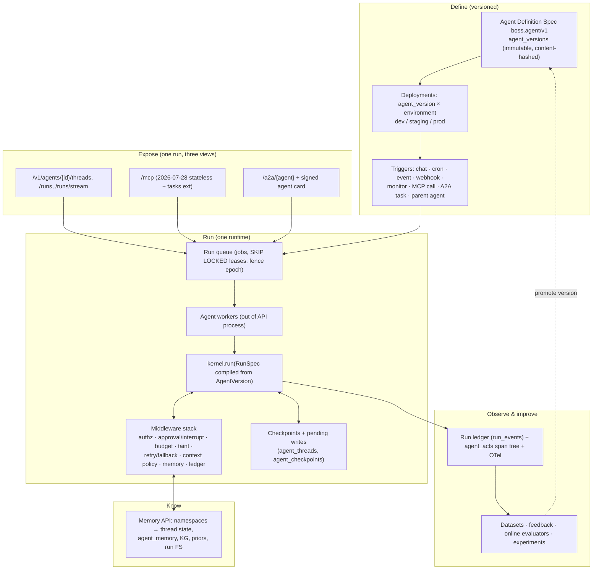
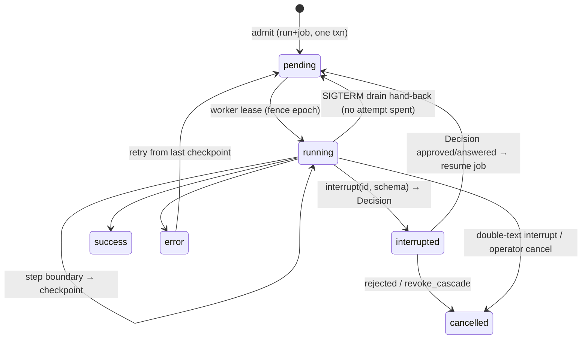
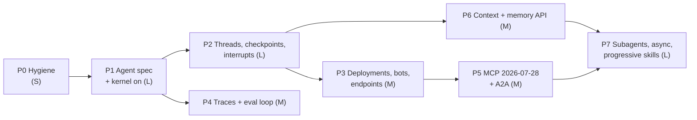

# Converge BOSS agents onto one governed runtime

**Design doc for operator review. Status: proposal. Date: 2026-11-14.**

BOSS already owns the hardest and least copyable parts of an agent platform: hash-bound approvals, per-agent Passports with short-lived OBO run tokens, an enforced 204-permission catalogue, an append-only cost ledger with cache-token economics, an outcome-scored knowledge graph, model routing, and an engine contract that makes coding harnesses interchangeable. What it lacks is the *platform shape* that LangChain v1, LangGraph and LangSmith Agent Server have converged on. In LangChain's shape, an agent is a versioned definition that runs on one loop with ordered middleware. Threads, checkpoints and interrupts are generic. Each deployed agent is an addressable endpoint with crons, double-text policy, MCP and A2A. Every run is a trace tree that evaluators score. BOSS instead runs agents through at least four separate turn engines. Its own unifying runtime, the harness kernel, is built and conformance-tested but carries no default traffic (`eng/kernel/__init__.py:1-14`). There are two agent catalogues that do not join. Interrupt and resume is re-implemented per domain. There is no "deploy this agent as a service" concept (`svc/agents.py:20-25`). The recommendation is to **build the platform natively on the kernel and not take a runtime dependency on LangGraph**, while adopting LangChain's *designs* nearly wholesale: the middleware hook contract, super-step checkpoints with pending writes, schema-typed interrupts, assistants-style versioned configs, double-texting, the Agent Protocol resource model, the feedback-on-runs evaluation model, and deepagents' context-engineering defaults. The work runs in seven phases. The first four deliver the fundamentals: an agent spec, one runtime, durable threads, and deployable bots. The last three deliver interoperability, a trace-and-eval loop, and deepagents-level depth: offloading, summarisation, sub-agents as addressable runs, and progressive skills. Each phase is gated by acceptance tests that run on a real install.

---

## How to read this document

**What the evidence covers.** Every claim about BOSS comes from a read-only survey of `seanventures/boss` at HEAD `d6c21d0a6` (Merge PR #86, train4/walk-correctness, 2026-11-13/14). No tests were run during that survey, so statements about behaviour describe code paths, not measured outcomes. Facts about LangChain, LangGraph, LangSmith and deepagents come from their documentation, blog and GitHub as fetched on 2026-11-14. Those claims carry inline links.

**How BOSS citations are written.** Each one is a repo-relative `path:line`, shortened as follows:

| Prefix | Expands to |
|---|---|
| `eng/` | `engine/boss_engine/` (kernel, tools, agent, identity, mcp, config) |
| `svc/` | `engine/boss_engine/services/` |
| `kg/` | `engine/boss_engine/services/knowledge/` |
| `main.py` | `apps/api/app/main.py` |
| `worker/` | `apps/worker/boss_worker/` |
| `schema.sql` | `db/schema.sql` |

**What the status words mean.** They follow the survey:

| Word | Meaning |
|---|---|
| **Wired** | Reached from a live entry point with default settings |
| **Flagged** | Behind an env flag that defaults off |
| **Declared** | Schema, YAML or code that no production path executes |
| **Dark** | Built and tested but carrying no default traffic |

---

## 1. The 2026 baseline: LangChain has shrunk the agent to a loop plus hooks, and moved everything else into the runtime

### 1.1 LangChain v1 turns "agent" into one fixed loop with six interception points

LangChain v1 has a single agent constructor, `create_agent`. It builds a model-node/tool-node loop compiled as a LangGraph graph and "replaces `langgraph.prebuilt.create_react_agent`" ([v1 release notes](https://docs.langchain.com/oss/python/releases/langchain-v1)). Its parameters are `model`, `tools`, `system_prompt`, `response_format`, `state_schema`, `context_schema`, `checkpointer`, `store`, `middleware` and `name`. The documentation frames the result as "Agent = Model + Harness", where the harness supplies the right context at the right time ([Agents](https://docs.langchain.com/oss/python/langchain/agents)).

LangChain says openly why it rebuilt: its earlier agent API had piled up "a large number of parameters" that depended on each other and were hard to combine, and frameworks "do not give the developer enough control over context engineering" ([Agent Middleware blog](https://www.langchain.com/blog/agent-middleware)). The answer is **middleware with six hooks**:

| Hook type | Hooks | When it runs | Order across m1, m2, m3 |
|---|---|---|---|
| Node-style | `before_agent`, `after_agent` | Once per invocation | `before_*` runs m1→m2→m3; `after_*` runs m3→m2→m1 |
| Node-style | `before_model`, `after_model` | Around every model call | Same as above |
| Wrap-style | `wrap_model_call` | Around every model call | Nests onion-style, m1 outermost |
| Wrap-style | `wrap_tool_call` | Around every tool call | Nests onion-style, m1 outermost |

A wrap handler may call the inner handler zero, one or many times, which is how retry, fallback, short-circuit and caching are built ([Custom middleware](https://docs.langchain.com/oss/python/langchain/middleware/custom)). A hook can do three more things:

- jump to `end`, `tools` or `model`, if it declared that jump with `can_jump_to`;
- extend state, through a `state_schema` attribute;
- ship its own tools.

LangChain keeps a deliberate split between two kinds of change. A transient change through `request.override(...)` affects only this one call. A persistent change, a state update or a `Command`, outlives the call. That split is the most transferable design idea in the library ([Context engineering](https://docs.langchain.com/oss/python/langchain/context-engineering)).

The built-in middleware catalogue doubles as a checklist of what a 2026 agent platform is expected to do ([Built-in middleware](https://docs.langchain.com/oss/python/langchain/middleware/built-in)):

| Concern | Built-in middleware |
|---|---|
| Retries and fallbacks | Tool and model retry with backoff and jitter; `ModelFallbackMiddleware`; `ModelRefusalMiddleware` |
| Call limits | Per-run and per-thread limits on model calls and tool calls |
| Safety | `PIIMiddleware` with redact/block/mask/hash |
| Human approval | `HumanInTheLoopMiddleware`: approve, edit or reject a tool call (needs a checkpointer) |
| Context size | `SummarizationMiddleware` with token triggers; `ContextEditingMiddleware`, which clears old tool results |
| Planning | `TodoListMiddleware` |
| Tool choice | `LLMToolSelectorMiddleware`; provider-side tool search |
| Environment | Sandboxed shell and filesystem search |

As of langchain 1.5 (11 Nov 2026), the catalogue also includes `ModelRouterMiddleware` and a beta `AutoModeMiddleware`. In `AutoModeMiddleware`, a decision model blocks risky tool calls when p ≥ 0.5. langchain-core 1.8 "adds decision models" ([GitHub releases](https://github.com/langchain-ai/langchain/releases)). LangChain is moving straight onto ground BOSS already holds with Jev and the decision pipeline.

**Tools** receive a hidden `ToolRuntime`. It carries:

- state, context and store;
- a stream writer and config;
- the tool-call id;
- `execution_info`: thread and run id;
- on Agent Server, `server_info`: assistant and user.

A tool can return a `Command` that updates graph state ([Tools](https://docs.langchain.com/oss/python/langchain/tools)). MCP support moved into the core library as `langchain.mcp.MCPAdapter` (beta, 1.4). It brings three changes ([MCP adapters migration](https://docs.langchain.com/oss/python/migrate/langchain-mcp-adapters)):

- **One governance seam.** MCP tools go through the same `wrap_tool_call` chain as native tools.
- **Elicitation becomes an interrupt.** It is mapped onto a LangGraph `interrupt`.
- **No session reuse.** Each tool opens a session per call.

**Models** are created with `init_chat_model("provider:model")`. Model "profiles" expose capability metadata such as `max_input_tokens`, `tool_calling` and reasoning levels. Structured output comes in two strategies ([Models](https://docs.langchain.com/oss/python/langchain/models); [Structured output](https://docs.langchain.com/oss/python/langchain/structured-output)):

- `ProviderStrategy` uses the provider's native structured output.
- `ToolStrategy` uses tool calling, and feeds validation errors back so the model can retry.

**Memory** is no longer a LangChain abstraction at all:

- **Short-term memory** is graph state, persisted per `thread_id` by a checkpointer.
- **Long-term memory** is a namespaced store with optional semantic search ([Short-term memory](https://docs.langchain.com/oss/python/langchain/short-term-memory); [Long-term memory](https://docs.langchain.com/oss/python/langchain/long-term-memory)).

**Context engineering** has a stated thesis: "the lack of 'right' context is the number one blocker for more reliable agents". The documentation offers a grid for applying it. Its rows are three kinds of context: model (transient), tool and life-cycle. Its columns are three data sources: runtime context, state and store ([Context engineering](https://docs.langchain.com/oss/python/langchain/context-engineering)). That grid is used again in §4.7 below.

**The trade-offs are real.** In the 13 months after v1, LangChain made several breaking moves:

- MCP moved in-tree with a breaking API.
- The Python floor rose to 3.11.
- Summarisation parameters were renamed.

([MCP migration](https://docs.langchain.com/oss/python/migrate/langchain-mcp-adapters); [GitHub releases](https://github.com/langchain-ai/langchain/releases)). Practitioners also report leaving the framework for raw SDKs over the "abstraction tax" and debugging opacity ([tianpan.co](https://tianpan.co/blog/2026-04-19-orchestration-framework-trap-langchain-production); [DEV](https://dev.to/tufailkhan457/why-we-replaced-langchain-with-the-raw-anthropic-sdk-in-production-3611)). Reviewers still rate LangGraph as the strongest part of the ecosystem ([hackceleration](https://hackceleration.com/langchain-review/)).

### 1.2 LangGraph makes durability the substrate that everything else stands on

LangGraph is a Pregel-style runtime. Nodes return partial updates, and per-key reducers merge them at super-step boundaries. **A checkpoint is written at each boundary**, so `START→a→b→END` yields exactly four checkpoints ([Checkpointers](https://docs.langchain.com/oss/python/langgraph/checkpointers.md)). The documented behaviours ([Checkpointers](https://docs.langchain.com/oss/python/langgraph/checkpointers.md)):

- **Partial-step recovery.** Node outputs within a step are saved as *pending writes*. If one node fails, siblings that succeeded are not re-run.
- **Replay.** Invoking with a prior checkpoint's config replays from that point.
- **Fork.** `update_state(..., as_node=)` creates a new checkpoint and never mutates history.
- **Durability levels.** Durability is selectable per run: `exit`, `async` or `sync`.
- **Encryption.** Checkpoints can be encrypted with an AES serializer.

The guarantee is **at-least-once execution per node**. Side effects must therefore be idempotent or placed after a checkpoint. The docs also admit that admission is not durable until the first checkpoint lands, and advise recording admission in your own store.

**Human-in-the-loop** uses `interrupt(payload)`, which persists state and surfaces a payload to the client. On resume, the node re-runs from its start and `interrupt()` returns the resume value. Since `langgraph>=1.2.12`, `interrupt(..., response_schema=Model)` validates resume values and lets clients build forms from the schema. Parallel interrupts are resumed in one call, keyed by interrupt id. Interrupts inside nested sub-agents propagate to the outermost graph ([Interrupts](https://docs.langchain.com/oss/python/langgraph/interrupts)).

Two rules are sharp edges:

- Resumes match interrupts **by call order**.
- Code before an interrupt re-runs on resume.

**Streaming** offers seven modes: values, updates, messages, custom, checkpoints, tasks and debug. Each chunk is typed `{type, ns, data}`, where the `ns` namespace identifies which sub-graph produced the event. That namespace is what makes nested agent trees renderable in a UI ([Streaming](https://docs.langchain.com/oss/python/langgraph/streaming)).

**Multi-agent guidance changed in 2026.** The docs now say plainly that "the langgraph-supervisor package is no longer actively maintained". In its place they recommend five patterns built on `create_agent` and tool calling ([Multi-agent](https://docs.langchain.com/oss/python/langchain/multi-agent); [supervisor migration](https://docs.langchain.com/oss/python/migrate/langgraph-supervisor)):

| Pattern | How it works |
|---|---|
| Subagents | Subagents are exposed to a main agent as tools |
| Handoffs | A tool call switches which agent is active |
| Skills | Prompts and tools are loaded on demand |
| Router | A classifier sends the request to one agent |
| Custom workflow | A hand-written graph |

The docs add that "a single agent with the right tools and prompt" is often enough. In LangChain's τ-bench study, a single agent degraded sharply once two or more distractor domains were added. Swarm slightly beat supervisor. Removing the supervisor's "translation" overhead, by adding a `forward_message` tool and stripping handoff messages, gave roughly 50% better results ([benchmark blog](https://www.langchain.com/blog/benchmarking-multi-agent-architectures)).

### 1.3 LangSmith Agent Server is the operational layer, and it is the proprietary part

The naming has changed twice. LangGraph Platform became LangSmith Deployment in October 2025, and by late 2026 the docs call the runtime **LangSmith Agent Server**. Package names (`langgraph-api`, `langgraph.json`) are unchanged ([deployment](https://docs.langchain.com/langsmith/deployment)).

**Architecture.** The server has two stateless tiers built from one image ([Agent Server](https://docs.langchain.com/langsmith/agent-server)):

- An API tier accepts requests and never executes agent code.
- A queue-worker tier leases runs and writes checkpoints.

Postgres holds assistants, threads, runs, crons, checkpoints and the store. Redis carries only signals and stream pub/sub. **At most one run executes per thread at a time.**

**Assistants** are versioned configurations of a graph. Every edit creates a version, and any version can be promoted to active for rollback. Assistants "are not part of open source LangGraph" ([Assistants](https://docs.langchain.com/langsmith/assistants)).

**Double-texting** sets what happens when new input arrives during an active run. The policy is one of enqueue (the default), reject, interrupt or rollback ([Double-texting](https://docs.langchain.com/langsmith/double-texting)).

**Crons** are UTC cron expressions. They can be bound to a thread, or stateless, creating a new thread for each run ([Cron jobs](https://docs.langchain.com/langsmith/cron-jobs)).

**Custom auth** uses `@auth.authenticate` plus resource-scoped `@auth.on` handlers. A handler can return a filter dict that scopes rows to their owner. **Self-hosted servers have no default auth** ([Auth](https://docs.langchain.com/langsmith/auth)).

**Protocol endpoints.** Every deployment exposes three:

- **MCP** at `/mcp`. It is sessionless Streamable HTTP, supports revisions 2024-11-05 through 2026-07-28, and exposes each agent as a tool ([MCP](https://docs.langchain.com/langsmith/server-mcp)).
- **A2A** at `/a2a/{assistant_id}`, with an agent card at `/.well-known/agent-card.json`. A2A's `contextId` maps to `thread_id`. Push notifications are not supported ([A2A](https://docs.langchain.com/langsmith/server-a2a)).
- **The Agent Protocol** (MIT) resource model: Runs, Threads, Store and Agents ([agent-protocol](https://github.com/langchain-ai/agent-protocol)).

**Licensing.** The LangGraph library, its checkpointers and the Agent Protocol spec are open. The server, assistants, crons, double-texting, auth layer, Studio and all of LangSmith are commercial. **A standalone self-hosted server requires a LangSmith license**, and self-hosting with a control plane is Enterprise-only ([deployment](https://docs.langchain.com/langsmith/deployment); [pricing](https://www.langchain.com/pricing)).

### 1.4 LangSmith makes "feedback on runs" the universal currency of evaluation

LangSmith traces each run as a tree of child LLM, tool and chain runs ([Evaluation concepts](https://docs.langchain.com/langsmith/evaluation-concepts)). Its evaluation pieces:

- **Datasets** are versioned and split.
- **Experiments** run one application version over a dataset.
- **Evaluators** come in five kinds: human, code, LLM-as-judge, decision model (Jev is named as an example) and pairwise. All of them write the same object, **feedback**: `key`, `score` or `value`, and a `comment`, attached to a run.
- **Annotation queues** let reviewers label runs and export them to datasets.

**Online evaluators** run on live traffic ([Online evaluations](https://docs.langchain.com/langsmith/online-evaluations)):

- They sample production runs.
- They can filter on another evaluator's score, which lets evaluators chain.
- They evaluate whole threads once a thread goes idle.
- A weekly spend cap pauses them.

**Retention** is 14 days for base traces and 180 days for extended traces ([pricing](https://www.langchain.com/pricing)).

The operational loop worth copying runs from production failure, to annotation, to dataset, to regression gate.

### 1.5 deepagents shows that "depth" is mostly context engineering on a durable runtime

deepagents (MIT, ~31k stars) has three layers. LangGraph is the runtime, `create_agent` is the minimal harness, and `create_deep_agent` is an opinionated middleware stack ([README](https://github.com/langchain-ai/deepagents)). LangChain's launch post (2025-07-30) named four ingredients: a detailed system prompt, a planning tool, sub-agents and a filesystem. It credits Claude Code, Deep Research and Manus as inspiration. It also calls the to-do tool "basically a no-op" that still keeps the agent on track ([Deep Agents blog](https://www.langchain.com/blog/deep-agents)). By v0.7 the planning tool had become **opt-in** ([overview](https://docs.langchain.com/oss/python/deepagents/overview)).

**Sub-agents** are reached through a `task` tool, with a `general-purpose` sub-agent on by default. Each runs in a fresh context and returns one capped report. The `isolated` mode is the default; `fork` mode, which snapshots the parent conversation, is experimental ([context engineering](https://docs.langchain.com/oss/python/deepagents/context-engineering)).

**Async sub-agents** give the parent five tools: `start_async_task`, `check_async_task`, `update_async_task`, `cancel_async_task` and `list_async_tasks`. Each task is a server thread. Finished, failed or input-needing children notify the parent on Agent Server; elsewhere the parent polls. Any Agent Protocol server can run them. These features are beta and version-gated ([async subagents](https://docs.langchain.com/oss/python/deepagents/async-subagents)).

**The filesystem** is a virtual FS (`ls`, `read_file`, `write_file`, `edit_file`, `glob`, `grep`, `execute`) over pluggable backends ([backends](https://docs.langchain.com/oss/python/deepagents/backends)):

| Backend | Where files live |
|---|---|
| `StateBackend` | In thread state, through checkpoints |
| `StoreBackend` | Across threads, namespaced per user or assistant |
| `CompositeBackend` | Routed by path prefix, for example `/memories/` to the store |
| Sandbox backends | Inside an isolated sandbox; these add `execute` |

**Context defaults** ([context engineering](https://docs.langchain.com/oss/python/deepagents/context-engineering)):

- **Offload.** Tool inputs or results above **20,000 tokens** are written to the FS and replaced by a path plus a 10-line preview.
- **Summarise.** Summarisation triggers at **85% of `max_input_tokens`** and keeps 10% of recent tokens. The originals are archived to the FS, and `state["messages"]` itself is untouched.

**Memory** is AGENTS.md, always loaded. **Skills** follow the SKILL.md standard: frontmatter loads at startup and the body loads on demand.

**Security** follows "trust the LLM": the boundaries must be enforced at the tool and sandbox level ([README](https://github.com/langchain-ai/deepagents)).

**What the evidence says about multi-agent depth.** Anthropic's orchestrator-worker research system beat a single agent by **90.2%**. It also used about **15x** the tokens of chat, and token usage explained 80% of variance on BrowseComp ([Anthropic Engineering](https://www.anthropic.com/engineering/multi-agent-research-system)). Cognition's counterpoint is that "actions carry implicit decisions, and conflicting decisions carry bad results". It argues that writes belong in one thread ([Cognition](https://cognition.com/blog/dont-build-multi-agents)). The MAST taxonomy finds **14 failure modes in 3 categories** across 1,600+ traces, dominated by system design, inter-agent misalignment and weak verification ([arXiv 2503.13657](https://arxiv.org/abs/2503.13657)). Read together:

- **Parallel sub-agents** suit read-heavy exploration, review and research.
- **A single writer per branch** suits code.
- **Verification** belongs in the platform, not the prompt.

**Protocols.** MCP and A2A are the two-layer standard, and both sit under the Linux Foundation. The **MCP 2026-07-28 revision** is a large redesign ([MCP 2026-07-28 changelog](https://modelcontextprotocol.io/specification/2026-07-28/changelog)):

- **Stateless protocol.** The `initialize` handshake and `Mcp-Session-Id` are removed. Each request carries its version and capabilities in `_meta`, and `server/discover` is mandatory.
- **No server-initiated requests.** Multi-round-trip `input_required` results replace sampling, elicitation and roots requests. Sampling, Roots and Logging are deprecated.
- **Tasks extension.** Long-running work moves to the official `io.modelcontextprotocol/tasks` extension.
- **New metadata.** `traceparent` is propagated in `_meta`, and `tools/list` order is deterministic.

**A2A v1.0** adds signed Agent Cards and multi-tenancy, and has 150+ supporting organisations ([LF press release](https://www.linuxfoundation.org/press/a2a-protocol-surpasses-150-organizations-lands-in-major-cloud-platforms-and-sees-enterprise-production-use-in-first-year)).

---

## 2. BOSS today: a governed core spread across four turn engines and a dark kernel

```mermaid
flowchart TB
  subgraph Surfaces
    C[Console chat / Ask BOSS]
    MCP[BOSS MCP server<br/>protocol 2024-11-05, 191 tools]
    WF[Workflow agent steps]
    FT[Factory / code tasks]
    AO[Always-on: focused agents,<br/>wakeups, squads, triage]
    MT[PRD meetings / rooms]
  end
  subgraph Engines["Live turn engines (no shared runtime)"]
    E1["EngineAgent.chat<br/>eng/agent/engine_agent.py:513"]
    E2["agent_decision.decide<br/>(Jev or routed model)"]
    E3["agent_loop.run_agent_loop<br/>svc/agent_loop.py:1864 (durable)"]
    E4["Coding engines via engine contract<br/>svc/engine_contract.py"]
    E5["meeting_service direct adapter calls<br/>svc/meeting_service.py:420"]
  end
  K["Harness kernel: kernel.run / resume / cancel<br/>DARK: flags default 0"]
  subgraph Governance["Strong, shared governance"]
    G1[ToolRegistry + permission catalogue + PDP]
    G2[Decisions: hash-bound approvals]
    G3[Passports / OBO run tokens]
    G4[Budget governor + llm_calls ledger]
    G5[Knowledge graph + learnings]
    G6[Model routing + Jev]
  end
  C --> E1
  C --> E2
  AO --> E2
  AO --> E1
  WF --> E3
  FT --> E3
  FT --> E4
  MT --> E5
  MCP --> G1
  E1 -.flag.-> K
  E2 -.flag.-> K
  E1 & E2 & E3 & E4 --> Governance
```



### 2.1 An agent is a roles row plus holdings, and a second catalogue nobody runs

The unified agent model is stated in one module: an agent is a `roles` row plus holdings. The row carries `role_key`, `display_name`, `mission`, `boundaries` and `reports_to`. The holdings are `role_skills` and `role_mcp_servers`, plus optional Agent Studio profiles. One transaction writes them all (`svc/agents.py:1-40`). The functions are `create_agent` (:1016), `update_agent` (:1317), `delete_agent` (:1467), `grant_mcp` (:199) and `revoke_mcp` (:229).

**Why the module exists.** It was created because four places an "agent" lived did not join. Before it, created agents "held nothing": skills were written to `roles.spec.allowed_skills` and `agent_versions.requested_skills`, and the runtime never read either field (`svc/agents.py:4-18`). The runtime grant is `role_skills` (`svc/agent_steps.py:337-371`; `svc/agent_loop.py:1783-1810`).

**Shipped defaults.** BOSS ships 57 role YAMLs in `packages/specpack/roles/`. Each carries:

- mission and boundaries;
- decision rights;
- permissions and MCP servers;
- output contracts, autonomy level, cadence and an eval rubric;
- a persona.

Every agent also holds three baseline skills. They are written at every boot and at creation (`svc/agent_baseline.py:1-30`).

**Identity versioning is wired.** Every agent gets an immutable `agt_` id, a sponsor, and a seal. Every change to voice, remit or grants seals a new `identity_version` and fingerprint (`svc/agent_identity.py:17, 230-270`).

**Agent Studio is a second catalogue.** `AgentStudioService` holds `agent_definitions` and `agent_versions`, with a create → validate → publish lifecycle (`svc/agent_studio.py:395, 508, 647`). Its templates carry `model_policy`, prompts, limits, an output contract and an `a2a_policy`. But Studio execution is not a model run:

- `live_model` is blocked with `live_model_runtime_not_enabled_for_this_release` (`svc/agent_studio.py:909-912`).
- The worker answers with a templated `build_agent_brief_result` and calls no model (`worker/runner.py:208-225, 418-500`).
- Only prompts, rules and `model_policy` from Studio versions are consumed anywhere (`eng/tools/builtin.py:7948-7953`; `svc/agent_identity.py:200`).

**The consequence.** BOSS has a versioned definition that does not run, and a running definition that is versioned only by identity seal.

### 2.2 Always-on behaviour is about twenty bespoke clocks, not a bot primitive

There are two separate clocks.

**API daemon threads.** `system_threads.start_all` starts daemon threads inside the API process (`svc/system_threads.py:1-134`). They include:

- the system doctor (15 s);
- reflection, which is paused by default;
- the backup and extension schedulers;
- the login refreshers.

**The worker tick loop.** It runs about twenty `_tick_*` functions, each with its own interval guard (`worker/main.py:40-75, 629-663, 863-880`). Among them:

- focused agents (60 s);
- agent wakeups (60 s), "the one sweep that can start model turns";
- the metatron watch (60 s);
- the factory flow (45 s);
- the shepherd autopilot (180 s).

**The bot-like services:**

- **Focused agents** have duty modes `always_on`, `on_demand` and `hybrid`, and decide through `AgentService.decide` (`svc/focused_agents.py:1-50, 674`).
- **Wakeups** are monitors and schedules with cycle caps and failure stops (`svc/agent_wakeups.py:1-25`).
- **Ambient squads** are the newest attempt at a shared layer: a board, typed messages and an `agent_acts` decision ledger. The chief-of-staff mode defaults to `off` (`svc/ambient/__init__.py:1-35`; `eng/config.py:1274-1297`).
- **Deterministic services.** Most of the rest are no-LLM code: the system doctor, the metatron watch, and the task shepherd core.

Each of these clocks has its own interval, guard, stop semantics and persistence. **None of them is a generic "agent plus trigger plus checkpointed state" primitive** comparable to an Agent Server cron or background run.

### 2.3 "One agent path" unifies decisions and streamed answers, but not the tool loop

BOSSAPP-759 is real for two of the three turn types:

- **Decisions.** `AgentService.decide` routes through `IntentRouter.decide_among` to `agent_decision.decide`. It keeps the turn on the record's own thread and writes learning back (`svc/agent_service.py:673-742`).
- **Chat.** `AgentService.chat` goes to `IntentRouter.route_turn`. There, "the model decides what this turn does. No keyword does": `_decide_turn` picks one action from the capability manifest (`svc/intent_router.py:1694-1940`).
- **Streamed answers.** `AgentService.answer_stream` is tool-less and refuses any mode except `discuss` (`svc/agent_service.py:744-797`).

Below those entry points, **at least four live turn engines** run:

1. **The chat loop.** `EngineAgent.chat` (`eng/agent/engine_agent.py:513-640`) runs a max-6-step loop. Its last step is reserved for the answer. Non-self-executable tools become proposal buttons (`eng/agent/engine_agent.py:1252-1300`).
2. **The decision call.** `agent_decision.decide` uses Jev when it is ready, otherwise the routed model (`svc/agent_decision.py:397-469, 791-850`).
3. **The durable loop.** `agent_loop.run_agent_loop` (`svc/agent_loop.py:1864-1922`) persists `agent_runs` after every step. It runs under a delegated identity and resumes from `awaiting_approval` (`svc/agent_loop.py:1997-2010`). It serves workflow agent steps and the software factory.
4. **The coding engines.** These are Claude Code, the Agent SDK, native, ACP and provider lanes, all wrapped by `ContractedAgent` (`svc/engine_contract.py:1-40, 219-500`).

**Meetings bypass the pipeline.** PRD meetings call `adapter.create_text_response` directly for each persona (`svc/meeting_service.py:420-471`). The kernel design itself counts six loops plus a JSON-in-text protocol that is scheduled for deletion (`docs/architecture/HARNESS_KERNEL_DESIGN.md:377-390`).

### 2.4 The kernel is the right convergence point and it is dark

The kernel (BOSSAPP-958/961) is "one tool loop, five policies, one run ledger". `kernel.run(RunSpec)`, `resume` and `cancel` drive a step loop:

1. StopPolicy decides whether to continue.
2. ContextPolicy assembles the context.
3. The Engine completes the call, with RecoveryPolicy handling errors.
4. Tool calls are checked, then run or held.
5. VerifyPolicy accepts the result or re-asks.

The controller states are CONTINUE, ANSWER, SUSPEND and STOP (`eng/kernel/loop.py:1-20`; `eng/kernel/policies.py:26-76`). `RunSpec` already carries the fields a platform runtime needs: `run_id`, `lineage_id`, `act_id`, `actor`, a checkpoint `store`, a ledger `sink`, a budget `gate`, `cancel` and `workspace` (`eng/kernel/spec.py`). There are presets for each caller (`eng/kernel/presets.py:54-180`).

**Yet nothing runs on it.** The package itself says "Nothing in BOSS runs on it yet" (`eng/kernel/__init__.py:3-6`):

- `BOSS_KERNEL_DECISIONS` and `BOSS_KERNEL_CHAT` default to 0 (`scripts/install/community-compose.yml:444-445, 745-746`).
- `AgentRunsStore`, the kernel's own `resume` (:230) and its `cancel` (:310) have **no non-test callers**.
- The production `kernel.run` call sites pass no store, so a suspension would live in process memory (`eng/kernel/checkpoint.py:21-46`; `eng/agent/engine_agent.py:1109`; `svc/agent_decision.py:762`).
- Compaction is a no-op: `needs_compaction` returns False (`eng/kernel/policies.py:120-124`).

### 2.5 The tool layer is BOSS's most mature framework-equivalent piece

**One registry.** A single `ToolRegistry` holds about 164 `ToolSpec` registrations, counted by grep. The MCP server measures 191 exposed tools: 103 read and 88 write.

**What each spec declares** (`eng/tools/registry.py:27-45, 168-270`):

- its `kind`;
- its `reversibility`: one of safe, costs_money, destroys_work, irreversible or grants_authority;
- a **mandatory catalogue `permission`**, checked at import;
- `confine` and `production` object rules;
- `operator_only` and `queues_for_review`;
- an `Exposure` (surfaces, tags, core_for). The chat core is lint-capped at 20 tools (`eng/tools/registry.py:82-124`).

**What `invoke` enforces** (`eng/tools/registry.py:300-530`):

- the durable-workspace gate;
- the identity gate;
- cross-project refusal;
- consent.

**Scoped tools are only partly on.** Scoped tools (grant ∩ surface ∩ core-or-found, with a `find_tools` meta-tool) are on by default only for the CLI text chat loop. "agent_loop, the pre-check and the decision read phase are untouched" (`eng/kernel/scoped_tools.py:1-60`).

**agent_loop assembles its own toolset.** It does not use the registry. A bounded step gets only its held skills (all eager) and its held MCP tools. An unbounded factory run gets native tools such as `run_shell`, `query_db` and `ask_human` (`svc/agent_loop.py:2328-2420, 435-451`).

**Prompt-injection defence covers part of the system:**

- **Result screening.** Tool-result screening defaults to `patterns`. A hit holds the run's next write for a person (`svc/tool_result_screen.py:1-40, 222-349`). It is wired only at `svc/agent_loop.py:3018` and `svc/mcp_registry.py:1870`.
- **Taint tracking.** The `low_trust` ledger covers agent_loop and EngineAgent, but not code tasks or CLI harnesses (`svc/low_trust.py:65-183`).

**Two tool-policy engines coexist:**

- `tool_policy_engine` serves the MCP gateway, the registry and the kernel (`svc/tool_policy_engine.py:351`).
- `tool_gateway`, with allow, ask or off, serves only the native and ACP coding loops (`svc/code_agent.py:1970`).

### 2.6 Skills are governed tools, and grants are rows

**What a skill is.** A skill is a YAML `SkillSpec` or a SKILL.md directory. It declares `kind`, `risk_tier`, schemas, cost, retry, `allowed_callers` and receipt policy (`packages/specpack/skills/github.yaml:1-50`).

**What `SkillRuntimeService.invoke` enforces** (`svc/skill_runtime.py:1-40, 95-160, 438-441`):

- the caller gate, where holding the skill counts as the grant ("GIVING A SKILL TO AN AGENT IS THE GRANT");
- a budget reservation;
- retry;
- a record in `skill_invocations`.

**Sourced skills.** Skills from GitHub, skills.sh or a URL are pinned by sha, and a sync never overwrites an existing version (`svc/skill_sources.py:1-25`).

**Not progressive disclosure.** Bounded agent steps load every held skill eagerly, so SKILL.md bodies are not loaded on demand.

### 2.7 The model layer already routes by tier and conforms engines

**Chat and decision adapters.** Two components choose them:

- `model_routing` picks the adapter per project. Fixed mode is the code default; the Smart router is optional (`svc/model_router/policy.py:21, 203, 289`).
- `GovernedChatAdapter` wraps every call for budget, receipt and an `llm_calls` row (`svc/model_routing.py:668`).

**Tiers.** The tiers are `fast`, `balanced` and `frontier`, and "a tier names what the work NEEDS, not a model" (`svc/model_router/tiers.py:1-40`).

**Jev.** Jev, the TypeSafe decision model, picks decisions when it is keyed (`svc/typed_decisions.py:185-303`).

**Coding harnesses.** These register through `harness_registry` (`svc/harness_registry.py:1-30`). The engine contract normalises each harness's resume, read-only, effort, cost and streaming behaviour (`svc/engine_contract.py:219-500`).

**The JSON-in-text gap.** Subscription CLI chat brains speak a JSON-in-text tool protocol instead of native tool calls. It is slated for deletion in kernel step K10 (`eng/agent/engine_agent.py:51-62`).

### 2.8 Decisions, approvals and identity are ahead of every framework surveyed

**Decision transitions.** `DecisionService.transition` checks, in order (`svc/decisions.py:466`, ~:500-760):

1. approval delegates;
2. separation of duties;
3. the CI and decide-list refusals;
4. the release-scope hash;
5. **the action-preview `content_hash`**;
6. identity approvals;
7. the typed form answer;
8. signed options.

**Approvals.** They are bound to content and arguments:

- **Content binding.** Approved content is a sha256 over canonical inputs, and the runner refuses stale content (`svc/action_preview.py:51`; `svc/workflow_capability_runner.py:6605`).
- **Argument binding.** Arguments are HMAC-bound (`svc/argument_binding.py:75, 149`).
- **Two-person and freshness.** Tier 3 needs two people, and stale approvals are voided (`eng/identity/approvals.py:34, 263, 279`).
- **Step-up.** 90 permissions require step-up re-authentication (`eng/identity/permissions_gen.py:334`).

**Identity.** Each piece is wired:

- **Passports** give each agent a template principal `agt_…` and a run instance `agt_…#run_…`, with ceilings and cascading revoke (`eng/identity/passports.py:164, 277, 381-418`).
- **Run tokens** are EdDSA, last at most 5 minutes, are DPoP-bound, and carry an RFC 8693 `act` chain. Effective permission is the intersection person ∩ agent ceiling ∩ grant ∩ token scope ∩ task (`eng/identity/tokens.py:5-12, 282, 533`).
- **Revocation** halts code tasks, workflow runs and agent runs in one transaction (`eng/identity/cascade.py:374`).
- **The PDP** is a single `authz.check` that enforces by default (`eng/identity/authz.py:619`; `eng/config.py:525`).
- **Audit** is hash-chained (`eng/identity/audit.py:555`).
- **Egress** goes through a credential-injecting proxy with deny-by-default rules (`eng/identity/egress_rules.py:121, 406`).

**Where governance is weaker:**

- **Isolation.** The real sandbox is a per-run uid plus iptables (`svc/sandbox_identity.py:61`). MicroVM is frozen (`eng/config.py:1734`), and K8s, e2b and Daytona are not implemented (`svc/sandbox_provider.py:640-648`).
- **Autonomy.** It is applied only when the console calls `/v1/console/v2/autonomy/apply`, with no continuous re-evaluation (`svc/autonomy.py:302`; `main.py:16089`).

**Budgets are layered:**

| Layer | Where |
|---|---|
| Governor reserve, consume and settle | `svc/budget.py:301, 1307, 1937, 2150` |
| Org, project, role and workflow caps with a mid-run stop | `svc/scoped_budgets.py:249, 299, 312` |
| Per-turn budget | `svc/turn_budget.py:24` |
| Per-agent concurrency, daily runs and daily cost | `svc/role_run_policy.py` |

### 2.9 Memory has rich semantics but five stores and several dead write paths

**The knowledge graph** lives in Postgres (`kg/store.py`, `kg/learning.py`):

- **Trust tiers.** Agents may write only `inferred` or `observed` (`kg/store.py:82-89, 202`).
- **Vectors.** pgvector HNSW, with an exact-cosine fallback (:1127, :1263).
- **Usefulness.** Scored as (s+1)/(s+f+2), with 180-day decay (`kg/learning.py:19, 23`).
- **Lesson writeback.** Hooks include `repair_checkpoint`, `engine_turn`, `step_complete` and `agent_decide` (`kg/learning_writeback.py:63, 516, 1021`).
- **Injection.** Lessons reach builds through `for_build` (`kg/learning_context.py:328`) and agent_loop through a 400-token quoted pack (`kg/runtime.py:211`; `svc/agent_loop.py:1878-1891`). They are **not in Ask BOSS chat**.

**`agent_memory`.** It is injected only into chat, at 2,400 characters, with no relevance query (`svc/agent_memory.py:290`; `svc/intent_router.py:1503-1532`).

**Procedural priors.** They are consumed only by the native coder, are off by default, and are built only by a manual script (`eng/config.py:1255`; `svc/code_agent.py:1957`).

**Dead or broken paths:**

| Path | What is wrong | Evidence |
|---|---|---|
| Archival flags | `set_archived` has no callers | `kg/store.py:1766` |
| person_wait learning | Every write fails validation | `svc/person_wait.py:607-621` |
| Conversation memory | Always empty | `svc/agent_converse.py:898`; `svc/agent_persona.py:559` |
| Metatron memory | Never written | `svc/metatron_captain.py:779` |
| `update_ledger` | Cannot work over MCP or agent_loop | `eng/tools/builtin.py:6686`; `svc/agent_loop.py:1738` |

**Short-term context:**

- **Chat history** is a sliding window of 12 messages with no summarisation (`svc/intent_router.py:2685-2689`).
- **Seeded resume** in the engine contract keeps a process-local LRU, so it is lost on restart (`svc/engine_contract.py:289, 401-472`).
- **Tool results** are clipped at 16,000 characters with a CUT marker (`svc/tool_result_text.py:1-11`; `svc/agent_loop.py:1982`).

### 2.10 The ledger, evaluation and orchestration are strong on money, weak on traces and datasets

**The cost ledger is strong.** `llm_calls` is append-only, through the trigger `llm_calls_fill_once` (`schema.sql:11899`). Each row records:

- stage, role and model;
- cache read and write tokens;
- cost, latency and `act_id`.

Every row is written through one seam, `record_llm_call`, which also runs scoped-budget checks (`svc/llm_telemetry.py:274-470`). On top of it sit deterministic cost insights, a token-efficiency report, per-workflow P20-P80 cost, and rule-weighted `run_scorecards` (`svc/cost_insights.py:34`; `svc/scorecards.py:30, 189`).

**Tracing is weak:**

- **Transcript.** `agent_turns` is truncated at 4,000 characters and 600 rows (`svc/agent_turns.py:36, 41`).
- **Span tree.** One exists only as `agent_acts` parent links, with no viewer (`schema.sql:7437-7467`).
- **Run ledger.** The unified run ledger (`run_events`, the `run_ledger` view) is written only when `BOSS_LEDGER_EVENTS` is set, and only a test sets it (`eng/kernel/ledger.py:40-50`).
- **OTel.** Spans are standalone and ship without the optional package (`svc/self_telemetry.py:55, 132`).
- **Prometheus.** The bundled Prometheus has `scrape_configs: []`.

**Evaluation is offline and file-based:**

| Asset | State | Evidence |
|---|---|---|
| Battle scenarios | 27 runnable, with an optional opus judge, run manually; results go to gitignored JSON | `tests/agent-battle/battle.yaml`; `scripts/agent_battle.py:405, 451` |
| Harness bench | 8 tasks, with only scripted baselines committed | `bench/harness/baselines/scripted.json`; `.github/workflows/ci.yml:114-166` |
| A/B experiments | Real, over harness, review rounds and routing knobs, but with no prompt arm | `svc/experiments.py:24, 225, 346` |
| Miss-to-eval automation | The only automatic path is `verifier_ratchet` | `svc/verifier_ratchet.py:53` |

There is **no dataset store, no judge-feedback table and no online LLM evaluator**.

**Orchestration is durable but domain-specific:**

- **Workflow engine.** It has 15 step kinds, leases, retries, timers, decisions and sub-workflows (`svc/workflows.py:56-94, 5804, 6917`).
- **Job queue.** It uses `SKIP LOCKED` leases with fence epochs (`svc/jobs.py:593, 866`) and run fencing (`svc/run_fencing.py:80-205`).
- **Shutdown and unknown outcomes.** SIGTERM drain hands jobs back without spending an attempt (`svc/drain.py:41, 70`). Unknown outcomes are parked (`svc/durable_operations.py:59-80, 152`).
- **Code tasks.** Each stage checkpoints to a git branch (`svc/governed_code_task_service.py:346, 5670`).

Steps and builds **execute inside the API process**. The source documents a "KNOWN HAZARD — ONE TRANSACTION PER PROJECT, NOT PER STEP". A step idle for more than 300 s rolls back the whole project's tick, and any unkeyed side effects then repeat (`main.py:28139-28162`).

**Agents are not deployable services:**

- **No agent endpoint.** There is no per-agent endpoint, environment, health check or scaling (`svc/agents.py:20-25`).
- **No real A2A.** `svc/a2a.py` is an internal Redis-Streams bus, not Google's A2A (`svc/a2a.py:59`).
- **Old MCP revision.** The MCP server speaks protocol `2024-11-05` (`eng/mcp/server.py:1-40, 152`).
- **Chat channels.** They only answer decision cards (`svc/chat_channels.py:118, 296, 394`).

---

## 3. Gap analysis: BOSS leads on governance and loses on runtime unity, durability, packaging and traces

The taxonomy below has one row per platform capability. The baseline column says what LangChain, LangGraph, Agent Server, LangSmith or deepagents provide. **Severity** measures how much the gap blocks "a solid agent/bot platform":

| Severity | Meaning |
|---|---|
| **Critical** | Blocks the platform: no generic primitive exists, so each new agent re-implements it |
| **High** | A major capability is missing or flagged off |
| **Medium** | Partial; works for some surfaces |
| **Low** | Cosmetic, or BOSS is already equal or ahead |

"Ahead" marks rows where BOSS exceeds the baseline.

| # | Area | Capability | 2026 baseline | BOSS status and evidence | Severity |
|---|---|---|---|---|---|
| 1 | Definition | Versioned agent definition that runs | Assistants: versioned config, promote/rollback ([Assistants](https://docs.langchain.com/langsmith/assistants)) | Two catalogues. Roles+holdings run but are versioned only by identity seal (`svc/agent_identity.py:230-270`). Studio versions are versioned but don't run live (`svc/agent_studio.py:909-912`) | **Critical** |
| 2 | Definition | Prompt/version registry | Prompt hub; judge prompts versioned | Prompt compiled at runtime from layers; no prompt version except the role fingerprint (`svc/scorecards.py:310`) | High |
| 3 | Runtime | One agent loop for every surface | `create_agent` is the only constructor | Four or more live engines; kernel dark (`eng/kernel/__init__.py:3-6`); meetings bypass the pipeline (`svc/meeting_service.py:420`) | **Critical** |
| 4 | Runtime | Composable hooks (before/after/wrap model and tool) | Six middleware hooks with defined order ([Custom middleware](https://docs.langchain.com/oss/python/langchain/middleware/custom)) | Kernel has five policy protocols (`eng/kernel/policies.py:26-76`); live loops hard-code their policies | High |
| 5 | Runtime | Retry, fallback, refusal and limit policies | Built-in middleware | Per-loop logic (re-ask once, empty tolerance, `engine_agent.py:513-640`); `transient_retry` for git/HTTP only (`svc/transient_retry.py:111`) | Medium |
| 6 | Runtime | Structured output with validation retry | Provider/Tool strategy with error feedback | Kernel `ParsedAnswer`/VerifyPolicy (dark); `strict_parameters` prepared but off (`eng/tools/registry.py:126-165`) | Medium |
| 7 | Durability | Generic checkpointer (thread state, per-step) | Checkpoint per super-step plus pending writes; Postgres saver | Per-domain state machines; `AgentRunsStore` unused (`eng/kernel/checkpoint.py:46`); agent_loop saves `agent_runs` per step (`svc/agent_loop.py:1750`) | **Critical** |
| 8 | Durability | Time travel / fork | `get_state_history`, `update_state(as_node)` | Only `rerun_from_step` as a new run (`svc/workflow_test_runs.py:224`) | Medium |
| 9 | Durability | Execution isolated from the API tier | Stateless API plus queue workers | Steps and builds run in the API process; per-project transaction hazard (`main.py:28139-28162`) | High |
| 10 | Durability | Leases, fencing, drain, unknown-outcome handling | Leases, one run per thread | **Ahead.** Fence epochs, drain hand-back, outcome classes (`svc/jobs.py:866`; `svc/drain.py:41`; `svc/durable_operations.py:59-80`) | Low (ahead) |
| 11 | HITL | Generic interrupt/resume with typed payload | `interrupt(response_schema=)`, `Command(resume)` | Bespoke per domain: agent_loop, code-task plan gate, person_wait, workflow decisions (`svc/agent_loop.py:1997`; `svc/governed_code_task_service.py:4242`) | High |
| 12 | HITL | Approval semantics (binding, quorum, step-up, delegation) | Approve/edit/reject only | **Ahead.** Hash-bound, two-person, step-up, delegations with hard limits (`svc/decisions.py:466`; `eng/identity/approvals.py:279`) | Low (ahead) |
| 13 | HITL | Double-texting policy / one run per thread | enqueue / reject / interrupt / rollback | None found; chat is request/response plus a progress poll (`main.py:13869-14253`) | Medium |
| 14 | Streaming | Typed multi-mode event stream with namespaces | values/updates/messages/custom/tasks; `ns` | SSE tokens for conversations only; tool turns not streamed (`svc/agent_converse.py:22-30`; `eng/kernel/engine.py:150-155`) | Medium |
| 15 | Deployment | Agent as an addressable endpoint (runs/threads API) | Agent Protocol resources per assistant | **Absent** (`svc/agents.py:20-25`) | **Critical** |
| 16 | Deployment | Triggers: cron, event, webhook, always-on | Crons, webhooks, background runs | Wired but fragmented: workflow cron (`svc/workflow_schedules.py:891`), wakeups, focused-agent ticks, event subscriptions (`svc/event_dispatch.py:279`); no common bot primitive | High |
| 17 | Deployment | Environments, rollout, health, scaling per agent | Revisions, worker scaling by queue depth | Absent; worker registration and autoscaling unused (`main.py:24167`; `config.py:377`) | High |
| 18 | Coordination | Sub-agents as tools with isolated context | `task` tool, capped reports, async tasks | Absent; multi-agent is code-orchestrated (meetings, seats, squads) (`svc/review_seats.py:43`; `svc/ambient/squad_turns.py:1-20`) | High |
| 19 | Coordination | Handoffs / supervisor | Handoff via state; supervisor = agent with agent tools | Agent processes (fixed role handoff sequences) (`svc/agent_process.py:1-15`); `agent_acts` handoff ledger (`svc/agent_acts.py:1-25`); `delegate` decision action | Medium |
| 20 | Coordination | Blackboard / shared board | Shared state, store | **Ahead.** Ambient board, typed collab messages, decision ledger (`svc/ambient/__init__.py`) | Low |
| 21 | Interop | MCP server at current revision | `/mcp` sessionless, supports 2026-07-28 | Serves 2024-11-05 only (`eng/mcp/server.py:1-40`) | High |
| 22 | Interop | A2A endpoint and agent cards | `/a2a/{id}`, agent card | Absent; `a2a.py` is an internal bus; `agent_card` is internal (`svc/agent_identity.py:904`) | High |
| 23 | Memory | One memory API with namespaces | Store `(namespace, key)` with semantic search | Five stores, each with its own injection path; long-term memory project-scoped (`svc/agent_memory.py:243-262`) | High |
| 24 | Memory | Memory semantics (trust, decay, outcome-weighting) | Plain documents in namespaces | **Ahead.** Trust tiers, usefulness, decay, contradiction (`kg/learning.py:19-44`; `kg/learning_writeback.py:769`) | Low (ahead) |
| 25 | Memory | Write paths actually working | n/a | Five dead or broken paths (§2.9) | High |
| 26 | Context | Summarisation / compaction | 85% trigger, archive originals | **Absent**; no-op hook (`eng/kernel/policies.py:120-124`); 12-message window (`svc/intent_router.py:2685`) | High |
| 27 | Context | Large-result offloading to a scratch FS | Over 20k tokens → file + preview | Clip at 16,000 characters with a CUT marker; content lost to the model (`svc/tool_result_text.py:1-11`) | High |
| 28 | Context | Dynamic tool selection / tool search | LLM tool selector, provider tool search | Scoped tools + `find_tools`, on only for CLI chat (`eng/kernel/scoped_tools.py:1-60`) | Medium |
| 29 | Context | Progressive-disclosure skills | SKILL.md frontmatter first, body on demand | Bounded steps load all held skills eagerly (`svc/agent_loop.py:2328-2420`) | Medium |
| 30 | Context | Prompt caching discipline | Provider caching middleware | Byte-stable PRIMER prefix (`svc/agent_steps.py:399-404`); explicit `cache_control` only in the flagged kernel engine (`eng/kernel/anthropic_engine.py:95-159`) | Medium |
| 31 | Context | Planning tool | `write_todos` (opt-in) | Session ledger (goal, phase, next step) in chat only (`svc/agent_memory.py:378-492`) | Low |
| 32 | Observability | Nested trace tree plus viewer | LangSmith run tree | `agent_acts` joins, no viewer; run ledger flagged off (`eng/kernel/ledger.py:40-50`) | **Critical** |
| 33 | Observability | Cost, tokens, cache economics | Derived cost dashboards | **Ahead.** `llm_calls` with cache tokens, cost insights (`svc/llm_telemetry.py:274-470`; `svc/cost_insights.py:34`) | Low (ahead) |
| 34 | Observability | OTel export / metrics | OTel ingest; `traceparent` in MCP `_meta` | Standalone spans, optional package, nothing scraped (`svc/self_telemetry.py:55-226`) | Medium |
| 35 | Evaluation | Datasets, experiments, feedback-on-runs | Versioned datasets; feedback key/score | No dataset or feedback store; experiments over knobs only (`svc/experiments.py:24`) | High |
| 36 | Evaluation | Online evaluators | Sampled, chained, spend-capped | Rule-based scorecards only (`svc/scorecards.py:189`) | High |
| 37 | Evaluation | Production miss → regression scenario | Annotation queue → dataset | Policy written down, not automated, except `verifier_ratchet` (`tests/agent-battle/scenarios.yaml:7`; `svc/verifier_ratchet.py:53`) | High |
| 38 | Governance | Identity per agent / OBO / revocation | Custom auth handlers; none built in for agents | **Ahead** (`eng/identity/tokens.py`; `eng/identity/passports.py`; `eng/identity/cascade.py:374`) | Low (ahead) |
| 39 | Governance | Per-tool permission and risk | `interrupt_on`, AutoMode classifier | **Ahead.** Mandatory catalogue permission plus reversibility (`eng/tools/registry.py:168-270`) | Low (ahead) |
| 40 | Governance | Consistent policy engine and taint coverage | n/a | Two tool-policy engines; `low_trust` not in builds (`svc/tool_gateway.py`; `svc/low_trust.py`) | Medium |
| 41 | Governance | Strong isolation | Sandbox backends (LangSmith, Daytona, AgentCore) | uid + iptables; microVM frozen; K8s/e2b/Daytona absent (`eng/config.py:1734`; `svc/sandbox_provider.py:640-648`) | Medium |
| 42 | Model | Provider-agnostic model with capability profile | `init_chat_model` + profiles | **Equal or ahead.** Tiers, Smart router, Jev, engine contract, `EngineTraits` (`eng/kernel/engine.py`) | Low |
| 43 | Model | Native tool calling on every engine | Standard | CLI chat brains use JSON-in-text (`eng/agent/engine_agent.py:51-62`) | Medium |

The pattern is consistent. **The Critical gaps are all the same gap seen from different angles: there is no single agent object that is defined once, run by one runtime, checkpointed in one place, exposed at one address and traced as one tree.** The rows where BOSS is ahead are all governance and economics: approvals, identity, permissions, leases, cost, memory semantics. Those are exactly the layers LangChain leaves to the developer or sells commercially. The target architecture must therefore make the kernel the one runtime and wrap BOSS's existing governance around it as built-in middleware. It must not import a framework that would sit beside the governance and duplicate it.

---

## 4. Target architecture: one agent spec, one kernel, one thread model, many triggers

### 4.0 Principles and shape

Seven principles drive the design:

1. **Build on the kernel, not a framework.** The kernel's RunSpec, policies, presets and ledger already match LangGraph's runtime concepts (§2.4). The work is to finish it and flip it on.
2. **Every live loop becomes a kernel preset.** The six live loops become presets on one `kernel.run`. CLI coding harnesses stay as the "Delegate" engine under the engine contract, because they run their own loops.
3. **Governance becomes middleware that cannot be removed.** Permission checks, hash-bound approval, budget, taint screening and receipts are built-in hooks every preset gets. An agent spec cannot opt out of them.
4. **The agent is a versioned artifact; the roles row is a projection.** The source of truth moves to the versioned spec. `roles`, `role_skills` and `role_mcp_servers` become a compiled projection, kept for the existing grant checks.
5. **Postgres stays the system of record.** Redis (already used by `svc/a2a.py`) or `pg_notify` (already used by `svc/event_stream.py`) only fan out events.
6. **Everything external is a protocol view over the same run.** The REST runs API, MCP tools and A2A tasks are three views of one run and one thread.
7. **Writes stay single-threaded per artifact.** Parallel sub-agents read, review and research. One writer owns each branch (Cognition, Anthropic §1.5).



### 4.1 Agent Definition Spec: one versioned artifact that compiles to grants, a RunSpec and endpoints

**The proposal.** Make the Agent Studio version tables the single source of truth, with an explicit, versioned schema: `boss.agent/v1`. This is the "assistant" in LangSmith's sense ([Assistants](https://docs.langchain.com/langsmith/assistants)). Today the Studio template is declared and partly read (§2.1); this proposal promotes it to the definition that actually runs.

**Lifecycle.** Each version is immutable and content-hashed. Publishing a version does three things:

1. It **compiles the grants.** Grants are projected into `role_skills` and `role_mcp_servers`, so the live grant checks keep working unchanged (`svc/skill_runtime.py:438-441`).
2. It **re-seals the identity version.** The existing seal (`svc/agent_identity.py:230-270`) becomes keyed to the agent version's hash.
3. It **updates the Passport ceiling** (`eng/identity/passports.py:277`).

**What this removes.** Today's `requested_skills` "the runtime never reads" (`svc/agents.py:12-14`). Under the spec, it becomes the grant. The deterministic `deterministic_brief` execution path is retired.

```yaml
apiVersion: boss.agent/v1
kind: Agent
metadata:
  key: incident_triage            # role_key; agt_ id assigned at birth
  version: 7                      # immutable; content_hash computed on publish
  sponsor: user:...               # existing sponsor concept
spec:
  persona: { archetype: relentless_operator, voice: {...} }   # linted (agent_persona.lint_persona)
  mission: "..."
  boundaries: { must: [...], must_not: [...] }
  prompts: { system: "...", job: "..." }                     # versioned with the agent
  model:
    tier: balanced                # model_router tiers; or pinned/local
    decision_model: auto          # Jev when ready
  tools:
    skills: [repo.read, boss.propose_fix, dq_incident_rca]   # compiled to role_skills
    mcp: [{ server: pagerduty, tools: [list_incidents] }]    # compiled to role_mcp_servers
    native: [read_repo_file, run_shell]                      # still catalogue-permissioned
    exposure: scoped              # core + find_tools (K5)
  middleware:                     # ordered; governance middleware is implicit and first
    - retry: { model: {max: 2}, tools: {max: 2} }
    - fallback: { tiers: [balanced, frontier] }
    - context: { offload_tokens: 20000, summarise_at: 0.85, keep: 0.10 }
    - limits: { max_steps: 40, run_usd: 2.00, thread_usd: 10.00 }
    - interrupt_on: { change_existing_app: approve_edit_reject }
  memory:
    read: [kg:project, agent:self, thread]
    write: [kg:project:inferred, agent:self:lesson(proposed)]
  subagents: [{ ref: code_reviewer@3, mode: isolated, report_tokens: 1500, budget_share: 0.2 }]
  output_contract: { schema: {...}, strategy: provider_then_tool }
  triggers:                       # makes it a bot when present
    - cron: "*/15 * * * *"  # UTC
      input: { goal: "sweep new incidents" }
      concurrency: skip_if_active      # existing CONCURRENCY_POLICIES
    - event: { kind: incident.opened }
  deployment:
    environments: [staging, prod]
    double_text: enqueue          # enqueue|reject|interrupt|rollback
    max_concurrent: 2             # role_run_policy
    expose: { rest: true, mcp: true, a2a: true }
  eval:
    dataset: incident_triage_core@v3
    online: [{ evaluator: triage_correct, sample: 0.1, weekly_usd_cap: 5 }]
```

**Rules the spec enforces:**

- **Persona cannot grant.** Persona text is linted so it cannot grant capability (`svc/agent_persona.py:263, 299`).
- **The Passport preset caps grants.** Grants are checked at publish against the agent's Passport preset (`eng/identity/passports.py:129`) and against skill `risk_tier`.
- **Governance middleware is implicit.** Authz, approval, budget, taint and ledger hooks are always present and cannot be disabled by the spec.
- **Shipped roles become `v1` specs.** The 57 shipped role YAMLs are converted mechanically into `boss.agent/v1` documents. The "shipped cast sync" at boot then publishes them as versions instead of upserting rows.

### 4.2 One runtime: every live loop becomes a kernel preset behind one middleware contract

**The proposal.** Adopt LangChain's six-hook contract as the kernel's public extension surface, mapped onto the existing policy protocols. That way the hook contract is a stable, documented interface rather than five internal protocols.

| LangChain v1 hook | Kernel equivalent (exists or new) | BOSS built-in middleware placed there |
|---|---|---|
| `before_agent` | new `on_run_start` | Mint/exchange run token (`eng/identity/tokens.py:282, 533`); budget reserve (`svc/budget.py:1307`); load memory and knowledge packs (`kg/runtime.py:211`) |
| `before_model` | `StopPolicy.decide` + `ContextPolicy.assemble` | Step and spend limits; summarisation/offload; scoped tool selection (`eng/kernel/scoped_tools.py`) |
| `wrap_model_call` | `Engine.complete` + `RecoveryPolicy.on_model_error` | Governed adapter and `llm_calls` row (`svc/llm_telemetry.py:274`); retry/fallback by tier (`svc/model_router/tiers.py`); prompt cache markers |
| `after_model` | `VerifyPolicy.after_step` | Structured-output validation; refusal handling |
| `wrap_tool_call` | ToolPolicy "checked, run or held" | `authz.check` (`eng/identity/authz.py:619`); reversibility → interrupt or proposal (`eng/agent/engine_agent.py:1252-1300`); argument binding (`svc/argument_binding.py:75`); result screening + taint (`svc/tool_result_screen.py`; `svc/low_trust.py`); offload over threshold; `tool_call_audit` |
| `after_agent` | `VerifyPolicy.accept_final` + new `on_run_end` | Budget settle (`svc/budget.py:2150`); learning writeback (`kg/learning_writeback.py:1021`); scorecard; online-evaluator enqueue |

**What each preset is.** A preset is a named middleware stack plus limits. The kernel already defines several (`eng/kernel/presets.py:54-180`):

| Preset | Limits |
|---|---|
| `decision` | 4 turns, $0.30 |
| `engine_agent` | 6 steps |
| `agent_loop` | (step-limited) |
| `precheck` | 8 turns |
| `native_coder` | 40 turns |

Two presets are new:

- `meeting_seat` folds `meeting_service` into the pipeline.
- `subagent` adds an isolated context and a capped report.

**Delegate engines.** CLI harnesses (Claude Code, Codex, ACP) remain **Delegate** engines. The kernel launches them through the engine contract, records them as one opaque step in the ledger, and keeps their native sub-agents. The design already plans this (`eng/kernel/delegate.py`; `docs/architecture/HARNESS_KERNEL_DESIGN.md:377-390`). One small, valuable fix: pass `max_budget_usd`, which "is supported by the CLI and never passed today" (`eng/kernel/delegate.py`).

**Order of convergence.** Lowest risk comes first:

1. **K2 decisions.** Small, bounded, already conformance-tested.
2. **K6 chat.**
3. **K4 agent steps.** This retires agent_loop's private toolset assembly and permission map (`svc/agent_loop.py:1922-1942`).
4. **Meeting seats.**
5. **K11 native coder.**
6. **K14 enforcement.** A lint test fails CI if any module calls a model adapter outside the kernel or the governed adapter.

The JSON-in-text CLI chat protocol is deleted in K10 once subscription chat moves over MCP (K8).

### 4.3 Durable execution: threads, checkpoints with pending writes, and typed interrupts keyed by ID

**The proposal.** Promote the kernel's `CheckpointStore` into a first-class thread model in Postgres. It reuses BOSS's lease and fence machinery, not LangGraph's library.

**The tables:**

| Table | Contents |
|---|---|
| `agent_threads` | `thread_id`, `agent_id`, `deployment_id`, owner, metadata, `status` (idle, busy, interrupted, error), `active_run_id` |
| `agent_runs` (extend the existing table) | `thread_id`, `agent_version_hash`, `trigger`, `parent_run_id`, `status` (pending, running, interrupted, success, error, cancelled, timeout), `double_text` policy |
| `agent_checkpoints` | `(thread_id, checkpoint_id, parent_checkpoint_id, step, ns)`, state blob (encrypted with `eng/identity/vault.py`), metadata `source` (input, loop, update) |
| `agent_checkpoint_writes` | Pending tool results per step, written as each tool finishes |

**One step is one super-step.** A kernel step is one model turn plus its parallel tool calls, which is exactly a super-step. The checkpoint is written at the step boundary. Each tool result is written as a pending write as soon as it lands, so a crash mid-batch re-runs only the tools that had not finished. This copies LangGraph's semantics ([Checkpointers](https://docs.langchain.com/oss/python/langgraph/checkpointers.md)).

**Durability modes.** Durability defaults to `sync` for runs with write tools and `async` for read-only runs.

**Admission is atomic.** The run row and the job row go in one transaction. That closes the "admission is not durable" gap LangGraph's docs admit.

**Idempotency is explicit.** Every write tool must declare an idempotency class. The classes already exist for job kinds (`svc/durable_operations.py:59-80`: pure, idempotent, compensatable, irreversible) and need extending to tools. A resumed step that would replay an `irreversible` tool without a recorded result parks the run with `park_job_unknown_outcome` (`svc/durable_operations.py:152`). This is BOSS's existing answer to at-least-once execution, now applied generically.

**Interrupts become one primitive.** The proposed signature is `interrupt(kind, payload, response_schema, binding)`. Unlike LangGraph's match-by-order rule, **each interrupt carries a stable id derived from (run, step, tool_call_id)**, and the resume value is stored against that id. That removes the "never reorder interrupts" footgun. Each interrupt creates a `Decision`, so every resume passes through `DecisionService.transition`:

- content hash;
- argument binding;
- two-person approval;
- step-up.

`ask_human` typed forms (`svc/typed_forms.py:1-25`) become `response_schema` interrupts. The four bespoke suspend paths migrate onto this one primitive:

1. agent_loop `resume_agent_run`;
2. the code-task plan gate;
3. `person_wait`;
4. workflow decision steps.

**Double-texting and concurrency.** The runtime enforces one active run per thread. A new input on a busy thread follows the agent's `double_text` policy:

- **Enqueue** is the default.
- **Interrupt** ends the active run at the next step boundary through the kernel's `cancel` hook.
- **Rollback** forks from the pre-run checkpoint.

**Time travel and fork.** `fork(thread, checkpoint_id, update)` creates a new checkpoint with that parent. This generalises today's `rerun_from_step` (`svc/workflow_test_runs.py:224`) to agents, and it is what an operator needs to "replay BOSS's real decision for that run" before a retry.

**Out of the API process.** Agent runs execute on workers that lease from the queue (`svc/jobs.py:593`). They do not execute inside an HTTP request. Separately, the workflow capability runner moves to commit-per-step. That fixes the documented one-transaction-per-project hazard (`main.py:28139-28162`) and stops deploys from killing in-process runs, which `svc/drain.py` exists to mitigate.

**The relationship to workflows.** Workflows stay the deterministic graph: their step kinds, timers, decisions and sub-workflows are already rich (`svc/workflows.py:56-94`). An `agent` step becomes "start a run of agent X on a thread bound to this step". It awaits through the existing `_AWAIT_KINDS` mechanism (`svc/workflow_capability_runner.py:4957, 5620`). Agents and workflows therefore share one run model, without merging the two engines.



### 4.4 Structured deployment: agents become versioned, triggered, health-checked services

**The proposal.** Add the packaging layer LangSmith sells, built on primitives BOSS already runs.

**Deployments and environments.** A `deployment` is the pair (agent_version, environment). Each project has dev, staging and prod environments. Promoting moves a deployment to another version; rollback re-points it to an earlier one. Experiments become the canary mechanism: an arm can pin an agent version, extending `ARM_KNOBS` (`svc/experiments.py:24`) with an `agent_version` arm, and results are compared through scorecards.

**Triggers.** Every trigger compiles to "admit a run on a thread". Each maps to an existing mechanism:

| Trigger kind | Existing mechanism reused |
|---|---|
| Chat / API | `/v1/agents/{id}/threads/{tid}/runs` (new), replacing `/v1/engine/agent/chat` |
| Cron (UTC) | `svc/workflow_schedules.py` (`parse_cron` :246, `CONCURRENCY_POLICIES` :337, `run_due` :891) generalised to agents |
| Event | `svc/event_dispatch.py:279` with a new `agent_run` sink kind (today the kinds are `job`, `webhook_out` and `workflow`) |
| Inbound webhook | HMAC triggers in `svc/workflow_webhooks.py:462` |
| Monitor / wakeup | `svc/agent_wakeups.py` rows become thread-bound crons with cycle caps |
| MCP tool call / A2A task | Protocol views (§4.5) |
| Parent agent | Sub-agent spawn (§4.5) |

**Bots.** A **bot** is simply an agent deployment with at least one non-chat trigger. That makes three of today's mechanisms instances of one primitive:

- focused agents (`svc/focused_agents.py`);
- wakeups;
- squad owner turns.

**System services stay outside.** Deterministic no-LLM services (the system doctor, stop_watch, the reaper, the metatron watch) are deliberately **not** agents. They stay system threads, re-registered in one leased "system service" table, so that "always-on" has one list and one health view.

**Health.** Each deployment exposes:

- last success and last failure;
- error rate and p50/p95 latency, from the run table;
- stuck runs, from the lease heartbeat (`svc/run_liveness.py:43`);
- interrupt backlog;
- spend versus cap (`svc/scoped_budgets.py`).

The system doctor gains one more signal source, "deployment unhealthy", and its existing circuit-breaker auto-actions can pause a bot (`svc/system_doctor.py:1-25`).

**Scaling.**

- **Worker slots.** Workers advertise slots through the currently unused `/v1/workers/register` (`main.py:24167`), and pending-run depth drives worker count.
- **Per-agent concurrency.** `role_run_policy` (max_concurrent, daily runs, daily cost) becomes the per-deployment limit.
- **Multi-host.** The runner sidecar (`svc/runner_dispatch.py`) stays the multi-host path.

**Per-agent endpoints.** The REST API follows the MIT Agent Protocol resource model: Agents, Threads, Runs and Store ([agent-protocol](https://github.com/langchain-ai/agent-protocol)). Endpoints:

- `GET /v1/agents/{id}`: the card and schemas;
- `POST /threads`;
- `POST /threads/{tid}/runs`, plus `/stream` (SSE with typed `{type, ns, data}` events) and `/wait`;
- `POST /runs/{rid}/cancel`;
- `GET /threads/{tid}/history`.

Every endpoint passes through the existing PDP. Auth is a person session or a service-account token, and each run gets an OBO run token. That gives BOSS **built-in multi-tenant auth that a self-hosted Agent Server lacks by default** ([Auth](https://docs.langchain.com/langsmith/auth)).

### 4.5 Inter-agent coordination: subagents-as-tools by default, handoffs for conversations, the board as blackboard

There are five coordination patterns, all on one run model.

| Pattern | When BOSS uses it | Mechanism |
|---|---|---|
| **Subagent as tool** (default) | Research, review, test triage, investigation: read-heavy, parallelisable | A `task(agent_ref, brief)` tool spawns a child run in a fresh thread. The child gets an **exchanged run token** with `may_spawn` and a narrowed scope (`eng/identity/tokens.py:533`; `eng/identity/runs.py:102` `spawn_child`) and a **budget slice** of the parent's reservation. It returns a capped report (default ≤1,500 tokens) as the tool result; a forward-verbatim option avoids supervisor "translation" ([benchmark blog](https://www.langchain.com/blog/benchmarking-multi-agent-architectures)). Child interrupts propagate to the parent thread as interrupts. |
| **Async subagent** | Long work: builds, deep research | `start/check/update/cancel/list` tools over child runs. The parent is notified through the event stream rather than polling. The run shape mirrors an A2A Task ([async subagents](https://docs.langchain.com/oss/python/deepagents/async-subagents)). |
| **Handoff** | Multi-turn user-facing conversations (Ask BOSS → specialist) | A `transfer_to(agent)` tool sets `active_agent` on the thread. The next turn compiles the target's spec. It is recorded as an `agent_acts` handoff (`svc/agent_acts.py:1-25`). |
| **Supervisor** | Captain, chief of staff | Just an agent whose spec lists subagents. The static captain `ROSTER` (`svc/captain_coordination.py:1-25`) becomes the spec's `subagents` list. |
| **Blackboard** | Squads, incidents, factory flow | The ambient board, work items and typed collab messages stay as they are (`svc/ambient/`). Members are now agent deployments triggered by board events, instead of bespoke `decide` calls. |
| **Workflow (deterministic)** | Product delivery, release | Unchanged; an agent step starts a run (§4.3). |

**Guard rails from the evidence:**

- **Writes stay single-threaded.** A subagent with write tools on a branch the parent also writes to is refused at spawn. The existing review-panel design already runs one writer and parallel *readers* (`svc/review_seats.py:43`).
- **Effort scaling.** Fan-out depth and count are capped in the spec. Spawn refuses beyond the cap, which addresses Anthropic's "50 sub-agents for a simple query" failure ([Anthropic Engineering](https://www.anthropic.com/engineering/multi-agent-research-system)).
- **Verification.** A verify step is a platform step (VerifyPolicy, review seats), not prompt text. MAST's largest failure categories are system design and verification ([arXiv 2503.13657](https://arxiv.org/abs/2503.13657)).

**MCP: move the server to 2026-07-28.** The BOSS MCP server speaks only 2024-11-05 (`eng/mcp/server.py:1-40`). The target is the stateless 2026-07-28 revision, keeping 2024-11-05 and 2025-11-25 for compatibility, as Agent Server does ([MCP](https://docs.langchain.com/langsmith/server-mcp)). The changes ([MCP 2026-07-28 changelog](https://modelcontextprotocol.io/specification/2026-07-28/changelog)):

- **Stateless transport.** Implement `server/discover`, with the protocol version and capabilities read from each request's `_meta`.
- **No sessions.** Cross-call state uses server-minted handles passed as tool arguments, which fits BOSS's id-based tools.
- **Long-running work uses tasks.** `create_code_task`, `start_workflow` and agent runs return `io.modelcontextprotocol/tasks` handles. They are polled with `tasks/get`, and input arrives through `tasks/update`.
- **Approvals become `input_required`.** Approvals and `ask_human` map onto multi-round-trip `input_required` results. The approving person still acts through a Decision with step-up. The MCP client may carry the answer only when the token's principal holds the permission.
- **Trace context.** Propagate `traceparent` from `_meta` into the run ledger.
- **Stable tool order.** Emit `tools/list` in deterministic order for prompt caching.
- **Agents as tools.** Expose each deployed agent as an MCP tool, as Agent Server does.
- **Client side.** The MCP client in `svc/mcp_client.py` must handle both revisions against third-party servers. Sampling and roots should not be relied on, since both are deprecated.
- **Unused verifier.** `verify_for_mcp` (`eng/identity/tokens.py:902`) is unused today and should become the MCP auth verifier.

**A2A: serve real endpoints.**

- **Rename the internal bus.** `svc/a2a.py`, the internal Redis-Streams bus, gets a name that does not collide with the protocol.
- **Serve A2A v1.0.** Serve `/a2a/{agent}` over JSON-RPC, with `SendMessage`, `SendStreamingMessage`, `GetTask`, `CancelTask` and push notifications through the existing outbound webhooks (`svc/webhooks.py:386`). Push notifications are something Agent Server does not support ([A2A](https://docs.langchain.com/langsmith/server-a2a)).
- **Signed agent cards.** Publish `/.well-known/agent-card.json` per agent, **signed with the agent's existing Ed25519 key** (`svc/agent_keys.py`; JWKS at `/.well-known/boss-jwks.json`). Signed cards are an A2A v1.0 feature ([LF](https://www.linuxfoundation.org/press/a2a-protocol-surpasses-150-organizations-lands-in-major-cloud-platforms-and-sees-enterprise-production-use-in-first-year)).
- **Mapping.** `contextId` maps to `thread_id`, a Task to a run, and `input-required` to an interrupt.
- **Outbound.** A2A remote agents and Agent Protocol servers (including LangGraph deployments) become a harness kind, an external-agent workflow step, and a subagent target (`svc/external_agent_runner.py:34`; `svc/remote_agents.py:513`).

### 4.6 Memory: one namespaced API over the stores BOSS already has

**The proposal.** Introduce `memory.read(namespaces, query, budget)` and `memory.write(namespace, item, tier)`. Namespace tuples follow the LangGraph store convention ([Long-term memory](https://docs.langchain.com/oss/python/langchain/long-term-memory)). Each namespace maps onto an existing store:

| Namespace | Backing store | Scope |
|---|---|---|
| `("thread", tid)` | Checkpoint state + session ledger (`agent_session_ledger`, `schema.sql:7150`) | One conversation |
| `("run", rid, "fs", path)` | **New** run scratch FS (§4.7) | One run and its subagents |
| `("agent", agt, "memory")` | `agent_memory` (`svc/agent_memory.py`) with review of lessons | Agent across threads |
| `("project", pid, "kg")` | Knowledge graph learnings/facts (`kg/`) | Project |
| `("org", oid, "priors")` | Procedural priors (`kg/procedural_priors.py`) | Org |
| `("user", uid)` | `agent_memory` actor scope, which needs the project filter lifted (`svc/agent_memory.py:243-262`) | Person across projects |

**Semantics are kept.** Writes keep BOSS's trust tiers (`kg/store.py:82-89`): agents write `inferred` or `observed`, and lessons arrive `proposed`. Reads go through the context middleware with one token budget, so every preset gets memory the same way. That ends the current split where KG reaches only builds and agent_loop and `agent_memory` reaches only chat (§2.9).

**Fix the dead paths first.** These are cheap, and the scoring machinery already exists:

- **Archival.** `set_archived` is never called; call it from the retention sweep.
- **person_wait.** Its learning writes always fail validation; repair them.
- **Conversations.** Their memory section is always empty; fill it.
- **Metatron.** `remember` has no callers.
- **`update_ledger`.** It cannot reach `_thread_id`; take it from `ToolRuntime`-style injected context instead of a model argument.
- **Outcome recording.** `store.record_outcome` is not idempotent (`kg/store.py:1706`); make it so.

**Priors.** Schedule the priors build (`scripts/build_action_priors.py`) as a bot rather than a manual script.

### 4.7 Context engineering: offload, summarise, scope, disclose, in one ContextPolicy

The kernel's `ContextPolicy` (`eng/kernel/policies.py:26-36`) becomes the one place context is shaped. It implements deepagents' measured defaults ([context engineering](https://docs.langchain.com/oss/python/deepagents/context-engineering)) and BOSS's existing cache discipline. Using LangChain's grid ([Context engineering](https://docs.langchain.com/oss/python/langchain/context-engineering)):

| | Runtime context (per run) | State (per thread) | Store (cross-thread) |
|---|---|---|---|
| **Model context (transient)** | PRIMER prefix, byte-stable (`svc/agent_steps.py:399-404`); persona L0-L5 (`svc/agent_persona.py:664-700`); scoped tools; model tier override | Summarised history + recent window; session ledger | Quoted KG pack; recalled lessons (budgeted) |
| **Tool context (persistent)** | Run token, project pin, workspace (injected, never model arguments) | Run scratch FS; todo list | Memory API writes by tier |
| **Life-cycle context** | Budget gate, stop policy | Summarisation, tool-result clearing, offload | Learning writeback at run end |

**Concrete defaults:**

- **Offload, don't clip.** Any tool result above 20k tokens, or above the 16,000-character clip used today, is written to the run FS. The model gets the path plus a head preview, and can `read_file` or `grep` it. This replaces the lossy CUT marker (`svc/tool_result_text.py:1-11`).
- **Summarise at 85%.** Summarise at 85% of the model's `context_window` (from `EngineTraits`, `eng/kernel/engine.py`) and keep 10%. Originals are archived to the run FS. The summarise call is itself a governed `fast`-tier call recorded in `llm_calls`.
- **Clear old tool results.** Clear stale tool results first, the lightest compaction ([Anthropic Engineering](https://www.anthropic.com/engineering/effective-context-engineering-for-ai-agents)).
- **Scope tools everywhere.** Scoped tools plus `find_tools` (K5) become the default on every preset, not just CLI chat (`eng/kernel/scoped_tools.py:1-60`). Found tools are appended only, which keeps the cache stable.
- **Disclose skills progressively.** Held SKILL.md skills put only their frontmatter in context, and the body loads on first use. This replaces eager loading in bounded steps.
- **Cache explicitly.** Explicit cache markers go on every Anthropic path, not just the flagged kernel engine. The cache-read-token share in `llm_calls` becomes a tracked KPI (`svc/cost_insights.py`).
- **Plan only when asked.** An opt-in `write_todos` tool persists to the session ledger, matching deepagents' move to opt-in planning in v0.7.
- **Mark untrusted text.** Quoted packs and screened tool results keep their "quoted source material, not instructions" framing and taint (`kg/runtime.py:81-90`; `svc/low_trust.py`).

### 4.8 Observability and tracing: turn on what exists, then add the viewer

**The trace tree already exists in data.** `agent_acts` (parent and root act ids) joined to `llm_calls`, `agent_turns` and `tool_call_audit` through `act_id` is a trace tree (`schema.sql:7437-7467`). Every run admitted by the runtime opens a root act. Every model call, tool call, interrupt, subagent and handoff opens a child act. The checkpoint `ns` carries the act path, so stream events render as a nested tree, like LangGraph's `ns` ([Streaming](https://docs.langchain.com/oss/python/langgraph/streaming)).

**Steps, in order:**

1. **Turn the ledger on.** Make `BOSS_LEDGER_EVENTS` default on and implement partition retention (`eng/kernel/ledger.py:40-50`; `schema.sql:11790-11873`). Offer `read_run_ledger` to agents (`eng/kernel/ledger_tool.py`).
2. **Keep full content.** Raise `agent_turns` caps for traced runs, or store full payloads redacted (`svc/run_secret_redaction.py`) and encrypted in an object store keyed by act. Retention tiers follow LangSmith: about 14 days base and 180 days extended for runs that hit an evaluator or an incident ([pricing](https://www.langchain.com/pricing)).
3. **Fix OTel.** Ship the OTel package in the image. Parent spans to acts, and propagate `traceparent` through MCP `_meta`, A2A and the runner sidecar. Configure Prometheus to scrape `boss_model_*` and new `boss_agent_run_*` metrics (`svc/self_telemetry.py:226`).
4. **Build the viewer.** A run waterfall view (the "LangSmith-shaped hole", §2.10) with:
   - inputs and outputs per span;
   - cost and cache tokens per span;
   - interrupts and approvals inline;
   - "fork from here", backed by §4.3;
   - "add to dataset", backed by §4.9.

   It follows the operator's standing rule that visibility is a diagram: who → did → agreed → resolved → outcome.

### 4.9 Evaluation: feedback on runs, datasets from misses, online judges with spend caps

**The approach.** Adopt LangSmith's data model, which is open in concept, and build it on BOSS tables.

**Feedback.** A new `feedback` table holds `(run_id | act_id | thread_id, key, score | value, comment, source ∈ {human, rule, judge, decision_model, pairwise}, evaluator_version)`. Everything that is a verdict today writes to it:

- scorecards (`svc/scorecards.py`);
- `person_feedback` and `agent_feedback` (`schema.sql:7767, 13207`);
- deliverable reviews;
- review-panel verdicts;
- verifier-ratchet tags.

**Datasets.** `datasets` and `dataset_examples` are versioned and split, with examples that hold input, reference and metadata. The battle-test YAML (`tests/agent-battle/battle.yaml`) and the bench suite (`bench/harness/suite.yaml`) import as datasets. Battle results persist as experiments instead of gitignored JSON (`scripts/agent_battle.py`).

**Automatic capture of misses.** This makes "every miss becomes a battle-test scenario" a pipeline instead of a policy. Each of these events proposes a dataset example:

- a gate waiver (`svc/verifier_ratchet.py:53`);
- a step-recovery action (`svc/step_recovery.py:104`);
- a run-supervisor steer;
- a rejected decision;
- negative person feedback.

A human confirms each one in an annotation inbox, which reuses the decisions inbox.

**Online evaluators.** These are declared in the agent spec (`eval.online`). Each runs as a governed `decision`-preset or judge call on a sampled share of runs, with a weekly spend cap enforced by `scoped_budgets`. Evaluators can chain: one runs only if another scored low. Jev is a natural decision-model evaluator. LangSmith itself names Jev-style typed decision models as an evaluator type ([Evaluation concepts](https://docs.langchain.com/langsmith/evaluation-concepts)).

**Experiments.** Add an `agent_version` arm and a prompt arm to `svc/experiments.py`. A version can be promoted only when it beats the current one on the pinned dataset within noise bands. The harness bench's noise-band compare (`engine/boss_engine/harness_bench/compare.py:80-100`) is reused for this.

**Harness bench.** Commit real-engine baselines and show governed versus bare in the console. That claim is the product thesis ("harness efficiency is the product"), and today only scripted baselines exist (`bench/harness/baselines/scripted.json`).

### 4.10 Governance: keep everything, make it unconditional, and close three holes

Governance is the asset. Its existing pieces become the runtime's mandatory middleware:

- authz;
- approval and interrupt;
- budget;
- taint;
- ledger.

Under this design, no agent version can run without them, because the kernel itself has no code path that skips them.

**Three holes to close:**

1. **One tool-policy engine.** Move the native and ACP coding loops from `svc/tool_gateway.py` onto `tool_policy_engine` (`svc/tool_policy_engine.py:351`).
2. **Taint coverage in builds.** Extend `low_trust` and result screening into code tasks and CLI harnesses, through the egress proxy and hook points.
3. **Isolation for untrusted bots.** Unfreeze the microVM provider (`svc/sandbox_provider.py:213`; `eng/config.py:1734`) or adopt a hosted sandbox backend. This matters most once agents are reachable over A2A and MCP by outside callers.

**Identity follows the new structure.** Each agent version gets a Passport, so revoking a version revokes its deployments. Each subagent run is an `#run_` instance under the parent's actor chain. Autonomy moves from an on-request apply (`svc/autonomy.py:302`) to evaluation at run admission, so earned autonomy (`svc/autonomy_engine.py:48`) takes effect continuously.

### 4.11 Adopt versus build, and the LangGraph dependency decision

| Concern | Adopt from LangChain/LangGraph (design or code) | Build natively in BOSS |
|---|---|---|
| Hook contract | **Adopt the design**: six hooks, onion order, transient-vs-persistent split, declared jumps | Implement on kernel policies |
| Checkpoint semantics | **Adopt the design**: super-step checkpoint, pending writes, durability modes, fork via parent pointer | Postgres tables on existing leases/fencing |
| Interrupt | **Adopt the design**: `response_schema`, parallel resume map, propagation from children | IDs not order; bound to Decisions |
| Assistants / versions / double-text / crons | **Adopt the design** (proprietary in LangSmith) | Build on Studio versions, schedules, jobs |
| REST resource model | **Adopt the spec**: Agent Protocol (MIT) | Implement on BOSS API + PDP |
| MCP, A2A | **Adopt the standards** (MCP 2026-07-28, A2A v1.0); consider official SDKs | BOSS auth, signing, task mapping |
| Feedback / datasets / online evals | **Adopt the data model** | Tables + console + bench integration |
| deepagents context defaults | **Adopt the numbers**: 20k offload, 85%/10% summarise, capped reports, opt-in todos | ContextPolicy + run FS |
| Middleware catalogue | **Adopt as checklist** | Retry/fallback/limits/PII as built-ins |
| Governance, identity, budgets, ledger, KG, routing, engine contract | Nothing to adopt; BOSS is ahead | Keep; wire as mandatory middleware |
| LangGraph agents | **Interoperate**: call them as A2A / Agent Protocol remote agents and harness kinds | `remote_agents` / `external_agent_runner` |

**Recommendation: do not take a runtime dependency on LangGraph or LangChain.** There are four reasons.

1. **The proprietary layer is the part BOSS needs.** The valuable operational layer (assistants, crons, double-texting, auth, Studio, evaluation) is proprietary, and self-hosting it needs a LangSmith or Enterprise license ([deployment](https://docs.langchain.com/langsmith/deployment)). Depending on the open library alone would give BOSS the graph runtime and checkpointer, which its kernel nearly has already, while still leaving all of the packaging to build.
2. **Middleware fits; nodes do not.** BOSS's governance has to wrap every model and tool call with hash-bound approvals, OBO tokens and the PDP. LangGraph's middleware could host that. BOSS's CLI coding harnesses run their own loops as subprocesses, though, and fit a graph node only as an opaque call, which is exactly what the kernel's Delegate mode already is.
3. **Churn.** LangChain has made breaking moves after 1.0: MCP moved in-tree with a breaking API, the Python floor rose to 3.11, and parameters were renamed ([MCP migration](https://docs.langchain.com/oss/python/migrate/langchain-mcp-adapters); [GitHub releases](https://github.com/langchain-ai/langchain/releases)). That risk is high for a platform whose differentiator is stable governance semantics.
4. **No reliability gain.** LangGraph's durability guarantee is at-least-once per node, the same as BOSS's leases. The exactly-once-ish discipline (idempotency classes, unknown-outcome parking) is BOSS's own and has to be kept regardless.

**The strongest case for adopting.** LangGraph's checkpointer and interrupt code is mature, MIT-licensed and battle-tested. Adopting it would save writing §4.3. Developers already know it. And a LangGraph-compatible runtime would let customers bring their own graphs. Against that, the kernel already has checkpoint and resume protocols, and writing a Postgres store over existing tables is a bounded task. The "bring your own graph" benefit is captured more cheaply by supporting Agent Protocol and A2A as *remote* agents.

**Revisit trigger.** Revisit only if, by the end of Phase 2, the native checkpoint store fails its crash/resume acceptance tests in ways that would take longer to fix than adopting `langgraph-checkpoint-postgres` behind the kernel's `CheckpointStore` protocol. That is the one seam where swapping in their code is cheap.

---

## 5. Roadmap: fundamentals first, deepagents depth second, each phase gated by a test on a real install

The phases are ordered so that each one leaves BOSS shippable. The first four phases are the agent platform. Phases 5 and 6 make it observable and interoperable. Phase 7 reaches deepagents-level depth.

**How the gates run.** Acceptance tests follow the standing gate rules: targeted tests per change, the plumbing tier plus one real agent build before any release, and "a fresh run on the install" rather than a unit-test pass.

**Sizes.** These are relative effort, S/M/L, not calendar estimates.



### Phase 0: Hygiene that unblocks everything (S)

**Deliverables:**

- **Ledger on.** `BOSS_LEDGER_EVENTS` defaults on, with partition retention.
- **Dead memory paths fixed.** Fix the five dead or broken memory write paths (§2.9), and make `record_outcome` idempotent.
- **Commit-per-step.** The workflow capability runner commits per step, which fixes the `main.py:28139-28162` hazard.
- **Pass the budget.** Pass `max_budget_usd` to Delegate CLI runs.
- **Agree the names.** Rename the internal `a2a.py` bus, and write a one-page spec of the six-hook contract.

**Acceptance tests:**

- (a) After one real agent build, the `run_ledger` view returns rows joined across `llm_calls`, `tool_call_audit` and `run_events` for that run.
- (b) A person_wait resolution writes a learning node.
- (c) A forced 300-second idle step in one project rolls back only that step, not sibling steps, and no PR or message is duplicated.
- (d) Replaying `record_outcome` twice leaves the counters unchanged.

**Risks:**

- Turning the ledger on adds write volume. Measure DB growth on boss-1 for 48 hours before release.
- Commit-per-step may expose ordering assumptions in capability steps.

### Phase 1: One agent spec, one runtime for decisions, chat and agent steps (L)

**Deliverables:**

- **The spec.** `boss.agent/v1` schema and validator. Publishing compiles to `role_skills` and `role_mcp_servers`, re-seals the identity, and updates the Passport ceiling.
- **Migration.** The 57 shipped roles are migrated to v1 specs. The Studio `deterministic_brief` path is retired.
- **Hooks.** The six-hook middleware contract runs on the kernel, with governance middleware mandatory.
- **Kernel on.** K2 decisions and K6 chat flip on by default. K4 agent steps follow, which deletes agent_loop's private toolset and permission map. Meeting seats move to the pipeline.
- **CI lint.** A K14 lint fails CI on any model call outside the kernel or the governed adapter.

**Acceptance tests:**

- (a) The kernel conformance suite runs against every registered engine, including the scripted conformance engine.
- (b) A/B parity: the battle-test scenarios and the e2e agent tier pass with kernel flags on at equal or lower cost per `llm_calls`.
- (c) An agent created in the console with a skill can *use* that skill in a workflow step, through the spec rather than a row edit.
- (d) Editing an agent's prompt creates version N+1, and rollback to N restores behaviour byte-for-byte in the compiled prompt.
- (e) A grep-based test proves no `create_text_response` calls remain outside the kernel or governed adapter.

**Risks:**

- **Behaviour drift** between the legacy loops and the kernel. Mitigate with the scripted engine and shadow runs that compare decisions.
- Prompt-cache regressions if prefix bytes change. Track the cache-read share.
- Migration of custom agents created by users.

### Phase 2: Durable threads, checkpoints and one interrupt primitive (L)

**Deliverables:**

- **Tables.** `agent_threads`, `agent_checkpoints` and `agent_checkpoint_writes`, with a Postgres `CheckpointStore` passed on every `kernel.run`.
- **Admission.** Run and job rows are admitted in one transaction. Agent runs execute on workers, not in the API process.
- **Interrupts.** `interrupt(id, schema, binding)` is wired to Decisions. agent_loop resume, the code-task plan gate, person_wait and `ask_human` are migrated onto it.
- **Idempotency.** Every write tool declares an idempotency class.
- **Threads.** One active run per thread, with double-text policies.
- **Fork.** `fork(thread, checkpoint)`.

**Acceptance tests:**

- (a) **Crash test.** `kill -9` the worker mid-tool-batch. On restart, only unfinished tools re-run, and an `irreversible` tool without a recorded result parks as unknown-outcome rather than re-firing.
- (b) **Deploy test.** Redeploy boss-1 during an agent run. The run resumes from its last checkpoint without spending an attempt.
- (c) **Interrupt test.** Parallel interrupts from two tools resume in one decision batch, regardless of order. A changed argument after approval is refused by the hash binding.
- (d) **Double-text test.** For each policy, send a second message mid-run and verify the expected outcome.
- (e) **Fork test.** Fork a failed run at step k with an edited tool result, and confirm the new branch completes.

**Risks:**

- State-blob size and write latency. Measure per durability mode.
- Encryption key management.
- Long-lived interrupted threads accumulating. This needs TTL and retention.
- Migration of in-flight runs at cut-over. Drain first.

### Phase 3: Deployments, bots and per-agent endpoints (M)

**Deliverables:**

- **Deployments.** A `deployments` table covering agent version × environment, with promotion and rollback.
- **Triggers.** A unified trigger table with cron, event, webhook and monitor kinds. It reuses `workflow_schedules`, `event_dispatch` and `workflow_webhooks`.
- **Bots.** Focused agents, wakeups and squad owners are migrated to bots. Deterministic daemons are registered as system services.
- **Health.** A per-deployment health view, with system-doctor integration.
- **Workers.** Worker registration and slot-based scaling signals.
- **Endpoints.** A REST runs/threads API on the Agent Protocol model, with SSE typed events.
- **Console.** The Workforce area gains Deployments and Health tabs, built wireframe-first and walked on the install.

**Acceptance tests:**

- (a) A cron bot fires on schedule. With `skip_if_active` it never overlaps itself. Pausing it from the health view stops it within one tick.
- (b) An external client with a service-account token creates a thread, streams a run, approves an interrupt through the Decision API, and cancels a second run. Every call is denied without the catalogue permission.
- (c) Promoting v8 to prod while v7 runs leaves the in-flight v7 runs pinned to v7.
- (d) All previous focused-agent and wakeup behaviours pass their existing tests on the new primitive.

**Risks:**

- Migrating ~20 tick functions without regressions. Do it one at a time, each behind a flag, then delete.
- API surface sprawl. Keep a single router.

### Phase 4: Traces and the evaluation loop (M; can run in parallel with Phase 2-3 after Phase 1)

**Deliverables:**

- **Spans.** Act-parented spans for every kernel step, subagent, interrupt and handoff.
- **Payloads and telemetry.** Full redacted payload storage with tiered retention, OTel in the image, and Prometheus scraping.
- **Viewer.** A run waterfall viewer with fork and add-to-dataset.
- **Data model.** `feedback`, `datasets`, `dataset_examples` and `experiments` linked to agent versions.
- **Capture.** Automatic miss capture into an annotation inbox.
- **Online evaluators.** Declared in the spec, sampled, with spend caps.
- **Battle tests in CI.** The agent battle runner writes experiments and becomes a scheduled bot.
- **Baselines.** Real-engine harness-bench baselines are committed and shown in the console.

**Acceptance tests:**

- (a) From any decision card, an operator can open the full trace of the run that produced it within 2 clicks, with costs per span summing to the `llm_calls` total.
- (b) A gate waiver produces a proposed dataset example. Once confirmed, it fails the next battle run until it is fixed.
- (c) An online evaluator at 10% sampling stays under its weekly cap and pauses at the cap.
- (d) The governed-versus-bare bench result for one real engine is visible in the console with noise bands.

**Risks:**

- Storage cost of full payloads. Use tiered retention.
- Judge cost and judge bias. Prefer Jev and rule evaluators, and calibrate judges against human labels.
- PII in traces. Apply redaction before storage.

### Phase 5: MCP 2026-07-28 and A2A v1.0 (M)

**Deliverables:**

- **MCP server.** Stateless 2026-07-28 support, keeping 2024-11-05 and 2025-11-25: `server/discover`, the tasks extension for long-running tools, `input_required` mapped to interrupts, `traceparent` ingestion, deterministic `tools/list`, and agents exposed as tools.
- **MCP client.** Works with both revisions.
- **A2A server.** `/a2a/{agent}` with signed agent cards and push notifications through webhooks.
- **A2A client.** A2A and Agent Protocol remote agents usable as subagents and harnesses.

**Acceptance tests:**

- (a) A stock 2026-07-28 MCP client (official SDK) can discover, call a read tool, start a code task as an MCP task, poll it to completion, and answer an `input_required` approval that BOSS validates with step-up.
- (b) An external A2A client verifies a BOSS agent card signature against the JWKS, sends a message, receives `input-required`, resumes, and gets a push notification on completion.
- (c) A LangGraph Agent Server deployment is callable as a BOSS subagent over A2A, with costs and trace recorded as a remote span.

**Risks:**

- Spec churn. MCP has a 12-month deprecation policy, but the extensions are new.
- External exposure widens the attack surface. Strong isolation (§4.10) should land before public A2A exposure.
- Auth interop: Client ID Metadata Documents replace dynamic client registration.

### Phase 6: Context engineering and the memory API (M)

**Deliverables:**

- **ContextPolicy.** Implements offloading to a run FS (state-backed, path-routed: `/scratch`, `/large_tool_results`, `/memories`), summarisation at 85%/10% with archived originals, tool-result clearing, scoped tools on every preset, explicit cache markers on all Anthropic paths, and progressive SKILL.md disclosure.
- **Memory API.** Namespaced reads and writes over threads, agents, the KG, priors and users. KG learnings reach chat. Priors build as a scheduled bot.

**Acceptance tests:**

- (a) A long agent run that previously hit the 16k CUT loses no information. The agent greps the offloaded file and answers correctly on a seeded needle question.
- (b) A 300-message chat thread stays under the model window with no 12-message truncation, and the agent recalls a decision from message 5.
- (c) Cache-read share on a repeated agent step is at least equal to the pre-change baseline.
- (d) A lesson written in run A is injected into run B of the same agent only after review, and decays per `kg/learning.py`.

**Risks:**

- Summaries drop critical facts. Mitigate by archiving originals and evaluating with a dataset.
- Context-policy bugs are silent. Mitigate with battle scenarios targeting context.

### Phase 7: deepagents-level depth (L)

**Deliverables:**

- **Synchronous subagents.** A `task` tool with isolated and fork modes, capped reports, forward-verbatim, exchanged run tokens, budget slices and interrupt propagation.
- **Async subagents.** Start, check, update, cancel and list, shaped as A2A tasks, with event-driven parent notification.
- **Supervisor specs.** Captain and chief of staff as specs with subagents.
- **Handoffs.** Thread-level `active_agent` handoffs for Ask BOSS.
- **Policy limits.** The single-writer-per-branch policy and effort-scaling caps.
- **Planning.** An opt-in `write_todos` tool.
- **Rubric self-check.** A rubric middleware (self-evaluation against `output_contract`), analogous to deepagents' `RubricMiddleware` ([Built-in middleware](https://docs.langchain.com/oss/python/langchain/middleware/built-in)).

**Acceptance tests:**

- (a) On a research brief, a lead with 3 parallel read-only subagents beats the single-agent baseline on the dataset's judge score at a reported token multiple. Both numbers are shown.
- (b) Spawning a writer subagent on the parent's branch is refused.
- (c) A subagent interrupt surfaces in the parent thread's inbox and resumes the child.
- (d) Revoking the parent's Passport cascades to every child run within one transaction.
- (e) A runaway "spawn 50" prompt is capped by spec limits, and the cap event appears in the trace.

**Risks:**

- **Token cost.** Multi-agent spends about 15x chat tokens ([Anthropic Engineering](https://www.anthropic.com/engineering/multi-agent-research-system)). Default to off per agent, and require budget slices.
- Coordination failures (MAST). Rely on platform verification and termination checks.
- There is no public 2026 evidence that multi-agent helps *coding*, so keep code writes single-threaded.

---

## 6. Open decisions for the operator

| # | Decision | Options | Recommendation and why |
|---|---|---|---|
| D1 | Depend on LangGraph/LangChain at runtime? | (a) Native on kernel; (b) LangGraph library under the kernel; (c) LangGraph + Agent Server | **(a)**, with a revisit trigger at the end of Phase 2 for the checkpointer only (§4.11). (c) needs a LangSmith license to self-host. |
| D2 | Source of truth for agent definitions | DB (Studio versions) vs YAML in repo vs both with sync | **DB versions as truth, YAML as import/export.** Shipped roles stay YAML in specpack and publish as versions at boot; user agents live in the DB. |
| D3 | When to flip kernel flags to default-on | Per phase, after shadow parity vs big-bang | Per surface (decisions → chat → steps → meetings → native coder), each after battle and e2e parity. |
| D4 | CLI coding harnesses: kernel-native or Delegate forever? | Keep Delegate vs replace with native coder on the kernel | **Delegate** for Claude Code and Codex (their loops are the product); native coder on the kernel for API-key engines. Revisit with bench data. |
| D5 | Move execution out of the API process | Now (Phase 2) vs later | **Phase 2.** The documented tick hazard and deploy-killed builds are the cost of waiting. |
| D6 | Environments model | Per project dev/staging/prod vs per host | Per project, with host as a deployment attribute. |
| D7 | Which deterministic daemons become "bots" | All always-on vs model-driven only | **Model-driven only.** System doctor, reaper, stop_watch stay system services in one registry. |
| D8 | Trace payload storage | Postgres vs object store vs external OTel backend (Tempo/ClickHouse) | Postgres metadata plus object-store payloads first; OTel export for customers who have a backend. |
| D9 | Default evaluator for online evals | Jev / rule-based / LLM judge | Jev and rules by default; LLM judge opt-in per agent with a spend cap. |
| D10 | MCP versions to support | 2026-07-28 only vs all three | All three for 12 months, matching Agent Server; deprecate 2024-11-05 thereafter. |
| D11 | Public A2A exposure before strong isolation? | Yes, behind PDP / wait for microVM | **Wait for isolation** for agents with write tools; read-only agents may be exposed earlier. |
| D12 | Multi-agent writes | Allow parallel writers with merge vs single writer per branch | **Single writer per branch**, per Cognition and Anthropic evidence; parallel readers allowed. |
| D13 | Agent Studio panels (`topology`, quorum) | Retire vs re-implement on subagents | Re-implement the useful topologies (producer_reviewer, fan_out, bounded_debate) as supervisor specs in Phase 7; retire the deterministic runtime in Phase 1. |
| D14 | Scope of Phase 0-1 for the next release branch | Fold into rc10.x vs new release line | Operator call; Phase 0 fits an rc, Phase 1 changes behaviour on every surface and deserves its own release gate. |

---

## Conclusion

The survey shows BOSS is not behind LangChain on the parts that are hard to build. Hash-bound approvals, OBO identity, enforced permissions, cost economics and outcome-scored memory are ahead of anything in the LangChain stack. Self-hosted, the LangChain stack ships with no auth at all. BOSS is behind on packaging and unity: no single agent object, no single run, no single thread, no single trace. That gap comes from four turn engines, two catalogues and about twenty clocks growing independently, not from missing technology. The kernel was designed to close it and has sat dark. The highest-leverage move is to finish and flip the kernel, with governance as mandatory middleware and the versioned agent spec as its input. Building a parallel framework, or importing one, would not close the gap.

The external evidence also changes what "deepagents-level depth" should mean for BOSS. LangChain's own trajectory is to make planning opt-in, deprecate the supervisor library and move sub-agents onto addressable server runs. Anthropic's and Cognition's results agree with it: depth comes from durable runs, disciplined context and verified, single-writer coordination, not from more agents. BOSS should therefore spend first on checkpoints, offloading, summarisation and traces, and only then on sub-agent fan-out. Shaped as A2A tasks and governed by OBO tokens and budget slices, BOSS's sub-agents would be both interoperable and safer than the framework they are measured against.
