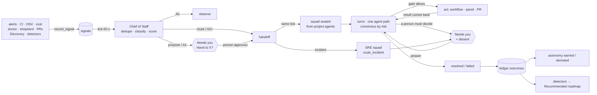
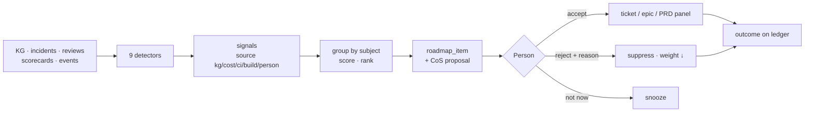

# Engineering spec: autonomous agents — Chief of Staff, squads, AI SRE and learning

**Status:** Built and integrated (foundation + 903–912); ships in v1.0-rc10.11 as a **preview, off by default** · **Epic:** BOSSAPP-902 · **Branch:** `feat/autonomous-agents` · **Date:** 2026-11-06
**Design:** `boss-autonomous-agents-design.md` (Option B, approved 2026-11-05; attached to BOSSAPP-902). Section numbers `§n` below refer to it.
**Code:** `engine/boss_engine/services/ambient/` · `engine/boss_engine/services/incident_squad*.py` · `apps/api/app/routers/ambient*.py`, `incident_squad.py` · `apps/web/app/agent-ops/` · `db/schema.sql` (block "AUTONOMOUS AGENTS").

BOSS notices problems on its own, decides who should work them, and its agents work them TOGETHER on a shared board — every decision on an append-only ledger, every action through the autonomy gate, and all of it visible as a diagram. This document is the one description of that system: what happens, in which module, under which setting, and how to see it. **Use these tables, functions, endpoints and events; never add a second copy of any of them.** To extend, change the module that owns the thing (each section names it) and add a test there.

---

## 0. Off by default (v1.0-rc10.11)

The autonomous agents ship as a **preview, off by default**. With nothing set, the worker's minute tick only expires leases: no signal sweep, no Chief-of-Staff triage, no squad turn, no automatic Discovery dossier and no Recommended-roadmap tick. The **Agents at work** area still shows, **Load demo** still works on a demo project, and a person's **Triage now** runs once in `propose` mode (every handover is a Needs-you card).

To turn it on, open **Govern › Autonomy › Always-on agents** (`PUT /v1/ambient/mode`, `autonomy:manage`, audited as `ambient.mode_changed`) and choose **Ask first** (`propose`) or **Act within levels** (`route`). The choice is install-wide (`system_state['ambient_mode']`) and takes effect on the next tick; no restart. To pin the mode on the server instead, set it in the install's `.env` and run `boss update` (or recreate the api and worker); the community compose forwards every `BOSS_AMBIENT_*` key (`engine/tests/test_compose_forwards_every_setting_an_operator_is_told_to_set.py` pins that), and a pinned mode shows as pinned in the console:

```sh
BOSS_AMBIENT_COS=propose   # safe: every handover asks a person first (route = act on A2+ classes)
# optional, both follow the mode when unset:
# BOSS_AMBIENT_SIGNALS=1   # the sweep + automatic dossier, even with the Chief of Staff off
# BOSS_AMBIENT_LEARNING=1  # the Recommended-roadmap tick, even with the Chief of Staff off
```

`BOSS_AMBIENT_DISABLED=1`, **Stop all** and a project's **Stop** still win over every setting. The gates live in `services/ambient/policy.py` (`mode_state`, `cos_mode`, `signals_on`, `learning_on`); `engine/tests/test_the_autonomous_agents_ship_off_by_default.py` pins them.

## 1. How to see it

1. **Open a demo project** (its name or slug says `demo`, `sample`, `sandbox` or `test`; or start the API with `BOSS_AMBIENT_DEMO=1`). As an owner/admin (`autonomy:manage`), open **Agents at work** — `?area=agent_ops` — and press **Load demo** (shown only on a demo project). It runs `POST /v1/ambient/demo/load`, which loads four stories through the real machinery (§7.9):
   - **Order API incident** — alert → signal → Chief of Staff → SRE squad (lead, Investigator, Engineer, Reviewer) → RCA from the code graph and a precedent → production rollback is a squad vote + a person: **Needs you** with the dissent on the card. Approve it (Command Center or the drawer) and the squad rolls back, fixes, verifies and writes the postmortem ("Recovered 4m12s").
   - **The morning** — CI red on a BOSS PR (engineer + reviewer fix it), a lodash advisory (security reviewer on it), a spend spike, a stale PR and a TODO cluster (cards / observe), and two more order-api alerts that **join** the incident above (one problem, one item).
   - **CVE squad** — four agents, a critique, a panel, a dissent, a workflow run that reports back, a merge only a person may approve: **Needs you**.
   - **Recommended roadmap** — twelve items from nine detectors, two already decided (`aav=roadmap`).
2. **Tabs** (Needs you · Running · Resolved by agents · Overridden · Failed · Dismissed · All) list each item as a diagram thumbnail: first signal → **owner** → last decision → Needs you / outcome. Click one for the full flow chart (left → right; dissent is a split arrow); click any node for its drawer (rationale, evidence, Take over, Dismiss, Why?).
3. **Scorecard** tiles: acceptance, noise, overrides, MTTM, cost per resolved item, and the learning outcomes (Merged, Reverted %, Roadmap taken %, BOSS-started %).
4. **Govern › Autonomy**: the class × level matrix, the daily envelope and the kill switch (Stop here / Stop all). **Command Center** shows an "Agents at work" card and the ambient Needs-you rows; **Ask BOSS** cites ledger rows as `[act:<id>]` links into the flow.
5. Without the console: `POST /v1/ambient/chief-of-staff/run {project_id}` triages now; `python -m boss_engine.services.ambient.demo --project <id>` loads the morning; `python -m boss_engine.services.incident_squad_demo --project <id>` replays the Order API incident.

**Settings** (env, `engine/boss_engine/config.py`):

| Setting | Default | Does |
|---|---|---|
| `BOSS_AMBIENT_COS` | `off` | `off` (the rc10.11 default): no triage, no squads, and the sweep and learning tick stop unless set; `propose`: every handover is a Needs-you card first; `route`: A2+ classes (and incidents at any level) go straight to their squad |
| `BOSS_AMBIENT_SIGNALS` | follows the mode | the worker's sweep of every signal adapter and Discovery's automatic dossier; unset = on unless `BOSS_AMBIENT_COS=off` |
| `BOSS_AMBIENT_LEARNING` | follows the mode | the worker's Recommended-roadmap tick; unset = on unless `BOSS_AMBIENT_COS=off` |
| `BOSS_AMBIENT_COS_MODEL_CALLS` | `3` | model calls the Chief of Staff may make per project per tick (ambiguous class / owner) |
| `BOSS_AMBIENT_COS_CARDS` | `3` | Chief-of-Staff Needs-you cards per class per project per day; the rest are observed |
| `BOSS_AMBIENT_SQUADS` | `1` | owners' turns on the tick (0 = handed-over items wait) |
| `BOSS_AMBIENT_SQUAD_ITEMS` | `3` | items the owners work per tick, install-wide |
| `BOSS_AMBIENT_DISABLED` | — | the install-wide kill switch (as Stop all) |
| `BOSS_AMBIENT_DEMO` / `BOSS_DEMO_DATA` | — | allow the demo loaders on a project whose name does not say demo |
| `BOSS_ROADMAP_DISABLED` | — | no detector runs |

---

## 2. The system in one picture



One path at each step: a problem enters only as a **signal**; work exists only as a **board item**; a decision exists only as a **ledger row**; an action happens only when the **gate** allows it; a person's answer reaches its owner only through **`answers.on_answered`**; and the console draws only **`read_model.graph`**.

---


## 3. The rules every part keeps

1. **One path in, one path out.** A problem enters only through `signals.record_signal`. Work exists only as a board item (`board.open_item`). A decision exists only as a ledger row (`ledger.record_decision`). An action is allowed only by `policy.gate`. There is no other way, and no "just this once" table.
2. **The gate is enforced at the ledger.** An agent, squad or policy decision that names an `action` the gate does not allow is refused by `record_decision` (`GateRefused`), whatever the caller thought. Merge, production deploy, external send and payment (`task_classes.ALWAYS_A_PERSON`) are only ever decided by `person:<id>`.
3. **An agent acts only while it holds the lease.** Call `board.assert_lease(..., lock=True)` in the same transaction as every external effect. On `LeaseLost`, stop — a person took over, the lease expired, or ambient work was stopped.
4. **Visibility is a diagram, not text** (§11.0, the operator's standing rule). The read model returns nodes, edges and badges with ≤ 4-word labels. A screen draws `read_model.graph`; it never renders a paragraph on the canvas. Detail is one click away via each node's `ref`.
5. **Text from outside is data** (§9). Signal titles, finding summaries and evidence notes are normalised by `_common.clean_text`. Nothing in a signal ever widens a grant or a level.
6. **Model-agnostic.** No module here calls a provider directly: the Chief of Staff (`agent_decision.decide`), squad members and the SRE squad (`AgentService.decide`) judge through the one agent path (BOSSAPP-759) and record the result here; the same rows result whichever engine decided, and tests run on scripted engines.
7. **Python 3.11.** The images run 3.11 (the laptop runs 3.13): no 3.12+ syntax.


---

## 4. Modules — who owns what

| Layer (§4) | Module | Owns |
|---|---|---|
| L1 Discover (909) | `ambient/dossier.py` | one dossier per repository; the signals Discovery seeds |
| L2 Sense (903) | `ambient/signals.py`, `ambient/adapters.py` | the `signals` inbox, fingerprints, pull adapters, the sweep |
| L3 Decide (904) | `ambient/chief_of_staff.py` | the tick: dedupe, classify, score, noise control, decide per level, hand over |
| L3 Board | `ambient/board.py` | ambient work items, lifecycle, leases, links, Needs you |
| L4 Act — owners (integration) | `ambient/owners.py` | after a handoff: seat the squad and run its turns on the tick; incidents to the SRE squad |
| L4 Act — squads (908) | `ambient/squads.py`, `squad_turns.py`, `squad_memory.py`, `squad_plugins.py` | roster, turns on the one agent path, consensus in practice, memory, panels/workflows |
| L4 Act — AI SRE (910) | `services/incident_squad.py` | the incident squad: triage, RCA, learnings, gated mitigation, verify, postmortem |
| L4 Act — coordination | `ambient/collab.py` | typed board messages, consensus by risk |
| L4 Act — people | `ambient/answers.py`, `ambient/person_actions.py` | a person's answer to any ambient card; a person's push/review/Stop takes over |
| L5 Govern (905) | `ambient/policy.py`, `ambient/guards.py`, `ambient/task_classes.py` | class × project matrix, the gate, envelope, stop, loop guards |
| Visibility (906) | `ambient/ledger.py`, `ambient/read_model.py`, `apps/web/app/agent-ops/` | the decision ledger; graphs, lists, scorecard; the console |
| L6 Learn (911/912) | `ambient/learning.py`, `detectors.py`, `roadmap.py`, `outcomes.py` | detectors, the Recommended roadmap, outcomes and metrics; `policy.review_track_record` |
| Demo | `ambient/demo.py` (+ `squad_demo.py`, `roadmap_demo.py`, `incident_squad_demo.py`) | `load_all`: every story on a demo project |

---

## 5. Decisions taken (and why)


| Question | Decision | Why |
|---|---|---|
| A new work-item table, or extend `work_orchestration`? | **Extend `work_items`.** An ambient item is created through `WorkOrchestrationService.upsert_work_item` (same scoring, same `work.priority_scored` event, same `evaluate_admission` / `rank_by_value_density`), plus ambient columns. | §3.2: "a ranked backlog that almost nothing feeds"; BOSSAPP-830 makes the work item the canonical node. A second table would split "what is BOSS working on" into two answers. |
| How does an ambient row fit `UNIQUE(project_id, subject_type, subject_id)`? | `subject_type='ambient'`, `subject_id=<its own id>`; the real subject is `subject_ref` (`app:order-api`, `pr:acme/shop#41`). Portfolio `status` is `active` while live, `done` after. | One app has many problems over time; the portfolio's uniqueness is one row per subject for ever. |
| Do ambient items show on the release board? | **No.** `list_work_items(..., ambient=False)` in `release_planning`. | They live on Agent Operations until a person accepts one into a ticket (§14.4); A0 items on the release board are the noise §10 warns about. |
| A decision table, or `agent_acts`? | **`agent_acts` kind `decision`** + a 1:1 detail table `agent_act_decisions`. | `agent_acts.py` exists to end "eight answers in eight tables" (§11.2). The act row gives who/when/cost/chain to every existing reader; the 30 decision-only fields would be NULL on every other act. |
| Append-only how? | A **database trigger** (`boss_append_only_ledger`). The only update fills an empty outcome once; deletes need `SET LOCAL boss.ledger_purge = 'on'`. | Enforced for every writer, not only the ones that remember. |
| Where is "one live item per fingerprint"? | A **unique partial index** on `work_items(project_id, fingerprint)` over live lifecycles, plus an advisory lock in `open_item`. | §6 rule 1, generalising `self_fix._live_claim`; the database refuses what a race would create. |
| The new `how` edges | `signal` ("Raised by a signal") and `board` ("From the work board"). An override uses `approved`. | A decision reaches its decider from a sensor or from the board; neither is a person's or agent's handoff. |
| Permissions | No new catalogue permissions. Reads: `work_item:read`, `decision:read`, `autonomy:read`. Take over / dismiss / **stop**: `work_item:manage`. Override: `decision:approve`. **Resume**, levels, envelope, install-wide stop: `autonomy:manage`. | The safe direction (stop, take over) must be easy; giving agents more room is privileged. |
| Sweep cadence | **Wired (904):** the worker's background thread knocks on `POST /v1/ambient/tick` every 60 s → `chief_of_staff.tick` (expire leases → `signals.sweep()` → triage every project with work). `POST /v1/ambient/signals/sweep` and `POST /v1/ambient/chief-of-staff/run` run it on request. | "No new daemon"; one tick owner (the CoS). On the background thread because an alert during a 45-minute build must be triaged during it. |
| How safe is the tick by default? (904) | rc10.11 ships `BOSS_AMBIENT_COS=off` (preview; §0). Once on, `propose`: every item at A1+ becomes a Needs-you card ("Hand to SRE?") whatever its class level; `route` honours the matrix (A2+ handed straight to the owner); `off` sweeps but triages nothing. `BOSS_AMBIENT_SIGNALS=0` stops the sweep. The stop wins over all of it. | The operator's "default ON, A1 propose, so it's safe"; a person raises a project to `route` deliberately. |
| Who works an item after the Chief of Staff hands it over? | **A squad, on the same tick** (`owners.work`, called at the end of `chief_of_staff.tick`): `squads.assemble` from the project's own agents + `squad_turns.collaborate` for 2 rounds; incident classes go to `incident_squad.route_incident`. Bounded by `BOSS_AMBIENT_SQUAD_ITEMS` (3/tick), an idle squad runs again only when its board has news (a person answered, a run came back, a non-member posted) or after 30 min. | One tick owner; a handoff that nobody picks up was the gap between 904 and 908/910. Re-running an idle squad every minute would spend model calls on nothing. |
| Who carries a person's answer to an ambient card? | **One function, `answers.on_answered`**, called by `DecisionService` on approve / reject / revise for any decision whose recommendation names a `work_item_id` and `asked_by`. Incident card → `incident_squad.on_needs_you_answered`; Chief-of-Staff card → `chief_of_staff.carry_answer` (handoff, its decision's outcome); squad card → `squad_turns.person_answered`; otherwise `board.answered`. | Three streams each owned a piece of "a person answered"; one carrier means no double handling. The tick's `follow_up` / `answers.sweep` are idempotent safety nets over the same carriers (an answer that bypassed the service). |
| Noise from propose-by-default | (1) A failed step/build whose run **already asks a person** (an open decision on the run/build) gets no card: the item links that decision and is observed. (2) At most **3 Chief-of-Staff cards per class per project per day** (`BOSS_AMBIENT_COS_CARDS`); the rest are recorded `observe` for the digest and stay on the list. (3) Guards' 10 items/class/day still cap item creation. | The operator should see one question per problem, not a second card for a run that is already waiting on them. |
| Project-less signals (the system doctor) | **Adopted into the install's default project** (`settings.default_project_id`) at the start of each tick (`chief_of_staff.adopt_install_wide`); a twin already open there absorbs it (`merged_into`). No default project → they stay in the inbox, observe-only. | That is where the operator works; a finding nobody triages is invisible. |
| Incidents in `route` mode | **Straight to the SRE squad at any level** (`chief_of_staff.ROUTE_AT_ANY_LEVEL`). In `propose` mode they get a card like everything else. | "Agents automatically invoked when a paging happens … root cause, apply the learnings" — the squad only investigates on its own; a production mitigation is still a squad vote + a person. |
| The diagram's labels for squads | A handoff's `seat` (≤ 4 words) labels the receiving node on that item ("SRE lead", "Investigator"); the generic seats `lead/specialist/critic` stay badges. A decision node reads the chosen option's label ("Hand to SRE", "Revise"). The list thumbnail shows the item's **owner** (squad lead, else last handoff, else lease holder). | Words, not keys; the owner is what a stranger looks for first. |
| Learning cadence | The learning tick runs on the worker's background thread beside the ambient tick. | A 45-minute build must not hold the roadmap and outcomes back. |


---

## 6. Tables (all in `db/schema.sql`, idempotent; the API self-migrates on boot)

### 6.1 `signals` — one normalised inbox (903)

| Column | Meaning |
|---|---|
| `id` | `sig_<ulid>` |
| `project_id` | NULL = install-wide (doctor findings). Listed for every project. |
| `source` | one of `signals.SOURCES`: `github ci osv alert doctor shepherd scan schedule cost kg person workflow build pr` |
| `kind` | dotted, e.g. `alert.firing`, `workflow.step_failed`, `build.failed`, `doctor.<kind>`, `shepherd.escalation`, `pr.stale` |
| `subject_kind`, `subject_id`, `app` | what it is about |
| `fingerprint` | stable identity of the problem (`signals.fingerprint(kind, *subject, project_id=)`) |
| `severity` | `info low medium high critical` (a repeat keeps the worst) |
| `title` | cleaned, ≤ 300 chars |
| `evidence` | `[{kind, ref, note?}]` (§5 ref kinds), newest first, ≤ 50 |
| `source_refs` | every source row already folded in (≤ 200, GIN-indexed) — what makes a re-sweep a no-op |
| `occurrences` | repeats counted on this row |
| `dedupe_window_seconds` | a repeat this soon after a CLOSED row is the same occurrence |
| `status` | `new → triaged → done`; or `merged_into` / `suppressed` (`suppressed_until` NULL = until the evidence changes) |
| `work_item_id` | the item that holds it (set by `board.open_item`) |
| `caused_by_run_id`, `causal_depth` | loop guard (§6 rule 2) |
| `observed_at`, `first_seen_at`, `last_seen_at`, `expires_at` | |

Unique: one row per `(project, fingerprint)` in `new/triaged/suppressed`. `signal_adapter_cursors(adapter, cursor_at, last_run_at, last_recorded, last_error)` holds each adapter's place (`<adapter>` install-wide, `<adapter>@<project>` per project).

### 6.2 `work_items` — ambient columns (908 core)

Added: `ambient` (bool), `fingerprint`, `lifecycle`, `task_class`, `autonomy_level` (`A0..A3`, the class's level when opened), `risk`, `severity`, `subject_ref`, `app`, `lease_owner` (`agent:<role>` / `person:<id>`), `lease_kind` (`agent`/`person`), `lease_token` (never serialised), `lease_expires_at` (NULL for a person), `causal_depth`, `caused_by_run_id`, `attempts`, `outcome`, `resolved_by`, `resolved_at`, `needs_you_at`, `needs_you_decision_id`, `answered_at`, `cost_usd_micros`, `squad` (JSON list of parties).

`work_item_links(work_item_id, kind, ref, project_id, note, created_by, created_at)` — kinds: `signal workflow_run code_task decision act incident meeting pull_request reservation alert recommendation`.

### 6.3 `work_item_messages` — the board's protocol (908)

`id (wim_<ulid>), project_id, work_item_id, kind, sender, body (json), reply_to, act_id, created_at (clock_timestamp)`. Kinds and bodies in §6. UPDATE refused by trigger; one vote per `(reply_to, sender)`.

### 6.4 `agent_acts` + `agent_act_decisions` — the decision ledger (906)

`agent_acts.kind` gains `decision`; `agent_acts.how` gains `signal`, `board`. A decision act is written closed (`status complete`), `role_key` = the deciding agent's role (NULL for a person / policy / squad), `accountable` = the person, else `boss`, `subject_kind='work_item'`, `subject_id=<item>`, `cost_usd` = the decision's cost.

`agent_act_decisions` (1:1, PK `act_id`):

| Column | Meaning |
|---|---|
| `work_item_id`, `signal_ids` | what it is about |
| `question` | one sentence |
| `decided_by` | `agent:<role>` · `policy:<rule id>` · `squad:<work item id>` · `person:<id>` (CHECK) |
| `chosen`, `options`, `rejected` | `options: [{key,label}]` incl. chosen; `rejected: [{option, why?}]` |
| `rationale` | ≤ 3 sentences (refused otherwise) |
| `evidence` | `[{kind, ref, note?, checked: "exists"|"shape"}]` — every BOSS ref verified to exist in the project |
| `confidence` | 0..1 |
| `autonomy_level`, `task_class`, `action` | what it was allowed under |
| `reversibility`, `undo` | `reversible` requires `undo` (CHECK) · `compensable` · `irreversible` |
| `consensus` | the record from `collab.tally` (§6.2) |
| `proposal_id` | the board proposal it settles |
| `cost_usd_micros` | |
| `overrides_act_id` | an override points at the row it overrides (at most one override per row) |
| `outcome`, `outcome_ref`, `outcome_at` | filled once: `accepted edited dismissed ignored merged reverted recurred overridden succeeded failed incident_caused` |

### 6.5 `ambient_autonomy`, `ambient_autonomy_changes`, `ambient_settings` (905)

- `ambient_autonomy(project_id, task_class, level, ceiling, set_by, reason, updated_at)` — a row only where a person (or a demotion) changed the default; `level ≤ ceiling ≤ catalogue ceiling`.
- `ambient_autonomy_changes(id, project_id, task_class, kind set|ceiling|promotion_suggested|promoted|demoted, from_level, to_level, actor, reason, evidence, created_at)`.
- `ambient_settings(project_id, daily_cap_usd_micros=5_000_000, max_concurrent=2, max_spawn_depth=2, daily_attempt_cap=10, cooldown_hours=24, breaker_failure_ratio=0.5, breaker_min_runs=4, stopped, stopped_by, stopped_at, stop_reason, resumed_at, updated_by, updated_at)`.
- Install-wide stop: `system_state['ambient'] = {stopped, by, at, reason}`. Environment: `BOSS_AMBIENT_DISABLED=1`.

---

### 6.6 `project_dossiers` (909)

One current dossier per `(project_id, repo)`: `id (dos_<ulid>), head_sha, facts (json), highlights (≤ 6 badge lines), seeded_signals ([{signal_id, kind, outcome}]), read_from checkout|graph, version, built_by, built_at`. `facts`: `stack, languages, structure, ci, commands {test, lint, build}, tests, owners {codeowners, rules, top_committers (names only)}, docs {readme, runbooks, adrs …}, todos {total, clusters}, hotspots [{file, churn, lines, score, has_tests}], dependencies, advisories {status ok|skipped, advisories}, boss {open_boss_prs, live_items, kg}`.

### 6.7 `ambient_recommendations` (911)

1:1 with a `roadmap_item` work item: detector(s), kind, fingerprint, subject, title, why, proposed shape (`ticket epic prd`), squad, evidence, score parts (value, evidence strength, freshness, effort, risk, detector weight, priority, estimated cost, score), status (`open snoozed accepted rejected resolved_by_change`), the proposal/decision act ids, who decided, reject reason + category, what it was accepted as, the artifact, recurrence. Outcomes are NOT stored here — they are on the ledger.


---

## 7. Python API (engine)

All functions take a SQLAlchemy `Connection` inside the caller's transaction and never commit. Parties are strings: `agent:<role>`, `person:<id>`, `policy:<id>`, `squad:<id>`, or `boss`.

### 7.1 Signals — `ambient.signals`

```python
record_signal(c, *, project_id, source, kind, title, fingerprint_parts=(), fingerprint_value=None,
              subject_kind=None, subject_id=None, app=None, severity="medium", evidence=(),
              source_ref=None, observed_at=None, dedupe_window_seconds=3600, expires_at=None,
              caused_by_run_id=None, actor="boss") -> {"signal": row, "outcome": str}
# outcome: created | repeat | duplicate | suppressed
fingerprint(kind, *subject, project_id=None) -> str
list_signals(c, *, project_id, status=(), source=None, include_install_wide=True, limit=100)
set_status(c, signal_id, status, *, actor="boss", reason=None, merged_into=None,
           suppressed_until=None, work_item_id=None)
sweep(c, *, project_id=None, only=None, actor="boss") -> {adapter: {since, outcomes, error}}
@adapter("name")   # register fn(c, since, project_id=None) -> Iterable[record_signal kwargs]
                   # + optional "_cursor": the value of the column filtered on `since`
```

Built-in adapters (`ambient/adapters.py`): `app_alerts` (alert.firing — BOSS rules, pushed app signals, external sources), `workflow_failures` (workflow.step_failed, folded by workflow + step + error shape), `build_failures` (build.failed, folded by error shape), `system_doctor` (doctor.<kind>, install-wide), `shepherd` (shepherd.escalation), `stale_prs` (pr.stale: a merge question open ≥ 3 days). **903 (built):** `ci_checks` (ci.failed — a failed `ci_waits` row on a PR BOSS opened; fingerprint = PR + failed check names; `caused_by_run_id` = the build), `dependency_advisories` (osv.vulnerable_dependency — open `osv` security findings; fingerprint `("osv", package, advisory)`, the same one Discovery uses), `cost_anomalies` (cost.anomaly — open `cost_anomalies`), `spend_spikes` (cost.spend_spike — 24 h spend ≥ 3× the 7-day mean and ≥ $1, subscription calls excluded; one per project per UTC day). `adapters.pr_ref(url)` → `pr:owner/repo#n`. An adapter yields `_cursor` so a sweep that hit its row limit resumes after the last row read.

Rules: pass `source_ref` whenever there is one (the source row id, plus whatever makes a new occurrence distinct — e.g. `app_alert:<id>#<fire_count>`). A re-read of a folded-in ref returns `duplicate` and changes nothing. A signal caused by an ambient run deeper than `max_spawn_depth` is stored `suppressed` with the reason and an `ambient.guard_refused` event.

Example — a CI sensor (903 follow-up):
```python
from boss_engine.services.ambient import signals

@signals.adapter("ci_checks")
def ci_checks(c, since, project_id=None):
    for run in read_failed_check_runs(c, since, project_id):
        yield {"project_id": run.project_id, "source": "ci", "kind": "ci.failed",
               "title": f"{run.check} failed on {run.branch}",
               "fingerprint_parts": (run.repo, run.branch, run.check),
               "subject_kind": "pull_request", "subject_id": run.pr_url,
               "severity": "high" if run.branch == "main" else "medium",
               "evidence": [{"kind": "url", "ref": run.html_url}],
               "source_ref": f"check_run:{run.id}", "observed_at": run.completed_at,
               "caused_by_run_id": run.boss_run_id,   # an ambient branch's own CI
               "_cursor": run.updated_at}
```

### 7.2 The board — `ambient.board`

```python
open_item(c, settings=None, *, project_id, fingerprint, title, task_class, subject_ref=None,
          app=None, signal_ids=(), severity="medium", description="", causal_depth=0,
          caused_by_run_id=None, actor="agent:chief_of_staff", scores=None)
    -> {"item", "outcome": "opened"|"joined"|"refused", "guard"?, "reason"?}
claim(c, item_id, *, owner="agent:<role>", minutes=30) -> {"item", "lease_token"}
assert_lease(c, item_id, *, owner, token, lock=False) -> item      # raises LeaseLost
renew(c, item_id, *, owner, token, minutes=30)
release(c, item_id, *, owner, token, reason="")
start(c, item_id, *, owner, token)                                 # claimed -> in_progress
needs_you(c, item_id, *, actor, question, recommendation, options=(), risk_tier=1,
          cost_of_waiting="", token=None) -> item + needs_you_decision_id
answered(c, item_id, *, actor, to=None)                            # back to the lease holder,
                                                                   # else proposed, or an end
finish(c, item_id, *, actor, lifecycle="resolved"|"failed"|"dismissed", outcome="", token=None)
dismiss(c, item_id, *, actor, reason)                              # a person; reason required
take_over(c, item_id, *, actor, reason="")                         # a person; cancels the lease
on_person_action(c, *, project_id, subject_ref, actor, what) -> [item ids]
cancel_agent_leases(c, *, project_id, actor, reason)               # the stop's teeth
expire_leases(c, *, project_id=None) -> [item ids]
link(c, item_id, kind, ref, *, actor="boss", note=None)
add_cost(c, item_id, usd_micros)
get(c, item_id, *, project_id=None) / links(c, item_id) / list_items(c, project_id, ...)
```

Lifecycle: `proposed → claimed → in_progress → resolved | failed`; any live state → `needs_you` → back; any live state → `dismissed`. Errors: `Conflict` (wrong state / held / stopped), `LeaseLost`, `LookupError`.

`needs_you` creates its Decisions row through `core.create_blocking_decision` (reason `ambient_needs_you`, default action `hold`, `recommendation` carries `work_item_id`, `task_class`, `autonomy_level`, `asked_by`, `cost_of_waiting`). That function keeps ONE open decision per cause: two items asking the identical question about the identical subject share one card, and one answer answers both — intended ("one queue", §11.5). The subject is appended to the question so different subjects never merge.

Example — an agent's turn on an item:
```python
from boss_engine.services.ambient import board, policy, ledger

held = board.claim(c, item_id, owner="agent:sre")
token = held["lease_token"]
verdict = policy.gate(c, project_id, "incident_staging_mitigation", "staging_rollback")
if verdict["allowed"] and not verdict["needs_person"]:
    board.start(c, item_id, owner="agent:sre", token=token)
    board.assert_lease(c, item_id, owner="agent:sre", token=token, lock=True)
    ledger.record_decision(c, project_id=project_id, decided_by="agent:sre", ...,
                           action="staging_rollback", consensus=record)  # record: collab.tally
    ...start the rollback workflow; board.link(c, item_id, "workflow_run", run_id)
elif verdict["needs_person"]:
    board.needs_you(c, item_id, actor="agent:sre", token=token, question="Roll back order-api?",
                    recommendation={"action": verdict["action"]})
```

Wiring the person's takeover (904/907/910): every place a person acts on a subject — a commit or comment webhook on a `boss/ambient/*` branch, Cancel on a run, an edit to a PR — calls `board.on_person_action(c, project_id=, subject_ref=, actor=, what=)`.

### 7.3 The ledger — `ambient.ledger`

```python
record_decision(c, *, project_id, decided_by, question, chosen, rationale, reversibility,
                options=(), rejected=(), evidence=(), confidence=None, work_item_id=None,
                signal_ids=(), task_class=None, autonomy_level=None, action=None, undo=None,
                consensus=None, proposal_id=None, cost_usd_micros=0, overrides_act_id=None,
                accountable=None, how=None, parent_act_id=None, **act_links) -> row
override(c, act_id, *, actor, chosen, rationale, evidence=()) -> new row
record_outcome(c, act_id, *, outcome, outcome_ref=None, actor="boss") -> row + track_record
get_decision(c, act_id) / list_decisions(c, project_id, *, work_item_id=None, task_class=None)
```

Refusals: `GateRefused` (`.verdict` is the gate's answer), `EvidenceError`, `LedgerConflict` (outcome already set / row already overridden), `ValueError` (rationale > 3 sentences, reversible without `undo`, bad level/class), `LookupError`. Agent, squad and policy decisions need ≥ 1 evidence ref. `**act_links` are `agent_acts` links (`workflow_run_id`, `code_task_run_id`, `meeting_run_id`, `decision_id`, `receipt_id`, ...). A decision on an item posts a `decision` message on the board (replying to `proposal_id` when given) and adds its cost to the item.

### 7.4 Policy — `ambient.policy` and `ambient.task_classes`

```python
gate(c, project_id, task_class, action) -> {allowed, needs_person, level, required_level,
                                            action, task_class, risk, reversibility,
                                            consensus_mode, reason}
level_for(c, project_id, task_class) / matrix(c, project_id) / changes(c, project_id, ...)
set_level(c, project_id, task_class, *, actor, level=None, ceiling=None, reason="")
track_record(c, project_id, task_class) / review_track_record(c, project_id, task_class)
settings_for(c, project_id) / update_settings(c, project_id, *, actor, **limits)
stop_state(c, project_id=None) / is_stopped(c, project_id)
stop(c, *, project_id|None, actor, reason) / resume(c, *, project_id|None, actor, reason="")
envelope(c, project_id) -> {cap_usd_micros, spent_usd_micros, held_usd_micros,
                            available_usd_micros, resets}
reserve(c, settings, *, project_id, work_item_id, amount_usd_micros, reason,
        expires_in_minutes=120, risk_tier=None)   # stop -> envelope -> BudgetGovernor('ambient')
```

**Task classes** (key · default · ceiling · risk · owner role): `ci_setup A1/A2 low operations_engineer` (909) · `ci_fix_boss_pr A2/A3 low software_engineer` · `red_main A1/A2 medium sre` · `security_patch A2/A3 medium security_reviewer` · `dependency_upgrade A1/A3 low` · `flaky_test A1/A3 low qa` · `missing_tests A1/A2 low qa` · `doc_drift A1/A2 low docs_writer` · `todo_triage A0/A1 low chief_of_staff` · `dead_code A1/A2 medium` · `issue_triage A1/A2 low` · `incident_response A1/A3 high sre` · `incident_staging_mitigation A2/A3 medium sre` · `perf_regression A1/A2 medium sre` · `stale_handoff A1/A2 low chief_of_staff` · `cost_anomaly A1/A3 low finops_sentinel` · `platform_self_fix A1/A2 medium` · `release_notes A1/A2 low docs_writer` · `knowledge_refresh A1/A3 low archivist` · `iac_drift A1/A1 high infra_steward` · `workflow_failure A1/A2 medium` · `system_health A1/A2 medium infra_steward`.

**Actions** (key · min level · risk · reversibility): `observe`, `record_finding` A0 · `propose`, `ask_question`, `comment` (compensable), `convene_meeting` A1 · `label`, `nudge` (compensable), `start_workflow`, `open_draft_pr`, `staging_rollback`, `staging_restart`, `silence_rule` A2 · `prod_rollback`, `prod_restart` A3 high · `quarantine_test` A3 low · **`merge`, `deploy_prod`, `send_external`, `pay` — always a person**.

Gate semantics: stopped → not allowed. Always-a-person action → `needs_person`. Level below the action's → `needs_person` if the class is ≥ A1 (propose it), else observe only. Otherwise allowed; `needs_person` is still true when the consensus mode is `squad_vote_and_person` or `recommend_only`. The class's risk raises the risk only for acting actions (A2+).

Track record: decisions by non-persons since the class's last level change; accepted = `accepted edited merged succeeded`; rejected = `dismissed ignored overridden failed`; demoting = `reverted incident_caused`. Any demoting outcome drops the class one level at once (`kind demoted`, actor `boss`). ≥ 20 decided, ≥ 85 % accepted, 0 reverted → one `promotion_suggested` change; **BOSS never raises a level itself**.

### 7.5 The Chief of Staff — `ambient.chief_of_staff` (904)

```python
tick(engine, settings=None, *, project_id=None, adapter=None, decider=None, sweep=None, mode=None,
     squad_model=None, launchers=None, incident_mind=None, incident_effects=None)
    -> {mode, sweep, adopted, expired, projects: {pid: report}, owners: owners.work report, stopped?}
triage_project(c, settings, project_id, *, mode=None, adapter=None, decider=None,
               max_model_calls=None) -> {mode, items: [{outcome, work_item_id, act_id, owner,
               task_class, level}], follow_ups, answers, counts, model_calls, model_cost_usd_micros}
carry_answer(c, *, item_id, decision_id=None)   # a person answered its card (answers.py calls it)
follow_up(c, project_id)                        # the tick's safety net over carry_answer
adopt_install_wide(c, settings) -> n            # doctor findings → the default project
run_already_asks(c, project_id, group) / cards_today(c, project_id, task_class)
rule_candidates(signal) / classify(...) / route(...) / scores(...) / subject_ref(signal)
```

One tick: stop check → expire leases → sweep → adopt install-wide signals → per project with work (new signals, or an answered card not yet carried): breaker → stop → follow-ups + `answers.sweep` → new signals grouped by `(task class, subject)` (subjects `app pull_request dependency repo provider budget`; else the signal's fingerprint) → classify (rules; `agent_decision.decide` only when ambiguous, ≤ `BOSS_AMBIENT_COS_MODEL_CALLS` per tick and only with ≥ $0.02 in the envelope; below the confidence bar → `ask_question`) → rank by `compute_priority_score` → per group `board.open_item(actor="agent:chief_of_staff")` → **owners' turn** (`owners.work`, §7.6).

Outcomes per group: `joined` (a `finding` "Seen again ×n"), `refused` (signals suppressed until the guard lifts; stop/breaker leave them `new`), `observed` (A0), `linked` (the failed run already asks a person: the item links that decision, decision `observe`, finding "Run already asks you"), `capped` (the class's daily card cap: decision `observe`), `proposed`/`asked` (decision `propose:<role>`/`ask` + `board.needs_you`, recommendation `{action: "ambient_route", owner, next_action, owner_may_act, act_id, estimate_usd, priority}`), `routed` (`route` mode, A2+ or an incident class: decision `route:<role>` + `handoff`, with `seat: "SRE lead"` for an incident). Board sequence: `claim → finding → proposal → decision → handoff | Needs you`; the lease is released at the end of the turn. Routing: `ROUTES` lists the roles that may own a class; the one with ≥ 3 resolved and ≥ 70 % here wins, else the model's pick, else the catalogue owner. An answered card: `approved` → `board.answered` + `handoff` to the owner + the CoS decision's outcome `accepted`; `rejected` → dismissed + `dismissed`; other → `ignored` — each recorded as a `person:<id>` decision.

### 7.6 Owners at work — `ambient.owners` (integration)

```python
work(engine, settings, *, project_id=None, limit=None, model=None, decider=None, launchers=None,
     incident_mind=None, incident_effects=None, rounds=2)
    -> {worked: [{work_item_id, kind: squad|incident|no_squad|error, ...}], watching: {pid: [...]}}
due_items(c, *, project_id=None, limit=3) -> [{id, kind: assemble|squad|incident, ...}]
```

Worked: live ambient items (not `roadmap_item`, not held by a person, not waiting on one) that carry a `handoff` from `agent:chief_of_staff`. An incident class with no triage decision yet → `incident_squad.route_incident`; then `incident_squad.tick` per project for incidents watching recovery. Any other class: no squad yet and `proposed` → `squads.assemble(actor=CoS)` (a project that cannot field a lead + a different critic gets one `escalate` "No squad could be seated: …" and is not retried) → `squad_turns.collaborate(engine, …, rounds=2)`. An item with a squad runs again only when its board has news since the last `ambient.squad_turn` (an answer, a returned run, a non-member's post) or after 30 min. Stopped by the kill switch, `BOSS_AMBIENT_COS=off` and `BOSS_AMBIENT_SQUADS=0`.

### 7.7 A person's answer — `ambient.answers`

```python
on_answered(c, settings, decision_row, actor, verdict: approve|reject|revise, note=None) -> carrier | None
sweep(c, settings, project_id) -> [{decision_id, carried_to}]
```

Called by `DecisionService` (`_handle_approved_follow_on` / `_handle_non_approved_follow_on`) for every decision whose recommendation has `work_item_id` + `asked_by` (i.e. raised by `board.needs_you`). Carriers: `incident_squad.mitigate` → `incident_squad.on_needs_you_answered` (approve = roll back + fix, revise = fix only, reject = hold); `asked_by agent:chief_of_staff` → `chief_of_staff.carry_answer`; `proposal_id` (a squad's card) → `squad_turns.person_answered` (the person's ledger row settles the proposal; the squad carries an approval out at its next round, once); otherwise `board.answered`. Each carrier checks the item still waits, so a second call is a no-op.

### 7.8 Discovery — `ambient.dossier` (909)

```python
build(c, *, project_id, repo, root=None, paths=None, head_sha=None, actor="boss", osv=None,
      seed_signals=True) -> dossier row
scan_tree(root, *, osv=None) / facts_from_paths(paths) / osv_lookup(packages) / get(c, pid, repo=None)
after_index(engine, settings, *, project_id, repo, root, head)   # called by repo_index
```

Seeded signals (`source scan`, or `osv`): `scan.no_ci` → `ci_setup`, `scan.missing_tests` / `scan.untested_hotspot` (≤ 3) → `missing_tests`, `scan.todo_cluster` (≥ 5 in one dir) → `todo_triage` (A0), `scan.no_docs` → `doc_drift`, `osv.vulnerable_dependency` → `security_patch`. `source_ref` includes the head, so a rebuild at the same commit raises nothing.

### 7.9 Person take-over wiring — `ambient.person_actions` and the demo

`on_github_event(c, project_id=, event=, payload=, bot_login=)` (called by `InboundWebhookService.ingest` for every GitHub delivery with a project and not from BOSS's App): a person's `pull_request` / `pull_request_review(_comment)` / PR `issue_comment` → `pr:<repo>#n`; `push` → `branch:<repo>:<branch>`. `on_run_cancelled(c, project_id=, run_id=, actor=, kind=)` (called by `workflows.cancel_run` and `code_task_service.cancel_run`): `run:<id>` / `build:<id>` and every live item linked to the run. Bots, BOSS's App and BOSS's own actors never take over; failures never reach the caller.

`ambient.demo` — `load(c, settings, *, project_id, mode="route")` (the morning: seven signals through the real triage, plus the engineer/reviewer and security owners' first turns) and **`load_all(engine, settings, *, project_id, actor)`** (the console's Load demo: Order API incident through the Chief of Staff (`incident_squad_demo.run_through_chief_of_staff`), the morning, the CVE squad (`squad_demo.seed`), the roadmap (`roadmap_demo.seed`); each in its own transaction, reported `loaded` or `skipped` with why). `status(c, project_id)` says whether it is offered. Refused unless the project's name/slug says demo/sample/sandbox/test or `BOSS_AMBIENT_DEMO=1` (the roadmap loader also needs `demo` in the name or `BOSS_DEMO_DATA=1`). CLI: `python -m boss_engine.services.ambient.demo --project <id>`.


### 7.10 Guards — `ambient.guards`

`admit_new_item(c, *, project_id, fingerprint, task_class, causal_depth)` (called by `open_item`): stop · breaker · depth > `max_spawn_depth` · cooldown (`cooldown_hours × 2^(n−1)` after the n-th dismissed/failed item for the fingerprint in 30 days) · `daily_attempt_cap` per class per UTC day. `admit_start(c, *, project_id)` (called by `start`): stop · breaker · `max_concurrent`. `check_breaker(c, project_id)`: in the last hour (or since `resumed_at`), ≥ `breaker_min_runs` ended and ≥ `breaker_failure_ratio` failed → `policy.stop` + `ambient.breaker_tripped`. Every refusal emits `ambient.guard_refused {guard, reason, ...}`.

### 7.11 Collaboration — `ambient.collab`

```python
post(c, item_id, *, kind, sender, body, reply_to=None, act_id=None) -> message
messages(c, item_id, *, kinds=(), viewer=None)   # viewer: hides votes the viewer has not cast
tally(c, item_id, proposal_id, *, mode=None) -> consensus record
consensus_mode(*, risk, reversibility, always_a_person=False) -> mode
satisfies(consensus, required_mode) -> bool
```

### 7.12 Read model — `ambient.read_model`

```python
graph(c, item_id, *, project_id) -> {item, badges, nodes, edges}
list_view(c, project_id, *, filter_="all", task_class=None, limit=30, before=None)
    -> {filter, items: [item summary + badges + owner + strip], counts: {tab: n}, next_before}
scorecard(c, project_id, *, days=7, task_class=None)   # + `outcomes` (912)
owner_of(c, item) -> party | None                      # squad lead, else last handoff, else lease
```

### 7.13 Squads — how agents work an item together (908)

Modules: `ambient/squads.py` (roster), `ambient/squad_turns.py` (turns, consensus, rounds), `ambient/squad_memory.py`, `ambient/squad_plugins.py` (panels, workflows, results back), `ambient/squad_demo.py` (non-production demo).

```python
squads.assemble(c, item_id, *, actor="agent:chief_of_staff", template=None, lease_minutes=60,
                max_specialists=2) -> {"squad", "lease_token", "message", "outcome": "assembled"|"existing"}
squads.roster(c, item_id) -> {template, title, execute_workflow, lead, members[{party, seat, why}],
                              critics, unfilled, assembled_by} | None
squads.hand_lead(c, item_id, *, to, token, summary) -> {lead, lease_token}
squads.workforce(c, project_id, task_class) -> [{role_key, on_duty, live_items, has_room, record}]

squad_turns.take_turn(c, settings, item_id, member, *, round_no=1, model=None, decider=None,
                      read=None, launchers=None) -> {member, seat, move, status, message_id?, ...}
squad_turns.settle(c, settings, item_id, *, end_of_round, launchers=None)
    -> None | {state: decided|revise|needs_you|waiting, act_id?, decision_id?, dissent, ...}
squad_turns.collaborate(engine_or_connection, settings, item_id, *, rounds=4, model=None,
                        decider=None, read=None, launchers=None)
    -> {rounds, turns, settled, results, stopped: {guard, reason}}
squad_turns.person_answered(c, item_id, *, actor, approve, rationale) -> {item, decision}
squad_memory.pack(c, item_id) / read / note(..., tried_and_failed=) / close(c, item_id, actor=)
squad_plugins.collect_results(c, item_id) -> [{kind, ref, status, failed, finding_id}]
squad_demo.seed(engine, settings, *, project_id, confirm_demo=True, ensure_roles=False)
```

- **Seats.** `lead` (holds the lease; proposes, convenes, hands off, resolves), `specialist`, `critic` (the checker of record; never the lead). Templates per task class: `incident`, `failing_ci`, `dependency_cve`, `design_question`, `general`. Only the project's own `roles`, `lifecycle = active`, on fewer than `MAX_LIVE_ITEMS_PER_AGENT` (3) live items; track record on the class breaks ties; an unfillable specialist seat is recorded as `unfilled` with the reason. No lead + different critic → `SquadError`. Whoever assembled the squad (the CoS) is not on it.
- **A turn is the one agent path.** `AgentService.decide(external_ref="work_item:<id>", role=<role key>)` with the board moves as candidates (`finding hypothesis proposal critique vote hand_lead escalate resolve pass`, offered by seat and board state), argument schemas, the agent's own brief, and a caller `check` (evidence exists, enums, no repeat, no re-proposing what was rejected) with one re-ask. Context: the item, the seat, **squad memory first**, the board as the member may see it (no herding), the refs it may cite, and for the lead the gate's verdict per action. No model → no move.
- **Consensus in practice.** A proposal settles at the end of a round (a `single` one at once). Approved → `record_decision` (decided by the lead for `single`, by `squad:<item>` for maker-checker) with the consensus record, then the action executes (`start_workflow`/`open_draft_pr` → workflow, `convene_meeting` → panel; other actions are carried out by their owner stream). Rejected → a `revise` decision by `squad:<item>` and a tried-and-failed entry. A person needed (gate, mode, unsafe, two objections, tie, no quorum, nobody checked in two turns each) → `board.needs_you` whose recommendation carries `proposal_id`, `recommended: approve|hold`, the consensus and every dissent. `person_answered` records the person's decision (it settles the proposal); what they approved executes at the next round, once. **Tie-break rules** are in `squad_turns`' docstring.
- **Guards.** Per item: `MAX_TURNS_PER_ITEM` 40 (`ambient.squad_turn` events), `SQUAD_BUDGET_USD_MICROS` $1.50, `MAX_PROPOSALS_PER_ITEM` 4; the project envelope; the stop; a person's take-over; the lead's lease checked before every turn and effect; a whole round of passes ends the run. A lapsed lead re-claims at the next round (never from a person, never while stopped).
- **Squad memory** is `agent_session_ledger` thread `squad:<item>` (goal, phase, next step, tried-and-failed, artifacts); findings are read from the board. `close` promotes it to one `investigation` KG learning through `learning_writeback.record`.
- **Plug-ins.** Production launchers are the `request_meeting` and `start_workflow` tools on the default registry, as the lead's role, confirmed. A launch posts a `handoff` `via` the run with the **packet** (goal, decision, found, tried-and-failed, dissent, verify, undo, report-back-to) and passes it as the run's `inputs.handoff` with `inputs.ambient_work_item_id`. `collect_results` (each round; the CoS tick may call it) posts a BOSS `finding` citing the run/panel (and its PR) and a `handoff` `returned_from` it to the lead; a failed run goes into tried-and-failed.
- **Who calls it.** `owners.work` seats and runs squads on the tick (§7.6); `answers.on_answered` calls `person_answered` for a squad's card (§7.7); 910's incident squad keeps its own fixed seats (§7.14) and is reached through `route_incident`.

### 7.14 The AI SRE incident squad — `services/incident_squad.py` (910)

Seats (labels on the diagram): **SRE lead** `agent:sre` · **Investigator** `agent:operations_engineer` · **Engineer** `agent:backend_engineer` · **Reviewer** `agent:adversarial_reviewer`. One pass: triage (dedupe against live incidents on the app, severity, blast radius) → RCA (failing route → endpoint → handler ∩ the release diff, log signatures, KG precedents, runbooks; ranked by `investigation.InvestigationEngine`) → learnings (a matching precedent's reversible fix first; KG `consulted`/`reused` edges) → mitigation under autonomy (staging rollback A2, automatic once the reviewer agrees; production rollback = squad vote AND a person: ONE Needs-you card, `recommendation.action = "incident_squad.mitigate"`, options approve / fix only / hold, the dissent on it) → verify (BOSS's own monitor; `incident_squad.tick` looks again while watching) → fix through the existing Incident Response workflow → postmortem to the KG with a `precedent` learning → hardening signals (`source kg`, `kind recommendation.hardening`) for the roadmap.

| Contract | |
|---|---|
| `route_incident(c, *, project_id, item_id, settings=None, mind=None, effects=None, squad=None) -> {stage}` | the handler `owners.work` calls (`HANDLERS[task_class]`); stage `joined needs_you verifying resolved escalated`; idempotent |
| `resume(c, *, project_id, item_id, answer: approve|fix_only|hold, actor, …)` | via `on_needs_you_answered` from `answers.on_answered` |
| `tick(c, *, project_id, …)` | incidents watching recovery |
| `incident_class(environment)` | `incident_staging_mitigation` for staging/preview/dev…, else `incident_response` |
| `Mind` (`AgentMind` through the one agent path ≤ 6 calls a pass · `RuleMind` · `ScriptedMind`) and `Effects` (`BossEffects` · `FixtureEffects`) | judgement and side effects are separately testable |
| Demo | `incident_squad_demo.run_through_chief_of_staff(c, project_id, …)` (the integrated path), `run_scenario` (the squad's own intake stand-in), the scenario clock re-times demo rows to the D2 pace (`MILESTONES`). No hand-seeded lesson: with none yet, the same fault first runs once on staging and its close-out writes the lesson (`learn_first`) |
| The fix's start door | `event_dispatch.SQUAD_DOOR` (`incident_squad`): Incident Response stays per-rule-only for every other door; the squad's door is admitted only when `squad_authority` re-derives it from the item — a live ambient incident item of this project, and either the class's level allows `start_workflow` without a person (staging mitigation at A2+) or a person approved on its card (production). A refused start is never recorded as "Start fix build" |
| Classification | `chief_of_staff.alert_facts` reads the alert's rows (target environment, rule metric, severity, apps firing): staging + one app → `incident_staging_mitigation`; production, unknown or a wide blast radius → `incident_response`; latency alerts reach the squad too. The model, when asked, sees the same facts |
| The learning loop | recall: `similar_incidents` → the investigator's context and "Seen before INC-n"; apply: `consulted`/`reused` edges + `kg_usage` rows anchored on the incident (`learning_writeback.log_incident_use`), the fix brief cites `[L:<id>]`; keep: the lead judges "same lesson?" (`Mind`, kind `same_lesson`) → `learning_writeback.reinforce` (seen again, the incident added, count kept) or a new precedent (`correlates_with` the old one; precedents are never superseded by subject). Shown as an "INC-n lesson" node in both flow diagrams and as "Learned in INC-1 · applied in INC-2" on the lesson's Graph panel. A resolved incident re-runs the incident detectors at once (`roadmap.on_event`, from the KG ingest) |
| Where and what | `app_place(c, project_id, item, alert=None) -> (name, environment)`: the app by the name a person knows (the deployment target's, else the monitored service's) and the environment a row names — `""` when none does. Words a person reads use `Ctx.app_name` / `Ctx.env_known`; only gating treats an unnamed environment as production (`Ctx.environment`). A raw id (`svc_…`) is never a name |
| Recovery with no BOSS monitor | `alert_recovery`: the item's own alerts are the evidence — all cleared (or only BOSS's own self-check) → recovered; still firing → waiting (the tick looks again) until `RECOVERY_ALERT_MINUTES` (30) → failing; no alert at all → `unknown`, which is never "still fails": it is "not confirmed — check it or close it?". The escalation goes through `asks.ask` (the project's one card) |

### 7.15 One card per project — `ambient.asks` (2026-11-07)

THE ONE WAY an always-on agent asks a person. The Chief of Staff (`ask_batch`, an incident hand-off in `propose` mode), a squad (`squad_turns._to_person`, the lead's `escalate`) and the SRE squad (`_Pass.escalate`) all call `asks.ask` / `asks.place`; none calls `board.needs_you` any more. Only the production-mitigation card (roll back prod? three answers) is its own card.

```python
asks.ask(c, settings, item_id, *, actor, token, entry) -> {outcome: joined|asked|parked, needs_you_decision_id}
asks.place(c, settings, project_id, entries, *, actor, manual=False, urgent=False) -> {decision_id, asked} | {held}
asks.squad_entry / question_entry / incident_entry(c, item, ...) -> entry   # plain words from rows
asks.verdict(c, card, entry, mode) -> ('ask'|'off'|'backlog'|'policy'|'healthy'|'moot', item)
asks.settle(c, project_id, card_id, item, entry, why)    # the item a withdrawn entry asked about
asks.backlog_twin(c, item) / defer_to_backlog(c, item_id) / refused_launches(c, item_id)
policy.grace(c, project_id, settings=None) -> {since, hours, open, reason} | None
```

- **One card.** A project has at most one open ambient card (`recommendation.card = "ambient"`, `batch` = its entries, each with `ask_kind` `handoff | squad | question | incident`). A new ask JOINS it; only with none open is a card raised, and only while `policy.ask_room` has room (`ASKS_PER_PROJECT_HOUR` cards an hour; an incident hand-off is exempt). With no room the ask is PARKED (the item waits on a person with no card, an `escalate` message carries the entry) and `ask_batch` carries it on the next card. A one-entry card lifts the entry's fields to the top (`proposal_id`, `recommended`, `dissent`, `asked_by` …), so it reads as before.
- **Plain words from rows.** `subject_words`: a dependency → "body-parser has a known security hole (GHSA-27r3…) · upgrade past 2.3.0" (the package from the item, version and advisory from its OSV signal); an incident → "HelpDesk AI Demo (staging)"; else the file / repo / app name. The action → "open a draft PR", "start a fix run". The card: "Open a draft PR? body-parser has …", several → "Agents ask about 3 things: 2 security patches, an incident". What an agent wrote rides as `detail` with raw ids scrubbed (`asks.scrub`). `board.plain_subject` never returns a raw id.
- **One answer, every entry.** `answers.on_answered` for a `card = ambient` decision: `chief_of_staff.carry_card` for the hand-offs, `asks.carry_card` for the rest — `squad` → `squad_turns.person_answered(entry=…)`, `question` → the squad goes on (approve) or the person takes it (reject), `incident` → take it over (approve, `incident_squad.on_needs_you_answered`) or close it (reject).
- **Re-judged every tick** (`chief_of_staff.reconsider`, every open ambient card, including those squads raised on their own before this rule): settled in any mode — `healthy` (an incident whose alerts cleared, or only BOSS's own self-check → item resolved), `backlog` (onboarding's backlog proposes the same signal → item dismissed "Left to the onboarding backlog: Add CI", the agents' findings added to that backlog item as evidence), `policy` (BOSS refused the squad's decided action `MAX_REFUSED_LAUNCHES` = 2 times → a `policy:squad_launch` ledger row "BOSS refused to open a draft PR twice", item failed — never a question); then `off` withdraws what would still ask. A legacy card that still asks is withdrawn and its entry moves onto the one card (`rebatch`).
- **Policy, not a question.** `squad_turns.stop_by_policy`: after the second refused launch (in `_approve`, or when the lead escalates about it) the outcome is recorded and the item ends. "Two consensus-approved attempts …" / "A2 gate has twice refused …" cards are no longer possible.
- **BOSS's own self-check is not an app.** The `app_alerts` adapter leaves out meta alerts (`rule_kind = 'meta'`, `labels.boss_meta`, `labels.layer = 'boss'`), as every app-health surface already did; `alert_facts.meta` → `system_health` if one ever arrives.

**New-project grace (design §4 L1/L5; the operator: "no squad acts within minutes of project creation without the person having seen the onboarding backlog").** Onboarding (L1 Discover) turns a new repository into a proposed backlog the person reviews; autonomy is earned per class (L5), and a project BOSS met minutes ago has earned nothing yet. So, from the onboarding run's start until a person has decided any backlog item, for at most `policy.NEW_PROJECT_GRACE_HOURS` (24 hours):

1. the Chief of Staff leaves the dossier's own `scan.*` signals new (onboarding owns them); advisories and alerts are triaged at once;
2. `policy.gate` answers `needs_person` for every A2+ action on a non-incident class — a squad may deliberate, but acting is a card;
3. `owners.due_items` seats no squad for the kinds of work onboarding proposes (`ONBOARDING_CLASSES`: CI, tests, docs, TODOs);
4. at any time, an item whose signal onboarding's backlog already proposes (open, snoozed, accepted or rejected) is never worked: `defer_to_backlog` at triage, at seating, on a waiting suggestion and on a card;
5. incidents are exempt — a failing app does not wait for a backlog review. The grace lifts by itself after the window, so an unreviewed project never stalls.

Tests: `engine/tests/test_a_fresh_project_gets_one_plain_card_not_a_flood.py` (the 2026-11-07 replay: mode on → fresh project → one card in plain words, nothing duplicating the backlog, the seven legacy cards settled in `route` and `off`, BOSS's self-check never an incident, a healthy app never asked "take over?").


---

---

## 8. Evidence refs

`{kind, ref, note?}`. Kinds checked to EXIST (in the project when the table has one): `signal work_item message act decision workflow_run step_run code_task alert incident kg_node meeting finding escalation deadletter receipt`. Kinds checked for SHAPE only: `commit` (7–40 hex), `url` (http/https), `pull_request` (URL or `owner/repo#n`), `query`, `log`, `file` (a repo-relative path, no `..`; 909). Added for 903/909: `ci_wait`, `security_finding`, `cost_anomaly`, `dossier` (checked to exist). Anything else is refused. Add a kind in `_common.EVIDENCE_TABLES` / `SHAPE_ONLY` with a test.

---

## 9. The board protocol and consensus

### 9.1 Message kinds

| Kind | Who posts | Body |
|---|---|---|
| `claim` | `board.claim` only | `{lease_minutes}` |
| `finding` | any party | `{summary, evidence[]}` (evidence verified) |
| `hypothesis` | any party | `{summary, confidence 0..1, evidence[]}` |
| `proposal` | any party | `{action (catalogue), summary, verify?, undo?, confidence?, workflow?}` → stored with `risk`, `reversibility` |
| `critique` | any party, `reply_to` a proposal | `{position: agree|object|concern|unsafe, summary}` |
| `vote` | any party, `reply_to` a proposal, once | `{vote: approve|reject|abstain, reason?}` |
| `decision` | `ledger.record_decision` only | `{act_id, chosen}` |
| `handoff` | any party (take-over writes one as `boss`) | `{to: party, from?, summary, seat? (≤4 words: `lead` hands the lead on; `Investigator` labels an incident seat), via?: {kind: workflow_run\|meeting\|code_task, ref}, returned_from?: {kind, ref}, packet?: {...}}` |
| `escalate` | any party | `{to: party, reason}` |
| `resolve` | `board.finish` only | `{outcome, summary}` |
| `squad` | `squads.assemble` only | `{template, lead, members: [{party, seat: lead\|specialist\|critic, why}], unfilled: [{seat, reason}]}` |

A closed item takes no posts except `decision` (a late override) and `resolve`.

### 9.2 Consensus by risk (§11.4)

| Mode | When | Rule | `result` |
|---|---|---|---|
| `single` | low risk, reversible | the owner decides | `approved` |
| `maker_checker` | medium risk, or compensable | a critic ≠ proposer agrees (critique `agree` or vote `approve`) | `approved` / `pending` / `rejected` (1 objection) / `needs_person` (2 objections or any `unsafe`) |
| `squad_vote_and_person` | high risk | `meeting_consensus.tally_votes`, quorum ≥ 3, ≥ 2/3 approve, then a person | `approved` / `rejected` / `no_quorum`, always `needs_person` |
| `recommend_only` | irreversible / always-a-person | the squad recommends | always `needs_person` |

The record: `{mode, proposal_id, proposer, action, participants, votes, critiques, dissent: [{party, position, reason}], quorum_rule, result, needs_person, tally}`. Pass it as `consensus=` to `record_decision`; for `maker_checker` the ledger requires `result == "approved"`.


---

## 10. HTTP API

### 10.1 Work, ledger, autonomy (`apps/api/app/routers/ambient.py`)

Writes take `{project_id, actor?, ...}` (actor is replaced by the signed-in principal under enforce); legacy-auth member permission in brackets.

| Method · Path | Permission | Does |
|---|---|---|
| `GET /v1/ambient/work-items?project_id&filter&task_class&limit&before` | work_item:read | `list_view` — filter ∈ `needs_you running resolved_by_agents overridden failed dismissed all` |
| `GET /v1/ambient/work-items/{work_item_id}?project_id` | work_item:read | `graph` + `links` |
| `GET /v1/ambient/work-items/{work_item_id}/messages?project_id` | work_item:read | the board |
| `POST /v1/ambient/work-items/{work_item_id}/take-over` `{reason?}` | work_item:manage [decision_resolve] | `board.take_over` |
| `POST /v1/ambient/work-items/{work_item_id}/dismiss` `{reason}` | work_item:manage [decision_resolve] | `board.dismiss` |
| `GET /v1/ambient/signals?project_id&status=a,b&source&limit` | work_item:read | `list_signals` |
| `POST /v1/ambient/signals/sweep` `{only?: [adapter]}` | work_item:manage [decision_resolve] | `sweep(project_id=)` ("Check now") |
| `GET /v1/ambient/decisions?project_id&work_item_id&task_class&limit` | decision:read | the ledger |
| `GET /v1/ambient/decisions/{act_id}?project_id` | decision:read | one row |
| `POST /v1/ambient/decisions/{act_id}/override` `{chosen, rationale, evidence?}` | decision:approve [decision_resolve] | `ledger.override` |
| `GET /v1/ambient/autonomy?project_id` | autonomy:read | `{classes (matrix + suggested_level), levels, actions, changes}` |
| `PUT /v1/ambient/autonomy/{task_class}` `{level?, ceiling?, reason?}` | autonomy:manage [role_review] | `set_level` |
| `GET /v1/ambient/settings?project_id` | autonomy:read | `{settings, envelope, stop}` |
| `PUT /v1/ambient/settings` `{limits…}` | autonomy:manage [role_review] | `update_settings` |
| `POST /v1/ambient/stop` `{reason?}` | **work_item:manage** [decision_resolve] | project stop |
| `POST /v1/ambient/resume` `{reason?}` | autonomy:manage [role_review] | project resume |
| `POST /v1/ambient/stop-all`, `/resume-all` `{actor?, reason?}` | autonomy:manage (org) | install-wide |
| `GET /v1/ambient/scorecard?project_id&days` | autonomy:read | `scorecard` |

Errors: 404 not found / other project's object (central id confinement), 403 permission or `GateRefused` (`detail: {refused, gate}`), 409 `Conflict`/`LeaseLost`/`LedgerConflict`, 422 validation / `EvidenceError`.


### 10.2 Chief of Staff, Discovery, demo (`apps/api/app/routers/ambient_cos.py`)

| Method · Path | Permission | Does |
|---|---|---|
| `POST /v1/ambient/tick` `{}` | **worker:lease** (system-only; handler checks the worker principal) | `chief_of_staff.tick` |
| `POST /v1/ambient/chief-of-staff/run` `{sweep?}` | work_item:manage [decision_resolve] | Triage now for one project |
| `GET /v1/ambient/dossier?project_id&repo` | work_item:read | `{dossiers}` |
| `POST /v1/ambient/dossier` `{repo?}` | work_item:manage [decision_resolve] | build from the index's checkout, else the graph's files; 404 no repository, 409 not read yet |
| `POST /v1/ambient/demo` `{mode?}` | autonomy:manage [role_review] | the demo morning; 403 on a real project |
| `GET /v1/ambient/demo/status?project_id` | autonomy:read | `{available, reason, loaders}` — whether Load demo is offered |
| `POST /v1/ambient/demo/load` `{}` | autonomy:manage [role_review] | `demo.load_all`: `{loaded: {order_api_incident, morning, squad_cve, roadmap}, skipped: {loader: why}}`; 403 on a real project |

### 10.3 Incident squad (`apps/api/app/routers/incident_squad.py`)

| Method · Path | Permission | Does |
|---|---|---|
| `POST /v1/ambient/incidents/{work_item_id}/route` `{}` | work_item:manage [decision_resolve] | "Work it now": `route_incident` |
| `POST /v1/ambient/demo/order-api-incident` `{environment?, approve?}` | autonomy:manage, only with `BOSS_DEMO_SCENARIOS=1` | the replay through the squad's own intake |

### 10.4 Roadmap and outcomes (`apps/api/app/routers/ambient_learning.py`) — see §14.

Answering an ambient Needs-you card is the ordinary Decisions API (`POST /v1/decisions/{id}/approve|reject|revise`); `answers.on_answered` carries it (§7.7).


### 10.5 The graph (what the console draws)

Illustrative — nodes from several moments of one item are shown together:

```json
{"item": {"id": "work_…", "title": "order-api 5xx at 6.6%", "lifecycle": "needs_you", …},
 "badges": {"problem_type": "Incident", "task_class": "incident_response",
            "outcome": "needs_you", "needs_you": true, "autonomy_level": "A1",
            "severity": "high", "cost_usd": 1.84, "dissent": true, "overridden": false},
 "nodes": [
   {"id": "signal:sig_…", "type": "signal", "label": "order-api 5xx at 6.6%", "stage": 0,
    "badges": ["high", "×3"], "ref": {"kind": "signal", "id": "sig_…"}},
   {"id": "party:agent:chief_of_staff", "type": "agent", "label": "Chief of Staff", "stage": 1, …},
   {"id": "party:agent:sre", "type": "agent", "label": "SRE", "stage": 1, "badges": []},
   {"id": "proposal:wim_…", "type": "action", "label": "Roll back prod", "stage": 2,
    "badges": ["high"]},
   {"id": "decision:act_…", "type": "decision", "label": "rollback", "stage": 3,
    "badges": ["A3", "person", "dissent"]},
   {"id": "needs_you", "type": "needs_you", "label": "Needs you", "stage": 3,
    "ref": {"kind": "decision", "id": "dec_…"}},
   {"id": "outcome", "type": "outcome", "label": "Resolved 4m", "stage": 5}],
 "edges": [
   {"from": "signal:sig_…", "to": "party:agent:chief_of_staff", "kind": "raised", "label": "raised", "dissent": false},
   {"from": "party:agent:chief_of_staff", "to": "party:agent:sre", "kind": "claimed", …},
   {"from": "party:agent:adversarial_reviewer", "to": "proposal:wim_…", "kind": "vote",
    "label": "reject", "dissent": true, "ref": {"kind": "message", "id": "wim_…"}}]}
```

A decision node's label is the chosen option's `label` when the decider gave one ("Hand to SRE"), else the action's catalogue title, else `chosen` (904). Node types: `signal agent person policy squad boss action decision needs_you run outcome`. A party node (agent / person / …) also carries `role` (the party's own role name, for the tooltip and drawer) and, when a `handoff` on the item named it, `seat` (its squad seat on this item: "SRE lead", "Investigator", "Engineer", "Reviewer"); the label is then the seat. A resolved incident's outcome reads `Recovered <span>` (`4m12s` under 10 minutes). Edge kinds: `raised claimed proposed critique vote handoff escalate decided settles overrides acted asks resulted`, and for squads (908) `assembled` (assembler → squad), `seated` (squad → member, labelled with the seat), `returned` (run/panel → the lead it reported back to). A handoff `via` a run is an edge from the lead to the run node; the squad node is `party:squad:<item id>`, the same node a `squad:<item>` decision comes from. A Needs-you node raised on a squad's proposal hangs off that proposal. Results BOSS posts back from a run are drawn as the `returned` edge, not as a BOSS node. Labels ≤ 4 words (nodes) / ≤ 3 (edges). `stage` 0–5 orders left to right. Every node has a `ref` for its drawer. List items carry `owner` and `strip` (≤ 6 nodes: first signal, the **owner** — `read_model.owner_of` — a person, the last decision, Needs you / outcome) for the thumbnail.

---

## 11. Events (`core.emit_event`, entity in parentheses)

`ambient.signal_recorded` (signal) · `ambient.signal_status` (signal) · `ambient.item_opened` (work_item) · `ambient.item_claimed` · `ambient.item_transitioned {from, to, decision_id?}` · `ambient.lease_released {cancelled?}` · `ambient.lease_expired` · `ambient.lease_taken_over {from, to}` · `ambient.message_posted {message_id, kind}` · `ambient.decision_recorded` (agent_act) · `ambient.decision_overridden` · `ambient.decision_outcome` · `ambient.autonomy_changed` (task_class) · `ambient.autonomy_demoted` · `ambient.promotion_suggested` · `ambient.settings_changed` (project) · `ambient.stopped {scope, reason, released}` · `ambient.resumed` · `ambient.breaker_tripped {failed, ended, ratio}` · `ambient.guard_refused {guard, reason}` · `ambient.envelope_refused` · `ambient.squad_turn {member, seat, round, move, status, message_id, cost_usd_micros}` (work_item; 908 — also what the per-item turn cap counts) · `ambient.dossier_built {dossier_id, repo, read_from, highlights, seeded}` (project; 909). Install-wide rows (no project) emit nothing. None of these is on the `event_dispatch` whitelist yet; a stream that wants a workflow triggered by one adds it there.

---

## 12. The console (`apps/web/app/agent-ops/`, `lib/ambient.ts`, `lib/ambient-layout.ts`)

`?area=agent_ops` "Agents at work": tabs with counts, a list of diagram thumbnails (`strip`), the scorecard (`GET /v1/ambient/scorecard`, with `outcomes`), the full flow chart (left → right by `stage`, own layout in `lib/ambient-layout.ts`; dissent drawn as a split arrow), a drawer per node (Take over · Dismiss · Check now · Why?), **Load demo** (owner/admin, demo projects), and the Recommended roadmap (`aav=roadmap`: `GET /v1/ambient/roadmap`, accept as ticket/epic/PRD, reject with reason + category, Not now 7/14/30 days → `until`). Govern › Autonomy: the matrix, the envelope, the kill switch. Command Center: "Agents at work" card + ambient Needs-you rows. Ask BOSS: `[act:<id>]` citations link into the flow. `?aa_demo=1` renders sample data with no API. Wireframes: `docs/product/wireframes/autonomous-agents/`.

---

## 13. Tests

Engine (real Postgres, `BOSS_TEST_DATABASE_URL`; each test gets its own project via `engine/tests/_ambient_support.py`, whose purge also clears whatever a demo loader wrote):
- **End to end:** `test_agents_work_a_signal_together_from_triage_to_outcome.py` — signal → CoS card → person (through `DecisionService`) → squad seated → turns (scripted engine) → dissent → Needs you → person → run → result back → resolved → outcome → every stage drawn, thumbnail = owner; the Order API incident through the Chief of Staff; the owners' tick routing an incident; noise controls; install-wide adoption; Load demo on a fresh project.
- Foundation: `test_a_signal_is_recorded_once_per_problem.py` · `test_each_signal_adapter_reads_its_real_store.py` · `test_an_ambient_item_has_one_owner_and_one_live_copy.py` · `test_the_decision_ledger_is_append_only.py` · `test_autonomy_is_earned_per_task_class.py` · `test_the_ambient_stop_and_envelope_hold.py` · `test_loop_guards_stop_runaway_ambient_work.py` · `test_agents_agree_on_the_board_by_risk.py` · `test_agent_operations_draws_each_item_as_a_flow.py` · `test_an_edge_says_how_the_work_moved.py`.
- 903/904/909: `test_the_chief_of_staff_triages_every_signal_into_one_routed_item.py` · `test_ci_dependency_and_cost_problems_reach_the_signal_inbox.py` · `test_discovery_reads_a_new_repository_into_a_dossier_and_proposals.py` · `test_a_person_acting_on_the_subject_stops_the_agent.py` · `test_the_demo_morning_shows_agents_working_together.py` · `test_every_role_has_a_team.py`.
- 908: `test_a_squad_is_seated_from_the_projects_own_agents.py` · `test_a_squad_member_takes_its_turn_through_the_one_agent_pipeline.py` · `test_a_squad_agrees_by_risk_and_keeps_its_dissent.py` · `test_loop_guards_stop_a_squad.py` · `test_a_squad_hands_work_to_a_workflow_and_gets_the_result_back.py` · `test_the_squad_demo_draws_the_whole_story.py` (no model is called — `squad_demo.ScriptedSquadModel`).
- 910: `test_an_incident_squad_works_one_incident_on_one_board.py` · `test_an_incident_squad_mitigates_within_its_autonomy.py` · `test_an_incident_squad_applies_what_it_learned.py` · `test_an_incident_ends_in_a_postmortem_and_hardening_items.py` · `test_the_order_api_incident_replays_end_to_end.py`.
- 911/912: `test_detectors_find_patterns_in_what_boss_already_knows.py` · `test_the_recommended_roadmap_ranks_dedupes_and_learns.py` · `test_outcomes_land_on_the_ledger_and_the_metrics_add_up.py`.
- API: `test_people_see_and_steer_ambient_work_over_http.py` · `test_the_chief_of_staff_and_discovery_answer_over_http.py` (incl. Load demo) · `test_a_person_loads_the_order_api_replay_over_http.py` · `test_people_review_the_recommended_roadmap_over_http.py`. Worker: `apps/worker/tests/test_the_ambient_tick_runs_while_the_worker_is_busy.py`.
- Console: `apps/web/tests/autonomous-agents/` (vitest).

A change to a module runs that module's files above plus the end-to-end file.

---


## 14. Continuous learning → the Recommended roadmap (911) and outcomes (912) — built

**Code:** `ambient/learning.py` (framework, grouping) · `ambient/detectors.py` (the nine) · `ambient/roadmap.py` (score, rank, open, review, tick) · `ambient/roadmap_artifacts.py` (what an accepted item becomes) · `ambient/outcomes.py` (sweep + metrics) · `ambient/roadmap_demo.py` (demo seed + the writers' shapes the tests use) · `routers/ambient_learning.py`.



| Decision | Choice | Why |
|---|---|---|
| A recommendation is | a board item (class `roadmap_item`, A1/A1, owner `pm`) + 1:1 `ambient_recommendations` row | one live copy per fingerprint, guards, cooldown and the ledger apply unchanged; the row holds only evidence, score parts, detector, what a person did |
| Detectors are | deterministic SQL over existing stores, NOT registered `signals.ADAPTERS` | they read 30-90-day windows, not a cursor; running them on every CoS sweep would be waste. They still enter through `record_signal` (`kind learn.<detector>`, `source_ref` = evidence digest, so a re-run is a no-op) |
| Score | `compute_priority_score` drivers × evidence × freshness × detector weight, ranked by `rank_by_value_density` with cost = project median build × √effort × risk | design §14.3, reusing BOSSAPP-353's math |
| Outcomes | on `agent_act_decisions.outcome` only (no new table) | spec §9 |
| Cadence | worker `_tick_ambient_learning` every 10 min (on the background thread, beside the ambient tick) → `POST /v1/ambient/learning/tick` (worker principal); detectors ≤ every 6 h per project, ≤ 10 projects a tick; outcome sweep batched | no new daemon; stop + `BOSS_AMBIENT_DISABLED` / `BOSS_ROADMAP_DISABLED` honoured |

Detectors: `hotspot` (PR churn × lines × incidents, fan-in = blast radius) · `incident_cause` (≥ 2 incidents, one cause) · `missing_tests` (≥ 3 PRs, no test file named for it) · `review_repeat` (same finding in ≥ 3 builds) · `design_drift` (consistency `drift`, PRD declined) · `cost_spike` (7-day median ≥ 1.5× the 8-60-day one, ≥ $5/week) · `flaky_test` (failing outside the change in ≥ 3 builds) · `slow_stage` (median ≥ 1.5× target over ≥ 5 builds) · `user_friction` (≥ 5 person steers/retries/waives… at one stage). Findings about one `file:` subject group into one item.

Review: **accept** → person decision `accept_as_<shape>` (parent = the proposal), proposal outcome `accepted`, a non-ambient work item (`source='roadmap'`, plus the connected tracker's issue) or `convene_prd_meeting_core`; **reject** (reason required, category `not_valuable wrong duplicate already_planned too_small other`) → proposal `dismissed`, item dismissed (cooldown), signals suppressed until evidence grows ×1.5 (≥ 2 refs) or a new source kind; labelled example in `learning_examples` (agent `roadmap`); "too small" raises the detector's thresholds 25 % each (≤ 2×); weight = Laplace acceptance ÷ 0.5 (0.25–2); muted under 15 % after 20 decided (`ambient.detector_muted`); **snooze** → person decision, hidden until the date. Evidence gone → `resolved_by_change`. Accepted but evidence keeps coming > 7 days later → accept decision `recurred`.

Outcome sweep: `ignored` (proposing action, 7 days, item still live, no person decision since) · `recurred` (resolved item's fingerprint opened again ≤ 14 days) · `reverted` (run scorecard `pr_reverted`) at once · `merged` after 14 days held. Metrics (`outcomes.metrics`, on `GET /v1/ambient/scorecard` as `outcomes`, `task_class` optional): acceptance %, noise %, override %, revert %, decisions by level/decider/day, time to human decision (Needs you + roadmap), MTTM/MTTR + agent-resolved % from `incidents`, cost per resolved item / merged change, ambient share (work items, builds), by task class, and `recommendations` (acceptance per detector, time to decision, cost per accepted).

| Method · Path | Permission |
|---|---|
| `GET /v1/ambient/roadmap?project_id&status&kind&detector&limit` · `GET /v1/ambient/roadmap/{id}` | work_item:read |
| `GET /v1/ambient/roadmap/detectors` | autonomy:read |
| `POST /v1/ambient/roadmap/{id}/accept` `{as?, note?}` · `/reject` `{reason, category?}` · `/snooze` `{until, reason?}` · `POST /v1/ambient/roadmap/run` · `POST /v1/ambient/outcomes/sweep` | work_item:manage |
| `POST /v1/ambient/roadmap/demo-seed` (demo projects only) | autonomy:manage |
| `POST /v1/ambient/learning/tick` | worker principal |

Events: `ambient.recommendation_opened` · `ambient.recommendation_accepted` · `ambient.recommendation_rejected` · `ambient.detector_muted`. Tests: `engine/tests/test_detectors_find_patterns_in_what_boss_already_knows.py` · `test_the_recommended_roadmap_ranks_dedupes_and_learns.py` · `test_outcomes_land_on_the_ledger_and_the_metrics_add_up.py` · `apps/api/tests/test_people_review_the_recommended_roadmap_over_http.py`.


---

## 15. Known limits and next steps

- **Real squads spend model calls.** On a real project in `route` mode (or after a person approves a card), squads take turns with the project's routed model: bounded per item ($1.50, 40 turns, 4 proposals), per tick (3 items × 2 rounds) and by the daily envelope — but not free. A demo project's morning cards, once approved, are worked by real squads too.
- **What a squad may execute is narrow.** `start_workflow` / `open_draft_pr` → a workflow run, `convene_meeting` → a panel; other approved actions (label, nudge, comment, quarantine) are recorded but carried out only where an owner stream implements them.
- **Discovery's no-CI and roadmap items** go through the same cards; the per-class cap keeps a fresh repository from flooding Needs you, but the first day on a large repository can still raise up to 3 cards per class.
- The squad watchdog (BOSSAPP-880) and the daily digest (907) are not built; Needs-you ambient rows reach the attention inbox through the Decisions queue only.
