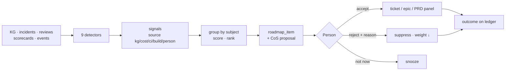

# Engineering spec: autonomous agents — the shared foundation

**Status:** Built (foundation) · **Epic:** BOSSAPP-902 (children 903–912) · **Branch:** `feat/autonomous-agents` · **Date:** 2026-11-05
**Design:** `boss-autonomous-agents-design.md` (Option B, approved 2026-11-05; attached to BOSSAPP-902). Section numbers `§n` below refer to it.
**Code:** `engine/boss_engine/services/ambient/` · `apps/api/app/routers/ambient.py` · `db/schema.sql` (block "AUTONOMOUS AGENTS").

This is the contract the parallel streams build on. **Use these tables, functions, endpoints and events; do not add a second copy of any of them.** If a stream needs something this foundation does not offer, extend the module that owns it (each section names it) and add a test there.

---

## 0. The rules every stream keeps

1. **One path in, one path out.** A problem enters only through `signals.record_signal`. Work exists only as a board item (`board.open_item`). A decision exists only as a ledger row (`ledger.record_decision`). An action is allowed only by `policy.gate`. There is no other way, and no "just this once" table.
2. **The gate is enforced at the ledger.** An agent, squad or policy decision that names an `action` the gate does not allow is refused by `record_decision` (`GateRefused`), whatever the caller thought. Merge, production deploy, external send and payment (`task_classes.ALWAYS_A_PERSON`) are only ever decided by `person:<id>`.
3. **An agent acts only while it holds the lease.** Call `board.assert_lease(..., lock=True)` in the same transaction as every external effect. On `LeaseLost`, stop — a person took over, the lease expired, or ambient work was stopped.
4. **Visibility is a diagram, not text** (§11.0, the operator's standing rule). The read model returns nodes, edges and badges with ≤ 4-word labels. A screen draws `read_model.graph`; it never renders a paragraph on the canvas. Detail is one click away via each node's `ref`.
5. **Text from outside is data** (§9). Signal titles, finding summaries and evidence notes are normalised by `_common.clean_text`. Nothing in a signal ever widens a grant or a level.
6. **Model-agnostic.** Nothing here calls a model. Agents decide through the one agent path (BOSSAPP-759) and record the result here; the same rows result whichever engine decided.
7. **Python 3.11.** The images run 3.11 (the laptop runs 3.13): no 3.12+ syntax.

---

## 1. The six layers, and where each lives

| Layer (§4) | Module | What it owns |
|---|---|---|
| L2 Sense | `ambient/signals.py`, `ambient/adapters.py` | the `signals` inbox, fingerprints, pull adapters, the sweep |
| L3 Decide (CoS writes here) | `ambient/board.py` | ambient work items on `work_items`, lifecycle, leases, links, Needs you |
| L4 Act (coordination) | `ambient/collab.py` | typed board messages, consensus by risk |
| L5 Govern | `ambient/policy.py`, `ambient/guards.py`, `ambient/task_classes.py` | the class × project matrix, the gate, envelope, stop, loop guards |
| Visibility (§11) | `ambient/ledger.py`, `ambient/read_model.py` | the decision ledger; graphs, lists, scorecard |
| L6 Learn | `ledger.record_outcome` → `policy.review_track_record` | outcome per decision; demotion and promotion suggestions |

---

## 2. Decisions taken in the foundation (and why)

| Question | Decision | Why |
|---|---|---|
| A new work-item table, or extend `work_orchestration`? | **Extend `work_items`.** An ambient item is created through `WorkOrchestrationService.upsert_work_item` (same scoring, same `work.priority_scored` event, same `evaluate_admission` / `rank_by_value_density`), plus ambient columns. | §3.2: "a ranked backlog that almost nothing feeds"; BOSSAPP-830 makes the work item the canonical node. A second table would split "what is BOSS working on" into two answers. |
| How does an ambient row fit `UNIQUE(project_id, subject_type, subject_id)`? | `subject_type='ambient'`, `subject_id=<its own id>`; the real subject is `subject_ref` (`app:order-api`, `pr:acme/shop#41`). Portfolio `status` is `active` while live, `done` after. | One app has many problems over time; the portfolio's uniqueness is one row per subject for ever. |
| Do ambient items show on the release board? | **No.** `list_work_items(..., ambient=False)` in `release_planning`. | They live on Agent Operations until a person accepts one into a ticket (§14.4); A0 items on the release board are the noise §10 warns about. |
| A decision table, or `agent_acts`? | **`agent_acts` kind `decision`** + a 1:1 detail table `agent_act_decisions`. | `agent_acts.py` exists to end "eight answers in eight tables" (§11.2). The act row gives who/when/cost/chain to every existing reader; the 30 decision-only fields would be NULL on every other act. |
| Append-only how? | A **database trigger** (`boss_append_only_ledger`). The only update fills an empty outcome once; deletes need `SET LOCAL boss.ledger_purge = 'on'`. | Enforced for every writer, not only the ones that remember. |
| Where is "one live item per fingerprint"? | A **unique partial index** on `work_items(project_id, fingerprint)` over live lifecycles, plus an advisory lock in `open_item`. | §6 rule 1, generalising `self_fix._live_claim`; the database refuses what a race would create. |
| The new `how` edges | `signal` ("Raised by a signal") and `board` ("From the work board"). An override uses `approved`. | A decision reaches its decider from a sensor or from the board; neither is a person's or agent's handoff. |
| Permissions | No new catalogue permissions. Reads: `work_item:read`, `decision:read`, `autonomy:read`. Take over / dismiss / **stop**: `work_item:manage`. Override: `decision:approve`. **Resume**, levels, envelope, install-wide stop: `autonomy:manage`. | The safe direction (stop, take over) must be easy; giving agents more room is privileged. |
| Sweep cadence | **Not wired into the worker yet.** `signals.sweep()` is a function; the CoS tick (904) calls it. `POST /v1/ambient/signals/sweep` runs it on request. | "No new daemon"; one tick owner (the CoS) rather than a second timer. |

---

## 3. Tables (all in `db/schema.sql`, idempotent; the API self-migrates on boot)

### 3.1 `signals` — one normalised inbox (903)

| Column | Meaning |
|---|---|
| `id` | `sig_<ulid>` |
| `project_id` | NULL = install-wide (doctor findings). Listed for every project. |
| `source` | one of `signals.SOURCES`: `github ci osv alert doctor shepherd scan schedule cost kg person workflow build pr` |
| `kind` | dotted, e.g. `alert.firing`, `workflow.step_failed`, `build.failed`, `doctor.<kind>`, `shepherd.escalation`, `pr.stale` |
| `subject_kind`, `subject_id`, `app` | what it is about |
| `fingerprint` | stable identity of the problem (`signals.fingerprint(kind, *subject, project_id=)`) |
| `severity` | `info low medium high critical` (a repeat keeps the worst) |
| `title` | cleaned, ≤ 300 chars |
| `evidence` | `[{kind, ref, note?}]` (§5 ref kinds), newest first, ≤ 50 |
| `source_refs` | every source row already folded in (≤ 200, GIN-indexed) — what makes a re-sweep a no-op |
| `occurrences` | repeats counted on this row |
| `dedupe_window_seconds` | a repeat this soon after a CLOSED row is the same occurrence |
| `status` | `new → triaged → done`; or `merged_into` / `suppressed` (`suppressed_until` NULL = until the evidence changes) |
| `work_item_id` | the item that holds it (set by `board.open_item`) |
| `caused_by_run_id`, `causal_depth` | loop guard (§6 rule 2) |
| `observed_at`, `first_seen_at`, `last_seen_at`, `expires_at` | |

Unique: one row per `(project, fingerprint)` in `new/triaged/suppressed`. `signal_adapter_cursors(adapter, cursor_at, last_run_at, last_recorded, last_error)` holds each adapter's place (`<adapter>` install-wide, `<adapter>@<project>` per project).

### 3.2 `work_items` — ambient columns (908 core)

Added: `ambient` (bool), `fingerprint`, `lifecycle`, `task_class`, `autonomy_level` (`A0..A3`, the class's level when opened), `risk`, `severity`, `subject_ref`, `app`, `lease_owner` (`agent:<role>` / `person:<id>`), `lease_kind` (`agent`/`person`), `lease_token` (never serialised), `lease_expires_at` (NULL for a person), `causal_depth`, `caused_by_run_id`, `attempts`, `outcome`, `resolved_by`, `resolved_at`, `needs_you_at`, `needs_you_decision_id`, `answered_at`, `cost_usd_micros`, `squad` (JSON list of parties).

`work_item_links(work_item_id, kind, ref, project_id, note, created_by, created_at)` — kinds: `signal workflow_run code_task decision act incident meeting pull_request reservation alert recommendation`.

### 3.3 `work_item_messages` — the board's protocol (908)

`id (wim_<ulid>), project_id, work_item_id, kind, sender, body (json), reply_to, act_id, created_at (clock_timestamp)`. Kinds and bodies in §6. UPDATE refused by trigger; one vote per `(reply_to, sender)`.

### 3.4 `agent_acts` + `agent_act_decisions` — the decision ledger (906)

`agent_acts.kind` gains `decision`; `agent_acts.how` gains `signal`, `board`. A decision act is written closed (`status complete`), `role_key` = the deciding agent's role (NULL for a person / policy / squad), `accountable` = the person, else `boss`, `subject_kind='work_item'`, `subject_id=<item>`, `cost_usd` = the decision's cost.

`agent_act_decisions` (1:1, PK `act_id`):

| Column | Meaning |
|---|---|
| `work_item_id`, `signal_ids` | what it is about |
| `question` | one sentence |
| `decided_by` | `agent:<role>` · `policy:<rule id>` · `squad:<work item id>` · `person:<id>` (CHECK) |
| `chosen`, `options`, `rejected` | `options: [{key,label}]` incl. chosen; `rejected: [{option, why?}]` |
| `rationale` | ≤ 3 sentences (refused otherwise) |
| `evidence` | `[{kind, ref, note?, checked: "exists"|"shape"}]` — every BOSS ref verified to exist in the project |
| `confidence` | 0..1 |
| `autonomy_level`, `task_class`, `action` | what it was allowed under |
| `reversibility`, `undo` | `reversible` requires `undo` (CHECK) · `compensable` · `irreversible` |
| `consensus` | the record from `collab.tally` (§6.2) |
| `proposal_id` | the board proposal it settles |
| `cost_usd_micros` | |
| `overrides_act_id` | an override points at the row it overrides (at most one override per row) |
| `outcome`, `outcome_ref`, `outcome_at` | filled once: `accepted edited dismissed ignored merged reverted recurred overridden succeeded failed incident_caused` |

### 3.5 `ambient_autonomy`, `ambient_autonomy_changes`, `ambient_settings` (905)

- `ambient_autonomy(project_id, task_class, level, ceiling, set_by, reason, updated_at)` — a row only where a person (or a demotion) changed the default; `level ≤ ceiling ≤ catalogue ceiling`.
- `ambient_autonomy_changes(id, project_id, task_class, kind set|ceiling|promotion_suggested|promoted|demoted, from_level, to_level, actor, reason, evidence, created_at)`.
- `ambient_settings(project_id, daily_cap_usd_micros=5_000_000, max_concurrent=2, max_spawn_depth=2, daily_attempt_cap=10, cooldown_hours=24, breaker_failure_ratio=0.5, breaker_min_runs=4, stopped, stopped_by, stopped_at, stop_reason, resumed_at, updated_by, updated_at)`.
- Install-wide stop: `system_state['ambient'] = {stopped, by, at, reason}`. Environment: `BOSS_AMBIENT_DISABLED=1`.

---

## 4. Python API (engine)

All functions take a SQLAlchemy `Connection` inside the caller's transaction and never commit. Parties are strings: `agent:<role>`, `person:<id>`, `policy:<id>`, `squad:<id>`, or `boss`.

### 4.1 Signals — `ambient.signals`

```python
record_signal(c, *, project_id, source, kind, title, fingerprint_parts=(), fingerprint_value=None,
              subject_kind=None, subject_id=None, app=None, severity="medium", evidence=(),
              source_ref=None, observed_at=None, dedupe_window_seconds=3600, expires_at=None,
              caused_by_run_id=None, actor="boss") -> {"signal": row, "outcome": str}
# outcome: created | repeat | duplicate | suppressed
fingerprint(kind, *subject, project_id=None) -> str
list_signals(c, *, project_id, status=(), source=None, include_install_wide=True, limit=100)
set_status(c, signal_id, status, *, actor="boss", reason=None, merged_into=None,
           suppressed_until=None, work_item_id=None)
sweep(c, *, project_id=None, only=None, actor="boss") -> {adapter: {since, outcomes, error}}
@adapter("name")   # register fn(c, since, project_id=None) -> Iterable[record_signal kwargs]
                   # + optional "_cursor": the value of the column filtered on `since`
```

Built-in adapters (`ambient/adapters.py`): `app_alerts` (alert.firing — BOSS rules, pushed app signals, external sources), `workflow_failures` (workflow.step_failed, folded by workflow + step + error shape), `build_failures` (build.failed, folded by error shape), `system_doctor` (doctor.<kind>, install-wide), `shepherd` (shepherd.escalation), `stale_prs` (pr.stale: a merge question open ≥ 3 days). An adapter yields `_cursor` so a sweep that hit its row limit resumes after the last row read.

Rules: pass `source_ref` whenever there is one (the source row id, plus whatever makes a new occurrence distinct — e.g. `app_alert:<id>#<fire_count>`). A re-read of a folded-in ref returns `duplicate` and changes nothing. A signal caused by an ambient run deeper than `max_spawn_depth` is stored `suppressed` with the reason and an `ambient.guard_refused` event.

Example — a CI sensor (903 follow-up):
```python
from boss_engine.services.ambient import signals

@signals.adapter("ci_checks")
def ci_checks(c, since, project_id=None):
    for run in read_failed_check_runs(c, since, project_id):
        yield {"project_id": run.project_id, "source": "ci", "kind": "ci.failed",
               "title": f"{run.check} failed on {run.branch}",
               "fingerprint_parts": (run.repo, run.branch, run.check),
               "subject_kind": "pull_request", "subject_id": run.pr_url,
               "severity": "high" if run.branch == "main" else "medium",
               "evidence": [{"kind": "url", "ref": run.html_url}],
               "source_ref": f"check_run:{run.id}", "observed_at": run.completed_at,
               "caused_by_run_id": run.boss_run_id,   # an ambient branch's own CI
               "_cursor": run.updated_at}
```

### 4.2 The board — `ambient.board`

```python
open_item(c, settings=None, *, project_id, fingerprint, title, task_class, subject_ref=None,
          app=None, signal_ids=(), severity="medium", description="", causal_depth=0,
          caused_by_run_id=None, actor="agent:chief_of_staff", scores=None)
    -> {"item", "outcome": "opened"|"joined"|"refused", "guard"?, "reason"?}
claim(c, item_id, *, owner="agent:<role>", minutes=30) -> {"item", "lease_token"}
assert_lease(c, item_id, *, owner, token, lock=False) -> item      # raises LeaseLost
renew(c, item_id, *, owner, token, minutes=30)
release(c, item_id, *, owner, token, reason="")
start(c, item_id, *, owner, token)                                 # claimed -> in_progress
needs_you(c, item_id, *, actor, question, recommendation, options=(), risk_tier=1,
          cost_of_waiting="", token=None) -> item + needs_you_decision_id
answered(c, item_id, *, actor, to=None)                            # back to the lease holder,
                                                                   # else proposed, or an end
finish(c, item_id, *, actor, lifecycle="resolved"|"failed"|"dismissed", outcome="", token=None)
dismiss(c, item_id, *, actor, reason)                              # a person; reason required
take_over(c, item_id, *, actor, reason="")                         # a person; cancels the lease
on_person_action(c, *, project_id, subject_ref, actor, what) -> [item ids]
cancel_agent_leases(c, *, project_id, actor, reason)               # the stop's teeth
expire_leases(c, *, project_id=None) -> [item ids]
link(c, item_id, kind, ref, *, actor="boss", note=None)
add_cost(c, item_id, usd_micros)
get(c, item_id, *, project_id=None) / links(c, item_id) / list_items(c, project_id, ...)
```

Lifecycle: `proposed → claimed → in_progress → resolved | failed`; any live state → `needs_you` → back; any live state → `dismissed`. Errors: `Conflict` (wrong state / held / stopped), `LeaseLost`, `LookupError`.

`needs_you` creates its Decisions row through `core.create_blocking_decision` (reason `ambient_needs_you`, default action `hold`, `recommendation` carries `work_item_id`, `task_class`, `autonomy_level`, `asked_by`, `cost_of_waiting`). That function keeps ONE open decision per cause: two items asking the identical question about the identical subject share one card, and one answer answers both — intended ("one queue", §11.5). The subject is appended to the question so different subjects never merge.

Example — an agent's turn on an item:
```python
from boss_engine.services.ambient import board, policy, ledger

held = board.claim(c, item_id, owner="agent:sre")
token = held["lease_token"]
verdict = policy.gate(c, project_id, "incident_staging_mitigation", "staging_rollback")
if verdict["allowed"] and not verdict["needs_person"]:
    board.start(c, item_id, owner="agent:sre", token=token)
    board.assert_lease(c, item_id, owner="agent:sre", token=token, lock=True)
    ledger.record_decision(c, project_id=project_id, decided_by="agent:sre", ...,
                           action="staging_rollback", consensus=record)  # record: collab.tally
    ...start the rollback workflow; board.link(c, item_id, "workflow_run", run_id)
elif verdict["needs_person"]:
    board.needs_you(c, item_id, actor="agent:sre", token=token, question="Roll back order-api?",
                    recommendation={"action": verdict["action"]})
```

Wiring the person's takeover (904/907/910): every place a person acts on a subject — a commit or comment webhook on a `boss/ambient/*` branch, Cancel on a run, an edit to a PR — calls `board.on_person_action(c, project_id=, subject_ref=, actor=, what=)`.

### 4.3 The ledger — `ambient.ledger`

```python
record_decision(c, *, project_id, decided_by, question, chosen, rationale, reversibility,
                options=(), rejected=(), evidence=(), confidence=None, work_item_id=None,
                signal_ids=(), task_class=None, autonomy_level=None, action=None, undo=None,
                consensus=None, proposal_id=None, cost_usd_micros=0, overrides_act_id=None,
                accountable=None, how=None, parent_act_id=None, **act_links) -> row
override(c, act_id, *, actor, chosen, rationale, evidence=()) -> new row
record_outcome(c, act_id, *, outcome, outcome_ref=None, actor="boss") -> row + track_record
get_decision(c, act_id) / list_decisions(c, project_id, *, work_item_id=None, task_class=None)
```

Refusals: `GateRefused` (`.verdict` is the gate's answer), `EvidenceError`, `LedgerConflict` (outcome already set / row already overridden), `ValueError` (rationale > 3 sentences, reversible without `undo`, bad level/class), `LookupError`. Agent, squad and policy decisions need ≥ 1 evidence ref. `**act_links` are `agent_acts` links (`workflow_run_id`, `code_task_run_id`, `meeting_run_id`, `decision_id`, `receipt_id`, ...). A decision on an item posts a `decision` message on the board (replying to `proposal_id` when given) and adds its cost to the item.

### 4.4 Policy — `ambient.policy` and `ambient.task_classes`

```python
gate(c, project_id, task_class, action) -> {allowed, needs_person, level, required_level,
                                            action, task_class, risk, reversibility,
                                            consensus_mode, reason}
level_for(c, project_id, task_class) / matrix(c, project_id) / changes(c, project_id, ...)
set_level(c, project_id, task_class, *, actor, level=None, ceiling=None, reason="")
track_record(c, project_id, task_class) / review_track_record(c, project_id, task_class)
settings_for(c, project_id) / update_settings(c, project_id, *, actor, **limits)
stop_state(c, project_id=None) / is_stopped(c, project_id)
stop(c, *, project_id|None, actor, reason) / resume(c, *, project_id|None, actor, reason="")
envelope(c, project_id) -> {cap_usd_micros, spent_usd_micros, held_usd_micros,
                            available_usd_micros, resets}
reserve(c, settings, *, project_id, work_item_id, amount_usd_micros, reason,
        expires_in_minutes=120, risk_tier=None)   # stop -> envelope -> BudgetGovernor('ambient')
```

**Task classes** (key · default · ceiling · risk · owner role): `ci_fix_boss_pr A2/A3 low software_engineer` · `red_main A1/A2 medium sre` · `security_patch A2/A3 medium security_reviewer` · `dependency_upgrade A1/A3 low` · `flaky_test A1/A3 low qa` · `missing_tests A1/A2 low qa` · `doc_drift A1/A2 low docs_writer` · `todo_triage A0/A1 low chief_of_staff` · `dead_code A1/A2 medium` · `issue_triage A1/A2 low` · `incident_response A1/A3 high sre` · `incident_staging_mitigation A2/A3 medium sre` · `perf_regression A1/A2 medium sre` · `stale_handoff A1/A2 low chief_of_staff` · `cost_anomaly A1/A3 low finops_sentinel` · `platform_self_fix A1/A2 medium` · `release_notes A1/A2 low docs_writer` · `knowledge_refresh A1/A3 low archivist` · `iac_drift A1/A1 high infra_steward` · `workflow_failure A1/A2 medium` · `system_health A1/A2 medium infra_steward`.

**Actions** (key · min level · risk · reversibility): `observe`, `record_finding` A0 · `propose`, `ask_question`, `comment` (compensable), `convene_meeting` A1 · `label`, `nudge` (compensable), `start_workflow`, `open_draft_pr`, `staging_rollback`, `staging_restart`, `silence_rule` A2 · `prod_rollback`, `prod_restart` A3 high · `quarantine_test` A3 low · **`merge`, `deploy_prod`, `send_external`, `pay` — always a person**.

Gate semantics: stopped → not allowed. Always-a-person action → `needs_person`. Level below the action's → `needs_person` if the class is ≥ A1 (propose it), else observe only. Otherwise allowed; `needs_person` is still true when the consensus mode is `squad_vote_and_person` or `recommend_only`. The class's risk raises the risk only for acting actions (A2+).

Track record: decisions by non-persons since the class's last level change; accepted = `accepted edited merged succeeded`; rejected = `dismissed ignored overridden failed`; demoting = `reverted incident_caused`. Any demoting outcome drops the class one level at once (`kind demoted`, actor `boss`). ≥ 20 decided, ≥ 85 % accepted, 0 reverted → one `promotion_suggested` change; **BOSS never raises a level itself**.

### 4.5 Guards — `ambient.guards`

`admit_new_item(c, *, project_id, fingerprint, task_class, causal_depth)` (called by `open_item`): stop · breaker · depth > `max_spawn_depth` · cooldown (`cooldown_hours × 2^(n−1)` after the n-th dismissed/failed item for the fingerprint in 30 days) · `daily_attempt_cap` per class per UTC day. `admit_start(c, *, project_id)` (called by `start`): stop · breaker · `max_concurrent`. `check_breaker(c, project_id)`: in the last hour (or since `resumed_at`), ≥ `breaker_min_runs` ended and ≥ `breaker_failure_ratio` failed → `policy.stop` + `ambient.breaker_tripped`. Every refusal emits `ambient.guard_refused {guard, reason, ...}`.

### 4.6 Collaboration — `ambient.collab`

```python
post(c, item_id, *, kind, sender, body, reply_to=None, act_id=None) -> message
messages(c, item_id, *, kinds=(), viewer=None)   # viewer: hides votes the viewer has not cast
tally(c, item_id, proposal_id, *, mode=None) -> consensus record
consensus_mode(*, risk, reversibility, always_a_person=False) -> mode
satisfies(consensus, required_mode) -> bool
```

### 4.7 Read model — `ambient.read_model`

```python
graph(c, item_id, *, project_id) -> {item, badges, nodes, edges}
list_view(c, project_id, *, filter_="all", task_class=None, limit=30, before=None)
    -> {filter, items: [item summary + badges + strip], counts: {tab: n}, next_before}
scorecard(c, project_id, *, days=7)
```

---

## 5. Evidence refs

`{kind, ref, note?}`. Kinds checked to EXIST (in the project when the table has one): `signal work_item message act decision workflow_run step_run code_task alert incident kg_node meeting finding escalation deadletter receipt`. Kinds checked for SHAPE only: `commit` (7–40 hex), `url` (http/https), `pull_request` (URL or `owner/repo#n`), `query`, `log`. Anything else is refused. Add a kind in `_common.EVIDENCE_TABLES` / `SHAPE_ONLY` with a test.

---

## 6. The board protocol and consensus

### 6.1 Message kinds

| Kind | Who posts | Body |
|---|---|---|
| `claim` | `board.claim` only | `{lease_minutes}` |
| `finding` | any party | `{summary, evidence[]}` (evidence verified) |
| `hypothesis` | any party | `{summary, confidence 0..1, evidence[]}` |
| `proposal` | any party | `{action (catalogue), summary, verify?, undo?, confidence?}` → stored with `risk`, `reversibility` |
| `critique` | any party, `reply_to` a proposal | `{position: agree|object|concern|unsafe, summary}` |
| `vote` | any party, `reply_to` a proposal, once | `{vote: approve|reject|abstain, reason?}` |
| `decision` | `ledger.record_decision` only | `{act_id, chosen}` |
| `handoff` | any party (take-over writes one as `boss`) | `{to: party, from?, summary}` |
| `escalate` | any party | `{to: party, reason}` |
| `resolve` | `board.finish` only | `{outcome, summary}` |

A closed item takes no posts except `decision` (a late override) and `resolve`.

### 6.2 Consensus by risk (§11.4)

| Mode | When | Rule | `result` |
|---|---|---|---|
| `single` | low risk, reversible | the owner decides | `approved` |
| `maker_checker` | medium risk, or compensable | a critic ≠ proposer agrees (critique `agree` or vote `approve`) | `approved` / `pending` / `rejected` (1 objection) / `needs_person` (2 objections or any `unsafe`) |
| `squad_vote_and_person` | high risk | `meeting_consensus.tally_votes`, quorum ≥ 3, ≥ 2/3 approve, then a person | `approved` / `rejected` / `no_quorum`, always `needs_person` |
| `recommend_only` | irreversible / always-a-person | the squad recommends | always `needs_person` |

The record: `{mode, proposal_id, proposer, action, participants, votes, critiques, dissent: [{party, position, reason}], quorum_rule, result, needs_person, tally}`. Pass it as `consensus=` to `record_decision`; for `maker_checker` the ledger requires `result == "approved"`.

---

## 7. HTTP API (`apps/api/app/routers/ambient.py`)

Writes take `{project_id, actor?, ...}` (actor is replaced by the signed-in principal under enforce); legacy-auth member permission in brackets.

| Method · Path | Permission | Does |
|---|---|---|
| `GET /v1/ambient/work-items?project_id&filter&task_class&limit&before` | work_item:read | `list_view` — filter ∈ `needs_you running resolved_by_agents overridden failed dismissed all` |
| `GET /v1/ambient/work-items/{work_item_id}?project_id` | work_item:read | `graph` + `links` |
| `GET /v1/ambient/work-items/{work_item_id}/messages?project_id` | work_item:read | the board |
| `POST /v1/ambient/work-items/{work_item_id}/take-over` `{reason?}` | work_item:manage [decision_resolve] | `board.take_over` |
| `POST /v1/ambient/work-items/{work_item_id}/dismiss` `{reason}` | work_item:manage [decision_resolve] | `board.dismiss` |
| `GET /v1/ambient/signals?project_id&status=a,b&source&limit` | work_item:read | `list_signals` |
| `POST /v1/ambient/signals/sweep` `{only?: [adapter]}` | work_item:manage [decision_resolve] | `sweep(project_id=)` ("Check now") |
| `GET /v1/ambient/decisions?project_id&work_item_id&task_class&limit` | decision:read | the ledger |
| `GET /v1/ambient/decisions/{act_id}?project_id` | decision:read | one row |
| `POST /v1/ambient/decisions/{act_id}/override` `{chosen, rationale, evidence?}` | decision:approve [decision_resolve] | `ledger.override` |
| `GET /v1/ambient/autonomy?project_id` | autonomy:read | `{classes (matrix + suggested_level), levels, actions, changes}` |
| `PUT /v1/ambient/autonomy/{task_class}` `{level?, ceiling?, reason?}` | autonomy:manage [role_review] | `set_level` |
| `GET /v1/ambient/settings?project_id` | autonomy:read | `{settings, envelope, stop}` |
| `PUT /v1/ambient/settings` `{limits…}` | autonomy:manage [role_review] | `update_settings` |
| `POST /v1/ambient/stop` `{reason?}` | **work_item:manage** [decision_resolve] | project stop |
| `POST /v1/ambient/resume` `{reason?}` | autonomy:manage [role_review] | project resume |
| `POST /v1/ambient/stop-all`, `/resume-all` `{actor?, reason?}` | autonomy:manage (org) | install-wide |
| `GET /v1/ambient/scorecard?project_id&days` | autonomy:read | `scorecard` |

Errors: 404 not found / other project's object (central id confinement), 403 permission or `GateRefused` (`detail: {refused, gate}`), 409 `Conflict`/`LeaseLost`/`LedgerConflict`, 422 validation / `EvidenceError`.

### 7.1 The graph (what the console draws)

Illustrative — nodes from several moments of one item are shown together:

```json
{"item": {"id": "work_…", "title": "order-api 5xx at 6.6%", "lifecycle": "needs_you", …},
 "badges": {"problem_type": "Incident", "task_class": "incident_response",
            "outcome": "needs_you", "needs_you": true, "autonomy_level": "A1",
            "severity": "high", "cost_usd": 1.84, "dissent": true, "overridden": false},
 "nodes": [
   {"id": "signal:sig_…", "type": "signal", "label": "order-api 5xx at 6.6%", "stage": 0,
    "badges": ["high", "×3"], "ref": {"kind": "signal", "id": "sig_…"}},
   {"id": "party:agent:chief_of_staff", "type": "agent", "label": "Chief of Staff", "stage": 1, …},
   {"id": "party:agent:sre", "type": "agent", "label": "SRE", "stage": 1, "badges": []},
   {"id": "proposal:wim_…", "type": "action", "label": "Roll back prod", "stage": 2,
    "badges": ["high"]},
   {"id": "decision:act_…", "type": "decision", "label": "rollback", "stage": 3,
    "badges": ["A3", "person", "dissent"]},
   {"id": "needs_you", "type": "needs_you", "label": "Needs you", "stage": 3,
    "ref": {"kind": "decision", "id": "dec_…"}},
   {"id": "outcome", "type": "outcome", "label": "Resolved 4m", "stage": 5}],
 "edges": [
   {"from": "signal:sig_…", "to": "party:agent:chief_of_staff", "kind": "raised", "label": "raised", "dissent": false},
   {"from": "party:agent:chief_of_staff", "to": "party:agent:sre", "kind": "claimed", …},
   {"from": "party:agent:adversarial_reviewer", "to": "proposal:wim_…", "kind": "vote",
    "label": "reject", "dissent": true, "ref": {"kind": "message", "id": "wim_…"}}]}
```

Node types: `signal agent person policy squad boss action decision needs_you run outcome`. Edge kinds: `raised claimed proposed critique vote handoff escalate decided settles overrides acted asks resulted`. Labels ≤ 4 words (nodes) / ≤ 3 (edges). `stage` 0–5 orders left to right. Every node has a `ref` for its drawer. List items carry `strip` (≤ 6 nodes: first signal, owner, last decision, Needs you / outcome) for the thumbnail.

---

## 8. Events (`core.emit_event`, entity in parentheses)

`ambient.signal_recorded` (signal) · `ambient.signal_status` (signal) · `ambient.item_opened` (work_item) · `ambient.item_claimed` · `ambient.item_transitioned {from, to, decision_id?}` · `ambient.lease_released {cancelled?}` · `ambient.lease_expired` · `ambient.lease_taken_over {from, to}` · `ambient.message_posted {message_id, kind}` · `ambient.decision_recorded` (agent_act) · `ambient.decision_overridden` · `ambient.decision_outcome` · `ambient.autonomy_changed` (task_class) · `ambient.autonomy_demoted` · `ambient.promotion_suggested` · `ambient.settings_changed` (project) · `ambient.stopped {scope, reason, released}` · `ambient.resumed` · `ambient.breaker_tripped {failed, ended, ratio}` · `ambient.guard_refused {guard, reason}` · `ambient.envelope_refused`. Install-wide rows (no project) emit nothing. None of these is on the `event_dispatch` whitelist yet; a stream that wants a workflow triggered by one adds it there.

---

## 9. What each parallel stream builds on this (and must not rebuild)

| Ticket | Builds | Uses | Notes / first tasks |
|---|---|---|---|
| **903** signals | more adapters (GitHub `check_run`/`workflow_run` on the dispatch whitelist, OSV via `security_scan`, `anomaly_detector`, deadletters, KG drift) | `@signals.adapter`, `record_signal` | Each adapter gets a test against its real table (pattern: `engine/tests/test_each_signal_adapter_reads_its_real_store.py`). |
| **904** Chief-of-Staff | the `chief_of_staff` role pack; the tick (worker cadence) that calls `signals.sweep`, groups/classifies via the one agent path, `board.open_item`, records its triage as `ledger.record_decision(decided_by="agent:chief_of_staff", action="propose"|"observe")`, routes by naming the owner role (`task_classes.TaskClass.owner_role`, or its own pick, recorded as a decision); the owner's own turn calls `board.claim` | everything in §4 | Run `board.expire_leases` and `guards.check_breaker` on the tick. Wire `on_person_action` into the GitHub webhook and run-cancel paths. |
| **905** autonomy UI | the matrix screen, the envelope, the stop button (one surface; concise) | §7 autonomy/settings/stop routes | Stop is operator-level; resume/raise are owner/admin. Show `suggested_level` with one "Raise" button. |
| **906** ledger + Agent Operations view | the console diagram (flow chart per item, list of thumbnails, five tabs, drawer per node) | `GET work-items`, `GET work-items/{id}`, decisions routes | **Draw `nodes`/`edges`; no prose on the canvas** (§11.0). Acceptance: a stranger says what happened in 10 s. |
| **907** Needs you, digest, Ask BOSS | ambient item kinds in the attention inbox (BOSSAPP-875), the daily digest, Ask BOSS answering from `list_decisions` with `[act:<id>]` citations | `board.needs_you` / `answered`; `scorecard` | When a Needs-you decision is answered, call `board.answered`, then the agent proceeds; record the person's answer with `record_decision(decided_by="person:<id>")`. Promotion suggestions become a Needs-you card. |
| **908** collaboration | squads (roster per class), squad memory → KG learnings at close, the watchdog | `collab.post/tally`, `board` | Add message kinds only in `collab.KINDS` + its `_body` schema + the table CHECK. |
| **910** AI SRE squad | the incident squad on `incident_response` / `incident_staging_mitigation`; `incident_actions` rows written through the ledger | gate actions `staging_*`, `prod_*`, `silence_rule`; consensus modes | Mitigate first; prod rollback is `squad_vote_and_person`. Link incidents (`board.link(..., "incident", id)`). |
| **911** recommended roadmap | KG detectors as `source="kg"` adapters; recommendations as items/links (`recommendation` link kind) | signals, board | Rejections → `dismiss` (cooldown) + `record_outcome("dismissed")`. |
| **912** outcomes & metrics | the 7-day "ignored" sweep (`record_outcome(..., "ignored")`), PR merged/reverted hooks, extra scorecard metrics | `ledger.record_outcome` (the canonical outcome store), `read_model.scorecard` | Do NOT add a parallel `proposal_outcomes` table; if a per-proposal view is needed, make it a SQL view over `agent_act_decisions`. |

---

## 10. Tests

Engine (real Postgres, `BOSS_TEST_DATABASE_URL`; each test gets its own project via `engine/tests/_ambient_support.py`):
`test_a_signal_is_recorded_once_per_problem.py` · `test_each_signal_adapter_reads_its_real_store.py` · `test_an_ambient_item_has_one_owner_and_one_live_copy.py` · `test_the_decision_ledger_is_append_only.py` · `test_autonomy_is_earned_per_task_class.py` · `test_the_ambient_stop_and_envelope_hold.py` · `test_loop_guards_stop_runaway_ambient_work.py` · `test_agents_agree_on_the_board_by_risk.py` · `test_agent_operations_draws_each_item_as_a_flow.py`.
API: `apps/api/tests/test_people_see_and_steer_ambient_work_over_http.py` (flows in shadow mode; viewer / operator / owner under enforce).

A stream that changes a module runs that module's file(s) above plus its own.

---

## 11. Continuous learning → the Recommended roadmap (911) and outcomes (912) — built

**Code:** `ambient/learning.py` (framework, grouping) · `ambient/detectors.py` (the nine) · `ambient/roadmap.py` (score, rank, open, review, tick) · `ambient/roadmap_artifacts.py` (what an accepted item becomes) · `ambient/outcomes.py` (sweep + metrics) · `ambient/roadmap_demo.py` (demo seed + the writers' shapes the tests use) · `routers/ambient_learning.py`.



| Decision | Choice | Why |
|---|---|---|
| A recommendation is | a board item (class `roadmap_item`, A1/A1, owner `pm`) + 1:1 `ambient_recommendations` row | one live copy per fingerprint, guards, cooldown and the ledger apply unchanged; the row holds only evidence, score parts, detector, what a person did |
| Detectors are | deterministic SQL over existing stores, NOT registered `signals.ADAPTERS` | they read 30-90-day windows, not a cursor; running them on every CoS sweep would be waste. They still enter through `record_signal` (`kind learn.<detector>`, `source_ref` = evidence digest, so a re-run is a no-op) |
| Score | `compute_priority_score` drivers × evidence × freshness × detector weight, ranked by `rank_by_value_density` with cost = project median build × √effort × risk | design §14.3, reusing BOSSAPP-353's math |
| Outcomes | on `agent_act_decisions.outcome` only (no new table) | spec §9 |
| Cadence | worker `_tick_ambient_learning` every 10 min → `POST /v1/ambient/learning/tick` (worker principal); detectors ≤ every 6 h per project, ≤ 10 projects a tick; outcome sweep batched | no new daemon; stop + `BOSS_AMBIENT_DISABLED` / `BOSS_ROADMAP_DISABLED` honoured |

Detectors: `hotspot` (PR churn × lines × incidents, fan-in = blast radius) · `incident_cause` (≥ 2 incidents, one cause) · `missing_tests` (≥ 3 PRs, no test file named for it) · `review_repeat` (same finding in ≥ 3 builds) · `design_drift` (consistency `drift`, PRD declined) · `cost_spike` (7-day median ≥ 1.5× the 8-60-day one, ≥ $5/week) · `flaky_test` (failing outside the change in ≥ 3 builds) · `slow_stage` (median ≥ 1.5× target over ≥ 5 builds) · `user_friction` (≥ 5 person steers/retries/waives… at one stage). Findings about one `file:` subject group into one item.

Review: **accept** → person decision `accept_as_<shape>` (parent = the proposal), proposal outcome `accepted`, a non-ambient work item (`source='roadmap'`, plus the connected tracker's issue) or `convene_prd_meeting_core`; **reject** (reason required, category `not_valuable wrong duplicate already_planned too_small other`) → proposal `dismissed`, item dismissed (cooldown), signals suppressed until evidence grows ×1.5 (≥ 2 refs) or a new source kind; labelled example in `learning_examples` (agent `roadmap`); "too small" raises the detector's thresholds 25 % each (≤ 2×); weight = Laplace acceptance ÷ 0.5 (0.25–2); muted under 15 % after 20 decided (`ambient.detector_muted`); **snooze** → person decision, hidden until the date. Evidence gone → `resolved_by_change`. Accepted but evidence keeps coming > 7 days later → accept decision `recurred`.

Outcome sweep: `ignored` (proposing action, 7 days, item still live, no person decision since) · `recurred` (resolved item's fingerprint opened again ≤ 14 days) · `reverted` (run scorecard `pr_reverted`) at once · `merged` after 14 days held. Metrics (`outcomes.metrics`, on `GET /v1/ambient/scorecard` as `outcomes`, `task_class` optional): acceptance %, noise %, override %, revert %, decisions by level/decider/day, time to human decision (Needs you + roadmap), MTTM/MTTR + agent-resolved % from `incidents`, cost per resolved item / merged change, ambient share (work items, builds), by task class, and `recommendations` (acceptance per detector, time to decision, cost per accepted).

| Method · Path | Permission |
|---|---|
| `GET /v1/ambient/roadmap?project_id&status&kind&detector&limit` · `GET /v1/ambient/roadmap/{id}` | work_item:read |
| `GET /v1/ambient/roadmap/detectors` | autonomy:read |
| `POST /v1/ambient/roadmap/{id}/accept` `{as?, note?}` · `/reject` `{reason, category?}` · `/snooze` `{until, reason?}` · `POST /v1/ambient/roadmap/run` · `POST /v1/ambient/outcomes/sweep` | work_item:manage |
| `POST /v1/ambient/roadmap/demo-seed` (demo projects only) | autonomy:manage |
| `POST /v1/ambient/learning/tick` | worker principal |

Events: `ambient.recommendation_opened` · `ambient.recommendation_accepted` · `ambient.recommendation_rejected` · `ambient.detector_muted`. Tests: `engine/tests/test_detectors_find_patterns_in_what_boss_already_knows.py` · `test_the_recommended_roadmap_ranks_dedupes_and_learns.py` · `test_outcomes_land_on_the_ledger_and_the_metrics_add_up.py` · `apps/api/tests/test_people_review_the_recommended_roadmap_over_http.py`.
