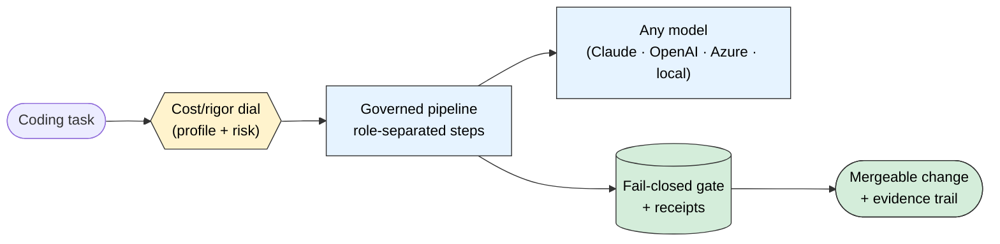
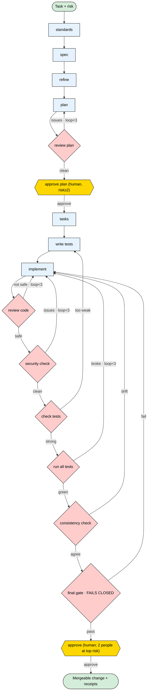
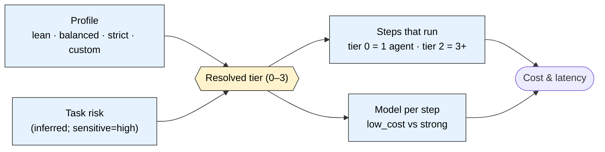

# The Governed Coding Pipeline

How BOSS builds code: every coding task runs through plain, role-separated steps — different
agents write, test, and review — with fail-closed checks, full receipts, a cost/rigor dial the
customer controls, and any model behind it.

Status: core runtime **live** (model-agnostic, proven on Claude + Azure gpt-4o); cost-control
feature **complete** (runtime + API + UI). Date: 2026-06-19. Owner: param.
Canonical shareable skill: `skills/boss-governed-coding-pipeline/SKILL.md`.
Interactive diagrams (fullscreen zoom + drag-to-pan): open `docs/product/pipeline-diagrams.html`
in a browser.

---

## 1. Why this feature exists

AI can write code in seconds. The hard part is no longer *generating* code — it's **trusting**
it, **at a cost you control**. Two problems block teams from shipping AI-written code to
production:

**Problem 1 — Correlated error (a trust problem).** When *one* agent writes the code, writes the
tests, and reviews the result, the tests and the review inherit the same misunderstanding that
produced the bug. The suite green-lights the very defect it should catch; an after-the-fact
reviewer faces a large, fully formed diff with none of the context a human builds while writing.
It's a *self-graded exam*. We watched this happen in our own dogfood: a single agent produced
`leads_app.py` **and** `test_leads.py` and iterated to green — and a later independent review
found a real bug (non-ASCII input handling) that the passing tests never probed.

**Problem 2 — Unbounded cost (a budget problem).** The obvious fix — more agents, more reviews —
costs more tokens and more time. AI budget is finite. If "more rigorous" always means "more
expensive," teams either overpay on every trivial change or skip rigor where it matters.

**This feature solves both.** It applies the **separation-of-duties** principle — *the author of
something never approves it*, the same control behind code review and SOX/SOC2 segregation — and
makes the **amount of rigor a dial customers tune to the work and their budget**.

> The differentiator isn't "an orchestrator" (every framework ships those). It's that here the
> separation, the checks, and the sign-offs are **enforced by BOSS** — receipts, decisions,
> budget, two-person sign-off — not merely *suggested in a prompt*. Quality is a **control**,
> not a recommendation.

---

## 2. What we built (three pillars)

1. **A governed, role-separated pipeline** — different agents write, test, and review; quality is
   a property of the workflow, not a hope placed on one agent (§3).
2. **A cost/rigor dial** — profiles (lean / balanced / strict / custom) scale *how much* of the
   pipeline runs and *which models* run it, so prototypes run low-cost and production runs strict (§4).
3. **Model-agnostic execution** — the steps are guidance any model impersonates; route per step
   (low-cost vs strong), on Claude, OpenAI, Azure, or local (§5).

All three are wired into BOSS's durable kernel: receipts, decisions, budget reservations,
dual-control, and a full audit trail.

---

## 3. The pipeline — plain steps, run by different agents

**The one rule: whoever writes something does not approve it.** Five separations are enforced as
policy, each step in its own isolated context:

- **plan reviewer ≠ planner** — a fresh agent tries to break the plan *before* any code.
- **tester ≠ coder** — tests are written from the spec, *before* the code, so they check the
  intent, not the coder's mistakes.
- **code reviewer ≠ coder** — a fresh reviewer tries to break the change; defaults to "not safe."
- **security reviewer ≠ coder** — a separate, dedicated security pass.
- **full-test runner ≠ coder** — runs the whole suite and confirms nothing else broke.

And **gate ≠ prompt**: standards become a **fail-closed** check (missing evidence = fail), not an
instruction an agent forgets when context summarizes away.

### Flowchart

Diamonds are checks (their result gates the loop); yellow are **human** sign-offs; curved arrows
are loops with a limit (≤3, then it asks a human instead of spinning).

**What each step does** (internal harness names — the AI agents use them; never developer-facing):

| Step | Plain meaning |
|---|---|
| `standards` | the project's coding rules, from the repo + org rules — every step is checked against them |
| `spec` | what to build, with a change list (added / changed / removed) |
| `refine` | clear up anything vague → clear, testable acceptance criteria |
| `plan` | the technical design |
| `review plan` | a different agent critiques the design before any code |
| `approve plan` | human sign-off (risk ≥ standard) |
| `tasks` | break into small pieces, each given only the context it needs |
| `write tests` | tests first, by a different agent than the coder |
| `implement` | the smallest change that makes those tests pass; can't touch the tests |
| `review code` | a fresh agent tries to break it |
| `security check` | a separate security pass |
| `check tests` | break the code on purpose to prove the tests catch it |
| `run all tests` | the full suite — confirm nothing else broke |
| `consistency check` | standards, spec, tests, and code all agree |
| `final gate` | collect all evidence; **fail closed** — nothing merges without it |
| `approve` | human sign-off (two people at top risk) |

---

## 4. The cost/rigor dial — tunable efficiency

The same pipeline can run low-cost or strict. A **profile** scales *how much runs* and *which models
run it*, and the risk tier is inferred per task and clamped to the profile's range.

| Profile | For | Tier range | Models | Relative cost |
|---|---|---|---|---|
| **Lean** | prototypes, throwaway | 0–1 | low-cost everywhere | ≈ 1× |
| **Balanced** (default) | normal work | 0–3 (inferred) | low-cost for low-cost steps, strong for implement/review/security | ≈ 1.5–3× |
| **Strict** | production / enterprise | 2–3 | strong everywhere, two-person at top | ≈ 4–8× |
| **Custom** (enterprise) | your call | any | any per-step | — |

**Proven, not claimed.** Same `is_even` task, same model (gpt-4o): **Lean ran 2 steps for
$0.0261 and opened a PR**; **Strict ran 3 steps for $0.0378, and its independent review caught a
problem → blocked.** ~31% lower cost from step-count alone; per-step model routing widens it
further. Every run records its profile, tier, steps, and **per-step cost** — visible in the UI.

**Safety override:** a sensitive change (auth, payments, secrets, migrations, deploys) is **never
cost-capped below standard rigor**, even under Lean. Cost dials must not silently de-risk.

**Editions & defaults:** community edition uses the lean/balanced/strict **presets** and defaults
new projects to **lean** (a first trial never looks expensive); **enterprise** can define
**custom profiles** with their own tier ranges and per-step model routing.

---

## 5. Model-agnostic — the pattern is the guidance, any model plays the role

The step descriptions are the *guidance*; the model impersonates the role. BOSS resolves the
agent through a single seam (`make_code_agent`): **`claude_code`** (Claude Code CLI) or
**`native`** (OpenAI / Azure via the chat API), with local models routable through the gateway.
Each step can run on a low-cost or a strong model. The recorded run shows exactly **which engine
and model ran each step** — proven live on both Claude and Azure gpt-4o.

This is the point of "rent the model, own the orchestration": customers are never locked to one
vendor, and they place strong models where reasoning is hard and low-cost models where it isn't.

---

## 6. What customers get (benefits)

| Benefit | How this feature delivers it |
|---|---|
| **Trustworthy AI code** | a different agent writes the tests, another tries to break the change, a separate pass checks security — correlated error is broken by construction |
| **Pay for rigor only where it's worth it** | the cost/rigor dial: prototypes run ≈1×, production runs strict; the average workload stays low-cost |
| **No "expensive surprise"** | trials default to Lean; a visible per-tier cost comparison in the console; effort auto-scales to risk |
| **No vendor lock-in** | model-agnostic — Claude, OpenAI, Azure, or local; low-cost vs strong per step |
| **Auditable & compliant** | every step leaves a receipt; the final gate fails closed; two-person sign-off on high-risk; a replayable evidence trail (the spec, tests, reviews, costs) |
| **Safe by default** | sensitive changes (auth/payments/secrets) can't be cost-capped below standard rigor; nothing merges without a passing gate |
| **Customizable for the enterprise** | define custom profiles per kind of work; per-project standards and defaults; edition-gated |
| **Consistent quality across the org** | the same enforced pipeline runs for every coding task — quality doesn't depend on which engineer or which prompt |

---

## 7. Worked example — one real task through the steps

A follow-up to the leads app (`paramg/boss-sandbox`):

> **Task:** "Add a `list_by_status(status)` method that returns only leads with that status."
> (something users rely on → **standard risk**)

The trap: `set_status` already *rejects* an unknown status, so `list_by_status` should reject one
too — not silently return `[]`.

| Step | Who | What happens |
|---|---|---|
| spec | `pm` | Clear criteria, incl. *"an invalid status is rejected, like `set_status`"* and *"empty result when none match"* |
| refine | `pm` | Pins the ambiguity: should an invalid status raise or return `[]`? — locks "raise" |
| review plan | `design_critic` *(≠ planner)* | Challenges the design: case sensitivity? empty store? |
| approve plan | human | Signs off before any code |
| write tests | `qa` *(≠ coder)* | Tests first: happy path, **invalid-status raises**, empty result, case sensitivity |
| implement | `software_engineer` | Makes those tests pass — **forced** to add the validation; can't touch the tests |
| review code | `adversarial_reviewer` *(fresh)* | Tries to break it: `list_by_status('WON')`? whitespace? |
| security check | `security_reviewer` | Could a crafted status leak data in a DB-backed version? |
| check tests | `qa` | Flips the guard on purpose; if tests still pass, they're too weak |
| run all tests | `integration_validator` | Full suite — did `add_lead`/`set_status` still work? |
| consistency check | `qa` | Standards + spec + tests + code all agree? |
| final gate | (automatic) | Collects all evidence; **fails closed** |
| approve | `release_manager` | Human sign-off (two people at top risk) |

**Before vs. after.** Before (one agent): it writes a happy-path self-test; `list_by_status('WON')`
silently returns `[]` and the inconsistency ships, because the same agent wrote the code and the
test. After: a different role sets the exam, a different role grades it, `check tests` proves the
suite has teeth, and the grade itself is receipted. The bug is caught at three independent points.

---

## 8. How many steps run, by risk

| Risk | Example | Steps that run | Human sign-off | Approval |
|---|---|---|---|---|
| tiny | docs, refactor already covered by tests | implement → final gate | — | none |
| low | small internal change | standards, spec, refine, plan, review plan, tasks, write tests, implement, final gate | — | one |
| standard | something users see, real logic | + approve plan, review code, security check, check tests, run all tests, consistency check | plan + final | one |
| high | login, payments, secrets, migrations, deploys | all of it, stricter bars | plan + final | **two people** |

Risk jumps to high automatically when the change touches login/payments/secrets/migrations/deploys.
The rule holds at every level: whoever writes something doesn't approve it, the final gate fails
closed, every step leaves a receipt, loops are bounded, nothing merges without the final gate.

---

## 9. How it works (architecture)

- **Specpack** defines the pattern declaratively: workflow `governed_coding_pipeline`, policy
  `governed_coding_pipeline_policy` (risk tiers + always-rules), skills `coding_pipeline.*`,
  the `Standards` and `QualityGate` objects, and the roles (`design_critic`,
  `adversarial_reviewer`, `security_reviewer`, `integration_validator`, plus pm/qa/SE/cao/
  program_manager/release_manager). Registered as default in `core_v1` / `core_v2`.
- **Runtime** (`governed_code_task_service.py`): provisions one sandbox, then runs each step as a
  **separate, isolated agent invocation** (no shared session) on the chosen model; re-runs the
  tests itself (never trusts the agent's self-report); enforces the implementer can't edit the
  tests; records per-step cost + model + engine; writes a fail-closed `quality_gates` row; opens
  the PR only if the gate passes.
- **Cost control**: `pipeline_profiles` (presets in code, custom in the DB) + the profile API
  (`/v1/pipeline-profiles`) + edition gating; per-task profile/tier override on `/v1/code-tasks`.
- **UI**: the "Coding Pipeline" console area — profile cards + the per-tier cost comparison.
- **Governance integration**: budget reservation per task, receipts per step, decisions for human
  gates, dual-control (two named approvers) at high risk — all primitives BOSS already owns.

---

## 10. Design lineage — standard controls, made enforceable

The pipeline composes well-understood software-delivery controls and applies them to AI agents —
the difference being that here they are **enforced**, not advisory: separation of duties; critique
before code; independent / test-first authorship; adversarial and dedicated security review;
proving the tests catch bugs; bounded feedback loops; human gates only where they pay; a full
audit trail. The contribution is making them a **control** (receipts, decisions, budget,
dual-control), scaled to risk.

---

## 11. Status & roadmap

**Live today (runtime, model-agnostic):** the core separation — `write tests → implement →
review code → fail-closed gate` — runs on any model (proven on Claude and Azure gpt-4o), with
per-step cost recorded and the PR gated. **Cost-control feature complete:** profiles, tier
inference, per-step model routing, edition gating, and the UI with cost comparison.

**Next increment:** wire the remaining steps (`refine`, `plan`/`review plan`, `security check`,
`check tests`, `run all tests`, `consistency check`) into the live runner. That unlocks the last
two efficiency levers — **prompt caching** of the stable repo context across steps and
**parallelizing the independent checks** (review / security / check-tests on the same diff) —
which recover most of the higher-tier latency and token overhead. See
`docs/product/PIPELINE_COST_CONTROL.md` for the cost-control phase detail.
