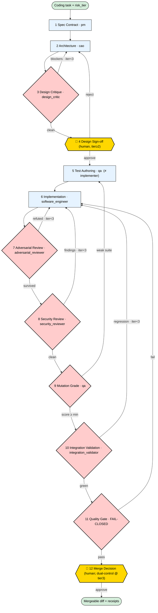

# The Governed Coding Pipeline — BOSS's Default Pattern for All Coding Tasks

Status: Pattern defined in specpack; runtime wiring is the follow-on (see §9)
Date: 2026-06-19
Owner: param
Canonical shareable skill: `skills/boss-governed-coding-pipeline/SKILL.md`

## 1. Why this exists

Frontier models are commoditized — everyone has them. The bottleneck in agentic engineering
is no longer *generating* code; it is *establishing trust* in generated code. The core failure
mode is **correlated error**: when one agent (one context) writes the code, writes the tests,
and reviews the result, the tests and the review inherit the same misunderstanding that
produced the bug — the suite green-lights the very defect it should catch, and an after-the-fact
reviewer faces a large, fully formed diff with none of the shared context a human accrues while
writing. This is the **separation-of-duties** principle — an author must not audit their own
work, the same control behind code review and SOX/SOC2 segregation — applied to AI agents.

BOSS's moat is therefore not "an orchestrator" (ADK/Azure/LangGraph all ship those). It is
**governed, durable, auditable agentic engineering**: quality made *structural and enforced*
rather than *prompted and hoped-for*. This pattern makes that concrete and the default for
every coding task.

> Note: in our 2026-06 dogfood, BOSS's real code path (`code.task` → single `ClaudeCodeAgent`)
> had one agent write the code *and* its tests *and* iterate to green — the exact anti-pattern.
> This pipeline fixes that by construction.

## 2. The spine — break correlation by role + context separation

Across the whole pipeline, **the agent that writes an artifact never judges it.** Five role
separations are enforced as policy invariants, each stage with isolated context:

- **Design critic ≠ architect.** A fresh critic tries to break the design *before* any code.
- **Test author ≠ implementer.** Tests are authored from the spec, *before* implementation
  (`qa`), so they encode intent, not the coder's mistakes.
- **Code reviewer ≠ implementer.** A fresh `adversarial_reviewer` tries to *refute* the diff and
  defaults to "refuted" under uncertainty.
- **Security reviewer ≠ implementer.** A dedicated, exploit-oriented pass, separate from
  correctness review.
- **Integration validator ≠ implementer.** Runs the full suite and confirms no regressions.

And **gate ≠ prompt**: standards become a fail-closed `QualityGate` object (missing evidence =
fail), not instructions an agent forgets when context summarizes away.

## 3. The patterns it encodes → BOSS primitive

| Agentic pattern (research) | Encoded as |
|---|---|
| Author ≠ Judge / evaluator-optimizer | `test_authoring` + `adversarial_review` phases (separate roles) |
| Independent / spec-first tests | `coding_pipeline.author_tests` (policy: `author_must_not_be_implementer`) |
| Adversarial review | `adversarial_reviewer` role + `coding_pipeline.adversarial_review` (refute-first) |
| Critique before code | `design_critic` role + `coding_pipeline.design_critique` (bounded loop with architecture) |
| Dedicated security review | `security_reviewer` role + `coding_pipeline.security_review` (separate from correctness) |
| Integration / no-regression | `integration_validator` role + `coding_pipeline.integration_validate` (full suite) |
| Quality gates over prompts | `QualityGate` object + `coding_pipeline.quality_gate` (`fail_closed`) |
| Grade the tests (mutation testing) | `coding_pipeline.mutation_grade` + `mutation_min` gate |
| Design around failure modes | `architecture` + `design_critique` → `FailureModeCatalog` |
| Spec-as-contract | `spec_contract` phase → executable `AcceptanceCriteria` |
| Bounded execution / circuit breaker | `max_pipeline_iterations: 3` → escalate to a Decision |
| Human-in-the-loop at the right altitude | `merge_decision` (release_manager) + dual-control by tier |
| Trajectory logging / evidence | every stage emits a Receipt; artifacts_required on completion |
| Tool sandboxing | reuses the existing microvm/Docker sandbox |
| Scale rigor to stakes | `governed_coding_pipeline_policy` risk tiers (the key knob) |

## 4. The pipeline (workflow `governed_coding_pipeline`)

```
spec_contract(pm) → architecture(cao) → design_critique(design_critic, loop) →
design_signoff(human, tier≥2) → test_authoring(qa) → implementation(software_engineer) →
adversarial_review(adversarial_reviewer, loop) → security_review(security_reviewer, loop) →
mutation_grade(qa) → integration_validation(integration_validator, loop) →
quality_gate(deterministic, fail-closed) → merge_decision(human; dual-control @ tier3)
```
- `implementation` consumes the tests it did **not** write and must make them pass.
- `design_critique`, `adversarial_review`, `security_review`, `integration_validation` run in
  **isolated context**; failures route findings back (bounded loops, max 3 each, then a Decision).
- `quality_gate` is **fail-closed**: missing/unavailable evidence counts as fail.

Diamonds are judgment stages (their verdict gates the loop); yellow are mandatory **human**
gates; back-arrows are bounded feedback loops (≤3, then escalate to a Decision).



```
 task+tier → 1 Spec(pm) → 2 Arch(cao) → 3 Design-Critique◇(design_critic)──blockers─►back to 2
                                              │clean
                                              ▼
                       4 Design Sign-off ▣ HUMAN(tier≥2) ──reject─►back to 2
                                              │approve
                                              ▼
   5 Test-Authoring(qa ≠ impl) → 6 Implementation(software_engineer)
        │                                     ▼
        │                       7 Adversarial-Review◇(adversarial_reviewer)──refuted─►back to 6
        │                                     │survived
        │                                     ▼
        │                       8 Security-Review◇(security_reviewer)──findings─►back to 6
        │                                     │clean
        │◄──weak suite── 9 Mutation-Grade◇(qa)
                                              │score≥min
                                              ▼
                       10 Integration-Validation◇(integration_validator)──regression─►back to 6
                                              │green
                                              ▼
                       11 Quality-Gate◇ FAIL-CLOSED ──fail─►back to 6
                                              │pass
                                              ▼
                       12 Merge-Decision ▣ HUMAN + dual-control@tier3 → mergeable diff + receipts
```

> The canonical, shareable orchestrator (full flowchart + per-stage agent briefs) is
> **`skills/boss-governed-coding-pipeline/SKILL.md`** — the default skill for all coding tasks.

## 5. Scaling rigor to risk (`governed_coding_pipeline_policy`)

Same tiers as the autonomy ladder, so it's not overkill for a throwaway script and full-panel
for production:

| Tier | Example | Required stages | Human gates | Approval |
|---|---|---|---|---|
| 0 trivial | docs, pure refactor w/ existing tests | implement → quality_gate | — | none |
| 1 low | small internal slice | architecture, design_critique, author_tests, implement, quality_gate | — | single |
| 2 standard | user-facing logic | + design_signoff, adversarial_review, security_review, mutation_grade, integration_validation | design + merge | single |
| 3 high | auth / payments / secrets / migration / deploy | full pipeline, higher thresholds | design + merge | **dual-control** |

Invariants hold at every tier: design critic ≠ architect, test author ≠ implementer, code
reviewer ≠ implementer, security reviewer ≠ implementer, integration validator ≠ implementer,
fail-closed gate, every stage receipted, bounded loops, no merge without a passing QualityGate.
Tier auto-escalates to 3 when changed paths touch auth/payment/secrets/migration/deploy.

## 6. Worked example — one real code task through the pipeline

Take a concrete follow-up to the leads app we built (`paramg/boss-sandbox` PR #15):

> **Task:** "Add a `list_by_status(status)` method to `LeadStore` that returns only leads
> with the given status." (user-facing data path → **risk tier 2**)

There is a subtle trap in this task: `set_status` already *rejects* an unknown status, so
`list_by_status` should be **consistent** and reject one too — not silently return `[]`.

| Phase | Owner role | What happens | Output / gate |
|---|---|---|---|
| spec_contract | `pm` | Writes executable acceptance criteria, incl. *"an invalid status is rejected, consistent with `set_status`"* and *"empty result when no leads match"* | `AcceptanceCriteria` · gate: criteria present, risk_tier=2 |
| architecture | `cao` | Proposes the method shape; notes the consistency requirement | `TechDesign` |
| **design_critique** | `design_critic` *(≠ architect)* | Challenges the design: should invalid status raise or return `[]`? case sensitivity? loops back to architecture if unresolved | `DesignCritique` · gate: design clean or max iters |
| design_signoff | human (tier ≥ 2) | Approves the design before any code is written | `Decision` |
| **test_authoring** | `qa` *(≠ implementer)* | Writes tests **from the spec, before any code**: happy path, **invalid-status raises**, empty-result, case-sensitivity | `TestArtifact` (4 cases) · gate: tests map to criteria |
| **implementation** | `software_engineer` | Must make those tests pass — so it is **forced** to add the validation it might otherwise skip | `DiffArtifact`, `TestReport` · gate: authored tests pass, diff small |
| **adversarial_review** | `adversarial_reviewer` *(fresh context)* | Tries to *refute*: `list_by_status('Won')` vs `'won'`? empty store? status not in enum? | `AdversarialVerdict` · gate: survived or findings resolved → loops back if refuted |
| **security_review** | `security_reviewer` *(≠ implementer)* | Dedicated pass: could a crafted `status` value cause injection/over-read in a DB-backed variant? is error text leaking data? | `SecurityFindings` · gate: clean or resolved → loops back |
| mutation_grade | `qa` | Flips the validation comparison / drops the guard; if tests still pass, the suite is inadequate | `MutationReport` · gate: mutation ≥ 0.6 |
| **integration_validation** | `integration_validator` | Runs the **full** suite; confirms the new method didn't regress `add_lead`/`set_status` | `IntegrationResults` · gate: full suite green, no regressions |
| quality_gate | deterministic | Aggregates all evidence, **fail-closed** | `QualityGate` (pass) · gate: status=pass |
| merge_decision | `release_manager` | Tier-2 → single approval (tier-3 would require dual-control) | `Decision` |

Each arrow emits a **Receipt**; the merge `Decision` cannot proceed until `QualityGate` is
`pass`. Every review/validation loop (design, adversarial, security, integration) routes findings
back — at most 3 iterations each, then it escalates to a human `Decision` rather than spinning.

## 7. Before vs. after this change

**The bug that ships "before" and is caught "after":** the implementer adds `list_by_status`
but writes a self-test that only checks the happy path; `list_by_status('WON')` silently
returns `[]` instead of raising. Because the *same* agent wrote the code and the test, the
test never probes the gap — the PR opens green and the inconsistency ships.

| | **Before (today's `code.task`)** | **After (governed pipeline)** |
|---|---|---|
| Who writes the tests | the implementer (same agent) | `qa`, **before** the code, from the spec |
| Who reviews | the implementer / no fresh review | `adversarial_reviewer`, **isolated context**, refute-first |
| Standards | in the prompt (forgotten as context summarizes) | **fail-closed `QualityGate`** object |
| Test quality | unmeasured (green ≠ good) | **mutation-graded** (≥ tier threshold) |
| The trap above | **ships** — self-test misses it | **caught** — independent test asserts it; reviewer probes it; mutation grade fails a weak suite |
| Rigor | same for a typo and for auth code | **scales with risk tier** (0→3); dual-control at tier 3 |
| Evidence | a PR + the agent's say-so | spec, independent tests, diff, adversarial verdict, mutation report, QualityGate — all **receipted & replayable** |
| When it's "done" | tests (it wrote) pass | every **separation invariant + fail-closed gate** satisfied |

The observed "before" is real: dogfood run `crun_860c68df…` had **one** `ClaudeCodeAgent`
produce `leads_app.py` **and** `test_leads.py` and iterate to green — a self-graded exam. The
"after" makes a different role set the exam, a different role grade it, and the grade itself
get audited.

## 8. Design lineage — standard controls, made enforceable

The pipeline composes well-understood software-delivery controls and applies them to AI agents,
with the difference that here they are **enforced**, not advisory:

- **Separation of duties** — the author of an artifact never approves it (the control behind
  code review and SOX/SOC2 segregation).
- **Critique before code** — defects are cheaper to fix in design than in implementation.
- **Independent / test-first authorship** — tests encode intent, written by a different role.
- **Adversarial and dedicated security review** — independent passes that try to break the change.
- **Mutation grading** — measure whether the tests can actually catch bugs.
- **Bounded feedback loops** — every loop has a ceiling, then escalates to a human decision.
- **Human gates only where they pay** — design sign-off and pre-merge approval.
- **Full audit trail** — every step leaves durable evidence.

The contribution is not the patterns themselves but making them a **control** rather than a
recommendation: enforced by the BOSS kernel (receipts, Decisions, budget, dual-control) and
scaled to risk.

## 9. Status & the follow-on (runtime wiring)

**Done (this change):** the pattern is fully expressed in the specpack and registered as the
**default** — roles (`adversarial_reviewer`, `design_critic`, `security_reviewer`,
`integration_validator`), object (`QualityGate`), skill set (`coding_pipeline.*`, 8 skills),
policy (`governed_coding_pipeline_policy`), workflow (`governed_coding_pipeline`), and the
shareable orchestrator (`skills/boss-governed-coding-pipeline/SKILL.md`) — all added to
`core_v1`/`core_v2`. All 8 skills pass `validate_skill_spec`; all 4 roles pass
`validate_role_spec`; both packs' installs resolve.

**Next (runtime):** `code_task_service` currently runs a single agent. To execute this pattern,
it should orchestrate the stages as separate agent invocations with **isolated context per
role**, persist a `QualityGate` row, and block the merge Decision until it passes. The
governance primitives it needs already exist (roles, receipts, decisions, dual-control on
ChangeSet, budget governor, the sandbox) — this is composition, not new infrastructure.
