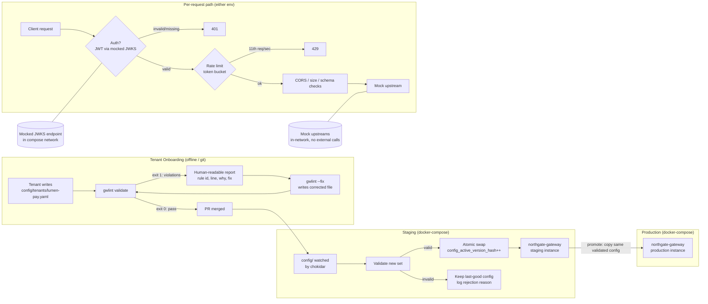
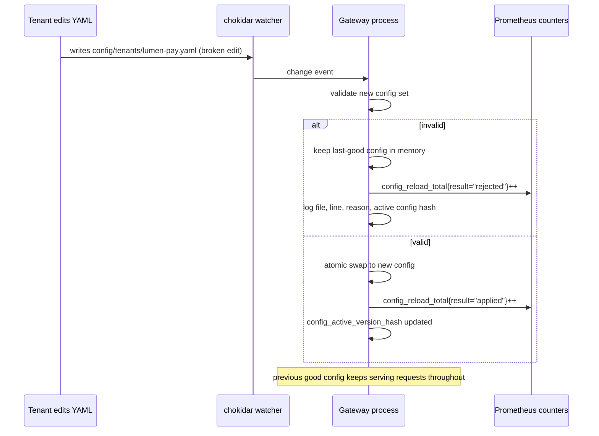

Northgate API Gateway + gwlint: API-onboarding case study demo

Problem: Automate tenant API onboarding: validate tenant YAML configs for format, security and API-guideline conformance, reject non-conforming ones (with a fix suggestion), and promote them from staging to production.

Who uses it: tenants onboarding to the API gateway (demo tenants: Lumen Pay, Orbit Travel, Harbor Health)

Must-haves:
- northgate-gateway: reverse-proxy API gateway (Go) with host/path/method routing, multi-tenant config/gateway.yaml + config/tenants/<tenant>.yaml, and hot reload that keeps the last good config on erro
- Authentication per route (JWT/OAuth2, API keys hashed, optional mTLS), rate limiting per tenant/route, CORS, request size limits and JSON Schema/OpenAPI request validation
- gwlint CLI: validate tenant YAML against a JSON Schema and an api-guidelines.yaml rulebook of at least 20 security/guideline rules, with exit codes 0/1/2
- gwlint --fix writes a corrected file for mechanically fixable rules and lists the ones needing a human
- Demo content: examples/lumen-pay.good.yaml and lumen-pay.bad.yaml (5+ violations) plus a README describing the fork → add tenant config → PR → BOSS-validates onboarding flow
- Two environments (staging and production) as two instances of the same binary via docker-compose, with mock upstreams so the demo runs with no external services

Out of scope: customer branding, names or logos anywhere; dependence on any external services to run the demo; the later BOSS 'API onboarding' workflow that will run this validator automatically on every tenant change

Done when: make run-staging boots the gateway and mock upstreams; a valid JWT request reaches the upstream, an unauthenticated one gets 401, the 11th request/second gets 429; editing config/tenants/lumen-pay.yaml hot-reloads without restart and a broken edit is rejected while the previous config keeps serving; gwlint validate exits 1 on lumen-pay.bad.yaml naming each violation with a line and fix, gwlint --f

In the person's words:
# Northgate API Gateway + gwlint: the demo system for an API-onboarding case study

## Why we are building this (the operator's own words)

> "Both Okta and Jira are for the customer. They have this API gateway where they want to use BOSS for their onboarding process. Today their onboarding process is a little manual and they want to automate it using BOSS. They would have a workflow step which does configuration management, where the API configurations are validated (the YAML spec) and then finally pushed to the staging environment for validation before moving to production. I want to build a case study for the customer using this use case: build an API gateway (a medium-complex one), have some YAML, assume a new customer is going to onboard to the API gateway. We need to validate whether the YAML file adheres to the right format and doesn't have any security issues and followed the API guidelines correctly. It should reject if it doesn't conform to standards, and then the customer would retry with the right one. It can also suggest fixing the configuration with the right one and upload it back to the repo."

The gateway and validator you build here are the **system under test** for that case study. A later BOSS workflow ("API onboarding") will run your validator on every tenant config change, reject or auto-fix, deploy to staging, test, gate, and promote to production. The whole thing will be shown in a video to the customer, so quality and clarity matter more than feature count.

**Do not use customer branding, names or logos anywhere.** The product is **"Northgate API Gateway"**. Demo tenants are fictional: *Lumen Pay*, *Orbit Travel*, *Harbor Health*.

## What to build

### 1. `northgate-gateway` (Go, medium complexity)

A reverse-proxy API gateway, one static binary, configured by YAML.

- **Routing:** by host, path prefix and method to named upstreams; path rewrite.
- **Multi-tenant config:** `config/gateway.yaml` (global) + `config/tenants/<tenant>.yaml` (one per onboarded customer). **Hot reload:** watch the directory; validate the new set; swap atomically; keep the last good config on error and log why.
- **Authentication per route:** JWT/OAuth2 (issuer, audience, required scopes, JWKS URL with caching), API keys (hashed in config, never plaintext), optional mTLS client certificates. A route with no auth is a configuration error unless explicitly `public: true` with a reason.
- **Rate limiting:** token bucket per tenant and per route (requests/second + burst).
- **CORS** per route; **request size limits**; **request validation** against a JSON Schema or OpenAPI fragment per route.
- **Resilience:** upstream timeouts, retries with backoff for idempotent methods, a simple circuit breaker.
- **Headers:** add/remove/rename; propagate a request id.
- **Observability:** structured JSON access logs with PII redaction (configurable field list), `/healthz`, `/readyz`, Prometheus `/metrics`.
- **Two environments:** `staging` and `production` are two instances of the same binary with different config directories and ports. Provide `docker-compose.yml` for both plus two tiny mock upstreams so demos run end to end. (Do not depend on anything external.)
- **Tests:** unit tests for routing, auth, rate limits, reload; an integration test that boots the gateway with the sample config and exercises a request through auth → rate limit → upstream.

### 2. Tenant onboarding YAML: schema + guidelines + `gwlint`

- **JSON Schema** for `tenants/<tenant>.yaml` (tenant id, owner + contact, tier, routes, auth, limits, CORS, upstreams, deprecation).
- **A rulebook, in YAML, readable by non-engineers:** `rules/api-guidelines.yaml`. Each rule has `id`, `severity` (error|warn), `title`, `why`, `fix`. At least 20 rules:
  - **Security:** every route has auth (or an explicit, justified `public`); no wildcard CORS origin together with credentials; upstreams must be `https://`; no secrets inlined (detect API-key/JWT/password-shaped values); rate limits present and within bounds; no `/admin`, `/internal`, `/debug` paths exposed; JWT `audience` set; mTLS required for `tier: partner-sensitive`; request size capped; PII fields declared for redaction; no `*` methods.
  - **API guidelines:** versioned base path (`/v1/...`); kebab-case path segments; only allowed methods; timeouts within bounds; owner and contact present and well-formed; description present; deprecations carry a `sunset` date; consistent naming between tenant id and file name.
- **`gwlint` CLI** (Go, same repo): `gwlint validate <file|dir>` prints a human report (rule id, YAML line, why, how to fix) or `--json`; exit code **0** pass, **1** violations, **2** invalid YAML/schema. `gwlint --fix <file>` writes a corrected file for the mechanically fixable rules and lists the ones that need a human. Golden tests: one good tenant config; several bad ones each triggering specific rules; a `--fix` round-trip test.

### 3. Demo content

`examples/`: `lumen-pay.good.yaml`, `lumen-pay.bad.yaml` (at least 5 violations: a wildcard CORS with credentials, an http upstream, an inlined API key, a missing rate limit, an `/admin` route), and the README that tells a tenant how to onboard (fork/branch → add `tenants/<tenant>.yaml` → open a PR → BOSS validates).

## Quality bar

- Clean, idiomatic Go; `go vet` and `go test ./...` clean; `make test`, `make run-staging`, `make run-prod`.
- A README with: what it is, a 5-minute quick start, the YAML reference, the rulebook table (generated from the YAML), and how `gwlint` is meant to run in CI/BOSS.
- Plain, concise naming. Someone at the customer will read this code.
- No external services required to run the demo.

## Acceptance (what we will check)

1. `make run-staging` starts the gateway + mock upstreams; a request with a valid JWT reaches the upstream; without it gets 401; the 11th request in a second gets 429.
2. Editing `config/tenants/lumen-pay.yaml` is picked up without restart; a broken edit

THIS APP WILL BE DEPLOYED by BOSS after review. Write a boss.deploy.yaml IN THE APP'S OWN FOLDER — next to its boss.preview.command; the repository root only for an app that lives at the root. A boss.deploy.yaml already at the repository root belongs to another app: never edit it, and do not count it as this app's. It says how the app runs, so nobody fills it in by hand:
  version: 1
  name: <the app's short name, lower-case-with-dashes>
  kind: commands
  install: [<the commands that install dependencies and start the app in the background on port $PORT>]
  health: [{url: "{target.public_url}", expect: 200}]
  open: {url: "{target.public_url}"}
Never set PORT in it: BOSS passes the target's. Health-check a route the app really serves. IF THE APP USES POSTGRES, the manifest brings it: `resources: {db: {capability: database.relational, engine: postgres}}` (BOSS provisions it and passes DATABASE_URL), or kind: compose with a postgres service in its compose file. A deploy of a Postgres app whose manifest declares no database is refused before anyone is asked to approve it. A demo/seed password BOSS provides (DEMO_PASSWORD) is allowed in production: do not refuse it; make demo seeding an explicit opt-in flag (e.g. ALLOW_DEMO_SEED) instead. Use compose (kind: compose, compose: {file: docker-compose.yml}) when the app already runs with docker compose. Keep it in the same pull request.

THE MACHINE THIS APP DEPLOYS TO: 192.0.2.202 (192.0.2.202) has Docker (29.1.3), Docker Compose 2.40.3+ds1-0ubuntu1, python3 (3.14.4), git; has no node, npm, pip3, java, go, ruby, php, make. Write boss.deploy.yaml for what that machine has: use kind: compose (a Dockerfile and a docker-compose.yml) when it has Docker and not the app's runtime; use kind: commands only with programs it has.

The work happens in this project's repository, 'northgate-api-gateway' (kept on this machine by BOSS). If it already holds an app, this is a change to that EXISTING codebase: read its code first, then write and build this feature only, in its folders, its stack and its conventions. Do not re-scaffold the app, do not start a parallel app beside it, and do not redesign what exists. Its existing behaviour and its existing tests must keep passing. The repository's root is your working directory. A new app goes at that root unless the brief names its folder; never create a folder named after the repository or its owner.

---

THE PRODUCT SPEC BELOW IS THE BRIEF. The directive above is the one-line
request that started this; what follows is the specification a panel of
agents produced from it, and it is what you are building. Where the two
differ in detail, the spec is the decision.

# PRD: Northgate API Gateway + gwlint — API-Onboarding Case Study Demo

**Status:** Ready for human sign-off on scope (see §10)
**Repo:** `northgate-api-gateway` (existing repo — read conventions before first line of code)
**Owner (panel facilitator):** Chief of Staff, on behalf of Forge (build), Sentry (security), Relay (ops/observability), Juno (QA/acceptance)
**Date:** 2026-11-15

---

## 1. Summary

We are building the **system under test** for a customer case study: a working, medium-complexity API gateway (**Northgate**) plus a tenant-config linter (**gwlint**) that together demonstrate automated API onboarding — validate a tenant's YAML, reject it with a plain-English fix if it's broken, hot-reload it into a running gateway if it's good, and promote staging → production. This is **not** the later BOSS "API onboarding" workflow that will orchestrate this automatically; it is the thing that workflow will run.

The brief specifies Go. **This install does not support Go.** The panel's converged decision is to build on **Node (Fastify)** instead — the closest supported stack, and per Forge's assessment a better practical fit than Python for JWKS/JSON-Schema tooling. This is a required deviation from the literal brief, flagged prominently, not buried.

Quality bar for the video: a viewer should watch `gwlint` catch 5+ real violations with plain-English fixes, and watch a bad tenant edit get rejected live while the gateway keeps serving the last-good config — unaided by narration.

---

## 2. Problem & Context

**The operator's own framing:** the customer's tenant-API onboarding is manual today — a human checks a YAML config's format, security, and guideline conformance, pushes to staging, then production. BOSS should eventually automate that gate. Before BOSS can automate it, there needs to be something real to automate *against*: a gateway that actually enforces what the YAML describes, and a linter that actually catches what it claims to catch.

**What research established, and how it shapes this PRD:**
- The core problem — catching bad gateway config before deploy — is not novel. Kong shipped `decK file lint` as a production feature in Nov 2023, proving commercial gateways treat this as a real, valuable gate (konghq.com). This PRD does not need to invent the concept; it needs to execute it cleanly and visibly.
- Two near-identical OSS projects exist (`api-onboarding-kit`, `GatewayLens`), both small/unmaintained personal projects, not products. They validate that YAML-onboarding-plus-lint is a sensible shape for this case study, but neither is a maintained benchmark to integrate with.
- A **different, already-published** Go CLI is also named `gwlint` (github.com/sdOps/gwlint, Kubernetes Gateway API linting). Different domain, same name — a naming collision research flagged as worth resolving before this ships on camera (see Open Questions §9.3).
- Research could not establish the real-world ratio of security-vs-style tenant rejections, or the customer's actual onboarding cycle time/headcount bottleneck beyond one unrelated blog anecdote (2 days → 3 hours, not this customer). **We are proceeding without this data.** The 20+ rule rulebook below is built from the brief's own examples, not from customer rejection history — flagged honestly in Open Questions, not presented as calibrated.

---

## 3. Goals & Non-Goals

### Goals
1. A gateway that actually enforces auth, rate limits, and config hot-reload — not a mockup of these behaviors.
2. A linter (`gwlint`) that reports every violation in one pass, with rule id, line, why, and fix — not just a pass/fail.
3. A demo narrative that runs end-to-end with zero external dependencies, recorded in a single take: bad config rejected → fixed → hot-reloaded → promoted.
4. Every claim in this PRD is labeled **tested-and-gating** or **built-but-unverified-in-demo** — nothing ships with an implicit "done."

### Non-Goals (explicit, not silently cut)
- No customer branding, names, or logos anywhere — product is "Northgate," tenants are Lumen Pay / Orbit Travel / Harbor Health.
- No dependency on any external service to run the demo (no real IdP, no real cloud, no real DNS).
- We are **not** building the later BOSS "API onboarding" workflow (the orchestrator that will run this validator automatically on every tenant PR). We build the thing it runs.
- No client-side git-hook enforcement of secret detection — detection is CI/server-side only in this demo (see §6, Risks).
- No second-reviewer workflow for `public: true` overrides — cut by the panel; substituted with severity escalation + explicit override flag (see §7, Sentry's dissent).

---

## 4. Target Users

| User | What they do here |
|---|---|
| **Tenant engineer** (Lumen Pay, Orbit Travel, Harbor Health — fictional) | Forks/branches, adds `config/tenants/<tenant>.yaml`, opens a PR, gets `gwlint` feedback, fixes, re-submits. |
| **Platform operator** (demo stand-in for the customer's gateway team) | Runs `make run-staging`/`run-prod`, watches hot reload, watches promotion, verifies via `/version` and metrics. |
| **Case-study viewer** (the actual audience — customer-equivalent decision-maker) | Watches the recorded demo; needs the behavior to be self-evidently real, not narrated-over. |

---

## 5. Proposed Solution

### 5.1 System architecture



### 5.2 Stack decision (forced + justified)

| Layer | Choice | Why |
|---|---|---|
| Gateway runtime | **Node + Fastify** | Go unsupported on this install; Fastify's plugin model fits per-route auth/CORS/schema cleanly. |
| Schema validation | **Ajv** | Standard JSON Schema engine for Node; used for both gateway request validation and gwlint's tenant-config schema. |
| JWT/JWKS | **`jose` / `jwks-rsa`** | Mature libraries; Sentry flagged their cache-miss/retry defaults must be confirmed against our fail-closed requirement before we build on them — not assumed. |
| Hot reload | **chokidar** | Directory watch for `config/tenants/*.yaml`. |
| Logging | **pino** | Structured JSON logs with redaction hooks. |
| Metrics | **prom-client** | `/metrics` on a separate internal listener (§5.4). |
| Repo layout | `gateway/` + `gwlint/` at root | Matches "no folder named after the repo/owner" rule; final placement pending Forge's read of existing repo conventions. |

### 5.3 gwlint report shape (CLI, not a web UI — ASCII sketch of actual output)

```
Northgate gwlint — config/tenants/lumen-pay.yaml
Legend: [ERROR] blocks merge   [WARN] does not block

⚠  PUBLIC ROUTES (highlighted — requires justified reason)
  [ERROR] PUB-001  route GET /v1/webhooks/inbound  public: true
          reason: "webhook-receiver"  (structured enum, override flag required)

VIOLATIONS (5 shown, grouped by severity)
  [ERROR] SEC-003  line 14  Wildcard CORS origin with credentials=true
          why: credentialed wildcard CORS allows any origin to read tenant data
          fix: set allow_origins to an explicit list — not fixable automatically
  [ERROR] SEC-005  line 21  Upstream URL uses http://, not https://
          why: unencrypted upstream traffic inside gateway's trust boundary
          fix: change to https://  — mechanically fixable (gwlint --fix)
  [ERROR] SEC-002  line 9   Inlined API key literal detected
          why: plaintext secret in a file that will be committed to git
          fix: move to a secret store reference — not fixable automatically
  [ERROR] SEC-007  line 30  No rate limit configured on route
          why: unbounded route can be used to exhaust upstream capacity
          fix: apply tenant-tier default rate limit — mechanically fixable
  [ERROR] SEC-006  line 33  Path /admin exposed without restriction
          why: admin surface should never be tenant-reachable
          fix: remove route or restrict — not fixable automatically

Needs human (2 buckets, not one list):
  SECURITY-BLOCKED-BY-POLICY: SEC-003, SEC-002, SEC-006
  MECHANICALLY-OUT-OF-SCOPE: (none this run)

Result: 5 errors, 0 warnings → exit 1
```

This block is not hand-written prose for the PRD only — the README's copy of it **must be literal captured output from a golden test run**; CI fails if it drifts.

### 5.4 Key behavioral decisions (from panel synthesis)

- **JWKS fail-closed:** cache last-good keyset; on refresh failure past TTL, reject with 401 — never fall back to "accept unverified." `/readyz` goes red the instant `jwks_cache_age_seconds` exceeds TTL with no successful refresh. Explicit test: kill mock JWKS, assert fail-closed.
- **`/metrics` isolation:** bound to a separate, non-tenant-facing listener/port, not published on the public compose network — Sentry's point that a reachable `/metrics` is recon surface even in a demo.
- **PII redaction default-deny:** Authorization headers, cookies, JWTs, API keys, email/phone/SSN shapes hardcoded redacted; config can only *add* fields, never remove the baseline. CI feeds a known PII-shaped field through the logger and fails the build if it appears raw.
- **`public: true` hardening:** requires a structured reason enum (`health-check|webhook-receiver|static-asset|other-with-ticket-link`), not free text; rendered in its own highlighted report section; `error`-tier severity by default requiring an explicit override flag. (Sentry's original ask for a second-reviewer gate was cut — no review infra exists in this demo; this is the agreed substitute, recorded as dissent, not silently dropped.)
- **`--fix` boundaries:** writes a local file only — no push/PR action. Security-tagged rules (inlined secrets, `/admin` exposure, wildcard-CORS+credentials, missing auth, `public: true` abuse) are never auto-fixed. No cleartext secret value appears in any intermediate artifact, even transiently.
- **Secrets prevention is detection-only here:** a pre-commit hook template may ship in `examples/` as documentation, but the real gate is `gwlint` running server-side with exit-code-blocks-merge. README states this as a known limitation the later BOSS onboarding workflow must close — we are not building client-side enforcement infra in this demo.

### 5.5 Hot-reload / fail-closed sequence



---

## 6. Functional Requirements

### 6.1 `northgate-gateway`
- FR1: Route by host, path prefix, and method to named upstreams, with path rewrite.
- FR2: Multi-tenant config split — `config/gateway.yaml` (global) + one `config/tenants/<tenant>.yaml` per tenant.
- FR3: Hot reload: watch config directory, validate-then-swap atomically, keep last-good config on invalid edit, log human-readable rejection (file, line, reason, active hash).
- FR4: Auth per route: JWT/OAuth2 (issuer, audience, scopes) against a **locally mocked JWKS endpoint** in the compose network; API keys hashed in config, never plaintext; mTLS as optional, built-but-unverified (see §8 labeling).
- FR5: Rate limiting: token bucket per tenant and per route (requests/second + burst).
- FR6: CORS per route, request size limits, JSON Schema/OpenAPI request validation per route.
- FR7: Structured JSON access logs with default-deny PII redaction.
- FR8: `/healthz`, `/readyz` (readiness reflects JWKS cache health), `/metrics` on an internal-only listener, `/version` exposing `config_active_version_hash{env}`.
- FR9: Two environments (staging, production) as two instances of the same image via `docker-compose`, with mock upstreams — no external services.

### 6.2 `gwlint`
- FR10: JSON Schema for `tenants/<tenant>.yaml` (id, owner/contact, tier, routes, auth, limits, CORS, upstreams, deprecation).
- FR11: `rules/api-guidelines.yaml` rulebook, ≥20 rules, each with `id`, `severity` (error|warn), `title`, `why`, `fix`, and a `fixable: mechanical|human|never` column. Every `category: security` rule defaults to `fixable: human` or `never` unless explicitly justified in writing.
- FR12: `gwlint validate <file|dir>` — reports **all** violations per run (no fail-fast), grouped by severity, legend printed every run, human or `--json` output (JSON includes a `status` field: `pass|violation|invalid`, matching exit code). Exit codes: 0 pass, 1 violation, 2 invalid YAML/schema.
- FR13: `gwlint --fix <file>` — writes a corrected file for mechanically fixable rules; lists remaining items in two distinct sub-lists (`mechanically-out-of-scope`, `security-blocked-by-policy`); never writes/exposes cleartext secrets, even transiently.
- FR14: `public: true` routes rendered as a distinct, highlighted top-of-report section; schema requires the structured reason enum.
- FR15: Golden tests: one good tenant config; several bad configs each triggering named rule IDs (≥5 distinct IDs against `lumen-pay.bad.yaml`); a `--fix` round-trip test asserting post-fix line numbers match the new file, not the stale original.

### 6.3 Demo content
- FR16: `examples/lumen-pay.good.yaml`, `examples/lumen-pay.bad.yaml` (≥5 violations: wildcard CORS+credentials, http upstream, inlined API key, missing rate limit, `/admin` route exposed).
- FR17: README documenting fork → add tenant config → PR → BOSS-validates flow; YAML reference; rulebook table **generated from the rulebook YAML**, not hand-maintained; CLI output blocks captured from golden test runs, CI-enforced non-drift; bold statement that example/PR content must never contain real credentials.

---

## 7. Non-Functional Requirements

| Area | Requirement |
|---|---|
| **Security** | JWKS fail-closed (no grace period); secrets never logged/written in cleartext at any stage; PII redaction default-on and CI-verified; every one of the 5 required bad-config violation types has a corresponding gateway-side behavioral test, not just a lint claim. |
| **Observability** | `config_reload_total{env,result}`, `jwks_cache_age_seconds`, `config_active_version_hash{env}` are load-bearing metrics behind acceptance claims, not decoration. `/metrics` on internal-only listener. |
| **Operability** | Docker-compose healthchecks call `/readyz` over HTTP, not bare TCP. First-diagnostic-steps and rollback procedures documented as literal commands (bad tenant config → keep-last-good is automatic; bad gateway release → redeploy prior image + confirm via `/version`; bad rulebook change → revert YAML + re-run golden tests). |
| **Quality** | Lint-clean, `npm test` clean, one container image per environment. No `go vet`/Go toolchain anywhere in this repo. |
| **Portability** | Zero external services at runtime: mock JWKS, mock upstreams, all in the compose network. |
| **Known limitation (documented, not hidden)** | In-process rate-limit buckets don't coordinate across replicas — acceptable for this single-instance-per-env demo; flagged for the future multi-replica BOSS workflow. Secret-detection is CI/server-side only, no client-side hook enforcement in this demo. |

---

## 8. Acceptance Criteria — labeled, not implied

Per the panel's resolution to the brief's incomplete "Done when" sentence, every item below carries an explicit status. **Tested-and-gating** items must pass before sign-off; **built-but-unverified** items may ship in code but do not block sign-off.

### Tested-and-gating
1. `make run-staging` boots the gateway and mock upstreams.
2. A request with a valid JWT reaches the upstream.
3. A request without a valid JWT gets 401.
4. The 11th request/second on a rate-limited route gets 429.
5. Editing `config/tenants/lumen-pay.yaml` to a valid change hot-reloads without restart.
6. Editing it to a broken change is rejected; the previous good config keeps serving; rejection is logged with file/line/reason and reflected in `config_reload_total{result="rejected"}`.
7. Killing the mock JWKS endpoint causes auth to fail closed (401s, not silent accept) once the cache TTL is exceeded; `/readyz` reflects this.
8. `gwlint validate examples/lumen-pay.bad.yaml` exits 1, reports ≥5 distinct rule IDs, each with rule id, YAML line, why, and fix, grouped by severity with legend.
9. `gwlint validate examples/lumen-pay.good.yaml` exits 0.
10. `gwlint validate` on a malformed/non-schema-conforming YAML exits 2.
11. `gwlint --fix` on the bad file produces a corrected file; re-running `validate` on it shows fewer violations, with security-tagged rules still flagged and explicitly listed as `security-blocked-by-policy`.
12. The `--fix` round-trip golden test confirms post-fix line numbers match the new file.
13. No cleartext secret appears in any file, temp file, or log line produced during the `--fix` pipeline.
14. PII-shaped test field fed through the logger does not appear raw in output (CI-enforced).
15. `/metrics` is unreachable from the public-facing compose network; reachable only on its internal listener.
16. `config_active_version_hash{env}` differs/matches correctly to prove staging and production are running what they're supposed to run.
17. README's CLI output blocks match a golden-test-captured run (CI fails on drift).

### Built-but-unverified-in-demo (shipped if time allows, not gating)
- mTLS client certificate support
- Circuit breaker behavior under sustained upstream failure
- Retries-with-backoff for idempotent methods
- Full CORS matrix beyond the single wildcard+credentials gating case
- Prometheus metrics beyond `config_reload_total`, `jwks_cache_age_seconds`, `config_active_version_hash`
- Rate-limit tokens-remaining heatmap, `config_reload_duration_seconds` histogram, `gwlint_runs_total`, owner/contact webhook stub

---

## 9. Risks & Mitigations

| Risk | Raised by | Mitigation |
|---|---|---|
| Go unsupported on this install conflicts with the literal brief | Chief of Staff (forced by platform constraint) | Build on Node/Fastify instead; stated explicitly in this PRD, not silently substituted. |
| JWT/JWKS library's cache-miss/retry defaults may not actually fail closed | Sentry | Confirm `jose`/`jwks-rsa` behavior against the fail-closed requirement before building on it, not after; explicit kill-JWKS test gates sign-off. |
| `/metrics` and other internal endpoints become real recon surface if demo is ever run live against a reachable host | Sentry | Confirmed assumption needed from human: demo is recorded-only (see Open Question 9.5). Until confirmed, `/metrics` stays on an internal-only listener regardless. |
| `public: true` abuse (tenants marking routes public to bypass auth) | Sentry | Structured reason enum, error-tier severity by default, explicit override flag required, highlighted report section. Second-reviewer gate was proposed and **cut** — no review infra exists in this demo; this is the recorded substitute, not a silent gap. |
| Lint claims a security rule is checked but gateway doesn't actually enforce the matching behavior | Juno | Every one of the 5 required bad-config violation types must have a corresponding gateway-side behavioral test; "lint claims it" is not sufficient for sign-off. |
| Dashboard/metrics work consumes sprint time before gwlint has its 20 working rules and the gateway hits its gating list | Relay (self-flagged), accepted by panel | Heatmaps, extra histograms, `gwlint_runs_total` explicitly demoted to stretch/follow-on, named as such, not built first. |
| Rulebook's security-vs-style mix isn't calibrated against real customer rejection data | Chief of Staff (research gap) | Proceeding on the brief's literal rule list; flagged as an open question for the human, not presented as validated. |
| Name collision with an existing published `gwlint` Go CLI (different domain: Kubernetes Gateway API) | Research (competitor scan) | Flagged for human decision — rename vs. keep (Open Question 9.3); does not block build either way since domains don't literally collide. |
| In-process rate-limit buckets won't coordinate if this demo is later scaled to multiple replicas | Relay | Documented as a known limitation in the README; explicitly out of scope — this demo is single-instance-per-env by design. |
| Secret-detection has no enforcement teeth beyond CI (no git-hook blocking a determined committer) | Sentry, Relay, Forge (converged) | README states this as a known gap the later BOSS onboarding workflow must close; a documentation-only pre-commit hook template may ship in `examples/`, not presented as a real control. |

---

## 10. Rollout

1. **Build order (per panel, to avoid wasted effort):** gwlint's 20 rules + golden tests first → gateway's gating acceptance list second → stretch observability items last, only if budget remains.
2. **Environments:** `docker-compose up` brings up staging + production + mock upstreams + mock JWKS in one network; `make run-staging` / `make run-prod` are the demo entry points.
3. **Demo recording:** case study is filmed against this recorded environment (pending confirmation per Open Question 9.5); not run live against a reachable host without additional network controls.
4. **Sign-off:** a human verifies the tested-and-gating acceptance list in §8 by watching the recorded run and/or re-running it locally; built-but-unverified items are called out by name in the walkthrough, not implied as done.
5. **Handoff:** this repo becomes the system under test for the later, separately-scoped BOSS "API onboarding" workflow — not built here.

---

## 11. Open Questions for the Human

1. **Per-item acceptance status** — for mTLS, circuit breaker, retries/backoff, full CORS, and extended Prometheus metrics: do you want these **tested and gating**, or is "built, best-effort, unverified in this demo" acceptable? This decides real sprint budget, not just PRD wording.
2. **Rulebook calibration** — no customer rejection data was available to this panel to calibrate the security-vs-style rule mix. Proceed on the brief's literal rule list, or do you have real data to recalibrate against?
3. **`gwlint` naming** — an existing published Go CLI already uses this name for a different domain (Kubernetes Gateway API linting). Keep `gwlint` (domains don't collide in practice) or rename (e.g. `northgate-lint`, `nglint`) to avoid confusion on camera?
4. **Mechanical vs. human vs. never line** — confirm the fixable-classification drawn in §5.4/§6.2 before gwlint's rule table and `--fix` taxonomy are finalized; changing it later means re-touching golden tests.
5. **Demo environment** — confirm this is recorded-only, not run live/exposed, so we know whether network controls beyond "internal compose network only" are needed for `/metrics` and other internal endpoints.

---

## 12. The Single Decision Needing Human Approval

> **Before build starts: confirm the acceptance status of mTLS, circuit breaker, retries/backoff, full CORS coverage, and extended Prometheus metrics — "tested and gating sign-off" vs. "built, best-effort, unverified in this demo."**

This is the one decision that directly changes how sprint time is allocated. Everything else in §11 can be resolved in parallel with early build work (gwlint's rule list, JWKS library confirmation, naming) without blocking the first commit. This one does: if these five items must be tested-and-gating, Forge needs to budget for them before touching stretch observability work; if they're best-effort, that time moves to hardening the gating acceptance list in §8 instead.

DEPLOYABILITY (required for any network service): bind the host from the HOST env var (default 0.0.0.0) and the port from the PORT env var, with sensible fallbacks. Do NOT hardcode 127.0.0.1 or a fixed port for the running server — it must run in a container / behind a proxy. (Unit tests may still bind loopback + an ephemeral port.) Binding 0.0.0.0 here is expected for a containerized internal tool behind the platform proxy — it is not a vulnerability.
