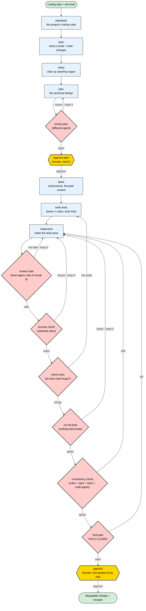

# BOSS Governed Coding Pipeline

This is how BOSS builds code. A task goes from a spec to a tested, reviewed, mergeable change
through **plain steps run by different agents** — the agent that writes something never judges
it. The steps, the checks, and the sign-offs are **enforced by BOSS** (receipts, decisions,
budget, two-person sign-off), not just suggested in a prompt.

These names are **internal** — the AI agents use them to do the work to the team's standard.
Developers never see them; they just get a change that meets the bar.

## The one rule

> **Whoever writes something does not get to approve it.** The planner ≠ the plan reviewer,
> the tester ≠ the coder, the coder ≠ the code reviewer ≠ the security reviewer. Different
> agents, fresh context. That's what stops one mistake from sailing through unnoticed.

## The steps

Diamonds are checks (their result decides whether the loop continues). Yellow are **human**
sign-offs. Curved arrows are loops with a limit (≤3, then it asks a human instead of spinning).



### Plain-text version

```
  standards  → the project's coding rules (from the repo + org rules)
  spec       → what to build + what's added/changed/removed
  refine     → clear up anything vague; clear, testable criteria
  plan       → the technical design
  review plan◇ (different agent) ──issues──► back to plan
  approve plan▣ (human, risk≥2)
  tasks      → small pieces, each with only the context it needs
  write tests→ tests first, by a different agent than the coder
  implement  → smallest change that makes the tests pass (can't touch the tests)
  review code◇ (fresh agent, tries to break it) ──not safe──► back to implement
  security check◇ (separate pass) ──issues──► back to implement
  check tests◇ (do the tests actually catch bugs?) ──too weak──► back to write tests
  run all tests◇ (nothing else broke) ──broke──► back to implement
  consistency check◇ (rules + spec + tests + code agree) ──drift──► back to implement
  final gate◇ FAILS CLOSED (missing evidence = fail) ──fail──► back to implement
  approve▣ (human; two people at top risk) → mergeable change + full receipts
```

## What's different here (not just a checklist)

| Idea | An advisory skill | **BOSS (enforced)** |
|---|---|---|
| Different agent writes vs. judges | *asks* the model to | a same-agent approval is **rejected** |
| Standards | a note in the prompt | a **`standards` record** every step is checked against |
| Final check | "looks good" | a **fail-closed gate** — missing evidence = fail |
| Test quality | "write good tests" | **check tests** breaks the code on purpose to prove tests catch it |
| Human sign-off | "pause and ask" | real **decisions**; top risk needs **two people** |
| Loops | a number in the prompt | bounded, then it **asks a human** — never spins on budget |
| Trail | markdown files | **receipts + decisions** in the durable store, replayable |
| Cost | none | **budget reserved** per step |
| Effort vs. risk | on/off | **scales by risk level** (tiny → top) |

The short version: an advisory skill is a *suggestion*; this is a *control*. The agent **can't**
skip the tester, approve its own code, or call it done without evidence — BOSS won't let it.

## Who does each step

Each step is run by a different agent with its own context. Most map to existing BOSS roles:
`standards`→cao · `spec`/`refine`→pm · `plan`→cao · `review plan`→design_critic ·
`approve plan`/`approve`→release_manager (human) · `tasks`→program_manager ·
`write tests`/`check tests`/`consistency check`→qa · `implement`→software_engineer ·
`review code`→adversarial_reviewer · `security check`→security_reviewer ·
`run all tests`→integration_validator · `final gate`→deterministic.

## How many steps run, by risk

| Risk | Example | Steps that run | Human sign-off | Approval |
|---|---|---|---|---|
| **tiny** | docs, a refactor already covered by tests | implement → final gate | — | none |
| **low** | a small internal change | + standards, spec, refine, plan, review plan, tasks, write tests | — | one |
| **standard** | something users see, real logic | + approve plan, review code, security check, check tests, run all tests, consistency check | plan + final | one |
| **high** | login, payments, secrets, migrations, deploys | all of it, stricter bars | plan + final | **two people** |

Risk jumps to **high** automatically when the change touches login, payments, secrets,
migrations, or deploys. The rule holds at every level: whoever writes something doesn't approve
it, the final gate fails closed, every step leaves a receipt, loops are bounded.

## Model-agnostic

The step descriptions are the *guidance*; any model can play each role. BOSS resolves the agent
through the model-agnostic seam (Claude, OpenAI, Azure, or a local model) — the recorded run
shows which model ran each step.

## Status

Defined and registered as the default (workflow `governed_coding_pipeline`, skills
`coding_pipeline.*`, policy `governed_coding_pipeline_policy`, object `Standards`). The runtime
today runs the core separation live (write tests → implement → review code → fail-closed gate),
proven on both Claude and OpenAI/Azure. Wiring the remaining steps (refine, plan review,
security, check tests, run all tests, consistency) into the live runner is the next increment.
See docs/product/GOVERNED_CODING_PIPELINE.md.
