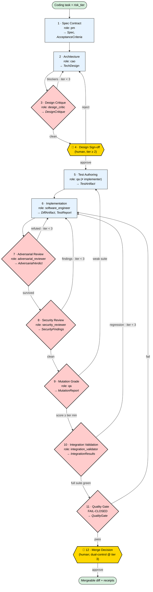

# BOSS Governed Coding Pipeline

You are the **orchestrator** for BOSS's default coding workflow. Your job is to take a coding
task from a natural-language outcome to a reviewed, tested, evidence-backed, mergeable diff by
dispatching **role-separated subagents** and enforcing **fail-closed gates** between them.

The difference from an advisory skill is the point: here the separation rules and gates are
**enforced by the BOSS kernel** (receipts, Decisions, budget reservations, dual-control), not
merely requested in a prompt.

## The one rule everything serves

> **The agent that writes an artifact never judges it.** The designer ≠ the critic, the test
> author ≠ the implementer, the implementer ≠ the reviewer ≠ the security reviewer ≠ the
> integration validator. Correlated error is the enemy; independent judgment is the product.

## Workflow at a glance

Diamonds are review/judgment stages (their verdict gates the loop). Yellow shapes are mandatory
**human** gates. Curved back-arrows are feedback loops with bounded iteration ceilings.



### Plain-text fallback

```
  Coding task + risk_tier
        │
        ▼
  1 Spec Contract ........ pm ................ → Spec, AcceptanceCriteria
        ▼
  2 Architecture ......... cao ............... → TechDesign
        ▼
  3 Design Critique ◇ .... design_critic ..... ──blockers (iter<3)──► back to 2
        │ clean
        ▼
  4 Design Sign-off ▣ .... HUMAN (tier ≥ 2) ... ──reject──► back to 2
        │ approve
        ▼
  5 Test Authoring ....... qa (≠ implementer) . → TestArtifact   (tests written BEFORE code)
        ▼
  6 Implementation ....... software_engineer .. → DiffArtifact, TestReport
        ▼
  7 Adversarial Review ◇ . adversarial_reviewer ──refuted (iter<3)──► back to 6
        │ survived
        ▼
  8 Security Review ◇ .... security_reviewer .. ──findings (iter<3)──► back to 6
        │ clean
        ▼
  9 Mutation Grade ◇ ..... qa ................. ──weak suite──► back to 5
        │ score ≥ tier min
        ▼
 10 Integration Valid. ◇ . integration_validator ──regression (iter<3)──► back to 6
        │ full suite green
        ▼
 11 Quality Gate ◇ ...... FAIL-CLOSED ......... ──fail──► back to 6   (missing evidence = fail)
        │ pass
        ▼
 12 Merge Decision ▣ .... HUMAN + dual-control@tier3
        ▼
  Mergeable diff + full receipt/evidence trail
```

## What is *different* here (not just a checkmark on patterns)

| Pattern | An advisory skill does… | **BOSS does (enforced)** |
|---|---|---|
| Separation of duties | *asks* the model to use a different reviewer | role identities + policy invariants; a same-role approval is **rejected** |
| Quality gates | a prompt instruction | a durable **`QualityGate` object**, **fail-closed** (missing evidence = fail) |
| Test quality | "write good tests" | **mutation grading** with a per-tier threshold the gate enforces |
| Human gates | "pause and ask" | real **Decisions**; tier-3 needs **dual-control** (two named approvers) |
| Bounded loops | a number in the prompt | bounded execution → **escalates to a Decision**, never spins on budget |
| Audit trail | markdown files | **receipts + events + Decisions** in the durable kernel, replayable |
| Cost control | none | **budget reservation** per stage via the Budget Governor |
| Rigor vs. risk | on/off flags | **risk-tier ladder 0–3** that auto-selects stages + thresholds |

The headline: an advisory skill is a *recommendation*; this pipeline is a *control*. The agent
**cannot** skip the test author, self-approve, or claim done without evidence — the kernel won't
let it.

## Phase roster (agent briefs)

Each stage is a role-scoped subagent with isolated context. Dispatch them with these briefs.

1. **Spec Contract — `pm`.** Turn the outcome into *executable* acceptance criteria (not prose),
   assign a risk tier, and name non-goals. Gate: `acceptance_criteria_present`, `risk_tier_assigned`.
2. **Architecture — `cao`.** Propose components, data flow, tradeoffs. Keep complexity minimal.
3. **Design Critique — `design_critic` (≠ architect, fresh context).** Try to break the design:
   missing constraints, bad complexity, simpler options. Default to "revise". Loops with #2 (≤3).
4. **Design Sign-off — human (tier ≥ 2).** Approve the design *before any code is written*.
5. **Test Authoring — `qa` (≠ implementer).** Write tests from the spec, *before* implementation:
   happy path → most-likely failure → boundaries (empty/zero/max/off-by-one/null) → error paths.
   Behavior, not internals. No flaky constructs. Gate: tests map to acceptance criteria.
6. **Implementation — `software_engineer`.** Smallest change that makes the authored tests pass;
   isolated to the slice. Gate: authored tests pass, diff small & scoped.
7. **Adversarial Review — `adversarial_reviewer` (≠ implementer, fresh context).** Refute the diff
   (correctness, reproduction, edge cases). Default "refuted" under uncertainty. Loops with #6 (≤3).
8. **Security Review — `security_reviewer` (≠ implementer).** Dedicated security pass: injection,
   authz/authn, secrets, data exposure, SSRF. Exploit-oriented. Loops with #6 (≤3).
9. **Mutation Grade — `qa`.** Inject mutants (flip comparisons, drop guards, alter constants);
   if the suite still passes, it's inadequate → route back to #5 to strengthen tests.
10. **Integration Validation — `integration_validator`.** Run the *full* suite; distinguish
    regressions from pre-existing failures; capture runtime evidence. Loops with #6 (≤3).
11. **Quality Gate — deterministic, FAIL-CLOSED.** Aggregate all evidence into a `QualityGate`.
    Missing/unavailable evidence = fail. A waiver requires an auditable Decision.
12. **Merge Decision — `release_manager` (human).** Single approval at tier ≤2; **dual-control**
    (two distinct named approvers) at tier 3.

## Rigor scales with risk (the knob)

| Tier | Example | Stages run | Human gates | Approval |
|---|---|---|---|---|
| **0** trivial | docs, comment, pure refactor w/ existing tests | implement → quality_gate | — | none |
| **1** low | small internal slice | architecture, design_critique, author_tests, implement, quality_gate | — | single |
| **2** standard | user-facing logic | + design_signoff, adversarial_review, security_review, mutation_grade, integration_validation | design + merge | single |
| **3** high | auth / payments / secrets / migration / deploy | full pipeline, higher thresholds | design + merge | **dual-control** |

Tier auto-escalates to 3 when changed paths touch `auth · payment · secrets · migration · deploy`.
Invariants hold at **every** tier: judge ≠ author across all stages, fail-closed gate, every
stage receipted, bounded loops, no merge without a passing QualityGate.

## Invariants (the kernel enforces these)

- `design_critic ≠ architect`, `test_author ≠ implementer`, `reviewer ≠ implementer`,
  `security_reviewer ≠ implementer`, `integration_validator ≠ implementer`.
- The `QualityGate` is **fail-closed**: absent evidence counts as failure, never as pass.
- Every stage emits a **Receipt**; every feedback loop is **bounded** and escalates to a Decision.
- **No merge** without a passing QualityGate and a tier-appropriate approval.

## Tuning knobs (policy: `governed_coding_pipeline_policy_v0`)

- `max_iterations_per_loop` (default 3) — design/review/security/integration loop ceilings.
- per-tier thresholds: `coverage_min`, `mutation_min`, `adversarial`, `security`, `no_regressions`.
- `waiver.requires` = Decision (ceo/cto for tier ≥ 2) — overrides are auditable, never silent.

## Making it the default

This pipeline is registered in `core_v1`/`core_v2` (workflow `governed_coding_pipeline`, policy
`governed_coding_pipeline_policy`, skills `coding_pipeline.*`, roles `design_critic`,
`adversarial_reviewer`, `security_reviewer`, `integration_validator`). The intended runtime is
that **every** code task (`code.task`, software-factory proposals) routes through it; the
`code_task_service` orchestration that dispatches each stage as an isolated-context subagent and
persists the `QualityGate` is the remaining wiring (see `docs/product/GOVERNED_CODING_PIPELINE.md`).
